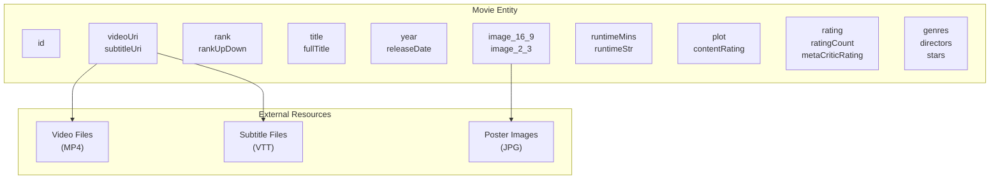
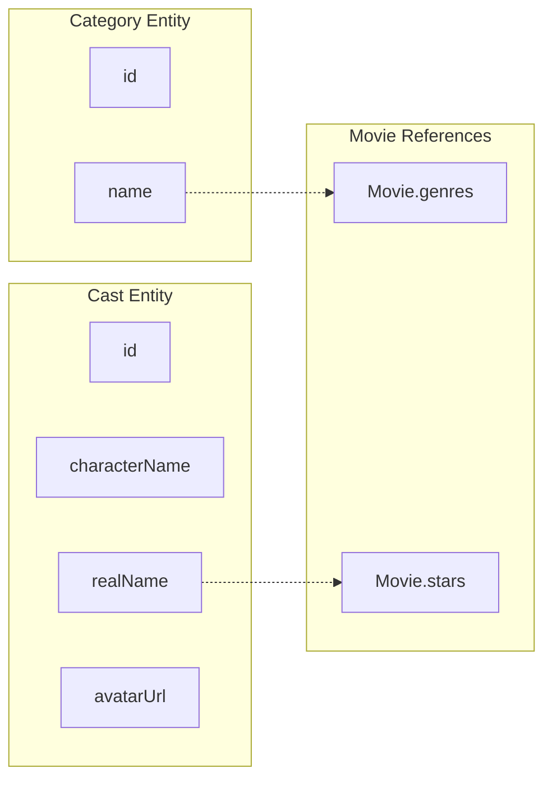
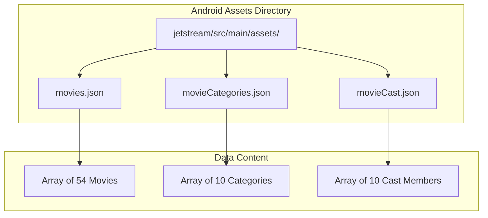
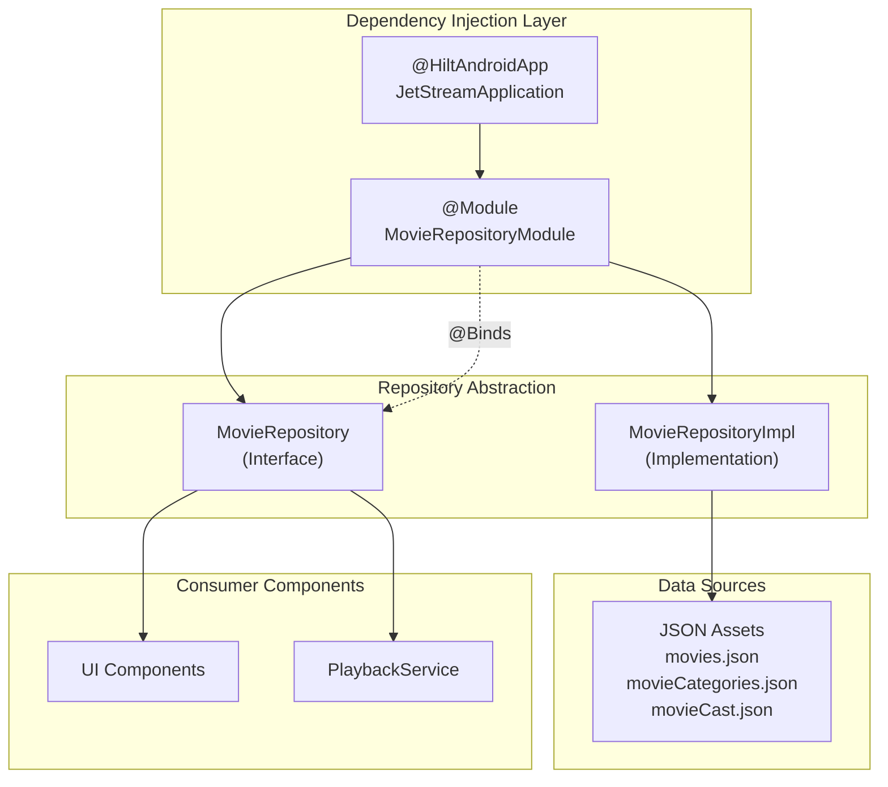
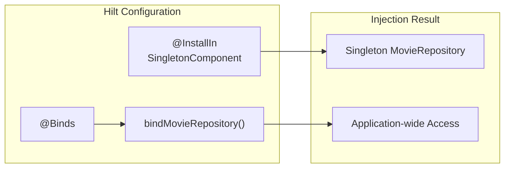
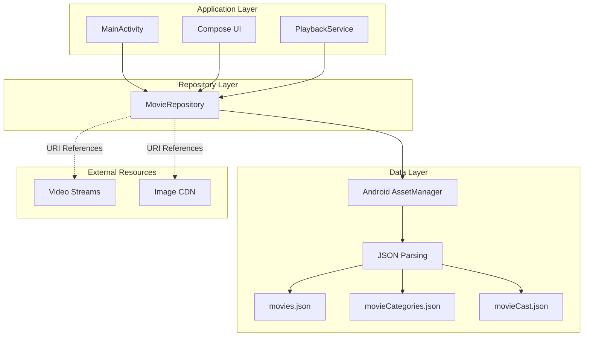

<!-- source: DeepWiki mcp.deepwiki.com · repo android/adaptive-apps-samples · page 2.3 Data Layer · fetched 2026-10-23 -->

# Data Layer

Relevant source files

The following files were used as context for generating this wiki page:

- [AdaptiveJetStream/jetstream/src/main/assets/movieCast.json](AdaptiveJetStream/jetstream/src/main/assets/movieCast.json)
- [AdaptiveJetStream/jetstream/src/main/assets/movieCategories.json](AdaptiveJetStream/jetstream/src/main/assets/movieCategories.json)
- [AdaptiveJetStream/jetstream/src/main/assets/movies.json](AdaptiveJetStream/jetstream/src/main/assets/movies.json)
- [AdaptiveJetStream/jetstream/src/main/java/com/google/jetstream/JetStreamApplication.kt](AdaptiveJetStream/jetstream/src/main/java/com/google/jetstream/JetStreamApplication.kt)

This document describes the data layer architecture of AdaptiveJetStream, covering the movie data structure, JSON asset organization, and repository pattern implementation. The data layer is responsible for managing movie content, cast information, and category data that drives the media streaming application.

For information about the media playback system that consumes this data, see [Media Playback System](#2.2). For details about the application structure and dependency injection setup, see [Application Structure](#2.1).

## Data Models and Structure

The AdaptiveJetStream application organizes its data around three primary entities: movies, categories, and cast members. Each entity is structured to support the application's media streaming and adaptive UI requirements.

### Movie Data Model

Movies represent the core content entity, containing comprehensive metadata for media streaming and UI presentation. Each movie includes identification, media resources, descriptive content, and rating information.

**Movie Entity Structure:**
- **Identity**: `id` (unique hash identifier)
- **Media Resources**: `videoUri`, `subtitleUri` (external URLs)
- **Display Content**: `title`, `fullTitle`, `plot`
- **Temporal Data**: `year`, `releaseDate`
- **Visual Assets**: `image_16_9`, `image_2_3` (adaptive aspect ratios)
- **Runtime Information**: `runtimeMins`, `runtimeStr`
- **Rating System**: `rating`, `ratingCount`, `metaCriticRating`
- **Categorization**: `genres`, `directors`, `stars` (comma-separated strings)
- **Ranking**: `rank`, `rankUpDown` (popularity metrics)

Sources: [AdaptiveJetStream/jetstream/src/main/assets/movies.json:1-1198]()

### Category and Cast Data Models

Categories provide genre classification, while cast members link character portrayals to real actors with visual representation.

**Category Entity Structure:**
- **Identity**: `id` (numeric identifier)
- **Display**: `name` (genre name like "Action", "Drama", "Comedy")

**Cast Entity Structure:**
- **Identity**: `id` (numeric identifier)
- **Character**: `characterName` (fictional character name)
- **Actor**: `realName` (actor's real name)
- **Visual**: `avatarUrl` (actor profile image)

Sources: [AdaptiveJetStream/jetstream/src/main/assets/movieCategories.json:1-42](), [AdaptiveJetStream/jetstream/src/main/assets/movieCast.json:1-62]()

## JSON Asset Organization

The application stores all content data as JSON assets within the Android application bundle, providing offline access and consistent data structure across all deployment targets.

### Asset File Structure

**Asset Organization:**
- **`movies.json`**: 54 movie records with complete metadata
- **`movieCategories.json`**: 10 genre categories
- **`movieCast.json`**: 10 cast member profiles

The JSON structure uses arrays as root elements, enabling direct deserialization into collection types. External media resources are referenced via URLs pointing to Google Cloud Storage buckets.

Sources: [AdaptiveJetStream/jetstream/src/main/assets/movies.json:1-1198](), [AdaptiveJetStream/jetstream/src/main/assets/movieCategories.json:1-42](), [AdaptiveJetStream/jetstream/src/main/assets/movieCast.json:1-62]()

### External Resource References

Movies reference external resources through URI fields that point to hosted content:

- **Video URIs**: MP4 files hosted on `commondatastorage.googleapis.com`
- **Subtitle URIs**: VTT files hosted on external services
- **Image URIs**: JPG poster images on `storage.googleapis.com`

This architecture separates content metadata (stored locally) from large media files (hosted externally), optimizing application bundle size while maintaining offline metadata access.

Sources: [AdaptiveJetStream/jetstream/src/main/assets/movies.json:4-6](), [AdaptiveJetStream/jetstream/src/main/assets/movies.json:12-13]()

## Repository Pattern Implementation

The data layer implements the repository pattern through dependency injection, providing abstraction between data sources and business logic components.

### Repository Architecture

**Repository Pattern Components:**
- **`MovieRepository`**: Interface defining data access contract
- **`MovieRepositoryImpl`**: Concrete implementation handling JSON asset parsing
- **`MovieRepositoryModule`**: Hilt module binding interface to implementation

The `@Binds` annotation in `MovieRepositoryModule` creates the interface-to-implementation binding, enabling dependency injection throughout the application.

Sources: [AdaptiveJetStream/jetstream/src/main/java/com/google/jetstream/JetStreamApplication.kt:31-39]()

### Dependency Injection Setup

The repository is configured as a singleton through `@InstallIn(SingletonComponent::class)`, ensuring a single instance serves all application components. The abstract `bindMovieRepository()` function creates the binding between `MovieRepositoryImpl` and `MovieRepository`.

Sources: [AdaptiveJetStream/jetstream/src/main/java/com/google/jetstream/JetStreamApplication.kt:31-39]()

## Data Flow Architecture

The data layer supports the application's adaptive UI requirements by providing structured access to movie content across different form factors and interaction modes.

### Data Access Flow

**Data Flow Process:**
1. **UI Components** request data through `MovieRepository` interface
2. **Repository Implementation** accesses JSON assets via Android `AssetManager`
3. **JSON Parsing** converts asset files to data objects
4. **External Resources** are accessed via URI references from parsed data

This architecture enables offline-first operation with metadata while supporting streaming of large media files from external sources.

Sources: [AdaptiveJetStream/jetstream/src/main/java/com/google/jetstream/JetStreamApplication.kt:20-21](), [AdaptiveJetStream/jetstream/src/main/java/com/google/jetstream/JetStreamApplication.kt:35-38]()

---

