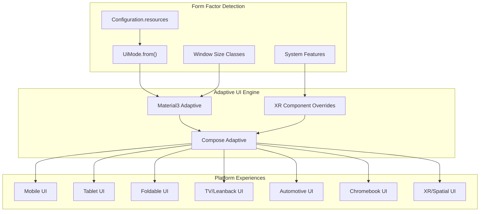
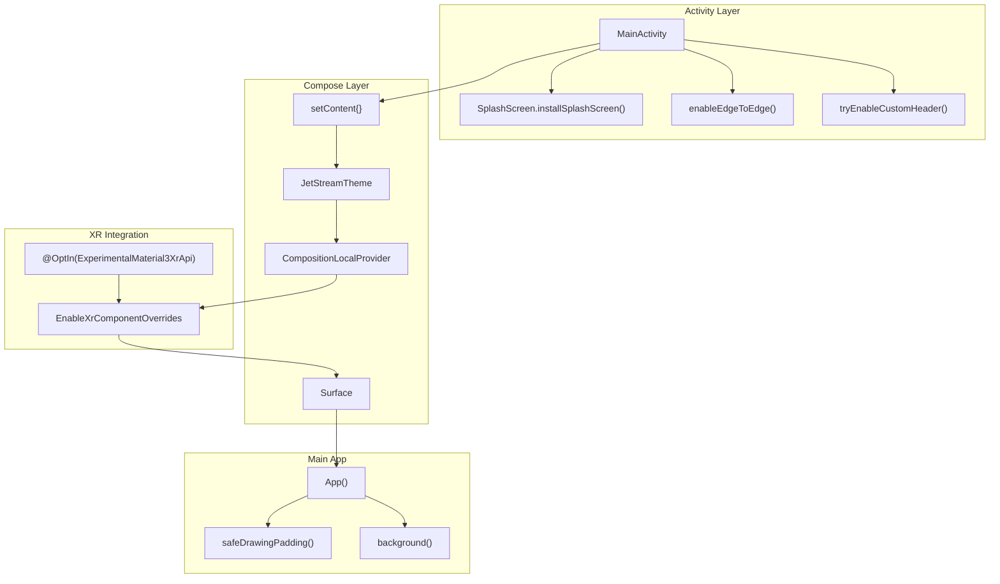
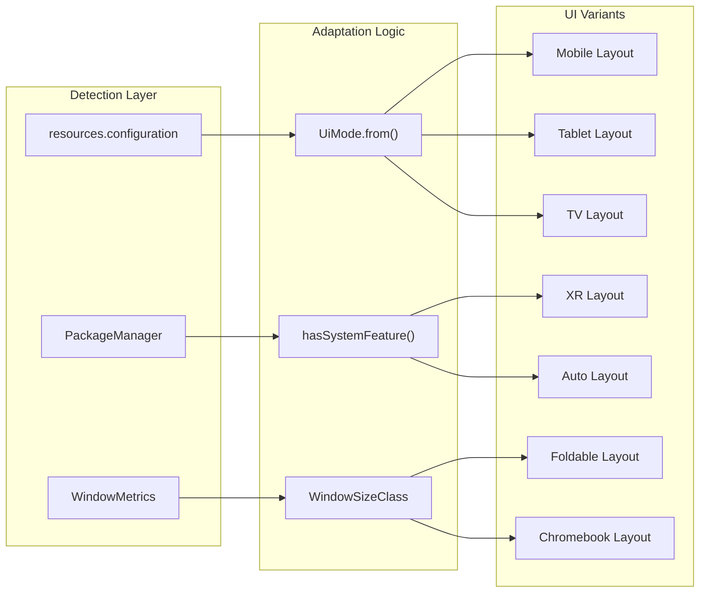
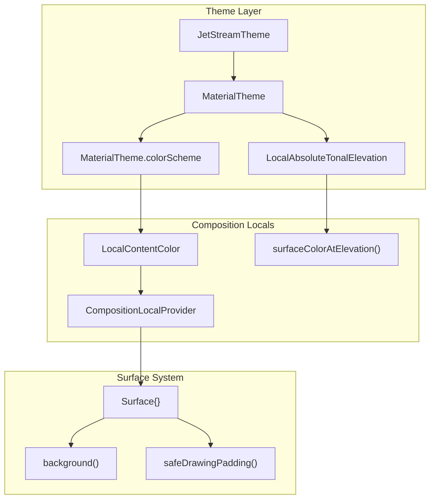
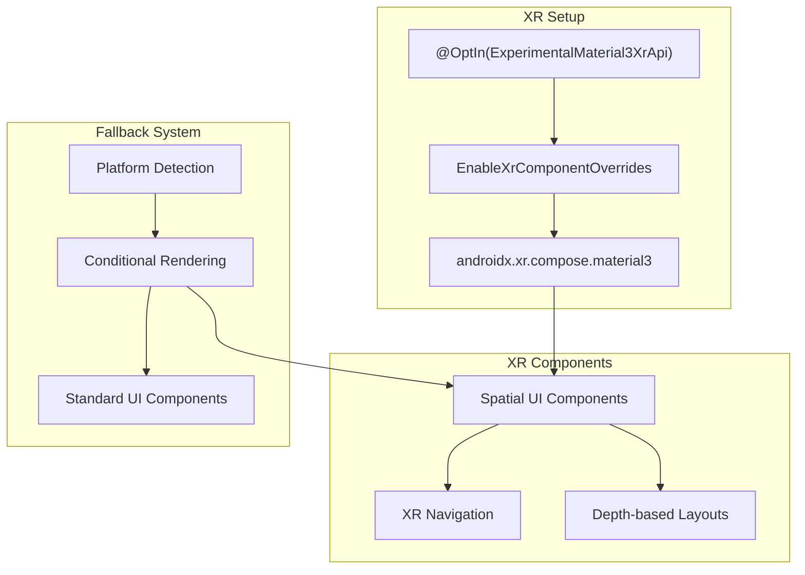
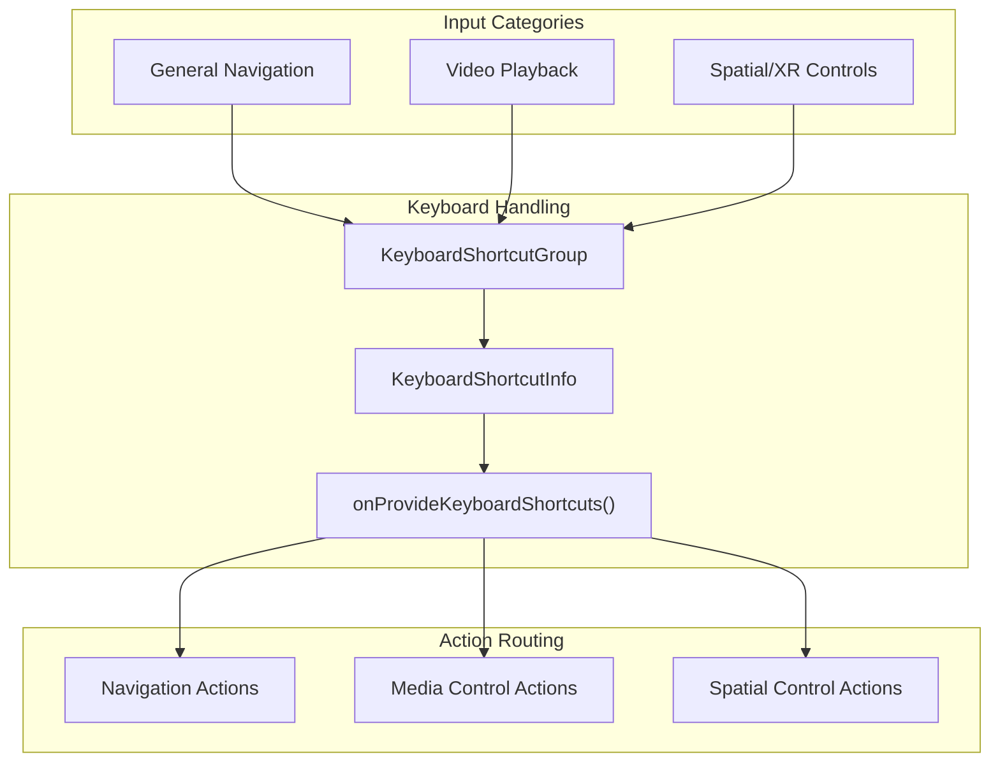
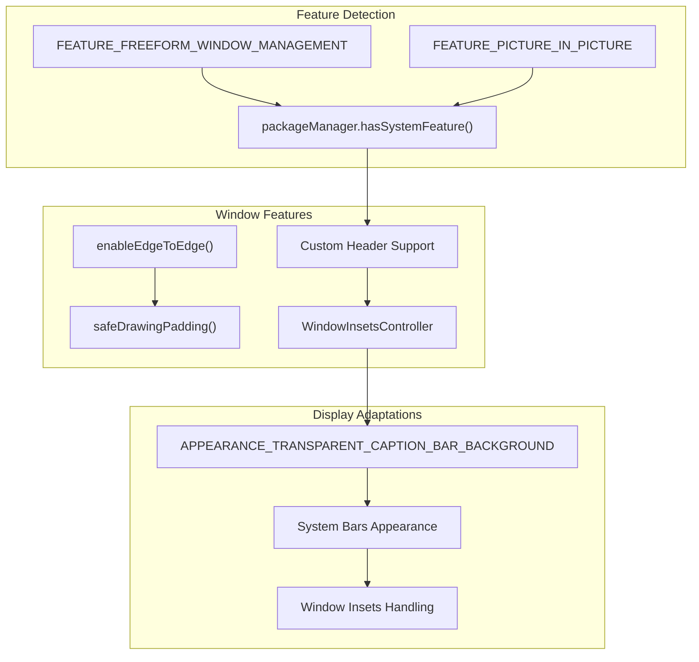

<!-- source: DeepWiki mcp.deepwiki.com · repo android/adaptive-apps-samples · page 3 User Interface · fetched 2026-10-23 -->

# User Interface

Relevant source files

The following files were used as context for generating this wiki page:

- [AdaptiveJetStream/README.md](AdaptiveJetStream/README.md)
- [AdaptiveJetStream/jetstream/src/main/ic_launcher-playstore.png](AdaptiveJetStream/jetstream/src/main/ic_launcher-playstore.png)
- [AdaptiveJetStream/jetstream/src/main/java/com/google/jetstream/MainActivity.kt](AdaptiveJetStream/jetstream/src/main/java/com/google/jetstream/MainActivity.kt)

This document describes the adaptive user interface framework used in AdaptiveJetStream. The UI system is designed to provide consistent media streaming experiences across multiple form factors including mobile, tablet, foldable, TV, automotive, Chromebook, and XR devices using a single codebase.

For information about the application's overall architecture and component structure, see [Architecture](#2). For details about media playback integration with the UI, see [Media Playback System](#2.2).

## Adaptive UI Framework

AdaptiveJetStream implements a comprehensive adaptive UI system that automatically adjusts layouts, navigation patterns, and interaction models based on the target device's form factor and capabilities.

The adaptive framework operates through several key detection mechanisms that determine the appropriate UI layout and interaction patterns for each device type.

Sources: [AdaptiveJetStream/jetstream/src/main/java/com/google/jetstream/MainActivity.kt:106-117](), [AdaptiveJetStream/README.md:3-11]()

## Main UI Entry Points

The application's UI hierarchy starts with `MainActivity` as the Android entry point, which sets up the Compose environment and delegates to the main `App` composable.

The `MainActivity` class handles platform-specific setup including splash screen installation, edge-to-edge display configuration, and custom header support for windowed environments.

Sources: [AdaptiveJetStream/jetstream/src/main/java/com/google/jetstream/MainActivity.kt:49-82]()

## Form Factor Detection and Adaptation

The UI system uses multiple detection mechanisms to identify the current device context and adapt the interface accordingly.

| Detection Method | Purpose | Implementation |
|-----------------|---------|----------------|
| `UiMode.from(resources.configuration)` | Detect basic form factor category | [MainActivity.kt:107]() |
| Window Size Classes | Determine layout breakpoints | Material3 Adaptive |
| System Features | Detect capabilities like PiP, freeform windows | [MainActivity.kt:110-116]() |
| XR Environment | Enable spatial UI components | `EnableXrComponentOverrides` |

Sources: [AdaptiveJetStream/jetstream/src/main/java/com/google/jetstream/MainActivity.kt:106-117](), [AdaptiveJetStream/README.md:5-11]()

## Material3 and Theming Integration

The application uses Material Design 3 components with adaptive capabilities to ensure consistent theming across all form factors while allowing for platform-specific customizations.

The theming system provides consistent color schemes, typography, and spacing while adapting to different display densities and form factors.

Sources: [AdaptiveJetStream/jetstream/src/main/java/com/google/jetstream/MainActivity.kt:60-80]()

## XR and Spatial UI Support

AdaptiveJetStream includes experimental support for XR devices through Material3's XR extensions, enabling spatial user interfaces for AR/VR experiences.

XR support is implemented through component overrides that replace standard Material3 components with spatial equivalents when running in XR environments.

Sources: [AdaptiveJetStream/jetstream/src/main/java/com/google/jetstream/MainActivity.kt:42-43](), [AdaptiveJetStream/jetstream/src/main/java/com/google/jetstream/MainActivity.kt:52](), [AdaptiveJetStream/jetstream/src/main/java/com/google/jetstream/MainActivity.kt:64]()

## Input Handling and Keyboard Shortcuts

The application provides comprehensive input handling including keyboard shortcuts for efficient navigation and media control across different input modalities.

| Category | Function | Key Combination |
|----------|----------|----------------|
| General | Close Dialog | `Escape` |
| General | Scroll Down/Up | `Page Down`/`Page Up` |
| General | Show Profile | `Ctrl+,` or `Ctrl+Alt+P` |
| General | Show Home | `Ctrl+Alt+H` |
| General | Show Search | `/` or `Ctrl+Alt+S` |
| Video | Toggle Play/Pause | `K` |
| Video | Rewind 10 seconds | `J` |
| Video | Skip 10 seconds | `L` |
| Video | Toggle Fullscreen | `F` |
| Spatial | Pan Controls | `W`,`A`,`S`,`D` |
| Spatial | Zoom Controls | `+`/`-`, `[`/`]` |

The keyboard shortcut system is organized into logical groups and provides discoverable shortcuts through the Android system's shortcut display mechanism.

Sources: [AdaptiveJetStream/jetstream/src/main/java/com/google/jetstream/MainActivity.kt:84-90](), [AdaptiveJetStream/jetstream/src/main/java/com/google/jetstream/MainActivity.kt:119-263]()

## Window Management and Display Features

The UI system includes advanced window management capabilities for modern Android form factors including foldables, large screens, and windowed environments.

Advanced window management features are conditionally enabled based on system capabilities, ensuring optimal experiences on devices that support features like freeform windows and picture-in-picture mode.

Sources: [AdaptiveJetStream/jetstream/src/main/java/com/google/jetstream/MainActivity.kt:57-58](), [AdaptiveJetStream/jetstream/src/main/java/com/google/jetstream/MainActivity.kt:92-117]()

---

