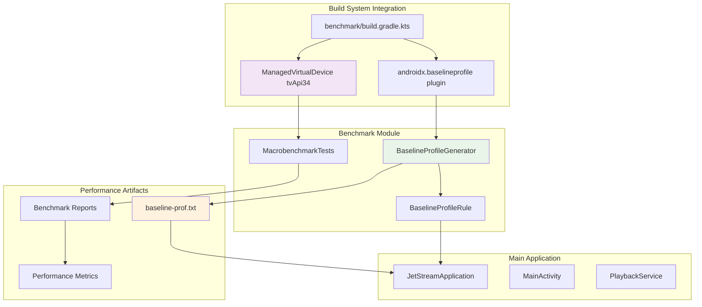
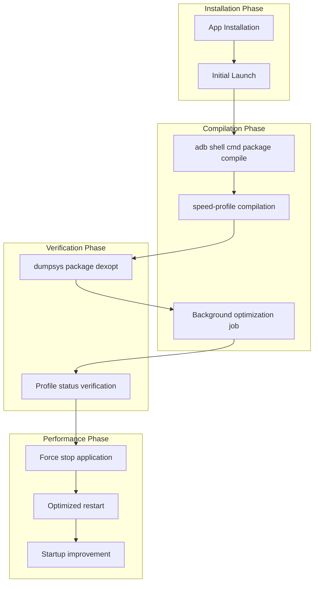
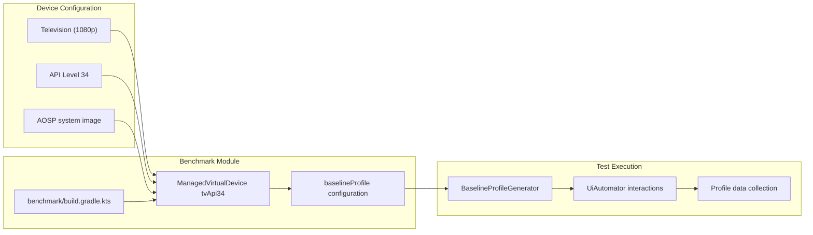
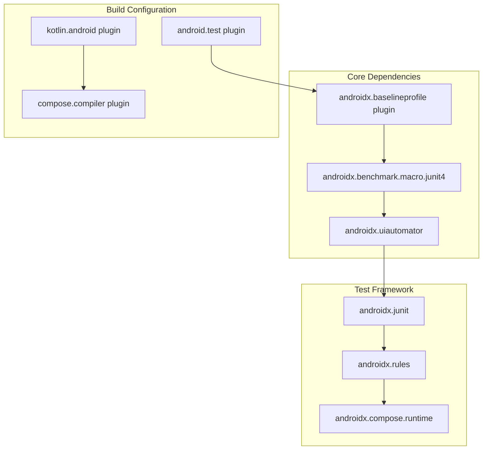

<!-- source: DeepWiki mcp.deepwiki.com · repo android/adaptive-apps-samples · page 4 Performance Optimization · fetched 2026-10-23 -->

# Performance Optimization

Relevant source files

The following files were used as context for generating this wiki page:

- [AdaptiveJetStream/baseline-profiles.md](AdaptiveJetStream/baseline-profiles.md)
- [AdaptiveJetStream/benchmark/build.gradle.kts](AdaptiveJetStream/benchmark/build.gradle.kts)
- [AdaptiveJetStream/benchmark/src/main/java/com/google/jetstream/benchmark/BaselineProfileGenerator.kt](AdaptiveJetStream/benchmark/src/main/java/com/google/jetstream/benchmark/BaselineProfileGenerator.kt)

## Purpose and Scope

This document provides an overview of the performance optimization strategies implemented in AdaptiveJetStream, focusing on startup performance improvements and automated performance measurement. The optimization approach centers on baseline profile generation and comprehensive benchmarking infrastructure to ensure consistent application performance across different device types and form factors.

For detailed information about baseline profile implementation, see [Baseline Profiles](#4.1). For comprehensive benchmarking setup and procedures, see [Benchmarking](#4.2).

## Performance Optimization Overview

AdaptiveJetStream implements a multi-layered performance optimization strategy designed to minimize application startup time and improve runtime performance. The optimization framework consists of three primary components:

| Component | Purpose | Implementation |
|-----------|---------|----------------|
| Baseline Profiles | AOT compilation optimization | Profile-guided optimization for hot code paths |
| Macrobenchmarks | Performance measurement | Automated startup and navigation benchmarks |
| Managed Test Devices | Consistent testing | Virtual TV devices for reproducible performance tests |

The performance optimization system integrates directly with the build pipeline to automatically generate and validate performance improvements during development.

### Performance Optimization Architecture

Sources: [AdaptiveJetStream/benchmark/build.gradle.kts:1-83](), [AdaptiveJetStream/benchmark/src/main/java/com/google/jetstream/benchmark/BaselineProfileGenerator.kt:1-203]()

## Baseline Profile System

The baseline profile system captures runtime performance data during typical user interactions and generates optimization rules for AOT (Ahead-of-Time) compilation. This approach significantly improves application startup performance by pre-compiling frequently executed code paths.

### Baseline Profile Generation Process

```mermaid
graph LR
    subgraph "Profile Collection"
        START["startActivityAndWait()"]
        WAIT["device.waitForIdle()"]
        CAROUSEL["Wait for Carousel focus"]
    end
    
    subgraph "Navigation Simulation"
        HOME["Home tab exploration"]
        CATEGORIES["Categories tab navigation"]
        MOVIES["Movies tab exploration"]
        SHOWS["Shows tab exploration"]
        FAVOURITES["Favourites tab navigation"]
        SEARCH["Search tab exploration"]
    end
    
    subgraph "Screen Interactions"
        PROFILE_SCREEN["Account screen navigation"]
        CATEGORY_DETAILS["Category details exploration"]
        MOVIE_DETAILS["Movie details navigation"]
    end
    
    subgraph "Profile Output"
        BASELINE_PROF["baseline-prof.txt generation"]
    end
    
    START --> WAIT
    WAIT --> CAROUSEL
    CAROUSEL --> HOME
    HOME --> CATEGORIES
    CATEGORIES --> MOVIES
    MOVIES --> SHOWS
    SHOWS --> FAVOURITES
    FAVOURITES --> SEARCH
    SEARCH --> PROFILE_SCREEN
    PROFILE_SCREEN --> CATEGORY_DETAILS
    CATEGORY_DETAILS --> MOVIE_DETAILS
    MOVIE_DETAILS --> BASELINE_PROF
```

The `BaselineProfileGenerator` class orchestrates this process through the `startup()` method, which systematically navigates through all application screens using D-pad controls to simulate TV remote interactions.

Sources: [AdaptiveJetStream/benchmark/src/main/java/com/google/jetstream/benchmark/BaselineProfileGenerator.kt:30-186]()

### Profile Application Workflow

The baseline profile application follows a specific sequence to ensure optimal performance benefits:

Sources: [AdaptiveJetStream/baseline-profiles.md:23-69]()

## Benchmarking Infrastructure

The benchmarking infrastructure provides automated performance measurement capabilities through the dedicated `benchmark` module. This module is configured as an Android Test module with specific optimizations for TV device testing.

### Benchmark Module Configuration

The benchmark module configuration includes several key components:

| Configuration | Value | Purpose |
|---------------|-------|---------|
| `targetProjectPath` | `:jetstream` | Links benchmark module to main app |
| `managedDevices` | `tvApi34` | Virtual TV device for testing |
| `suppressErrors` | `EMULATOR` | Allows benchmarking on virtual devices |
| `baselineProfile.useConnectedDevices` | `false` | Forces use of managed virtual devices |

### Managed Virtual Device Setup

Sources: [AdaptiveJetStream/benchmark/build.gradle.kts:48-62]()

## Performance Measurement Workflow

The performance measurement workflow integrates baseline profile generation with the application build process, ensuring that performance optimizations are automatically validated and applied.

### Build System Integration

The benchmark module integrates with the main application through several Gradle plugins and configurations:

- `androidx.baselineprofile` plugin manages profile generation and application
- `android.test` plugin provides the testing framework
- `compose.compiler` plugin ensures Compose-specific optimizations
- Target project path configuration links the benchmark to the main `jetstream` module

### UI Automation Strategy

The baseline profile generation uses `UiAutomator` to simulate realistic user interactions:

| Interaction Pattern | Implementation | Purpose |
|-------------------|---------------|---------|
| D-pad navigation | `pressDPadRight()`, `pressDPadLeft()` | TV remote simulation |
| Focus verification | `Until.findObject().focused(true)` | Ensures UI element accessibility |
| Content exploration | Systematic tab navigation | Comprehensive code path coverage |
| Screen transitions | `pressDPadCenter()` for selection | Deep navigation patterns |

Sources: [AdaptiveJetStream/benchmark/src/main/java/com/google/jetstream/benchmark/BaselineProfileGenerator.kt:36-185]()

### Performance Optimization Dependencies

The performance optimization system relies on several key dependencies managed through the version catalog:

Sources: [AdaptiveJetStream/benchmark/build.gradle.kts:19-76]()

The performance optimization framework ensures that AdaptiveJetStream maintains optimal startup and runtime performance across different device configurations while providing automated validation of performance improvements through the development lifecycle.

---

