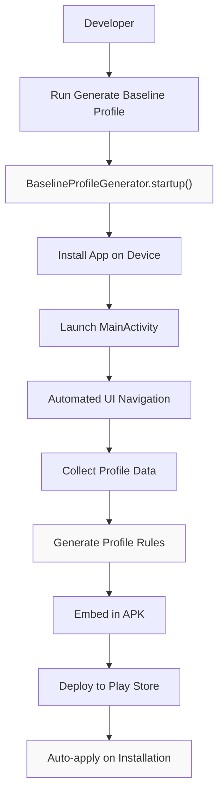
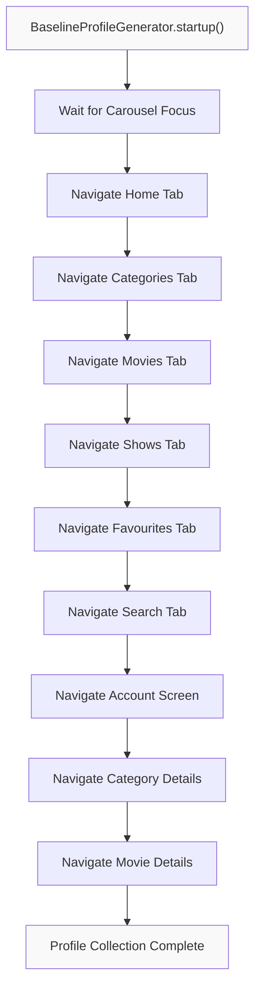
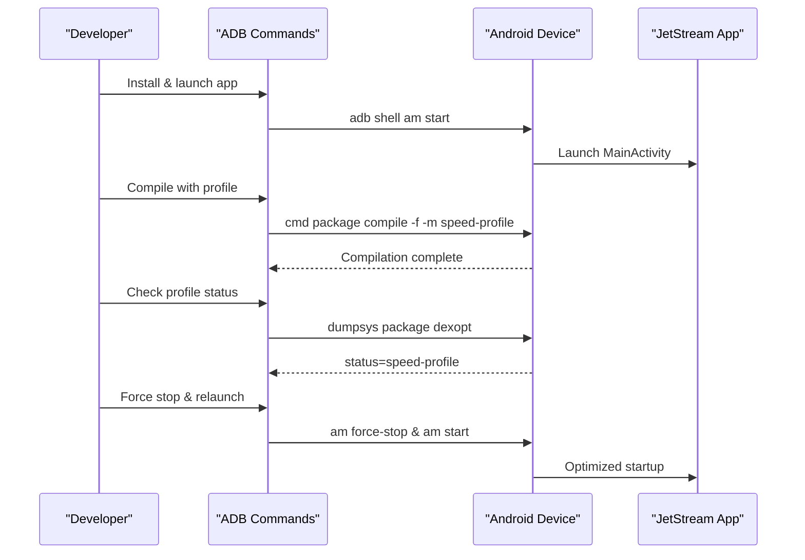

<!-- source: DeepWiki mcp.deepwiki.com · repo android/adaptive-apps-samples · page 4.1 Baseline Profiles · fetched 2026-10-23 -->

# Baseline Profiles

<details>
<summary>Relevant source files</summary>

The following files were used as context for generating this wiki page:

- [AdaptiveJetStream/baseline-profiles.md](AdaptiveJetStream/baseline-profiles.md)
- [AdaptiveJetStream/benchmark/src/main/java/com/google/jetstream/benchmark/BaselineProfileGenerator.kt](AdaptiveJetStream/benchmark/src/main/java/com/google/jetstream/benchmark/BaselineProfileGenerator.kt)

</details>


## Purpose and Scope

This document covers the baseline profile implementation in AdaptiveJetStream, including automated profile generation, application mechanisms, and performance optimization benefits. Baseline profiles improve app startup performance by pre-compiling critical code paths identified through UI automation testing.

For information about benchmarking infrastructure and performance measurement, see [Benchmarking](#4.2).

## What are Baseline Profiles

Baseline profiles are a performance optimization technique that identifies and pre-compiles the most critical code paths executed during typical app usage. The Android runtime uses these profiles to optimize app startup and reduce time-to-interaction for users.

The AdaptiveJetStream application implements baseline profiles to optimize:
- App startup performance
- Initial UI rendering
- Navigation between screens
- Media content browsing

## Profile Generation Process



**Profile Generation Flow**

The baseline profile generation follows an automated approach where UI interactions simulate real user behavior to capture the most frequently used code paths.

Sources: [AdaptiveJetStream/baseline-profiles.md:6-12](), [AdaptiveJetStream/benchmark/src/main/java/com/google/jetstream/benchmark/BaselineProfileGenerator.kt:29-33]()

## BaselineProfileGenerator Implementation

The `BaselineProfileGenerator` class implements comprehensive UI automation to capture realistic usage patterns across all major app screens and features.



**UI Automation Flow in BaselineProfileGenerator**

### Key Navigation Patterns

The generator captures these essential user journeys:

| Screen | Navigation Actions | Code Reference |
|--------|-------------------|----------------|
| Home Tab | Carousel exploration, up/down/left/right navigation | [BaselineProfileGenerator.kt:44-53]() |
| Categories Tab | Category browsing, selection interactions | [BaselineProfileGenerator.kt:61-70]() |
| Movies Tab | Movie grid navigation, content discovery | [BaselineProfileGenerator.kt:75-89]() |
| Shows Tab | TV show browsing patterns | [BaselineProfileGenerator.kt:92-105]() |
| Favourites Tab | Filter selection, favourites management | [BaselineProfileGenerator.kt:109-127]() |
| Search Tab | Search interface interaction | [BaselineProfileGenerator.kt:130-142]() |

### Device Interaction Constants

The generator uses specific timing and identification constants:

- `JETSTREAM_PACKAGE_NAME`: `"com.google.jetstream"`
- `INITIAL_WAIT_TIMEOUT`: `2000L` milliseconds
- `WAIT_TIMEOUT`: `1000L` milliseconds

Key UI element identifiers include `CAROUSEL_DESCRIPTION`, `CATEGORIES_TAB_LABEL`, `MOVIES_TAB_LABEL`, and `PROFILE_BUTTON_DESCRIPTION`.

Sources: [AdaptiveJetStream/benchmark/src/main/java/com/google/jetstream/benchmark/BaselineProfileGenerator.kt:25-187]()

## Manual Profile Application

For development and testing purposes, baseline profiles can be manually applied using ADB commands. This process involves multiple steps to ensure proper profile compilation and application.



**Manual Profile Application Sequence**

### Application Steps

1. **Install and Launch**: Deploy app and verify initial launch
   ```bash
   adb shell am start -n com.google.jetstream/com.google.jetstream.MainActivity
   ```

2. **Compile with Profile**: Apply speed-profile compilation
   ```bash
   adb shell cmd package compile -f -m speed-profile com.google.jetstream
   ```

3. **Verify Status**: Confirm profile application
   ```bash
   adb shell dumpsys package dexopt | grep -A 1 com.google.jetstream
   ```

4. **Background Optimization** (if needed): Execute background dexopt
   ```bash
   adb shell cmd package bg-dexopt-job
   ```

5. **Restart App**: Force close and relaunch to observe improvements
   ```bash
   adb shell am force-stop com.google.jetstream
   adb shell am start -n com.google.jetstream/com.google.jetstream.MainActivity
   ```

Sources: [AdaptiveJetStream/baseline-profiles.md:20-69]()

## Integration with Build System

Baseline profiles integrate seamlessly with the Android build system and are automatically applied in production environments:

- **Play Store Distribution**: Profiles are automatically applied when users install the app from Google Play Store
- **Benchmark Testing**: Profiles are automatically applied during macrobenchmark test execution
- **Release Builds**: Profile regeneration is required when code changes affect app startup paths

The `BaselineProfileRule` from the AndroidX Benchmark library manages the profile collection process and integrates with the project's testing infrastructure.

Sources: [AdaptiveJetStream/baseline-profiles.md:15-17](), [AdaptiveJetStream/benchmark/src/main/java/com/google/jetstream/benchmark/BaselineProfileGenerator.kt:19-27]()

---

