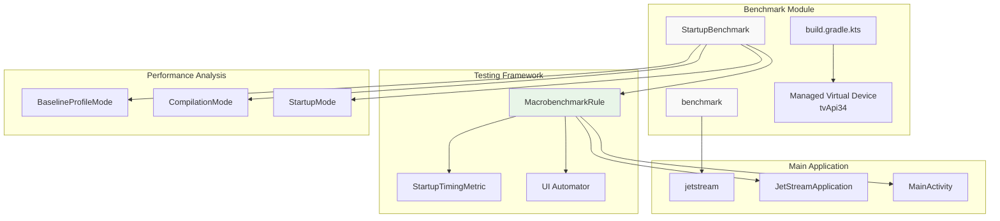
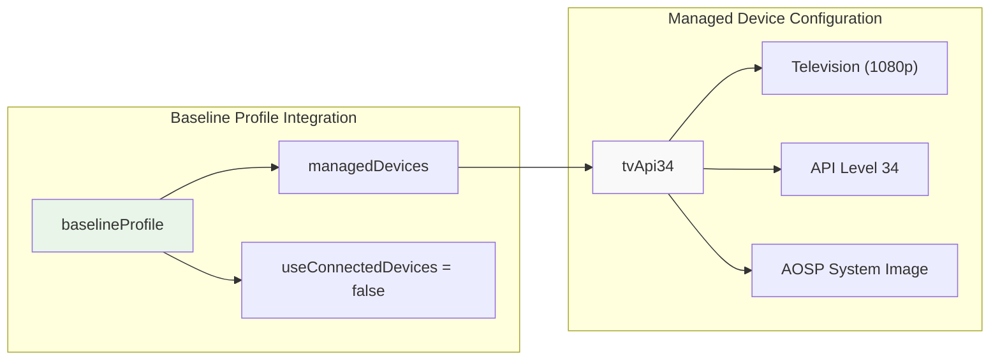
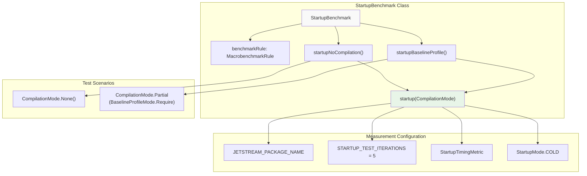
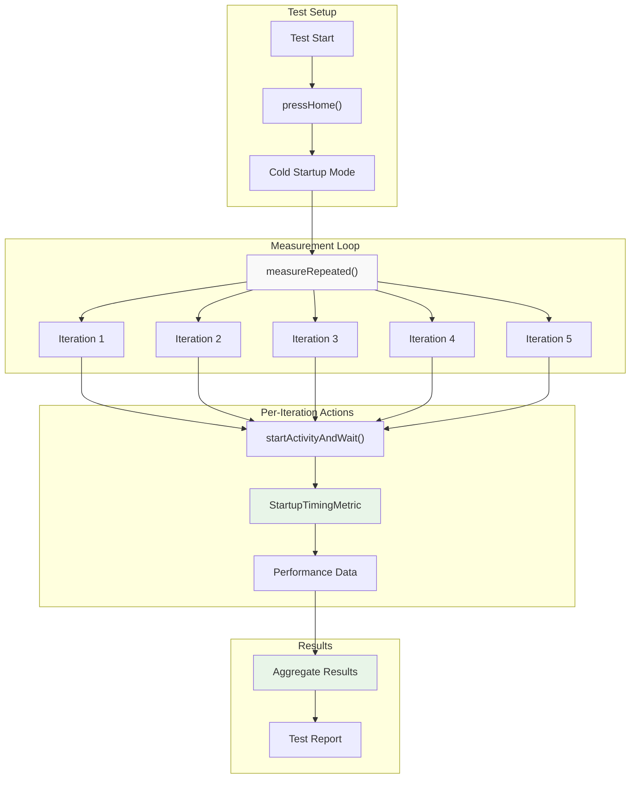

<!-- source: DeepWiki mcp.deepwiki.com · repo android/adaptive-apps-samples · page 4.2 Benchmarking · fetched 2026-10-23 -->

# Benchmarking

<details>
<summary>Relevant source files</summary>

The following files were used as context for generating this wiki page:

- [AdaptiveJetStream/benchmark/.gitignore](AdaptiveJetStream/benchmark/.gitignore)
- [AdaptiveJetStream/benchmark/build.gradle.kts](AdaptiveJetStream/benchmark/build.gradle.kts)
- [AdaptiveJetStream/benchmark/src/main/java/com/google/jetstream/benchmark/StartupBenchmark.kt](AdaptiveJetStream/benchmark/src/main/java/com/google/jetstream/benchmark/StartupBenchmark.kt)

</details>


This document covers the benchmarking infrastructure used in AdaptiveJetStream for measuring application performance, particularly startup performance. The benchmarking system is implemented as a separate module that uses AndroidX Macrobenchmark library to conduct automated performance tests against the main application.

For information about baseline profile generation and optimization benefits, see [Baseline Profiles](#4.1).

## Purpose and Scope

The benchmarking system serves to:
- Measure cold startup performance under different compilation scenarios
- Validate the effectiveness of baseline profiles on startup time
- Provide automated performance regression detection
- Generate performance data for optimization decisions

The system focuses primarily on startup performance measurement using controlled test environments with managed virtual devices.

## Benchmark Module Architecture

The benchmarking infrastructure is implemented as a dedicated Android test module that targets the main JetStream application for performance measurement.



**Sources:** [AdaptiveJetStream/benchmark/build.gradle.kts:1-83](), [AdaptiveJetStream/benchmark/src/main/java/com/google/jetstream/benchmark/StartupBenchmark.kt:1-75]()

## Module Configuration

The benchmark module is configured as an Android test project with specific dependencies and device targets for performance testing.

### Build Configuration

| Configuration | Value | Purpose |
|---------------|-------|---------|
| `namespace` | `com.google.jetstream.benchmark` | Benchmark module namespace |
| `compileSdk` | `35` | Target Android API level |
| `minSdk` | `28` | Minimum supported API level |
| `targetProjectPath` | `:jetstream` | Main app module being benchmarked |
| `testInstrumentationRunner` | `androidx.test.runner.AndroidJUnitRunner` | Test execution framework |

### Managed Virtual Device

The system uses a managed virtual device for consistent testing conditions:



**Sources:** [AdaptiveJetStream/benchmark/build.gradle.kts:48-62]()

## Startup Benchmark Tests

The `StartupBenchmark` class implements performance tests for different compilation scenarios to measure the impact of optimization techniques on application startup time.

### Test Implementation Structure



**Sources:** [AdaptiveJetStream/benchmark/src/main/java/com/google/jetstream/benchmark/StartupBenchmark.kt:41-71]()

### Compilation Mode Testing

The benchmark tests two distinct compilation scenarios:

#### No Compilation Test
- **Method:** `startupNoCompilation()`
- **Mode:** `CompilationMode.None()`
- **Purpose:** Measures worst-case startup performance without any optimizations
- **Use Case:** Baseline measurement for comparison

#### Baseline Profile Test  
- **Method:** `startupBaselineProfile()`
- **Mode:** `CompilationMode.Partial(baselineProfileMode = BaselineProfileMode.Require)`
- **Purpose:** Measures optimized startup performance with baseline profiles applied
- **Use Case:** Validates effectiveness of baseline profile optimizations

**Sources:** [AdaptiveJetStream/benchmark/src/main/java/com/google/jetstream/benchmark/StartupBenchmark.kt:49-58]()

## Benchmark Execution Flow

The benchmarking system follows a standardized execution pattern for consistent and reliable performance measurements.



**Sources:** [AdaptiveJetStream/benchmark/src/main/java/com/google/jetstream/benchmark/StartupBenchmark.kt:60-70]()

## Dependencies and Integration

The benchmark module integrates several testing and measurement libraries:

### Key Dependencies

| Library | Version | Purpose |
|---------|---------|---------|
| `androidx.benchmark.macro.junit4` | Latest stable | Macrobenchmark framework |
| `androidx.uiautomator` | Latest stable | UI automation for test interactions |
| `androidx.junit` | Latest stable | Test execution framework |
| `androidx.compose.runtime` | BOM managed | Compose runtime for UI testing |

### Build Variant Configuration

The benchmark module includes specific build variant handling:

```kotlin
androidComponents {
    beforeVariants(selector().withBuildType("benchmark").all()) {
        it.enable = true
    }
}
```

This configuration ensures the benchmark build variant is enabled for performance testing scenarios.

**Sources:** [AdaptiveJetStream/benchmark/build.gradle.kts:65-82]()

---

