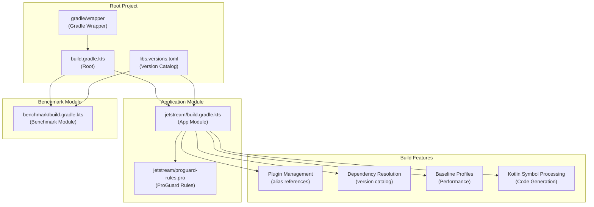
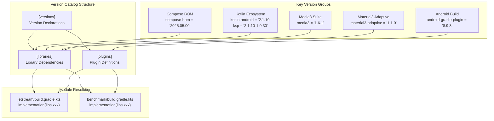
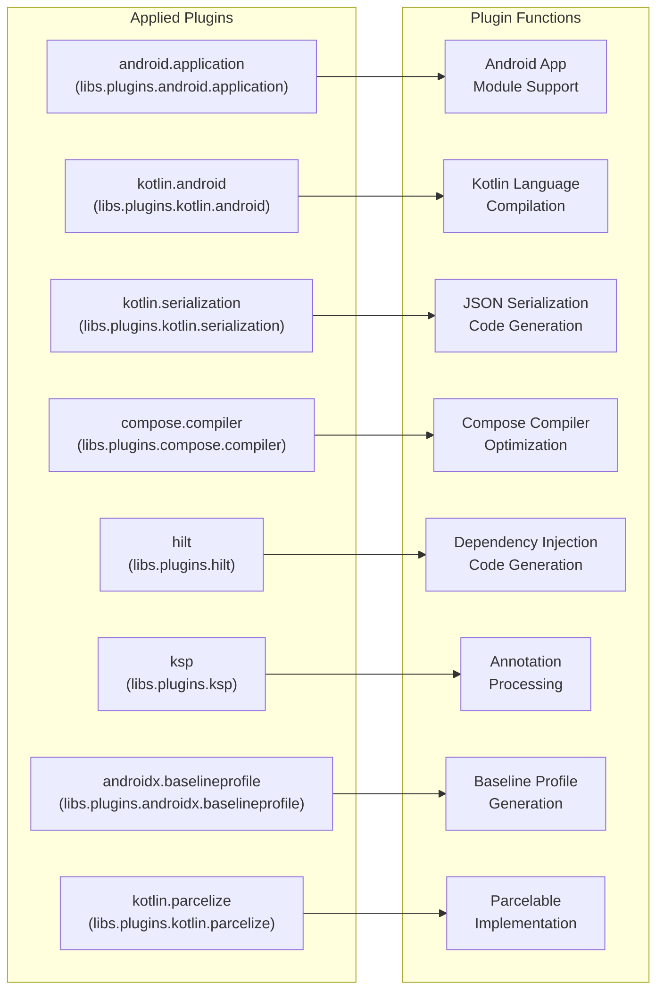

<!-- source: DeepWiki mcp.deepwiki.com · repo android/adaptive-apps-samples · page 5 Build System · fetched 2026-10-23 -->

# Build System

<details>
<summary>Relevant source files</summary>

The following files were used as context for generating this wiki page:

- [AdaptiveJetStream/build.gradle.kts](AdaptiveJetStream/build.gradle.kts)
- [AdaptiveJetStream/gradle/libs.versions.toml](AdaptiveJetStream/gradle/libs.versions.toml)
- [AdaptiveJetStream/jetstream/build.gradle.kts](AdaptiveJetStream/jetstream/build.gradle.kts)

</details>


This document covers the Gradle-based build system for the AdaptiveJetStream project, including dependency management, module configuration, and build optimization features. The build system is designed to support multi-platform Android development with performance optimization and code quality enforcement.

For information about specific dependency libraries and their usage, see [Dependencies](#5.1). For details about code quality enforcement, see [Code Quality](#5.3).

## Build System Architecture

The AdaptiveJetStream project uses a modern Gradle build system with centralized dependency management through version catalogs. The build configuration is structured to support multiple Android form factors while maintaining consistent build practices across modules.



Sources: [AdaptiveJetStream/build.gradle.kts:1-34](), [AdaptiveJetStream/gradle/libs.versions.toml:1-77](), [AdaptiveJetStream/jetstream/build.gradle.kts:1-141]()

## Top-Level Build Configuration

The root `build.gradle.kts` file establishes the plugin ecosystem for the entire project using the version catalog pattern. All plugins are declared using the `alias()` function with `apply false` to make them available to submodules without applying them at the root level.

| Plugin | Purpose | Catalog Reference |
|--------|---------|-------------------|
| `android.application` | Android app module configuration | `libs.plugins.android.application` |
| `kotlin.android` | Kotlin Android plugin | `libs.plugins.kotlin.android` |
| `kotlin.serialization` | Kotlin serialization support | `libs.plugins.kotlin.serialization` |
| `compose.compiler` | Compose compiler plugin | `libs.plugins.compose.compiler` |
| `android.test` | Android test module support | `libs.plugins.android.test` |
| `hilt` | Dependency injection | `libs.plugins.hilt` |
| `ksp` | Kotlin Symbol Processing | `libs.plugins.ksp` |

The plugin declarations in [AdaptiveJetStream/build.gradle.kts:25-33]() use the centralized version catalog to ensure consistent plugin versions across all modules.

Sources: [AdaptiveJetStream/build.gradle.kts:17-33]()

## Version Catalog Structure

The `libs.versions.toml` file implements centralized dependency management using Gradle's version catalog feature. This approach ensures consistent dependency versions across modules and simplifies dependency updates.



The version catalog defines 27 distinct version declarations in [AdaptiveJetStream/gradle/libs.versions.toml:1-28](), covering major dependency families including Compose, Kotlin, Android, Media3, and XR components.

Sources: [AdaptiveJetStream/gradle/libs.versions.toml:1-77]()

## Application Module Build Configuration

The main application module build script in `jetstream/build.gradle.kts` configures the Android application with comprehensive feature support including Compose, dependency injection, and performance optimization.

### Android Configuration

The Android configuration block establishes the application metadata and build behavior:

- **Namespace**: `com.google.jetstream` [AdaptiveJetStream/jetstream/build.gradle.kts:32]()
- **SDK Targets**: `compileSdk = 35`, `minSdk = 28`, `targetSdk = 35` [AdaptiveJetStream/jetstream/build.gradle.kts:34-39]()
- **Build Features**: Compose UI enabled, BuildConfig generation enabled [AdaptiveJetStream/jetstream/build.gradle.kts:59-62]()
- **JVM Toolchain**: Java 17 [AdaptiveJetStream/jetstream/build.gradle.kts:28-29]()

### Build Types Configuration

The release build type is configured for production optimization with ProGuard minification enabled [AdaptiveJetStream/jetstream/build.gradle.kts:49-58]():

```
buildTypes {
    getByName("release") {
        isMinifyEnabled = true
        signingConfig = signingConfigs.getByName("debug")
        proguardFiles(
            getDefaultProguardFile("proguard-android-optimize.txt"),
            "proguard-rules.pro"
        )
    }
}
```

Sources: [AdaptiveJetStream/jetstream/build.gradle.kts:31-73]()

## Dependency Management Implementation

The application module demonstrates the version catalog pattern in practice through its dependency declarations. Dependencies are organized into logical groups using the `libs` accessor.

### Core Android Dependencies

| Dependency Group | Libraries | Purpose |
|------------------|-----------|---------|
| **Core Android** | `androidx.core.ktx`, `androidx.lifecycle.runtime.ktx` | Essential Android functionality |
| **Compose UI** | `androidx.compose.bom`, `androidx.compose.material3` | Jetpack Compose framework |
| **Activity/Navigation** | `androidx.activity.compose`, `androidx.navigation.compose` | App structure and navigation |

### Specialized Feature Dependencies

The build includes specialized libraries for adaptive UI, media playback, and XR functionality:

- **Material3 Adaptive**: Four separate adaptive libraries for responsive UI [AdaptiveJetStream/jetstream/build.gradle.kts:104-108]()
- **Media3 Suite**: ExoPlayer, session management, and Compose UI integration [AdaptiveJetStream/jetstream/build.gradle.kts:110-113]()
- **XR Components**: SceneCore, Compose integration, and Material3 XR support [AdaptiveJetStream/jetstream/build.gradle.kts:130-133]()

### Build-Time Dependencies

The configuration includes build-time processors and tools:

- **Hilt DI**: Runtime implementation and KSP annotation processor [AdaptiveJetStream/jetstream/build.gradle.kts:118-121]()
- **Baseline Profiles**: Connection to benchmark module for performance optimization [AdaptiveJetStream/jetstream/build.gradle.kts:139]()
- **Debug Tools**: Compose UI tooling for development [AdaptiveJetStream/jetstream/build.gradle.kts:136]()

Sources: [AdaptiveJetStream/jetstream/build.gradle.kts:75-140]()

## Plugin Integration

The application module applies multiple plugins to enable comprehensive build functionality. The plugin application follows the version catalog pattern using `alias()` references.



The plugin configuration enables several code generation and optimization features essential for modern Android development, particularly the KSP-based Hilt annotation processing [AdaptiveJetStream/jetstream/build.gradle.kts:121]() and baseline profile integration [AdaptiveJetStream/jetstream/build.gradle.kts:23]().

Sources: [AdaptiveJetStream/jetstream/build.gradle.kts:16-25]()

## Build Optimization Features

The build system incorporates several optimization strategies for performance and code quality:

### Baseline Profile Integration

The application module connects to the benchmark module for baseline profile generation through the `baselineProfile()` dependency declaration [AdaptiveJetStream/jetstream/build.gradle.kts:139](). This enables runtime performance optimization by pre-compiling frequently used code paths.

### ProGuard Configuration

The release build type enables code minification and optimization through ProGuard, using both the default Android optimization rules and custom application-specific rules [AdaptiveJetStream/jetstream/build.gradle.kts:53-56]().

### Packaging Optimization

Resource packaging excludes common license files to reduce APK size [AdaptiveJetStream/jetstream/build.gradle.kts:64-68]():

```
packaging {
    resources {
        excludes += "/META-INF/{AL2.0,LGPL2.1}"
    }
}
```

Sources: [AdaptiveJetStream/jetstream/build.gradle.kts:49-68](), [AdaptiveJetStream/jetstream/build.gradle.kts:139]()

---

