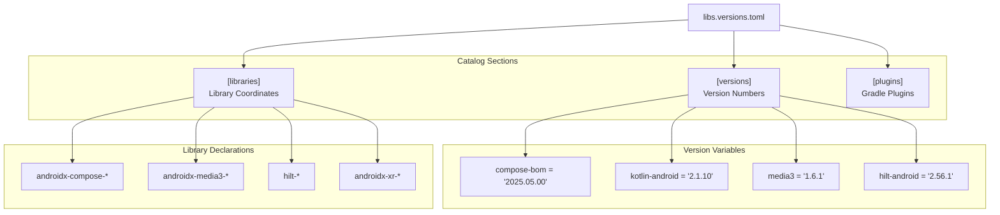
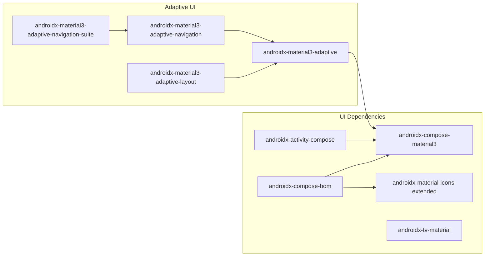
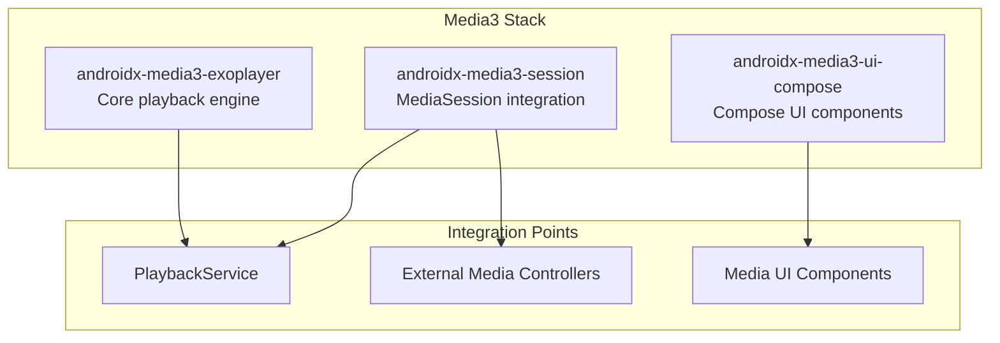
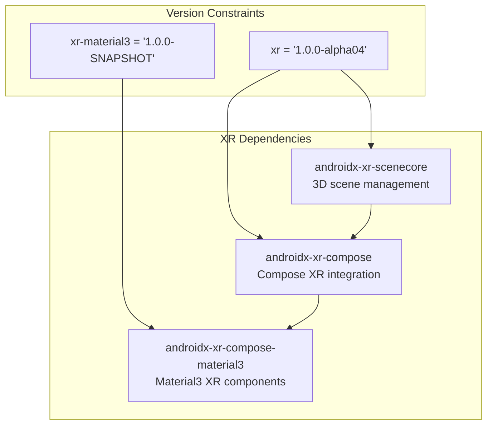
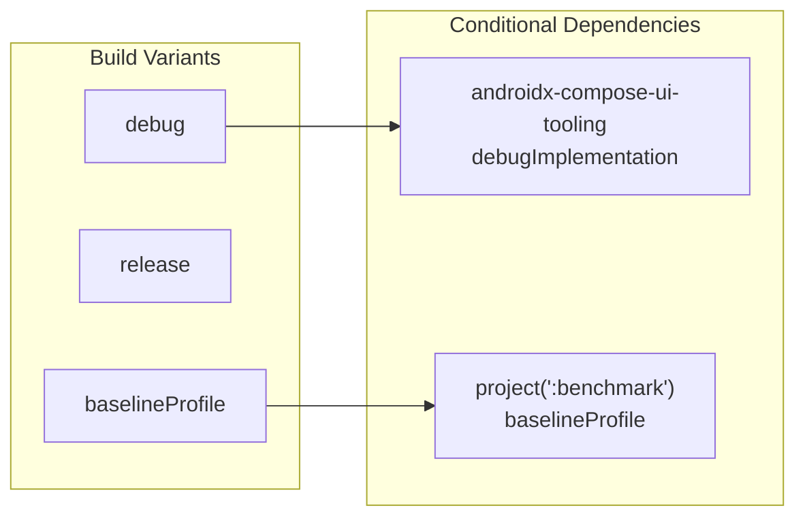

<!-- source: DeepWiki mcp.deepwiki.com · repo android/adaptive-apps-samples · page 5.1 Dependencies · fetched 2026-10-23 -->

# Dependencies

Relevant source files

The following files were used as context for generating this wiki page:

- [AdaptiveJetStream/gradle/libs.versions.toml](AdaptiveJetStream/gradle/libs.versions.toml)
- [AdaptiveJetStream/jetstream/build.gradle.kts](AdaptiveJetStream/jetstream/build.gradle.kts)

This page documents the dependency management system used in AdaptiveJetStream, which leverages Gradle version catalogs to centralize dependency declarations and ensure consistent versions across modules. The dependency structure supports multi-platform adaptive UI, media playback, performance optimization, and XR capabilities.

For information about Gradle configuration and build scripts, see [Gradle Configuration](#5.2). For code quality enforcement tools, see [Code Quality](#5.3).

## Version Catalog System

AdaptiveJetStream uses Gradle's version catalog feature to centralize dependency management in a single TOML file. This approach ensures version consistency and provides type-safe accessors for dependencies across all modules.

### Catalog Structure

The version catalog is organized into three main sections in [gradle/libs.versions.toml:1-77]():

Sources: [gradle/libs.versions.toml:1-77]()

## Core Dependency Categories

### UI Framework Stack

The application's UI foundation is built on Jetpack Compose with Material Design 3 and adaptive components:

| Category | Libraries | Version Reference |
|----------|-----------|-------------------|
| Compose BOM | `androidx-compose-bom` | `compose-bom = "2025.05.00"` |
| Material 3 | `androidx-compose-material3` | Controlled by BOM |
| Material Icons | `androidx-material-icons-extended` | Controlled by BOM |
| Activity Integration | `androidx-activity-compose` | `activity-compose = "1.10.1"` |
| TV Components | `androidx-tv-material` | `tv-material = "1.0.0"` |

Sources: [gradle/libs.versions.toml:8,31,34,45-49](), [jetstream/build.gradle.kts:80,84,87,90,105-108]()

### Media Playback Dependencies

Media functionality is provided by the AndroidX Media3 library suite:

Sources: [gradle/libs.versions.toml:21,50-52](), [jetstream/build.gradle.kts:111-113]()

### Dependency Injection Framework

Hilt provides compile-time dependency injection with Kotlin Symbol Processing (KSP):

| Component | Library | Purpose |
|-----------|---------|---------|
| Runtime | `hilt-android` | Core Hilt runtime |
| Compiler | `hilt-compiler` | Annotation processing via KSP |
| Compose Integration | `androidx-hilt-navigation-compose` | Navigation integration |

Sources: [gradle/libs.versions.toml:12,17,40,58-59](), [jetstream/build.gradle.kts:119-121]()

### XR and Immersive Experience Dependencies

Extended Reality support is provided through AndroidX XR libraries:

Sources: [gradle/libs.versions.toml:27-28,64-66](), [jetstream/build.gradle.kts:131-133]()

## Build Plugin Configuration

### Applied Plugins

The main application module applies plugins through the version catalog system in [jetstream/build.gradle.kts:16-25]():

| Plugin | Purpose | Version Reference |
|--------|---------|-------------------|
| `android-application` | Android app module configuration | `android-gradle-plugin = "8.9.3"` |
| `kotlin-android` | Kotlin Android support | `kotlin-android = "2.1.10"` |
| `kotlin-serialization` | JSON serialization support | Same as Kotlin version |
| `compose-compiler` | Compose compiler plugin | Same as Kotlin version |
| `hilt` | Dependency injection | `hilt-android = "2.56.1"` |
| `ksp` | Kotlin Symbol Processing | `ksp = "2.1.10-1.0.30"` |
| `androidx-baselineprofile` | Performance optimization | `androidx-baselineprofile = "1.3.4"` |
| `kotlin-parcelize` | Parcelable generation | Built-in Kotlin plugin |

Sources: [gradle/libs.versions.toml:68-77](), [jetstream/build.gradle.kts:16-25]()

## Performance and Development Dependencies

### Performance Optimization

| Library | Purpose | Implementation |
|---------|---------|----------------|
| `androidx-profileinstaller` | Baseline profile installation | Runtime optimization |
| `androidx-core-splashscreen` | App startup experience | UI enhancement |

### Development Tools

Development-specific dependencies are applied conditionally:

Sources: [jetstream/build.gradle.kts:136,139]()

## Window Management and Adaptive UI

Window size class detection and adaptive layouts are supported through:

| Library | Purpose |
|---------|---------|
| `androidx-window` | Window metrics and size classes |
| `androidx-window-core` | Core window management APIs |

These dependencies enable the adaptive UI system to respond to different form factors and window configurations across mobile, tablet, TV, and foldable devices.

Sources: [gradle/libs.versions.toml:26,62-63](), [jetstream/build.gradle.kts:127-128]()

## Serialization and Data Handling

JSON data processing is handled by Kotlin Serialization:

- **Library**: `kotlinx-serialization-json`
- **Version**: `kotlinx-serialization = "1.8.1"`
- **Plugin**: `kotlin-serialization` (applied via version catalog)

This supports parsing of movie data, categories, and cast information from JSON assets.

Sources: [gradle/libs.versions.toml:16,60,73](), [jetstream/build.gradle.kts:19,102]()

---

