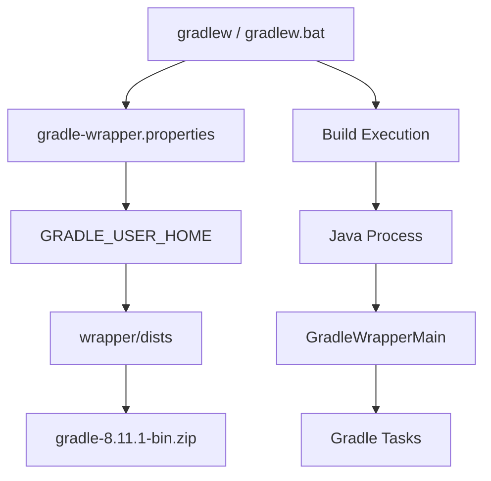
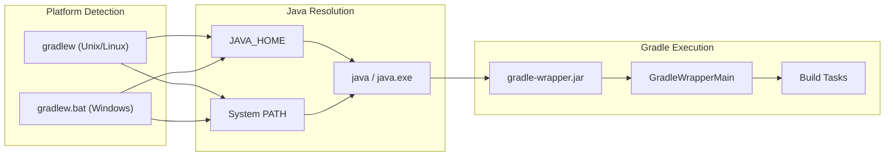
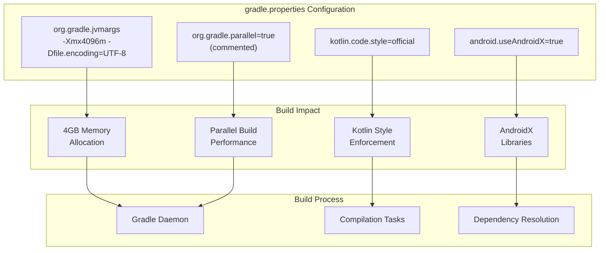

<!-- source: DeepWiki mcp.deepwiki.com · repo android/adaptive-apps-samples · page 5.2 Gradle Configuration · fetched 2026-10-23 -->

# Gradle Configuration

<details>
<summary>Relevant source files</summary>

The following files were used as context for generating this wiki page:

- [AdaptiveJetStream/gradle.properties](AdaptiveJetStream/gradle.properties)
- [AdaptiveJetStream/gradle/wrapper/gradle-wrapper.properties](AdaptiveJetStream/gradle/wrapper/gradle-wrapper.properties)
- [AdaptiveJetStream/gradlew](AdaptiveJetStream/gradlew)
- [AdaptiveJetStream/gradlew.bat](AdaptiveJetStream/gradlew.bat)

</details>


## Purpose and Scope

This document describes the Gradle build system configuration for the AdaptiveJetStream project, including the Gradle wrapper setup, project-wide properties, and cross-platform build execution. This covers the foundational build infrastructure that enables compilation, dependency resolution, and task execution across all modules.

For information about dependency management and version catalogs, see [Dependencies](#5.1). For code quality tools and formatting configuration, see [Code Quality](#5.3).

## Gradle Wrapper Configuration

The project uses Gradle Wrapper to ensure consistent build environments across different development machines and CI systems. The wrapper configuration standardizes the Gradle version and distribution settings.

### Wrapper Properties

The Gradle wrapper is configured to use version **8.11.1** with specific distribution and caching settings:

| Property | Value | Purpose |
|----------|--------|---------|
| `distributionUrl` | `gradle-8.11.1-bin.zip` | Specifies Gradle version 8.11.1 |
| `distributionBase` | `GRADLE_USER_HOME` | Base directory for Gradle distributions |
| `distributionPath` | `wrapper/dists` | Subdirectory for distribution storage |
| `zipStoreBase` | `GRADLE_USER_HOME` | Base directory for downloaded archives |
| `zipStorePath` | `wrapper/dists` | Subdirectory for zip storage |
| `networkTimeout` | `10000` | 10-second timeout for network operations |



**Gradle Wrapper Architecture**

Sources: [AdaptiveJetStream/gradle/wrapper/gradle-wrapper.properties:1-7](), [AdaptiveJetStream/gradlew:210-211](), [AdaptiveJetStream/gradlew.bat:75]()

### Cross-Platform Execution Scripts

The project provides platform-specific wrapper scripts that handle environment detection and Java execution:

#### Unix/Linux Script (`gradlew`)

The Unix wrapper script provides comprehensive POSIX shell compatibility and handles various operating system specifics:

- **Environment Detection**: Automatically detects Cygwin, Darwin, MSYS, and NonStop systems
- **Java Detection**: Locates Java installation via `JAVA_HOME` or system PATH
- **Resource Management**: Optimizes file descriptor limits for build performance
- **Path Handling**: Converts paths appropriately for different environments

#### Windows Script (`gradlew.bat`)

The Windows batch script provides equivalent functionality for Windows environments:

- **Java Location**: Searches for `java.exe` via `JAVA_HOME` or system PATH
- **Error Handling**: Provides clear error messages for configuration issues
- **Classpath Setup**: Configures wrapper JAR in classpath



**Cross-Platform Gradle Execution Flow**

Sources: [AdaptiveJetStream/gradlew:102-112](), [AdaptiveJetStream/gradlew:117-137](), [AdaptiveJetStream/gradlew.bat:40-51](), [AdaptiveJetStream/gradlew.bat:54-66]()

## Project Properties Configuration

The project-wide Gradle properties are defined in `gradle.properties` and control build behavior, memory allocation, and Android-specific settings.

### JVM Configuration

The build system is configured with generous memory allocation to handle the complexity of multi-module Android builds with Compose and extensive dependencies:

```
org.gradle.jvmargs=-Xmx4096m -Dfile.encoding=UTF-8
```

This configuration provides:
- **Maximum Heap**: 4GB memory allocation for Gradle daemon
- **Character Encoding**: UTF-8 encoding for consistent text processing
- **Build Performance**: Sufficient memory for parallel compilation and dependency resolution

### Android Configuration

The project uses modern Android development practices with specific build optimizations:

| Property | Value | Impact |
|----------|--------|--------|
| `android.useAndroidX` | `true` | Enables AndroidX library support |
| `kotlin.code.style` | `official` | Enforces official Kotlin coding conventions |

### Build Optimization Settings

The configuration includes commented parallel build settings that can be enabled for decoupled project builds:

```
# org.gradle.parallel=true
```

This setting is disabled by default to ensure build reliability but can be enabled for performance improvements in appropriate development environments.



**Gradle Properties Impact on Build Process**

Sources: [AdaptiveJetStream/gradle.properties:9](), [AdaptiveJetStream/gradle.properties:17](), [AdaptiveJetStream/gradle.properties:19](), [AdaptiveJetStream/gradle.properties:13]()

## Build Environment Requirements

The Gradle configuration establishes specific requirements for the development and build environment:

### Java Requirements

The wrapper scripts enforce Java availability and provide clear error handling when Java is not properly configured. The build requires:

- **Java Installation**: Either via `JAVA_HOME` environment variable or system PATH
- **Java Version Compatibility**: Compatible with Gradle 8.11.1 requirements
- **Cross-Platform Support**: Handles IBM JDK specific paths and various operating systems

### Memory and Performance

The build configuration is optimized for complex Android projects with multiple considerations:

- **Daemon Memory**: 4GB heap allocation for Gradle daemon processes
- **File Descriptors**: Automatic optimization on Unix systems for concurrent file operations
- **Network Timeouts**: 10-second timeout for dependency downloads and distribution fetching
- **Encoding**: UTF-8 support for internationalization and special characters

### Development Workflow Integration

The Gradle configuration integrates with common development tools and practices:

- **IDE Integration**: Properties can be overridden by Android Studio/IntelliJ settings
- **CI/CD Compatibility**: Wrapper ensures consistent builds across different environments
- **Version Control**: Wrapper JAR and scripts are committed for reproducible builds

Sources: [AdaptiveJetStream/gradle.properties:1-6](), [AdaptiveJetStream/gradlew:139-156](), [AdaptiveJetStream/gradle/wrapper/gradle-wrapper.properties:4]()

---

