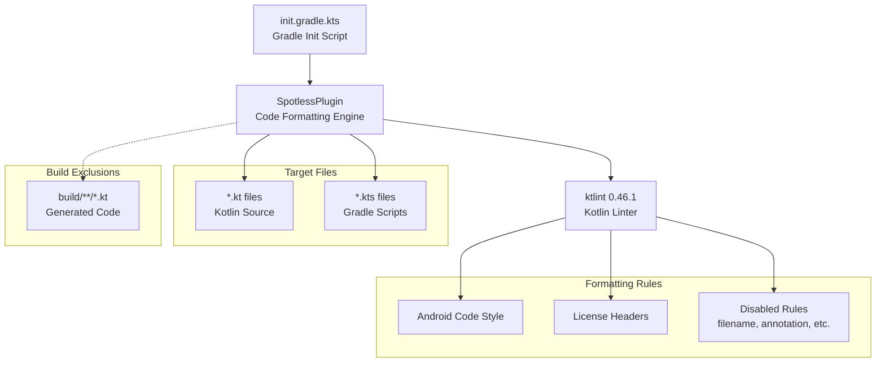
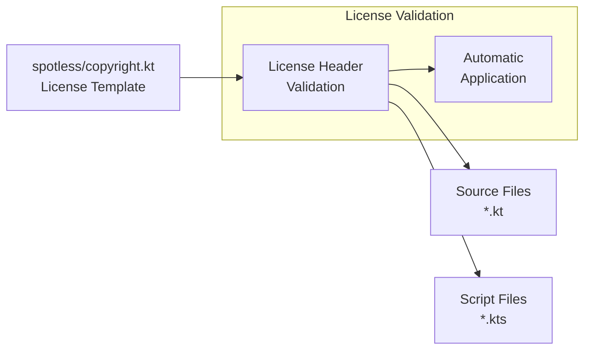
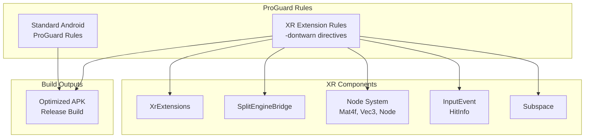
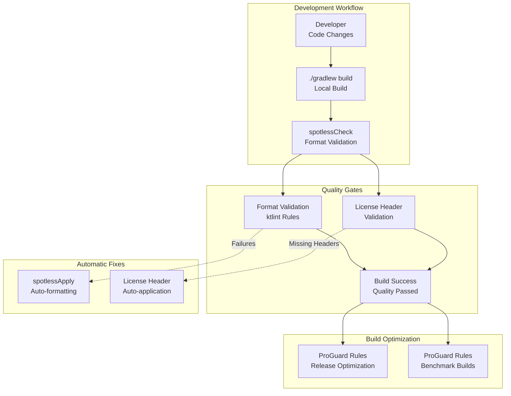

<!-- source: DeepWiki mcp.deepwiki.com · repo android/adaptive-apps-samples · page 5.3 Code Quality · fetched 2026-10-23 -->

# Code Quality

Relevant source files

The following files were used as context for generating this wiki page:

- [AdaptiveJetStream/buildscripts/init.gradle.kts](AdaptiveJetStream/buildscripts/init.gradle.kts)
- [AdaptiveJetStream/jetstream/proguard-benchmark-rules.pro](AdaptiveJetStream/jetstream/proguard-benchmark-rules.pro)
- [AdaptiveJetStream/jetstream/proguard-rules.pro](AdaptiveJetStream/jetstream/proguard-rules.pro)

This document covers the code quality enforcement mechanisms in the AdaptiveJetStream project, including automated code formatting, linting rules, and code optimization configurations. The system ensures consistent code style across all modules and optimizes release builds through ProGuard rules.

For information about the overall build system configuration, see [Gradle Configuration](#5.2). For dependency management details, see [Dependencies](#5.1).

## Code Formatting and Linting

The project uses a comprehensive code quality system built on Spotless and ktlint to enforce consistent formatting and coding standards across all Kotlin source files.

### Spotless Integration

The build system automatically applies the Spotless plugin to all subprojects through a Gradle init script. This ensures uniform code formatting without requiring manual configuration in each module.

Sources: [AdaptiveJetStream/buildscripts/init.gradle.kts:19-72]()

### ktlint Configuration

The project uses ktlint version 0.46.1 with Android-specific code style rules. Several newer ktlint rules are deliberately disabled to maintain compatibility and avoid disruptive formatting changes.

| Configuration Option | Value | Purpose |
|---------------------|--------|---------|
| `ktlint_code_style` | `android` | Uses Android-specific formatting rules |
| `ij_kotlin_allow_trailing_comma` | `true` | Allows trailing commas in collections |
| `disabled_rules` | Multiple rules | Disables problematic rules from ktlint 0.46.0 |

**Disabled Rules:**
- `filename` - Filename convention enforcement
- `annotation` and `annotation-spacing` - Annotation formatting
- `argument-list-wrapping` - Method argument formatting
- `package-name` - Package naming conventions
- `trailing-comma` - Trailing comma enforcement
- `spacing-around-angle-brackets` - Generic type formatting

Sources: [AdaptiveJetStream/buildscripts/init.gradle.kts:40-61]()

### License Header Enforcement

All Kotlin source files must include the Apache License 2.0 header. The system automatically validates and can apply the correct license header to all `.kt` and `.kts` files.

Sources: [AdaptiveJetStream/buildscripts/init.gradle.kts:63-69]()

## ProGuard Configuration

The project includes two distinct ProGuard configurations for different build scenarios, ensuring optimal code optimization while maintaining necessary debugging capabilities.

### Release Build Optimization

The main ProGuard configuration applies standard Android optimizations with specific rules for XR (Extended Reality) components.

Sources: [AdaptiveJetStream/jetstream/proguard-rules.pro:23-34]()

### Benchmark Build Configuration

Benchmark builds use a specialized ProGuard configuration that disables obfuscation to maintain proper class and method names for baseline profile generation.

**Key Differences:**
- `-dontobfuscate` directive preserves original names
- Enables accurate performance measurement
- Supports baseline profile generation process

Sources: [AdaptiveJetStream/jetstream/proguard-benchmark-rules.pro:23-25]()

## Code Quality Enforcement Pipeline

The code quality system integrates into the build process through multiple enforcement points, ensuring consistent standards across development and CI/CD workflows.

Sources: [AdaptiveJetStream/buildscripts/init.gradle.kts:31-72](), [AdaptiveJetStream/jetstream/proguard-rules.pro:1-34](), [AdaptiveJetStream/jetstream/proguard-benchmark-rules.pro:1-25]()

## File Target Configuration

The code quality system applies different rules to different file types, with careful exclusions to avoid processing generated code.

| File Pattern | Purpose | Exclusions |
|-------------|---------|------------|
| `**/*.kt` | Kotlin source files | `**/build/**/*.kt` |
| `**/*.kts` | Gradle script files | `**/build/**/*.kts` |

**Build Directory Exclusions:**
All files under `build/` directories are excluded from formatting to prevent processing of generated code, compiled classes, and temporary build artifacts.

Sources: [AdaptiveJetStream/buildscripts/init.gradle.kts:38-39](), [AdaptiveJetStream/buildscripts/init.gradle.kts:66-67]()

---

