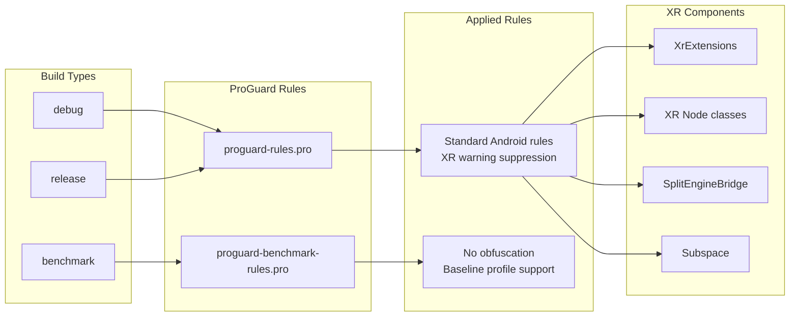
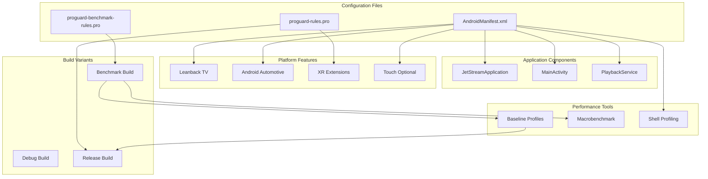

<!-- source: DeepWiki mcp.deepwiki.com · repo android/adaptive-apps-samples · page 6 Configuration · fetched 2026-10-23 -->

# Configuration

<details>
<summary>Relevant source files</summary>

The following files were used as context for generating this wiki page:

- [AdaptiveJetStream/jetstream/proguard-benchmark-rules.pro](AdaptiveJetStream/jetstream/proguard-benchmark-rules.pro)
- [AdaptiveJetStream/jetstream/proguard-rules.pro](AdaptiveJetStream/jetstream/proguard-rules.pro)
- [AdaptiveJetStream/jetstream/src/main/AndroidManifest.xml](AdaptiveJetStream/jetstream/src/main/AndroidManifest.xml)

</details>


## Purpose and Scope

This document covers the application configuration for AdaptiveJetStream, including Android manifest settings, ProGuard rules, and build-time configuration. For information about build system configuration and Gradle setup, see [Build System](#5). For dependency management details, see [Dependencies](#5.1).

## Android Manifest Configuration

The AdaptiveJetStream application uses a comprehensive Android manifest configuration to support multiple device types and form factors. The manifest defines feature requirements, permissions, and application components.

### Application Declaration

The application is configured with the `JetStreamApplication` class as the main entry point, enabling dependency injection through Hilt and providing global application context.

```xml
<application
    android:name=".JetStreamApplication"
    android:allowBackup="true"
    android:banner="@mipmap/app_banner"
    android:theme="@style/Theme.App.Starting">
```

*Sources: [AdaptiveJetStream/jetstream/src/main/AndroidManifest.xml:48-57]()*

### Multi-Platform Feature Support

The application declares optional hardware and software features to ensure compatibility across different Android device categories:

| Feature | Required | Purpose |
|---------|----------|---------|
| `android.software.leanback` | false | Android TV support |
| `android.hardware.touchscreen` | false | Non-touch device compatibility |
| `android.hardware.type.automotive` | false | Android Automotive support |
| `android.hardware.wifi` | false | Offline capability |
| `android.hardware.screen.portrait` | false | Flexible orientation support |
| `android.hardware.screen.landscape` | false | Flexible orientation support |

*Sources: [AdaptiveJetStream/jetstream/src/main/AndroidManifest.xml:20-42]()*

### Application Components

#### MainActivity Configuration

The main activity supports multiple launcher categories and includes default window sizing for devices that support freeform windows:

```xml
<activity
    android:name=".MainActivity"
    android:exported="true"
    android:theme="@style/Theme.App.Starting">
    <intent-filter>
        <action android:name="android.intent.action.MAIN" />
        <category android:name="android.intent.category.LAUNCHER" />
        <category android:name="android.intent.category.LEANBACK_LAUNCHER" />
    </intent-filter>
    <layout
        android:defaultWidth="960dp"
        android:defaultHeight="540dp"
        android:gravity="center" />
</activity>
```

*Sources: [AdaptiveJetStream/jetstream/src/main/AndroidManifest.xml:70-86]()*

#### PlaybackService Configuration

The media playback service is configured as a foreground service with Media3 session support:

```xml
<service
    android:name=".PlaybackService"
    android:foregroundServiceType="mediaPlayback"
    android:exported="true">
    <intent-filter>
        <action android:name="androidx.media3.session.MediaSessionService"/>
        <action android:name="android.media.browse.MediaBrowserService"/>
    </intent-filter>
</service>
```

*Sources: [AdaptiveJetStream/jetstream/src/main/AndroidManifest.xml:88-96]()*

### Android Manifest Component Architecture

```mermaid
graph TB
    subgraph "AndroidManifest.xml"
        MANIFEST["manifest"]
        FEATURES["uses-feature declarations"]
        PERMISSIONS["uses-permission declarations"]
        APPLICATION["application"]
    end
    
    subgraph "Application Components"
        APP_CLASS["JetStreamApplication"]
        MAIN_ACTIVITY["MainActivity"]
        PLAYBACK_SERVICE["PlaybackService"]
        AUTOMOTIVE_META["automotive metadata"]
    end
    
    subgraph "Platform Support"
        LEANBACK["android.software.leanback"]
        TOUCHSCREEN["android.hardware.touchscreen"]
        AUTOMOTIVE["android.hardware.type.automotive"]
        WIFI["android.hardware.wifi"]
        PORTRAIT["android.hardware.screen.portrait"]
        LANDSCAPE["android.hardware.screen.landscape"]
    end
    
    subgraph "Intent Filters"
        MAIN_INTENT["android.intent.action.MAIN"]
        LAUNCHER["android.intent.category.LAUNCHER"]
        LEANBACK_LAUNCHER["android.intent.category.LEANBACK_LAUNCHER"]
        MEDIA_SESSION["androidx.media3.session.MediaSessionService"]
        MEDIA_BROWSER["android.media.browse.MediaBrowserService"]
    end
    
    MANIFEST --> FEATURES
    MANIFEST --> PERMISSIONS
    MANIFEST --> APPLICATION
    
    APPLICATION --> APP_CLASS
    APPLICATION --> MAIN_ACTIVITY
    APPLICATION --> PLAYBACK_SERVICE
    APPLICATION --> AUTOMOTIVE_META
    
    FEATURES --> LEANBACK
    FEATURES --> TOUCHSCREEN
    FEATURES --> AUTOMOTIVE
    FEATURES --> WIFI
    FEATURES --> PORTRAIT
    FEATURES --> LANDSCAPE
    
    MAIN_ACTIVITY --> MAIN_INTENT
    MAIN_ACTIVITY --> LAUNCHER
    MAIN_ACTIVITY --> LEANBACK_LAUNCHER
    
    PLAYBACK_SERVICE --> MEDIA_SESSION
    PLAYBACK_SERVICE --> MEDIA_BROWSER
```



*Sources: [AdaptiveJetStream/jetstream/src/main/AndroidManifest.xml:1-99]()*

### Permissions and Security

The application requires minimal permissions to maintain security while enabling core functionality:

- `android.permission.INTERNET` - Network access for content streaming
- `android.permission.FOREGROUND_SERVICE` - Background media playback
- `android.permission.FOREGROUND_SERVICE_MEDIA_PLAYBACK` - Media-specific foreground service

The application also enables `android:usesCleartextTraffic="true"` for development and testing purposes.

*Sources: [AdaptiveJetStream/jetstream/src/main/AndroidManifest.xml:44-46,58]()*

### Performance and Development Configuration

The manifest includes performance optimization settings:

- `<profileable android:shell="true">` - Enables profiling by macrobenchmark tools
- Automotive metadata reference - `@xml/automotive_app_desc`
- Default window layout for multi-window support

*Sources: [AdaptiveJetStream/jetstream/src/main/AndroidManifest.xml:61-68,81-84]()*

## ProGuard Configuration

AdaptiveJetStream uses two ProGuard configuration files to handle code optimization and obfuscation for different build scenarios.

### Standard ProGuard Rules

The main ProGuard configuration ([AdaptiveJetStream/jetstream/proguard-rules.pro]()) includes standard Android ProGuard rules with additional warnings suppression for XR (Extended Reality) components:

```pro
-dontwarn com.android.extensions.xr.XrExtensionResult
-dontwarn com.android.extensions.xr.XrExtensions
-dontwarn com.android.extensions.xr.function.Consumer
-dontwarn com.android.extensions.xr.node.InputEvent$HitInfo
-dontwarn com.android.extensions.xr.node.InputEvent
-dontwarn com.android.extensions.xr.node.Mat4f
-dontwarn com.android.extensions.xr.node.Node
-dontwarn com.android.extensions.xr.node.NodeTransaction
-dontwarn com.android.extensions.xr.node.NodeTransform
-dontwarn com.android.extensions.xr.node.Vec3
-dontwarn com.android.extensions.xr.splitengine.SplitEngineBridge
-dontwarn com.android.extensions.xr.subspace.Subspace
```

*Sources: [AdaptiveJetStream/jetstream/proguard-rules.pro:23-34]()*

### Benchmark-Specific ProGuard Rules

The benchmark ProGuard configuration ([AdaptiveJetStream/jetstream/proguard-benchmark-rules.pro]()) disables obfuscation to maintain proper method and class names for baseline profile generation:

```pro
# When generating the baseline profile we want the proper names of
# the methods and classes
-dontobfuscate
```

*Sources: [AdaptiveJetStream/jetstream/proguard-benchmark-rules.pro:23-25]()*

### ProGuard Configuration Flow



*Sources: [AdaptiveJetStream/jetstream/proguard-rules.pro:1-34](), [AdaptiveJetStream/jetstream/proguard-benchmark-rules.pro:1-25]()*

## Configuration Integration

The configuration system integrates multiple aspects of the application setup:

### Configuration Component Relationships



*Sources: [AdaptiveJetStream/jetstream/src/main/AndroidManifest.xml:1-99](), [AdaptiveJetStream/jetstream/proguard-rules.pro:1-34](), [AdaptiveJetStream/jetstream/proguard-benchmark-rules.pro:1-25]()*

The configuration system ensures that AdaptiveJetStream can adapt to various Android platforms while maintaining optimal performance through appropriate build-time optimizations and runtime feature detection.

---

