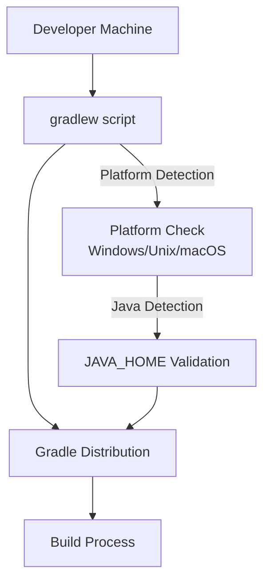
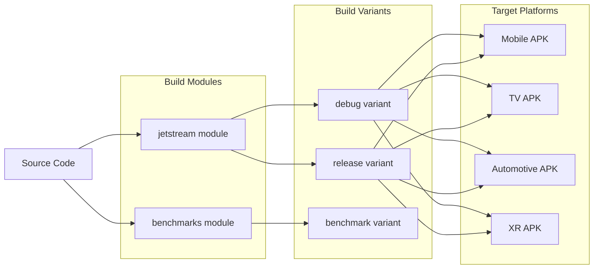
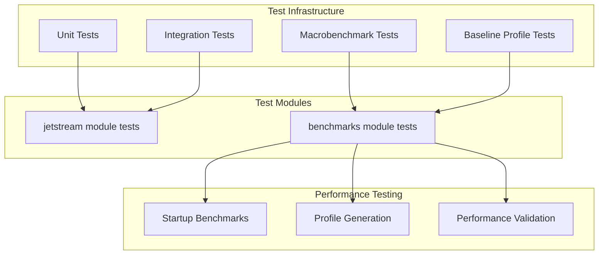
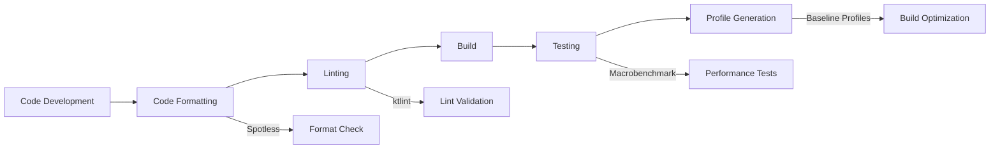

<!-- source: DeepWiki mcp.deepwiki.com · repo android/adaptive-apps-samples · page 7 Development Setup · fetched 2026-10-23 -->

# Development Setup

<details>
<summary>Relevant source files</summary>

The following files were used as context for generating this wiki page:

- [AdaptiveJetStream/README.md](AdaptiveJetStream/README.md)
- [AdaptiveJetStream/gradle.properties](AdaptiveJetStream/gradle.properties)
- [AdaptiveJetStream/gradlew](AdaptiveJetStream/gradlew)

</details>


This document provides a comprehensive guide for setting up the development environment, building the AdaptiveJetStream project, and running tests. It covers the essential steps needed to get started with development on this adaptive media streaming application.

For detailed information about the build system configuration, see [Build System](#5). For dependency management specifics, see [Dependencies](#5.1). For code quality enforcement and formatting rules, see [Code Quality](#5.3).

## Prerequisites

The AdaptiveJetStream project requires specific tools and environment setup to build and run successfully across multiple form factors.

### Required Software

| Component | Requirement | Purpose |
|-----------|-------------|---------|
| Android Studio | Latest stable version | Primary IDE for development |
| Java Development Kit | JDK 8 or higher | Required for Gradle and Android builds |
| Android SDK | API levels 28-35 | Target platform support |
| Git | Latest version | Version control |

### Platform-Specific Requirements

For **XR development**, additional setup is required following the [XR Jetpack SDK setup documentation](https://developer.android.com/develop/xr/jetpack-xr-sdk/setup) as referenced in [AdaptiveJetStream/README.md:20]().

For **TV development**, ensure Android TV system images are installed in the Android SDK Manager.

Sources: [AdaptiveJetStream/README.md:17-21]()

## Environment Configuration

### Gradle Configuration

The project uses specific Gradle settings optimized for performance and compatibility. The main configuration is defined in [AdaptiveJetStream/gradle.properties:1-19]():

```
org.gradle.jvmargs=-Xmx4096m -Dfile.encoding=UTF-8
android.useAndroidX=true
kotlin.code.style=official
```

### JVM Memory Settings

The Gradle daemon is configured with 4GB of heap memory to handle the complex build process across multiple modules and form factors. This setting in [AdaptiveJetStream/gradle.properties:9]() ensures stable builds for the adaptive UI components and baseline profile generation.

Sources: [AdaptiveJetStream/gradle.properties:1-19]()

## Project Setup

### Repository Cloning

```bash
git clone https://github.com/android/adaptive-apps-samples
cd adaptive-apps-samples/AdaptiveJetStream
```

### Gradle Wrapper Verification

The project includes a Gradle wrapper script that ensures consistent build environments across different development machines. The wrapper is located at [AdaptiveJetStream/gradlew:1-246]() and handles platform-specific execution.



**Development Environment Setup Flow**

Sources: [AdaptiveJetStream/gradlew:1-246](), [AdaptiveJetStream/gradle.properties:1-19]()

## Building the Application

### Build Targets

The AdaptiveJetStream project supports multiple build configurations for different form factors and optimization levels.



**Build Configuration and Target Matrix**

### Basic Build Commands

```bash
# Build debug version
./gradlew assembleDebug

# Build release version with baseline profiles
./gradlew assembleRelease

# Build all variants
./gradlew build

# Clean build
./gradlew clean build
```

### Platform-Specific Builds

```bash
# Mobile/Tablet build
./gradlew :jetstream:assembleDebug

# TV-optimized build
./gradlew :jetstream:assembleTvDebug

# XR build (requires XR SDK setup)
./gradlew :jetstream:assembleXrDebug
```

Sources: [AdaptiveJetStream/README.md:21](), [AdaptiveJetStream/gradlew:1-246]()

## Running Tests

### Test Categories

The project includes comprehensive testing infrastructure across multiple modules:



**Testing Architecture Overview**

### Test Execution Commands

```bash
# Run all unit tests
./gradlew test

# Run instrumentation tests
./gradlew connectedAndroidTest

# Run macrobenchmark tests
./gradlew :benchmarks:connectedBenchmarkAndroidTest

# Generate baseline profiles
./gradlew :benchmarks:generateBaselineProfile
```

### Baseline Profile Generation

The project includes automated baseline profile generation as described in [AdaptiveJetStream/README.md:25-29](). This process requires connected devices or emulators:

```bash
# Generate baseline profiles with connected device
./gradlew :benchmarks:generateReleaseBaselineProfile

# Validate baseline profile application
./gradlew :jetstream:validateBaselineProfile
```

Sources: [AdaptiveJetStream/README.md:23-29]()

## Development Workflow

### Code Quality Integration

The development workflow integrates automated code quality checks and formatting. For detailed configuration, see [Code Quality](#5.3).



**Development Workflow Pipeline**

### IDE Configuration

#### Android Studio Setup

1. **Import Project**: Open Android Studio and select "Open an existing Android Studio project"
2. **SDK Configuration**: Ensure Android SDK levels 28-35 are installed
3. **Build Variants**: Configure build variants for target form factors
4. **Run Configurations**: Set up run configurations for different device types

#### Build Configuration Sync

After importing, Android Studio will automatically sync the project using the Gradle wrapper configuration from [AdaptiveJetStream/gradle.properties:1-19]().

### Multi-Platform Development

The adaptive nature of the application requires testing across multiple form factors during development:

| Form Factor | Emulator/Device Setup | Key Testing Areas |
|-------------|----------------------|-------------------|
| Mobile | Standard Android emulator | Portrait/landscape orientation |
| Tablet | Large screen emulator | Multi-pane layouts |
| TV | Android TV emulator | D-pad navigation |
| Automotive | Automotive emulator | Driver-safe UI |
| XR | XR emulator (requires setup) | 3D spatial interactions |
| Foldable | Foldable emulator | Fold/unfold transitions |

Sources: [AdaptiveJetStream/README.md:5-11](), [AdaptiveJetStream/gradle.properties:1-19]()

## Troubleshooting

### Common Build Issues

#### Memory Issues
If builds fail due to memory constraints, verify the JVM memory settings in [AdaptiveJetStream/gradle.properties:9]():
```
org.gradle.jvmargs=-Xmx4096m -Dfile.encoding=UTF-8
```

#### Gradle Wrapper Issues
If the Gradle wrapper fails to execute, ensure the script has proper permissions:
```bash
chmod +x gradlew
```

#### XR Build Issues
For XR-related build failures, verify that the XR SDK setup is complete as referenced in [AdaptiveJetStream/README.md:20]().

### Performance Optimization

For performance-related issues during development, the project includes comprehensive benchmarking tools. See [Performance Optimization](#4) for detailed information about baseline profiles and performance measurement.

### Dependency Resolution

For dependency-related build issues, consult the [Dependencies](#5.1) documentation which covers the version catalog system and library management.

Sources: [AdaptiveJetStream/gradle.properties:9](), [AdaptiveJetStream/README.md:20](), [AdaptiveJetStream/gradlew:1-246]()

---

