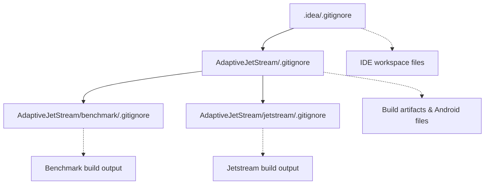
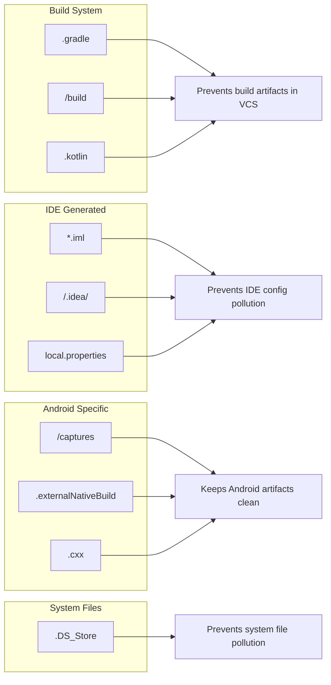

<!-- source: DeepWiki mcp.deepwiki.com · repo android/adaptive-apps-samples · page 8 Version Control · fetched 2026-10-23 -->

# Version Control

<details>
<summary>Relevant source files</summary>

The following files were used as context for generating this wiki page:

- [.idea/.gitignore](.idea/.gitignore)
- [AdaptiveJetStream/.gitignore](AdaptiveJetStream/.gitignore)
- [AdaptiveJetStream/benchmark/.gitignore](AdaptiveJetStream/benchmark/.gitignore)
- [AdaptiveJetStream/jetstream/.gitignore](AdaptiveJetStream/jetstream/.gitignore)

</details>


This document covers the version control configuration for the AdaptiveJetStream project, specifically focusing on Git ignore patterns and the hierarchical structure of `.gitignore` files throughout the codebase. The project uses a multi-level ignore strategy to handle different types of generated files, build artifacts, and development environment configurations.

For information about the overall project structure and build system, see [Build System](#5). For details about development environment setup, see [Development Setup](#7).

## Gitignore File Hierarchy

The AdaptiveJetStream project employs a hierarchical `.gitignore` structure with different ignore patterns applied at various levels of the project tree.

### Gitignore Structure Overview



Sources: [.idea/.gitignore:1-4](), [AdaptiveJetStream/.gitignore:1-11](), [AdaptiveJetStream/benchmark/.gitignore:1-2](), [AdaptiveJetStream/jetstream/.gitignore:1-1]()

## Main Project Ignore Patterns

The primary `.gitignore` file at `AdaptiveJetStream/.gitignore` contains the most comprehensive set of ignore patterns, covering Android development artifacts, build outputs, and system-specific files.

### Android Development Artifacts

| Pattern | Purpose | Description |
|---------|---------|-------------|
| `*.iml` | IntelliJ modules | Auto-generated module files |
| `.gradle` | Gradle daemon | Gradle wrapper and cache files |
| `/build` | Build output | Compiled artifacts and intermediates |
| `/captures` | Performance captures | Android Studio performance profiling data |
| `.externalNativeBuild` | NDK builds | Native code build artifacts |
| `.cxx` | C++ builds | C++ compilation artifacts |

### System and IDE Files

| Pattern | Purpose | Description |
|---------|---------|-------------|
| `.DS_Store` | macOS system | macOS file system metadata |
| `/.idea/` | IntelliJ IDEA | IDE project configuration |
| `local.properties` | Local config | Machine-specific SDK paths |
| `.kotlin` | Kotlin compiler | Kotlin compilation cache |

Sources: [AdaptiveJetStream/.gitignore:1-11]()

### Ignore Pattern Categories



Sources: [AdaptiveJetStream/.gitignore:1-11]()

## Module-Specific Ignore Patterns

Individual modules within the project have their own `.gitignore` files that focus on module-specific build artifacts.

### Benchmark Module

The benchmark module uses a minimal ignore pattern focusing solely on build output:

```
build
```

This pattern ignores the local build directory generated during benchmark compilation and test execution.

Sources: [AdaptiveJetStream/benchmark/.gitignore:1-2]()

### Jetstream Module

The main application module follows the same pattern:

```
/build
```

The leading slash ensures this pattern only matches the build directory at the root of the module, not nested build directories.

Sources: [AdaptiveJetStream/jetstream/.gitignore:1-1]()

## IDE Workspace Configuration

The `.idea/.gitignore` file specifically handles IntelliJ IDEA workspace files that should not be shared between developers.

### IDE-Specific Patterns

| Pattern | Purpose |
|---------|---------|
| `/shelf/` | Local shelved changes |
| `/workspace.xml` | Workspace state and layout |

These files contain developer-specific IDE state and should remain local to each development environment.

Sources: [.idea/.gitignore:1-4]()

## Version Control Best Practices

### Hierarchical Ignore Strategy

The project employs a layered approach to ignore patterns:

1. **Root level**: IDE workspace files that affect the entire project
2. **Project level**: Main Android development artifacts and system files
3. **Module level**: Build artifacts specific to individual modules

### Pattern Specificity

Different modules use different path specifications:
- **Absolute paths** (`/build`): Match only at module root
- **Relative paths** (`build`): Match at any level within the module
- **Wildcards** (`*.iml`): Match file extensions throughout the tree

### Maintained Artifacts

The version control configuration ensures that only source code and configuration files are tracked, while excluding:
- Generated build artifacts
- IDE-specific configuration
- Machine-specific paths and settings
- Temporary files and caches

Sources: [.idea/.gitignore:1-4](), [AdaptiveJetStream/.gitignore:1-11](), [AdaptiveJetStream/benchmark/.gitignore:1-2](), [AdaptiveJetStream/jetstream/.gitignore:1-1]()

---

