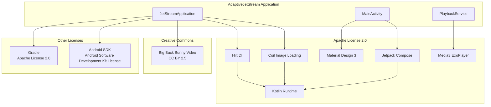
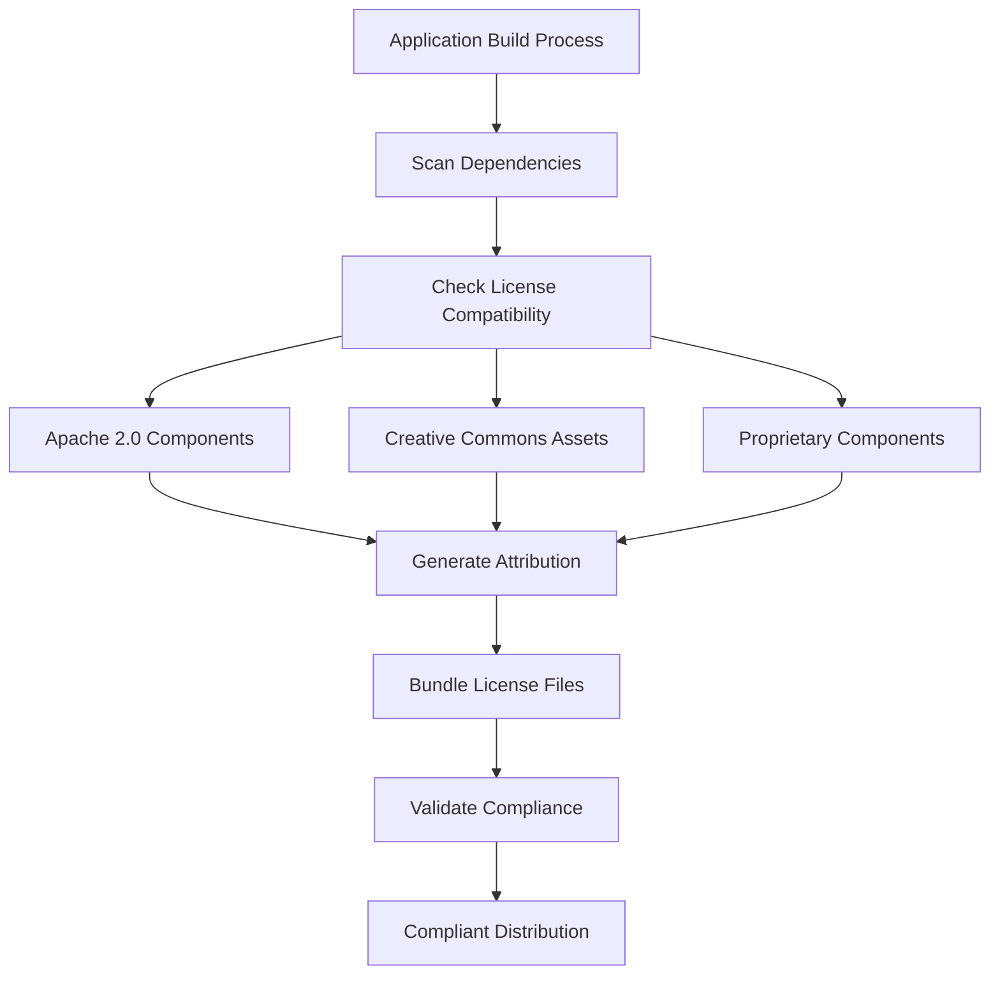

<!-- source: DeepWiki mcp.deepwiki.com · repo android/adaptive-apps-samples · page 9 Legal · fetched 2026-10-23 -->

# Legal

Relevant source files

The following files were used as context for generating this wiki page:

- [AdaptiveJetStream/LICENSES.md](AdaptiveJetStream/LICENSES.md)

This document provides comprehensive legal information for the AdaptiveJetStream project, including third-party licenses, copyright notices, and legal compliance requirements. It covers all external dependencies and assets that require legal attribution or have specific licensing terms that affect distribution and usage.

For information about build dependencies and version management, see [Dependencies](#5.1). For project configuration details, see [Configuration](#6).

## Third-Party Licenses Overview

The AdaptiveJetStream project incorporates several third-party libraries and assets that require specific license compliance. All dependencies must be properly attributed according to their respective license terms to ensure legal distribution of the application.

## License Dependencies Architecture

Sources: [AdaptiveJetStream/LICENSES.md:1-25]()

## License Compliance Matrix

| Component | License Type | Attribution Required | Source Code Access | Commercial Use |
|-----------|--------------|---------------------|-------------------|----------------|
| Coil | Apache 2.0 | Yes | Optional | Permitted |
| Big Buck Bunny | CC BY 2.5 | Yes | N/A | Permitted |
| Jetpack Compose | Apache 2.0 | Yes | Optional | Permitted |
| Media3 ExoPlayer | Apache 2.0 | Yes | Optional | Permitted |
| Hilt | Apache 2.0 | Yes | Optional | Permitted |
| Kotlin | Apache 2.0 | Yes | Optional | Permitted |

## Detailed License Information

### Coil Image Loading Library

Coil is used throughout the application for image loading and caching functionality, particularly in the movie catalog and detail views.

**License**: Apache License 2.0  
**Copyright**: Copyright 2022 Coil Contributors  
**Usage**: Image loading in `MovieRepository` and UI components  
**License Text**: [AdaptiveJetStream/LICENSES.md:3-17]()

### Big Buck Bunny Video Content

The Big Buck Bunny video is used as sample media content for demonstrating the application's video playback capabilities.

**License**: Creative Commons Attribution 2.5  
**Copyright**: (c) copyright 2008, Blender Foundation / www.bigbuckbunny.org  
**Usage**: Sample video content for media playback testing  
**License Text**: [AdaptiveJetStream/LICENSES.md:19-24]()

## License Compliance Flow

Sources: [AdaptiveJetStream/LICENSES.md:1-25]()

## Attribution Requirements

### Apache License 2.0 Components

All Apache 2.0 licensed components require:
1. Retention of copyright notices
2. Retention of license text
3. Disclaimer of warranty
4. Limitation of liability

### Creative Commons Attribution 2.5

The Big Buck Bunny video requires:
1. Attribution to Blender Foundation
2. Link to original source (www.bigbuckbunny.org)
3. Indication of license type (CC BY 2.5)

## Legal Compliance Implementation

### Build Integration

The project's build system should automatically validate license compliance during the build process. This includes:

- Dependency license scanning
- Attribution file generation
- License compatibility validation
- Distribution package compliance

### Documentation Requirements

All distributed versions of AdaptiveJetStream must include:

1. Complete license text for all third-party components
2. Copyright notices for all dependencies
3. Attribution for Creative Commons assets
4. Link to full license documentation

## Distribution Considerations

### Application Store Distribution

When distributing through application stores (Google Play, etc.):
- Include `LICENSES.md` in application bundle
- Provide in-app license viewer if required
- Ensure all attributions are accessible to end users

### Source Code Distribution

When distributing source code:
- Maintain all license headers in source files
- Include complete license documentation
- Preserve all copyright notices
- Provide clear attribution for all third-party components

Sources: [AdaptiveJetStream/LICENSES.md:1-25]()