# Page: Overview

# Overview

<details>
<summary>Relevant source files</summary>

The following files were used as context for generating this wiki page:

- [AdaptiveJetStream/README.md](AdaptiveJetStream/README.md)
- [AdaptiveJetStream/Screenshots.png](AdaptiveJetStream/Screenshots.png)
- [AdaptiveJetStream/jetstream/src/main/AndroidManifest.xml](AdaptiveJetStream/jetstream/src/main/AndroidManifest.xml)

</details>


## Purpose and Scope

This document provides a high-level overview of the AdaptiveJetStream sample application, which demonstrates cross-platform media streaming with adaptive UI capabilities across multiple Android form factors. This overview covers the application's purpose, key features, architecture, and technology stack.

For detailed information about specific subsystems, see [Architecture](#2) for core components, [User Interface](#3) for adaptive UI implementation, [Performance Optimization](#4) for baseline profiles and benchmarking, and [Build System](#5) for Gradle configuration and dependencies.

## What is AdaptiveJetStream

AdaptiveJetStream is a sample media streaming application designed to demonstrate adaptive user experiences across diverse Android form factors using a single binary. The application showcases how to build modern Android apps that automatically adapt their interface and behavior to different device characteristics while maintaining a cohesive user experience.

The application serves as a practical implementation guide for developers building cross-platform Android applications that need to work seamlessly across mobile devices, tablets, foldables, Chromebooks, Android TV, automotive systems, and XR devices.

**Sources:** [AdaptiveJetStream/README.md:1-15]()

## Key Features and Capabilities

| Feature Category | Capabilities |
|-----------------|-------------|
| **Adaptive UI** | Automatic layout adaptation using Compose Material3 components and window size classes |
| **Media Playback** | Full-featured video streaming using ExoPlayer and Media3 session management |
| **Cross-Platform** | Single binary supporting mobile, tablet, foldable, TV, automotive, and XR form factors |
| **Performance** | Baseline profile optimization for improved startup performance |
| **Modern Architecture** | Jetpack Compose UI with Hilt dependency injection and modern Android patterns |

### Supported Form Factors

AdaptiveJetStream supports the following device categories:

- **Mobile devices** - Phones with touch interfaces
- **Tablets** - Larger touch-enabled devices  
- **Foldable devices** - Devices with flexible or dual screens
- **Chromebooks** - Chrome OS devices with keyboard/mouse input
- **Android TV** - Television devices with D-pad navigation
- **Automotive** - Android Auto and Android Automotive OS
- **XR devices** - Augmented and virtual reality platforms

**Sources:** [AdaptiveJetStream/README.md:5-11](), [AdaptiveJetStream/jetstream/src/main/AndroidManifest.xml:20-42]()

## System Architecture Overview

The following diagram illustrates the high-level system architecture and relationships between major components:

### Core Application Architecture

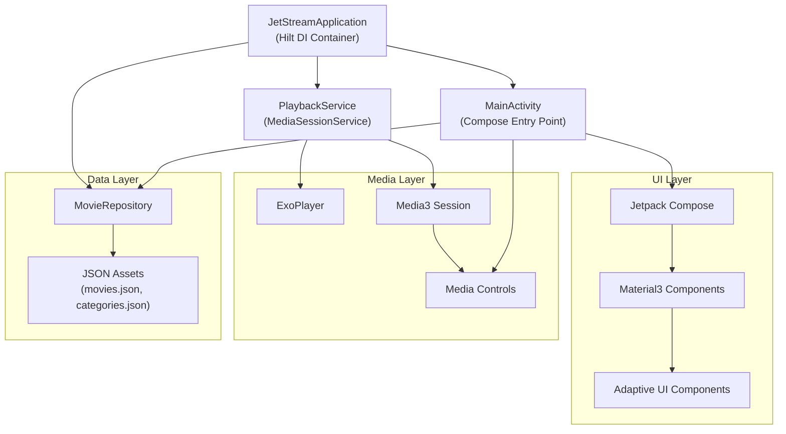

**Sources:** [AdaptiveJetStream/jetstream/src/main/AndroidManifest.xml:48-96](), [AdaptiveJetStream/README.md:3-4](), [AdaptiveJetStream/README.md:15]()

## Platform Configuration Matrix

The application uses feature declarations and permissions to support different platform capabilities:

| Platform Feature | Required | Purpose |
|------------------|----------|---------|
| `android.software.leanback` | false | Android TV support |
| `android.hardware.touchscreen` | false | Touch input (optional for TV/automotive) |
| `android.hardware.type.automotive` | false | Android Automotive platform |
| `android.hardware.wifi` | false | Network connectivity |
| `android.hardware.screen.portrait` | false | Portrait orientation support |
| `android.hardware.screen.landscape` | false | Landscape orientation support |

### Required Permissions

- `android.permission.INTERNET` - Network access for streaming
- `android.permission.FOREGROUND_SERVICE` - Background media playback
- `android.permission.FOREGROUND_SERVICE_MEDIA_PLAYBACK` - Media-specific foreground service

**Sources:** [AdaptiveJetStream/jetstream/src/main/AndroidManifest.xml:20-46]()

## Core Code Structure

The following diagram maps the application's logical components to specific code entities:

### Code Entity Relationships

```mermaid
graph LR
    subgraph "Application_Layer" ["Application Layer"]
        JetStreamApplication_class["JetStreamApplication<br/>(Application Class)"]
        MainActivity_class["MainActivity<br/>(ComponentActivity)"]
    end
    
    subgraph "Service_Layer" ["Service Layer"] 
        PlaybackService_class["PlaybackService<br/>(MediaSessionService)"]
        MediaSessionService_interface["MediaSessionService<br/>(Interface)"]
        MediaBrowserService_interface["MediaBrowserService<br/>(Interface)"]
    end
    
    subgraph "Intent_Filters" ["Intent System"]
        MAIN_action["android.intent.action.MAIN"]
        LAUNCHER_category["android.intent.category.LAUNCHER"]
        LEANBACK_LAUNCHER_category["android.intent.category.LEANBACK_LAUNCHER"]
        MediaSession_action["androidx.media3.session.MediaSessionService"]
        MediaBrowser_action["android.media.browse.MediaBrowserService"]
    end
    
    subgraph "Resource_System" ["Resource System"]
        app_name["@string/app_name"]
        ic_launcher["@mipmap/ic_launcher"]
        app_banner["@mipmap/app_banner"]
        Theme_App_Starting["@style/Theme.App.Starting"]
    end
    
    JetStreamApplication_class --> MainActivity_class
    JetStreamApplication_class --> PlaybackService_class
    
    MainActivity_class --> MAIN_action
    MainActivity_class --> LAUNCHER_category
    MainActivity_class --> LEANBACK_LAUNCHER_category
    
    PlaybackService_class --> MediaSessionService_interface
    PlaybackService_class --> MediaBrowserService_interface
    PlaybackService_class --> MediaSession_action
    PlaybackService_class --> MediaBrowser_action
    
    MainActivity_class --> Theme_App_Starting
    JetStreamApplication_class --> ic_launcher
    JetStreamApplication_class --> app_banner
    JetStreamApplication_class --> app_name
```

**Sources:** [AdaptiveJetStream/jetstream/src/main/AndroidManifest.xml:49-96]()

## Technology Stack

AdaptiveJetStream leverages modern Android development technologies and libraries:

### Core Technologies

- **UI Framework**: Jetpack Compose with Material3 adaptive components
- **Dependency Injection**: Hilt for dependency management  
- **Media Playback**: Media3 ExoPlayer with session management
- **Performance**: Baseline profiles for optimized app startup
- **Architecture**: Repository pattern with modern Android architecture components

### Development Tools

- **Build System**: Gradle with Kotlin DSL
- **Code Quality**: Spotless formatting with ktlint rules
- **Testing**: Macrobenchmark library for performance testing
- **Profiling**: Baseline profile generation and validation

### Cross-Platform Support

The application demonstrates adaptive design patterns using:
- Window size classes for responsive layouts
- Material3 adaptive navigation components
- Platform-specific optimizations for TV, automotive, and XR

**Sources:** [AdaptiveJetStream/README.md:15](), [AdaptiveJetStream/README.md:23-29](), [AdaptiveJetStream/jetstream/src/main/AndroidManifest.xml:61-64]()

---

# Page: Architecture

# Architecture

<details>
<summary>Relevant source files</summary>

The following files were used as context for generating this wiki page:

- [AdaptiveJetStream/jetstream/src/main/java/com/google/jetstream/JetStreamApplication.kt](AdaptiveJetStream/jetstream/src/main/java/com/google/jetstream/JetStreamApplication.kt)
- [AdaptiveJetStream/jetstream/src/main/java/com/google/jetstream/MainActivity.kt](AdaptiveJetStream/jetstream/src/main/java/com/google/jetstream/MainActivity.kt)
- [AdaptiveJetStream/jetstream/src/main/java/com/google/jetstream/PlaybackService.kt](AdaptiveJetStream/jetstream/src/main/java/com/google/jetstream/PlaybackService.kt)

</details>


This document provides an overview of the AdaptiveJetStream application's core architecture, including its primary components, design patterns, and system interactions. It covers the high-level structure and relationships between major subsystems.

For detailed information about specific subsystems, see [Application Structure](#2.1), [Media Playback System](#2.2), and [Data Layer](#2.3). For UI implementation details, see [User Interface](#3). For performance optimization strategies, see [Performance Optimization](#4).

## Architecture Overview

AdaptiveJetStream is built as a modern Android application designed for cross-platform media streaming with adaptive UI capabilities. The architecture follows clean architecture principles with clear separation of concerns across presentation, business logic, and data layers.

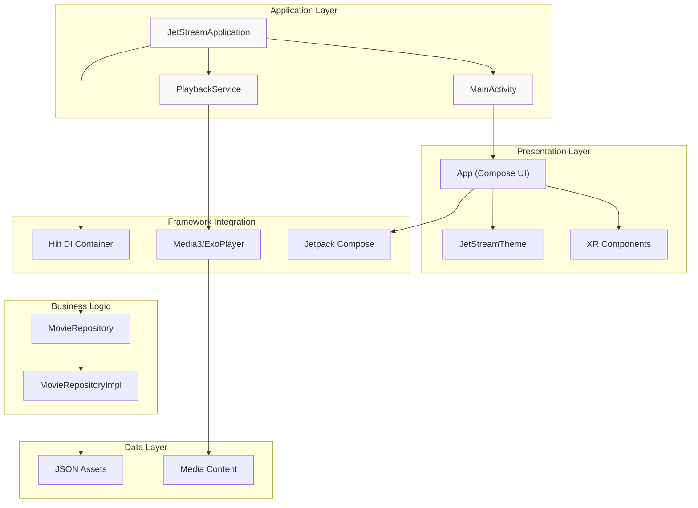

**Sources:** [AdaptiveJetStream/jetstream/src/main/java/com/google/jetstream/JetStreamApplication.kt:1-40](), [AdaptiveJetStream/jetstream/src/main/java/com/google/jetstream/MainActivity.kt:1-265](), [AdaptiveJetStream/jetstream/src/main/java/com/google/jetstream/PlaybackService.kt:1-68]()

## Core Components

The application consists of three primary components that form the foundation of the system architecture:

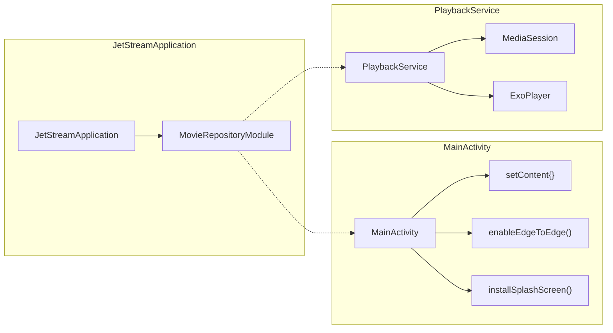

**Sources:** [AdaptiveJetStream/jetstream/src/main/java/com/google/jetstream/JetStreamApplication.kt:28-39](), [AdaptiveJetStream/jetstream/src/main/java/com/google/jetstream/MainActivity.kt:49-82](), [AdaptiveJetStream/jetstream/src/main/java/com/google/jetstream/PlaybackService.kt:29-67]()

## Application Initialization Flow

The application follows a structured initialization sequence that sets up dependency injection, UI theming, and media services:

```mermaid
sequenceDiagram
    participant System
    participant JetStreamApplication
    participant Hilt
    participant MainActivity
    participant PlaybackService
    participant App
    
    System->>JetStreamApplication: Application.onCreate()
    JetStreamApplication->>Hilt: Initialize DI Container
    Hilt->>Hilt: Bind MovieRepositoryImpl
    
    System->>MainActivity: Activity.onCreate()
    MainActivity->>MainActivity: installSplashScreen()
    MainActivity->>MainActivity: enableEdgeToEdge()
    MainActivity->>MainActivity: tryEnableCustomHeader()
    MainActivity->>App: setContent { JetStreamTheme { App() } }
    
    System->>PlaybackService: Service.onCreate()
    PlaybackService->>PlaybackService: createExoPlayer()
    PlaybackService->>PlaybackService: MediaSession.Builder().build()
```

**Sources:** [AdaptiveJetStream/jetstream/src/main/java/com/google/jetstream/JetStreamApplication.kt:28-29](), [AdaptiveJetStream/jetstream/src/main/java/com/google/jetstream/MainActivity.kt:53-82](), [AdaptiveJetStream/jetstream/src/main/java/com/google/jetstream/PlaybackService.kt:32-37]()

## Dependency Injection Architecture

The application uses Hilt for dependency injection with a clean module structure:

| Component | Responsibility | Scope |
|-----------|---------------|-------|
| `JetStreamApplication` | Application-level DI container | Singleton |
| `MovieRepositoryModule` | Provides repository implementations | Singleton |
| `MovieRepository` | Abstract repository interface | Singleton |
| `MovieRepositoryImpl` | Concrete repository implementation | Singleton |

The dependency graph is established through the `@HiltAndroidApp` annotation on `JetStreamApplication` and the `@Module` annotation on `MovieRepositoryModule`. The module uses `@Binds` to map the concrete `MovieRepositoryImpl` to the abstract `MovieRepository` interface.

**Sources:** [AdaptiveJetStream/jetstream/src/main/java/com/google/jetstream/JetStreamApplication.kt:25-39]()

## UI Framework Integration

The application integrates multiple UI frameworks to support adaptive and cross-platform experiences:

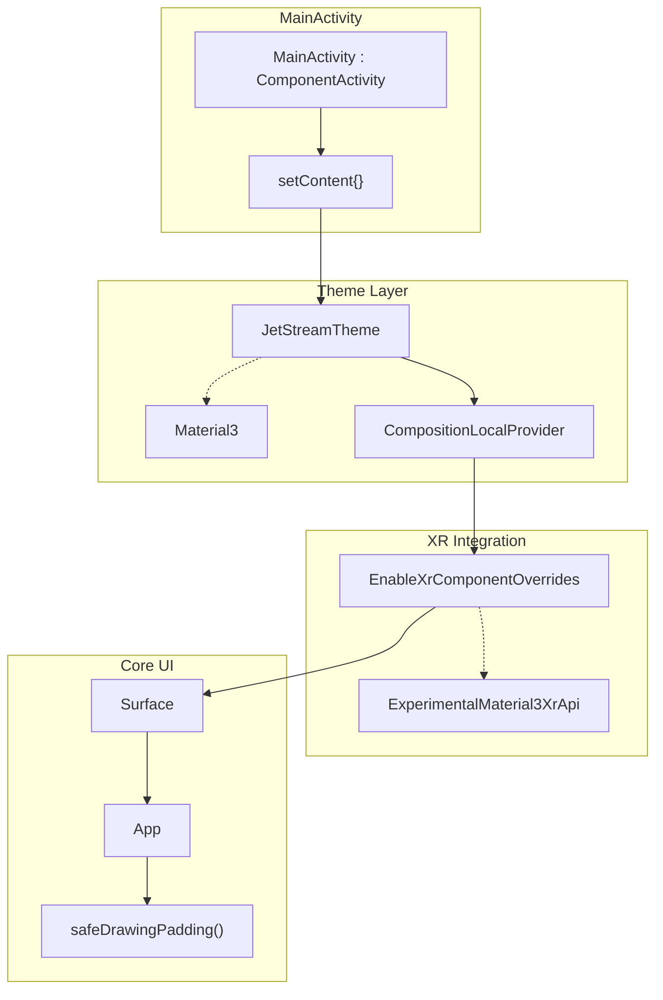

The `MainActivity` sets up the UI framework stack with XR component overrides enabled through the `@OptIn(ExperimentalMaterial3XrApi::class)` annotation. The UI uses edge-to-edge display with safe drawing padding for modern Android design guidelines.

**Sources:** [AdaptiveJetStream/jetstream/src/main/java/com/google/jetstream/MainActivity.kt:42-82]()

## Media Playback Architecture

The media playback system is built around Android's Media3 framework with ExoPlayer:

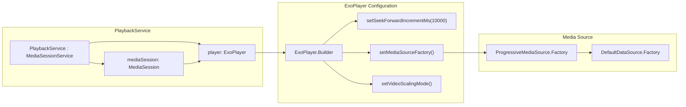

The `PlaybackService` extends `MediaSessionService` and creates an `ExoPlayer` instance with specific configurations including 10-second seek increments, progressive media source factory, and scale-to-fit-with-cropping video scaling mode. The service manages the lifecycle of both the `MediaSession` and `ExoPlayer` instances.

**Sources:** [AdaptiveJetStream/jetstream/src/main/java/com/google/jetstream/PlaybackService.kt:29-67]()

## Design Patterns

The architecture employs several key design patterns:

- **Dependency Injection**: Hilt provides compile-time dependency resolution
- **Repository Pattern**: `MovieRepository` abstracts data access
- **Service Pattern**: `PlaybackService` handles background media operations
- **Component Architecture**: Compose UI components with clear separation of concerns
- **Builder Pattern**: ExoPlayer configuration through builder pattern

The application supports advanced features including custom window headers for freeform window management, comprehensive keyboard shortcuts for navigation and media control, and XR component integration for extended reality experiences.

**Sources:** [AdaptiveJetStream/jetstream/src/main/java/com/google/jetstream/MainActivity.kt:92-117](), [AdaptiveJetStream/jetstream/src/main/java/com/google/jetstream/MainActivity.kt:119-263]()

---

# Page: Application Structure

# Application Structure

<details>
<summary>Relevant source files</summary>

The following files were used as context for generating this wiki page:

- [AdaptiveJetStream/jetstream/src/main/java/com/google/jetstream/JetStreamApplication.kt](AdaptiveJetStream/jetstream/src/main/java/com/google/jetstream/JetStreamApplication.kt)
- [AdaptiveJetStream/jetstream/src/main/java/com/google/jetstream/MainActivity.kt](AdaptiveJetStream/jetstream/src/main/java/com/google/jetstream/MainActivity.kt)

</details>


This document details the core application structure of AdaptiveJetStream, including the main application class, dependency injection configuration, and primary activity setup. It covers the initialization flow, Hilt integration, and Compose UI bootstrap process.

For information about the media playback architecture, see [Media Playback System](#2.2). For details about the data layer and repository pattern, see [Data Layer](#2.3).

## Overview

The AdaptiveJetStream application follows a standard Android architecture with modern frameworks. The application structure consists of three primary components:

- **JetStreamApplication**: The main Application class that initializes dependency injection
- **MainActivity**: The single activity that hosts the entire Compose UI
- **Hilt Module Configuration**: Dependency injection setup for core services

## Application Entry Point

The application initialization begins with the `JetStreamApplication` class, which serves as the Hilt dependency injection container for the entire application.

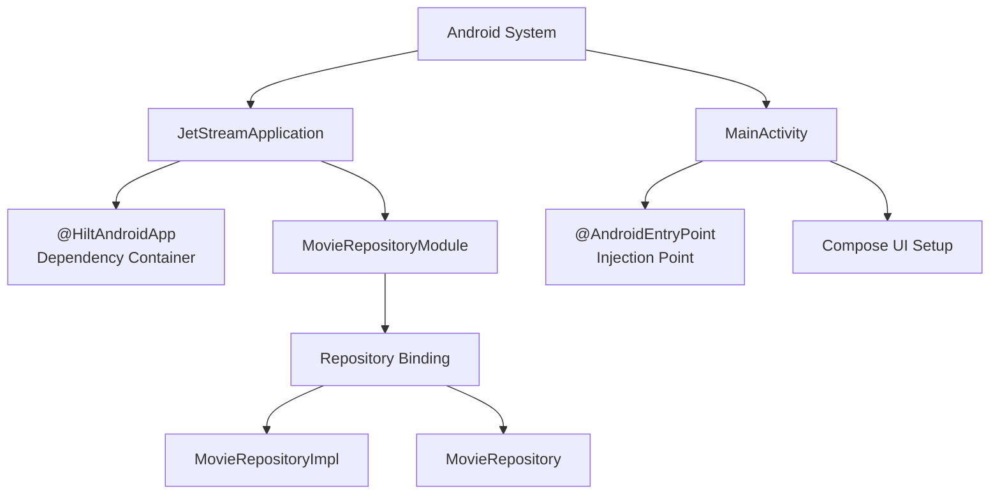

Sources: [AdaptiveJetStream/jetstream/src/main/java/com/google/jetstream/JetStreamApplication.kt:28-29](), [AdaptiveJetStream/jetstream/src/main/java/com/google/jetstream/MainActivity.kt:49-50]()

### JetStreamApplication Class

The `JetStreamApplication` class is minimal and focused solely on enabling Hilt dependency injection:

| Component | Purpose | Implementation |
|-----------|---------|----------------|
| `@HiltAndroidApp` | Enables Hilt DI | Applied at class level |
| Application inheritance | Android app lifecycle | Extends `Application` |
| Module inclusion | Repository binding | `MovieRepositoryModule` |

The application class registers the `MovieRepositoryModule` which provides the core data access abstraction used throughout the app.

Sources: [AdaptiveJetStream/jetstream/src/main/java/com/google/jetstream/JetStreamApplication.kt:28-29]()

## Dependency Injection Configuration

The Hilt module configuration defines how core dependencies are resolved and injected throughout the application.

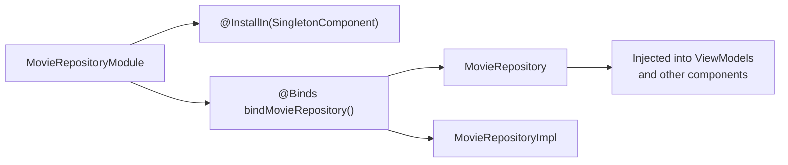

Sources: [AdaptiveJetStream/jetstream/src/main/java/com/google/jetstream/JetStreamApplication.kt:31-39]()

### Module Structure

The `MovieRepositoryModule` uses the following Hilt annotations:

- `@InstallIn(SingletonComponent::class)`: Installs the module in the application-wide singleton scope
- `@Binds`: Creates a binding from the implementation to the interface
- Abstract class structure: Allows Hilt to generate the binding code efficiently

This pattern ensures that `MovieRepository` instances are provided as singletons throughout the application lifecycle.

Sources: [AdaptiveJetStream/jetstream/src/main/java/com/google/jetstream/JetStreamApplication.kt:31-39]()

## MainActivity Structure

The `MainActivity` serves as the single entry point for the user interface, hosting the entire Compose-based application.

### Activity Initialization Flow

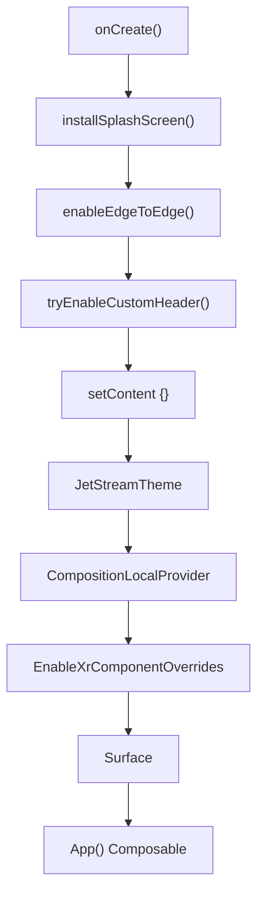

Sources: [AdaptiveJetStream/jetstream/src/main/java/com/google/jetstream/MainActivity.kt:53-82]()

### UI Framework Configuration

The activity configures multiple UI framework layers:

| Layer | Purpose | Implementation |
|-------|---------|----------------|
| Edge-to-edge | Modern display usage | `enableEdgeToEdge()` |
| Splash screen | App launch experience | `installSplashScreen()` |
| Custom header | Desktop window integration | `tryEnableCustomHeader()` |
| Material Theme | Design system | `JetStreamTheme` |
| XR Support | Extended reality | `EnableXrComponentOverrides` |
| Content color | Theme consistency | `CompositionLocalProvider` |

Sources: [AdaptiveJetStream/jetstream/src/main/java/com/google/jetstream/MainActivity.kt:54-58](), [AdaptiveJetStream/jetstream/src/main/java/com/google/jetstream/MainActivity.kt:60-81]()

## XR and Adaptive UI Integration

The application includes experimental XR support through Material3 XR APIs:

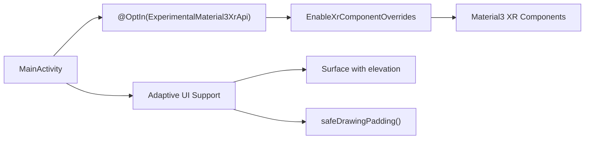

Sources: [AdaptiveJetStream/jetstream/src/main/java/com/google/jetstream/MainActivity.kt:52](), [AdaptiveJetStream/jetstream/src/main/java/com/google/jetstream/MainActivity.kt:64-78]()

## Keyboard Shortcuts System

The activity implements comprehensive keyboard shortcuts for navigation and media playback control.

### Shortcut Categories

| Category | Shortcuts | Key Combinations |
|----------|-----------|------------------|
| General Navigation | Home, Movies, Shows, etc. | `Ctrl+Alt+H`, `Ctrl+Alt+M`, etc. |
| Video Playback | Play/pause, seek, fullscreen | `K`, `J`, `L`, `F` |
| Spatial Video | Pan, zoom controls | `W`, `A`, `S`, `D`, `+`, `-` |
| Dialog Control | Close dialogs, scroll | `Escape`, `Page Up/Down` |

The keyboard shortcuts are defined in the `keyboardShortcuts` lazy property and provided through the `onProvideKeyboardShortcuts()` callback.

Sources: [AdaptiveJetStream/jetstream/src/main/java/com/google/jetstream/MainActivity.kt:84-90](), [AdaptiveJetStream/jetstream/src/main/java/com/google/jetstream/MainActivity.kt:119-263]()

## Platform Feature Detection

The activity includes adaptive behavior based on device capabilities:

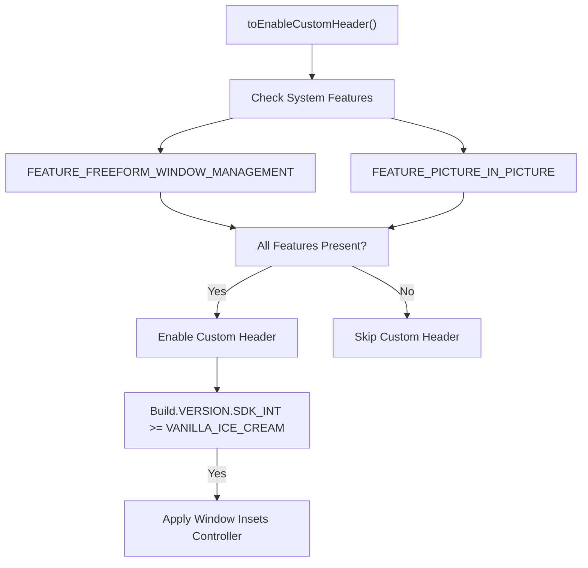

Sources: [AdaptiveJetStream/jetstream/src/main/java/com/google/jetstream/MainActivity.kt:92-117]()

This feature detection ensures that desktop-specific UI enhancements like transparent caption bars are only enabled on compatible platforms.

## Application Lifecycle Integration

The application structure integrates with Android's component lifecycle through several mechanisms:

- **Hilt Integration**: Automatic dependency injection tied to component lifecycles
- **Splash Screen**: Managed through the AndroidX SplashScreen API
- **Back Press Handling**: Delegated to the `onBackPressedDispatcher`
- **Configuration Changes**: Handled automatically by Compose and Activity

Sources: [AdaptiveJetStream/jetstream/src/main/java/com/google/jetstream/MainActivity.kt:67](), [AdaptiveJetStream/jetstream/src/main/java/com/google/jetstream/MainActivity.kt:54]()

---

# Page: Media Playback System

# Media Playback System

<details>
<summary>Relevant source files</summary>

The following files were used as context for generating this wiki page:

- [AdaptiveJetStream/jetstream/src/main/AndroidManifest.xml](AdaptiveJetStream/jetstream/src/main/AndroidManifest.xml)
- [AdaptiveJetStream/jetstream/src/main/java/com/google/jetstream/PlaybackService.kt](AdaptiveJetStream/jetstream/src/main/java/com/google/jetstream/PlaybackService.kt)

</details>


## Purpose and Scope

This document covers the media playback architecture of the AdaptiveJetStream application, focusing on the `PlaybackService` implementation and its integration with Android's Media3 framework. The system provides background media playback capabilities with external controller support for Android Auto, TV remotes, and other media control interfaces.

For information about the data structures that feed content to this playback system, see [Data Layer](#2.3). For details about the UI components that interact with media playback, see [User Interface](#3).

## Architecture Overview

The media playback system is built around Android's Media3 framework, specifically using `MediaSessionService` and `ExoPlayer` as core components. The architecture follows the recommended pattern for background media playback on Android.

### Media Playback Service Architecture

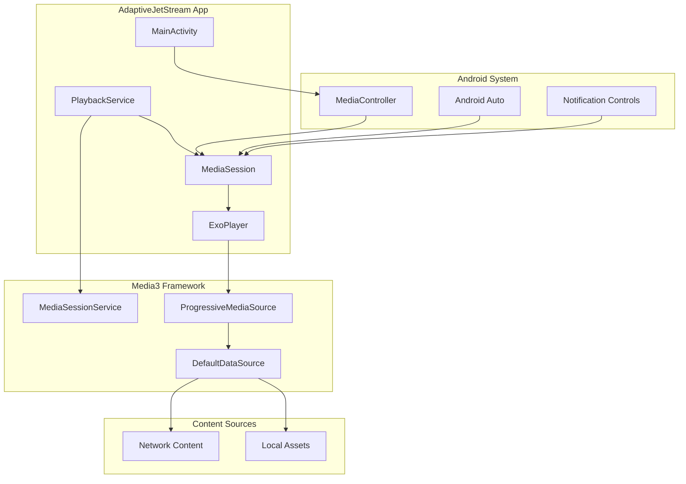

**Sources:** [AdaptiveJetStream/jetstream/src/main/java/com/google/jetstream/PlaybackService.kt:29-67](), [AdaptiveJetStream/jetstream/src/main/AndroidManifest.xml:88-96]()

## Service Implementation

### PlaybackService Class Structure

The `PlaybackService` extends `MediaSessionService` and manages the lifecycle of media playback sessions. The service maintains a single `MediaSession` instance that controls an `ExoPlayer`.

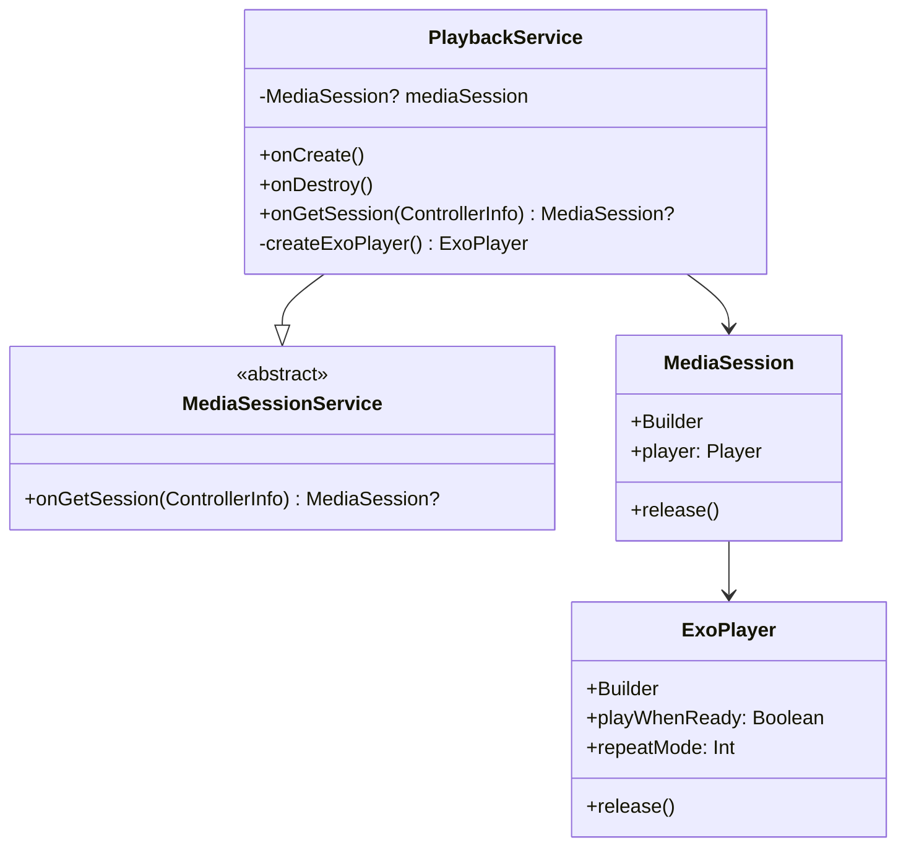

**Sources:** [AdaptiveJetStream/jetstream/src/main/java/com/google/jetstream/PlaybackService.kt:29-50]()

### Service Lifecycle Management

The service follows a standard lifecycle pattern:

| Lifecycle Method | Responsibilities |
|------------------|------------------|
| `onCreate()` | Creates `ExoPlayer` instance and wraps it in `MediaSession` |
| `onDestroy()` | Releases player resources and clears session reference |
| `onGetSession()` | Returns the active `MediaSession` to requesting controllers |

**Sources:** [AdaptiveJetStream/jetstream/src/main/java/com/google/jetstream/PlaybackService.kt:32-50]()

## ExoPlayer Configuration

### Player Builder Configuration

The `createExoPlayer()` method configures `ExoPlayer` with specific settings optimized for the streaming media use case:

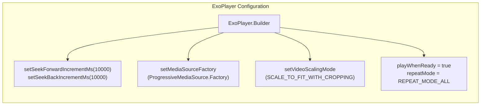

**Sources:** [AdaptiveJetStream/jetstream/src/main/java/com/google/jetstream/PlaybackService.kt:53-66]()

### Configuration Details

| Configuration | Value | Purpose |
|---------------|-------|---------|
| `setSeekForwardIncrementMs` | 10000 | 10-second forward seek increments |
| `setSeekBackIncrementMs` | 10000 | 10-second backward seek increments |
| `setVideoScalingMode` | `C.VIDEO_SCALING_MODE_SCALE_TO_FIT_WITH_CROPPING` | Optimized video scaling for different screen sizes |
| `playWhenReady` | `true` | Automatic playback when media is loaded |
| `repeatMode` | `Player.REPEAT_MODE_ALL` | Continuous playback loop |

**Sources:** [AdaptiveJetStream/jetstream/src/main/java/com/google/jetstream/PlaybackService.kt:55-65]()

## Media Source Factory Configuration

The player uses a `ProgressiveMediaSource.Factory` with a `DefaultDataSource.Factory` to handle various content sources including network streams and local assets.

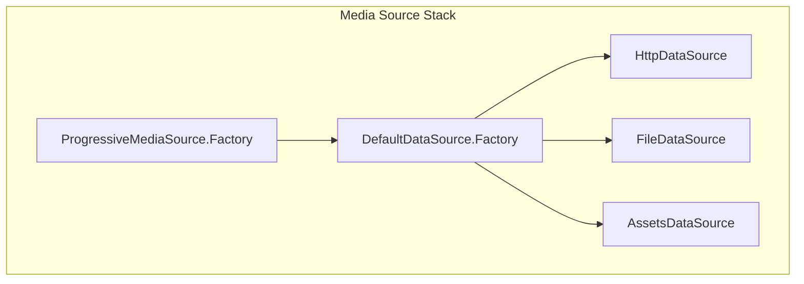

**Sources:** [AdaptiveJetStream/jetstream/src/main/java/com/google/jetstream/PlaybackService.kt:57-59]()

## Service Declaration and Permissions

### Manifest Configuration

The service is declared in the Android manifest with specific foreground service type and intent filters:

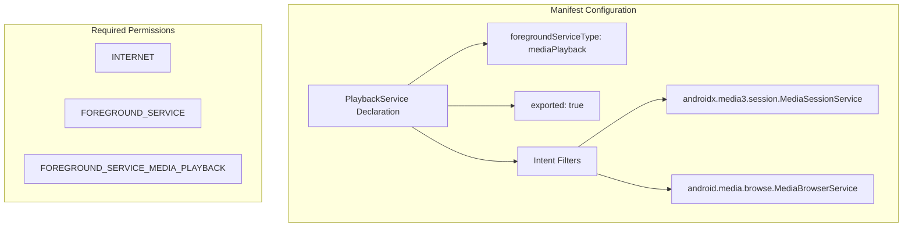

**Sources:** [AdaptiveJetStream/jetstream/src/main/AndroidManifest.xml:44-46](), [AdaptiveJetStream/jetstream/src/main/AndroidManifest.xml:88-96]()

### Hardware Feature Support

The manifest declares optional support for various hardware features to enable cross-platform compatibility:

| Feature | Required | Purpose |
|---------|----------|---------|
| `android.software.leanback` | false | Android TV support |
| `android.hardware.touchscreen` | false | Non-touch device support |
| `android.hardware.type.automotive` | false | Android Automotive integration |
| `android.hardware.wifi` | false | Network connectivity flexibility |

**Sources:** [AdaptiveJetStream/jetstream/src/main/AndroidManifest.xml:20-43]()

## External Integration Points

The media playback system supports external control through the `MediaSession` interface, enabling integration with:

- **Android Auto**: Automotive dashboard controls
- **Notification Controls**: System notification media controls  
- **TV Remote Controls**: D-pad and media key navigation
- **External Media Controllers**: Third-party apps and accessories

The service's exported nature and standard intent filters allow these external systems to discover and control playback through the Android media framework.

**Sources:** [AdaptiveJetStream/jetstream/src/main/AndroidManifest.xml:88-96](), [AdaptiveJetStream/jetstream/src/main/java/com/google/jetstream/PlaybackService.kt:48-50]()

---

# Page: Data Layer

# Data Layer

<details>
<summary>Relevant source files</summary>

The following files were used as context for generating this wiki page:

- [AdaptiveJetStream/jetstream/src/main/assets/movieCast.json](AdaptiveJetStream/jetstream/src/main/assets/movieCast.json)
- [AdaptiveJetStream/jetstream/src/main/assets/movieCategories.json](AdaptiveJetStream/jetstream/src/main/assets/movieCategories.json)
- [AdaptiveJetStream/jetstream/src/main/assets/movies.json](AdaptiveJetStream/jetstream/src/main/assets/movies.json)
- [AdaptiveJetStream/jetstream/src/main/java/com/google/jetstream/JetStreamApplication.kt](AdaptiveJetStream/jetstream/src/main/java/com/google/jetstream/JetStreamApplication.kt)

</details>


This document describes the data layer architecture of AdaptiveJetStream, covering the movie data structure, JSON asset organization, and repository pattern implementation. The data layer is responsible for managing movie content, cast information, and category data that drives the media streaming application.

For information about the media playback system that consumes this data, see [Media Playback System](#2.2). For details about the application structure and dependency injection setup, see [Application Structure](#2.1).

## Data Models and Structure

The AdaptiveJetStream application organizes its data around three primary entities: movies, categories, and cast members. Each entity is structured to support the application's media streaming and adaptive UI requirements.

### Movie Data Model

Movies represent the core content entity, containing comprehensive metadata for media streaming and UI presentation. Each movie includes identification, media resources, descriptive content, and rating information.

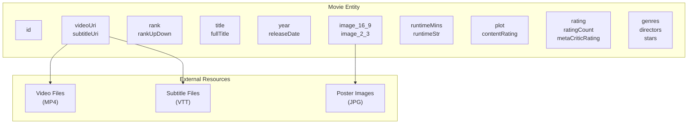

**Movie Entity Structure:**
- **Identity**: `id` (unique hash identifier)
- **Media Resources**: `videoUri`, `subtitleUri` (external URLs)
- **Display Content**: `title`, `fullTitle`, `plot`
- **Temporal Data**: `year`, `releaseDate`
- **Visual Assets**: `image_16_9`, `image_2_3` (adaptive aspect ratios)
- **Runtime Information**: `runtimeMins`, `runtimeStr`
- **Rating System**: `rating`, `ratingCount`, `metaCriticRating`
- **Categorization**: `genres`, `directors`, `stars` (comma-separated strings)
- **Ranking**: `rank`, `rankUpDown` (popularity metrics)

Sources: [AdaptiveJetStream/jetstream/src/main/assets/movies.json:1-1198]()

### Category and Cast Data Models

Categories provide genre classification, while cast members link character portrayals to real actors with visual representation.

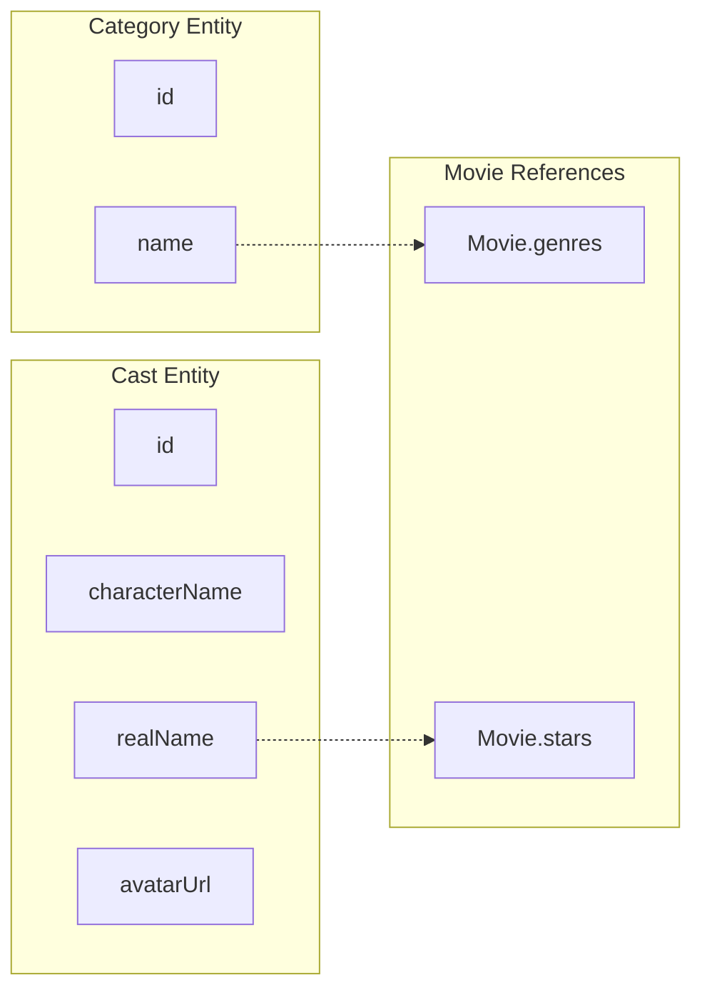

**Category Entity Structure:**
- **Identity**: `id` (numeric identifier)
- **Display**: `name` (genre name like "Action", "Drama", "Comedy")

**Cast Entity Structure:**
- **Identity**: `id` (numeric identifier)
- **Character**: `characterName` (fictional character name)
- **Actor**: `realName` (actor's real name)
- **Visual**: `avatarUrl` (actor profile image)

Sources: [AdaptiveJetStream/jetstream/src/main/assets/movieCategories.json:1-42](), [AdaptiveJetStream/jetstream/src/main/assets/movieCast.json:1-62]()

## JSON Asset Organization

The application stores all content data as JSON assets within the Android application bundle, providing offline access and consistent data structure across all deployment targets.

### Asset File Structure

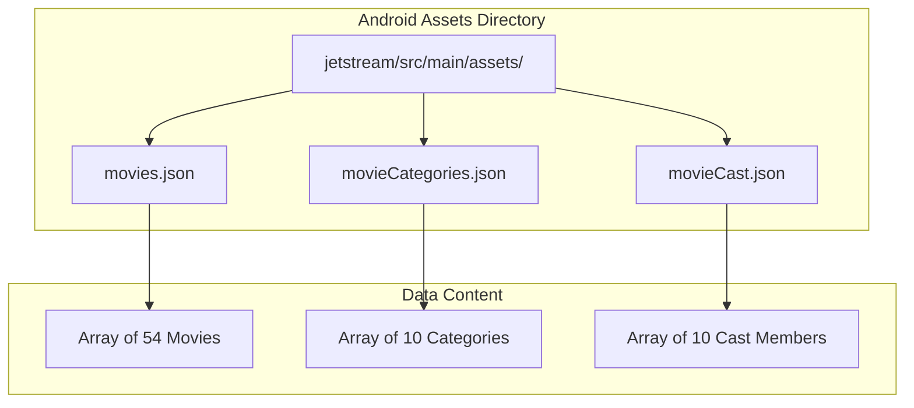

**Asset Organization:**
- **`movies.json`**: 54 movie records with complete metadata
- **`movieCategories.json`**: 10 genre categories
- **`movieCast.json`**: 10 cast member profiles

The JSON structure uses arrays as root elements, enabling direct deserialization into collection types. External media resources are referenced via URLs pointing to Google Cloud Storage buckets.

Sources: [AdaptiveJetStream/jetstream/src/main/assets/movies.json:1-1198](), [AdaptiveJetStream/jetstream/src/main/assets/movieCategories.json:1-42](), [AdaptiveJetStream/jetstream/src/main/assets/movieCast.json:1-62]()

### External Resource References

Movies reference external resources through URI fields that point to hosted content:

- **Video URIs**: MP4 files hosted on `commondatastorage.googleapis.com`
- **Subtitle URIs**: VTT files hosted on external services
- **Image URIs**: JPG poster images on `storage.googleapis.com`

This architecture separates content metadata (stored locally) from large media files (hosted externally), optimizing application bundle size while maintaining offline metadata access.

Sources: [AdaptiveJetStream/jetstream/src/main/assets/movies.json:4-6](), [AdaptiveJetStream/jetstream/src/main/assets/movies.json:12-13]()

## Repository Pattern Implementation

The data layer implements the repository pattern through dependency injection, providing abstraction between data sources and business logic components.

### Repository Architecture

```mermaid
graph TB
    subgraph "Dependency Injection Layer"
        HiltApp["@HiltAndroidApp<br/>JetStreamApplication"]
        MovieModule["@Module<br/>MovieRepositoryModule"]
    end
    
    subgraph "Repository Abstraction"
        MovieRepo["MovieRepository<br/>(Interface)"]
        MovieRepoImpl["MovieRepositoryImpl<br/>(Implementation)"]
    end
    
    subgraph "Data Sources"
        JSONAssets["JSON Assets<br/>movies.json<br/>movieCategories.json<br/>movieCast.json"]
    end
    
    subgraph "Consumer Components"
        UIComponents["UI Components"]
        PlaybackService["PlaybackService"]
    end
    
    HiltApp --> MovieModule
    MovieModule --> MovieRepo
    MovieModule --> MovieRepoImpl
    MovieRepoImpl --> JSONAssets
    MovieRepo --> UIComponents
    MovieRepo --> PlaybackService
    
    MovieModule -.->|"@Binds"| MovieRepo
```

**Repository Pattern Components:**
- **`MovieRepository`**: Interface defining data access contract
- **`MovieRepositoryImpl`**: Concrete implementation handling JSON asset parsing
- **`MovieRepositoryModule`**: Hilt module binding interface to implementation

The `@Binds` annotation in `MovieRepositoryModule` creates the interface-to-implementation binding, enabling dependency injection throughout the application.

Sources: [AdaptiveJetStream/jetstream/src/main/java/com/google/jetstream/JetStreamApplication.kt:31-39]()

### Dependency Injection Setup

```mermaid
graph LR
    subgraph "Hilt Configuration"
        SingletonComponent["@InstallIn<br/>SingletonComponent"]
        BindsAnnotation["@Binds"]
        AbstractFunction["bindMovieRepository()"]
    end
    
    subgraph "Injection Result"
        SingletonRepo["Singleton MovieRepository"]
        AppWideAccess["Application-wide Access"]
    end
    
    SingletonComponent --> SingletonRepo
    BindsAnnotation --> AbstractFunction
    AbstractFunction --> AppWideAccess
```

The repository is configured as a singleton through `@InstallIn(SingletonComponent::class)`, ensuring a single instance serves all application components. The abstract `bindMovieRepository()` function creates the binding between `MovieRepositoryImpl` and `MovieRepository`.

Sources: [AdaptiveJetStream/jetstream/src/main/java/com/google/jetstream/JetStreamApplication.kt:31-39]()

## Data Flow Architecture

The data layer supports the application's adaptive UI requirements by providing structured access to movie content across different form factors and interaction modes.

### Data Access Flow

```mermaid
graph TD
    subgraph "Application Layer"
        MainActivity["MainActivity"]
        Composables["Compose UI"]
        PlaybackService["PlaybackService"]
    end
    
    subgraph "Repository Layer"
        MovieRepository["MovieRepository"]
    end
    
    subgraph "Data Layer"
        AssetManager["Android AssetManager"]
        JSONParser["JSON Parsing"]
        MoviesJSON["movies.json"]
        CategoriesJSON["movieCategories.json"]
        CastJSON["movieCast.json"]
    end
    
    subgraph "External Resources"
        VideoStreams["Video Streams"]
        ImageCDN["Image CDN"]
    end
    
    MainActivity --> MovieRepository
    Composables --> MovieRepository
    PlaybackService --> MovieRepository
    
    MovieRepository --> AssetManager
    AssetManager --> JSONParser
    JSONParser --> MoviesJSON
    JSONParser --> CategoriesJSON
    JSONParser --> CastJSON
    
    MovieRepository -.->|"URI References"| VideoStreams
    MovieRepository -.->|"URI References"| ImageCDN
```

**Data Flow Process:**
1. **UI Components** request data through `MovieRepository` interface
2. **Repository Implementation** accesses JSON assets via Android `AssetManager`
3. **JSON Parsing** converts asset files to data objects
4. **External Resources** are accessed via URI references from parsed data

This architecture enables offline-first operation with metadata while supporting streaming of large media files from external sources.

Sources: [AdaptiveJetStream/jetstream/src/main/java/com/google/jetstream/JetStreamApplication.kt:20-21](), [AdaptiveJetStream/jetstream/src/main/java/com/google/jetstream/JetStreamApplication.kt:35-38]()

---

# Page: User Interface

# User Interface

<details>
<summary>Relevant source files</summary>

The following files were used as context for generating this wiki page:

- [AdaptiveJetStream/README.md](AdaptiveJetStream/README.md)
- [AdaptiveJetStream/jetstream/src/main/ic_launcher-playstore.png](AdaptiveJetStream/jetstream/src/main/ic_launcher-playstore.png)
- [AdaptiveJetStream/jetstream/src/main/java/com/google/jetstream/MainActivity.kt](AdaptiveJetStream/jetstream/src/main/java/com/google/jetstream/MainActivity.kt)

</details>


This document describes the adaptive user interface framework used in AdaptiveJetStream. The UI system is designed to provide consistent media streaming experiences across multiple form factors including mobile, tablet, foldable, TV, automotive, Chromebook, and XR devices using a single codebase.

For information about the application's overall architecture and component structure, see [Architecture](#2). For details about media playback integration with the UI, see [Media Playback System](#2.2).

## Adaptive UI Framework

AdaptiveJetStream implements a comprehensive adaptive UI system that automatically adjusts layouts, navigation patterns, and interaction models based on the target device's form factor and capabilities.

```mermaid
graph TD
    subgraph "Form Factor Detection"
        CONFIG["Configuration.resources"]
        UIMODE["UiMode.from()"]
        WINDOWSIZE["Window Size Classes"]
        FEATURES["System Features"]
    end
    
    subgraph "Adaptive UI Engine"
        MATERIAL3["Material3 Adaptive"]
        COMPOSE["Compose Adaptive"]
        XR_OVERRIDES["XR Component Overrides"]
    end
    
    subgraph "Platform Experiences"
        MOBILE["Mobile UI"]
        TABLET["Tablet UI"] 
        FOLDABLE["Foldable UI"]
        TV["TV/Leanback UI"]
        AUTO["Automotive UI"]
        CHROMEBOOK["Chromebook UI"]
        XR["XR/Spatial UI"]
    end
    
    CONFIG --> UIMODE
    UIMODE --> MATERIAL3
    WINDOWSIZE --> MATERIAL3
    FEATURES --> XR_OVERRIDES
    
    MATERIAL3 --> COMPOSE
    XR_OVERRIDES --> COMPOSE
    
    COMPOSE --> MOBILE
    COMPOSE --> TABLET
    COMPOSE --> FOLDABLE
    COMPOSE --> TV
    COMPOSE --> AUTO
    COMPOSE --> CHROMEBOOK
    COMPOSE --> XR
```

The adaptive framework operates through several key detection mechanisms that determine the appropriate UI layout and interaction patterns for each device type.

Sources: [AdaptiveJetStream/jetstream/src/main/java/com/google/jetstream/MainActivity.kt:106-117](), [AdaptiveJetStream/README.md:3-11]()

## Main UI Entry Points

The application's UI hierarchy starts with `MainActivity` as the Android entry point, which sets up the Compose environment and delegates to the main `App` composable.

```mermaid
graph TD
    subgraph "Activity Layer"
        MAINACTIVITY["MainActivity"]
        SPLASHSCREEN["SplashScreen.installSplashScreen()"]
        EDGETOEDGE["enableEdgeToEdge()"]
        CUSTOMHEADER["tryEnableCustomHeader()"]
    end
    
    subgraph "Compose Layer"
        SETCONTENT["setContent{}"]
        JETSTREAMTHEME["JetStreamTheme"]
        COMPOSITIONLOCAL["CompositionLocalProvider"]
        SURFACE["Surface"]
    end
    
    subgraph "XR Integration"
        ENABLEXR["EnableXrComponentOverrides"]
        MATERIAL3XR["@OptIn(ExperimentalMaterial3XrApi)"]
    end
    
    subgraph "Main App"
        APP["App()"]
        SAFEDRAWING["safeDrawingPadding()"]
        BACKGROUND["background()"]
    end
    
    MAINACTIVITY --> SPLASHSCREEN
    MAINACTIVITY --> EDGETOEDGE
    MAINACTIVITY --> CUSTOMHEADER
    MAINACTIVITY --> SETCONTENT
    
    SETCONTENT --> JETSTREAMTHEME
    JETSTREAMTHEME --> COMPOSITIONLOCAL
    COMPOSITIONLOCAL --> ENABLEXR
    ENABLEXR --> SURFACE
    SURFACE --> APP
    
    MATERIAL3XR --> ENABLEXR
    
    APP --> SAFEDRAWING
    APP --> BACKGROUND
```

The `MainActivity` class handles platform-specific setup including splash screen installation, edge-to-edge display configuration, and custom header support for windowed environments.

Sources: [AdaptiveJetStream/jetstream/src/main/java/com/google/jetstream/MainActivity.kt:49-82]()

## Form Factor Detection and Adaptation

The UI system uses multiple detection mechanisms to identify the current device context and adapt the interface accordingly.

| Detection Method | Purpose | Implementation |
|-----------------|---------|----------------|
| `UiMode.from(resources.configuration)` | Detect basic form factor category | [MainActivity.kt:107]() |
| Window Size Classes | Determine layout breakpoints | Material3 Adaptive |
| System Features | Detect capabilities like PiP, freeform windows | [MainActivity.kt:110-116]() |
| XR Environment | Enable spatial UI components | `EnableXrComponentOverrides` |

```mermaid
graph LR
    subgraph "Detection Layer"
        RESOURCES["resources.configuration"]
        PACKAGEMGR["PackageManager"]
        WINDOWMETRICS["WindowMetrics"]
    end
    
    subgraph "Adaptation Logic"
        UIMODE_DETECTION["UiMode.from()"]
        FEATURE_CHECK["hasSystemFeature()"]
        WINDOWCLASS["WindowSizeClass"]
    end
    
    subgraph "UI Variants"
        MOBILE_UI["Mobile Layout"]
        TABLET_UI["Tablet Layout"]
        TV_UI["TV Layout"]
        XR_UI["XR Layout"]
        FOLDABLE_UI["Foldable Layout"]
        AUTO_UI["Auto Layout"]
        CHROMEBOOK_UI["Chromebook Layout"]
    end
    
    RESOURCES --> UIMODE_DETECTION
    PACKAGEMGR --> FEATURE_CHECK
    WINDOWMETRICS --> WINDOWCLASS
    
    UIMODE_DETECTION --> MOBILE_UI
    UIMODE_DETECTION --> TABLET_UI
    UIMODE_DETECTION --> TV_UI
    FEATURE_CHECK --> XR_UI
    WINDOWCLASS --> FOLDABLE_UI
    FEATURE_CHECK --> AUTO_UI
    WINDOWCLASS --> CHROMEBOOK_UI
```

Sources: [AdaptiveJetStream/jetstream/src/main/java/com/google/jetstream/MainActivity.kt:106-117](), [AdaptiveJetStream/README.md:5-11]()

## Material3 and Theming Integration

The application uses Material Design 3 components with adaptive capabilities to ensure consistent theming across all form factors while allowing for platform-specific customizations.

```mermaid
graph TD
    subgraph "Theme Layer"
        JETSTREAMTHEME["JetStreamTheme"]
        MATERIALTHEME["MaterialTheme"]
        COLORSCHEME["MaterialTheme.colorScheme"]
        TONALELEVATION["LocalAbsoluteTonalElevation"]
    end
    
    subgraph "Composition Locals"
        CONTENTCOLOR["LocalContentColor"]
        SURFACECOLOR["surfaceColorAtElevation()"]
        COMPOSITIONPROVIDER["CompositionLocalProvider"]
    end
    
    subgraph "Surface System"
        SURFACE["Surface{}"]
        BACKGROUND["background()"]
        SAFEDRAWING["safeDrawingPadding()"]
    end
    
    JETSTREAMTHEME --> MATERIALTHEME
    MATERIALTHEME --> COLORSCHEME
    MATERIALTHEME --> TONALELEVATION
    
    COLORSCHEME --> CONTENTCOLOR
    TONALELEVATION --> SURFACECOLOR
    CONTENTCOLOR --> COMPOSITIONPROVIDER
    
    COMPOSITIONPROVIDER --> SURFACE
    SURFACE --> BACKGROUND
    SURFACE --> SAFEDRAWING
```

The theming system provides consistent color schemes, typography, and spacing while adapting to different display densities and form factors.

Sources: [AdaptiveJetStream/jetstream/src/main/java/com/google/jetstream/MainActivity.kt:60-80]()

## XR and Spatial UI Support

AdaptiveJetStream includes experimental support for XR devices through Material3's XR extensions, enabling spatial user interfaces for AR/VR experiences.

```mermaid
graph TD
    subgraph "XR Setup"
        EXPERIMENTAL["@OptIn(ExperimentalMaterial3XrApi)"]
        ENABLEXR["EnableXrComponentOverrides"]
        XR_MATERIAL3["androidx.xr.compose.material3"]
    end
    
    subgraph "XR Components"
        SPATIAL_UI["Spatial UI Components"]
        XR_NAVIGATION["XR Navigation"]
        DEPTH_LAYOUT["Depth-based Layouts"]
    end
    
    subgraph "Fallback System"
        STANDARD_UI["Standard UI Components"]
        CONDITIONAL["Conditional Rendering"]
        PLATFORM_CHECK["Platform Detection"]
    end
    
    EXPERIMENTAL --> ENABLEXR
    ENABLEXR --> XR_MATERIAL3
    XR_MATERIAL3 --> SPATIAL_UI
    SPATIAL_UI --> XR_NAVIGATION
    SPATIAL_UI --> DEPTH_LAYOUT
    
    PLATFORM_CHECK --> CONDITIONAL
    CONDITIONAL --> SPATIAL_UI
    CONDITIONAL --> STANDARD_UI
```

XR support is implemented through component overrides that replace standard Material3 components with spatial equivalents when running in XR environments.

Sources: [AdaptiveJetStream/jetstream/src/main/java/com/google/jetstream/MainActivity.kt:42-43](), [AdaptiveJetStream/jetstream/src/main/java/com/google/jetstream/MainActivity.kt:52](), [AdaptiveJetStream/jetstream/src/main/java/com/google/jetstream/MainActivity.kt:64]()

## Input Handling and Keyboard Shortcuts

The application provides comprehensive input handling including keyboard shortcuts for efficient navigation and media control across different input modalities.

| Category | Function | Key Combination |
|----------|----------|----------------|
| General | Close Dialog | `Escape` |
| General | Scroll Down/Up | `Page Down`/`Page Up` |
| General | Show Profile | `Ctrl+,` or `Ctrl+Alt+P` |
| General | Show Home | `Ctrl+Alt+H` |
| General | Show Search | `/` or `Ctrl+Alt+S` |
| Video | Toggle Play/Pause | `K` |
| Video | Rewind 10 seconds | `J` |
| Video | Skip 10 seconds | `L` |
| Video | Toggle Fullscreen | `F` |
| Spatial | Pan Controls | `W`,`A`,`S`,`D` |
| Spatial | Zoom Controls | `+`/`-`, `[`/`]` |

```mermaid
graph TD
    subgraph "Input Categories"
        GENERAL["General Navigation"]
        VIDEO["Video Playback"]
        SPATIAL["Spatial/XR Controls"]
    end
    
    subgraph "Keyboard Handling"
        SHORTCUTS["KeyboardShortcutGroup"]
        SHORTCUTINFO["KeyboardShortcutInfo"]
        ONPROVIDE["onProvideKeyboardShortcuts()"]
    end
    
    subgraph "Action Routing"
        NAVIGATION_ACTIONS["Navigation Actions"]
        MEDIA_ACTIONS["Media Control Actions"]
        SPATIAL_ACTIONS["Spatial Control Actions"]
    end
    
    GENERAL --> SHORTCUTS
    VIDEO --> SHORTCUTS
    SPATIAL --> SHORTCUTS
    
    SHORTCUTS --> SHORTCUTINFO
    SHORTCUTINFO --> ONPROVIDE
    
    ONPROVIDE --> NAVIGATION_ACTIONS
    ONPROVIDE --> MEDIA_ACTIONS
    ONPROVIDE --> SPATIAL_ACTIONS
```

The keyboard shortcut system is organized into logical groups and provides discoverable shortcuts through the Android system's shortcut display mechanism.

Sources: [AdaptiveJetStream/jetstream/src/main/java/com/google/jetstream/MainActivity.kt:84-90](), [AdaptiveJetStream/jetstream/src/main/java/com/google/jetstream/MainActivity.kt:119-263]()

## Window Management and Display Features

The UI system includes advanced window management capabilities for modern Android form factors including foldables, large screens, and windowed environments.

```mermaid
graph TD
    subgraph "Window Features"
        EDGETOEDGE["enableEdgeToEdge()"]
        CUSTOMHEADER["Custom Header Support"]
        SAFEDRAWING["safeDrawingPadding()"]
        WINDOWINSETS["WindowInsetsController"]
    end
    
    subgraph "Feature Detection"
        FREEFORM["FEATURE_FREEFORM_WINDOW_MANAGEMENT"]
        PIP["FEATURE_PICTURE_IN_PICTURE"]
        PACKAGEMGR_CHECK["packageManager.hasSystemFeature()"]
    end
    
    subgraph "Display Adaptations"
        TRANSPARENT_CAPTION["APPEARANCE_TRANSPARENT_CAPTION_BAR_BACKGROUND"]
        SYSTEM_BARS["System Bars Appearance"]
        INSETS_HANDLING["Window Insets Handling"]
    end
    
    EDGETOEDGE --> SAFEDRAWING
    CUSTOMHEADER --> WINDOWINSETS
    WINDOWINSETS --> TRANSPARENT_CAPTION
    
    FREEFORM --> PACKAGEMGR_CHECK
    PIP --> PACKAGEMGR_CHECK
    PACKAGEMGR_CHECK --> CUSTOMHEADER
    
    TRANSPARENT_CAPTION --> SYSTEM_BARS
    SYSTEM_BARS --> INSETS_HANDLING
```

Advanced window management features are conditionally enabled based on system capabilities, ensuring optimal experiences on devices that support features like freeform windows and picture-in-picture mode.

Sources: [AdaptiveJetStream/jetstream/src/main/java/com/google/jetstream/MainActivity.kt:57-58](), [AdaptiveJetStream/jetstream/src/main/java/com/google/jetstream/MainActivity.kt:92-117]()

---

# Page: Performance Optimization

# Performance Optimization

<details>
<summary>Relevant source files</summary>

The following files were used as context for generating this wiki page:

- [AdaptiveJetStream/baseline-profiles.md](AdaptiveJetStream/baseline-profiles.md)
- [AdaptiveJetStream/benchmark/build.gradle.kts](AdaptiveJetStream/benchmark/build.gradle.kts)
- [AdaptiveJetStream/benchmark/src/main/java/com/google/jetstream/benchmark/BaselineProfileGenerator.kt](AdaptiveJetStream/benchmark/src/main/java/com/google/jetstream/benchmark/BaselineProfileGenerator.kt)

</details>


## Purpose and Scope

This document provides an overview of the performance optimization strategies implemented in AdaptiveJetStream, focusing on startup performance improvements and automated performance measurement. The optimization approach centers on baseline profile generation and comprehensive benchmarking infrastructure to ensure consistent application performance across different device types and form factors.

For detailed information about baseline profile implementation, see [Baseline Profiles](#4.1). For comprehensive benchmarking setup and procedures, see [Benchmarking](#4.2).

## Performance Optimization Overview

AdaptiveJetStream implements a multi-layered performance optimization strategy designed to minimize application startup time and improve runtime performance. The optimization framework consists of three primary components:

| Component | Purpose | Implementation |
|-----------|---------|----------------|
| Baseline Profiles | AOT compilation optimization | Profile-guided optimization for hot code paths |
| Macrobenchmarks | Performance measurement | Automated startup and navigation benchmarks |
| Managed Test Devices | Consistent testing | Virtual TV devices for reproducible performance tests |

The performance optimization system integrates directly with the build pipeline to automatically generate and validate performance improvements during development.

### Performance Optimization Architecture

```mermaid
graph TB
    subgraph "Main Application"
        APP["JetStreamApplication"]
        MAIN["MainActivity"]
        SERVICE["PlaybackService"]
    end
    
    subgraph "Benchmark Module"
        GENERATOR["BaselineProfileGenerator"]
        RULE["BaselineProfileRule"]
        TESTS["MacrobenchmarkTests"]
    end
    
    subgraph "Performance Artifacts"
        PROFILE["baseline-prof.txt"]
        REPORTS["Benchmark Reports"]
        METRICS["Performance Metrics"]
    end
    
    subgraph "Build System Integration"
        GRADLE["benchmark/build.gradle.kts"]
        DEVICE["ManagedVirtualDevice tvApi34"]
        PLUGIN["androidx.baselineprofile plugin"]
    end
    
    GENERATOR --> RULE
    RULE --> APP
    GENERATOR --> PROFILE
    TESTS --> REPORTS
    REPORTS --> METRICS
    
    GRADLE --> DEVICE
    GRADLE --> PLUGIN
    PLUGIN --> GENERATOR
    DEVICE --> TESTS
    
    PROFILE --> APP
    
    style GENERATOR fill:#e8f5e8
    style PROFILE fill:#fff3e0
    style DEVICE fill:#f3e5f5
```

Sources: [AdaptiveJetStream/benchmark/build.gradle.kts:1-83](), [AdaptiveJetStream/benchmark/src/main/java/com/google/jetstream/benchmark/BaselineProfileGenerator.kt:1-203]()

## Baseline Profile System

The baseline profile system captures runtime performance data during typical user interactions and generates optimization rules for AOT (Ahead-of-Time) compilation. This approach significantly improves application startup performance by pre-compiling frequently executed code paths.

### Baseline Profile Generation Process

```mermaid
graph LR
    subgraph "Profile Collection"
        START["startActivityAndWait()"]
        WAIT["device.waitForIdle()"]
        CAROUSEL["Wait for Carousel focus"]
    end
    
    subgraph "Navigation Simulation"
        HOME["Home tab exploration"]
        CATEGORIES["Categories tab navigation"]
        MOVIES["Movies tab exploration"]
        SHOWS["Shows tab exploration"]
        FAVOURITES["Favourites tab navigation"]
        SEARCH["Search tab exploration"]
    end
    
    subgraph "Screen Interactions"
        PROFILE_SCREEN["Account screen navigation"]
        CATEGORY_DETAILS["Category details exploration"]
        MOVIE_DETAILS["Movie details navigation"]
    end
    
    subgraph "Profile Output"
        BASELINE_PROF["baseline-prof.txt generation"]
    end
    
    START --> WAIT
    WAIT --> CAROUSEL
    CAROUSEL --> HOME
    HOME --> CATEGORIES
    CATEGORIES --> MOVIES
    MOVIES --> SHOWS
    SHOWS --> FAVOURITES
    FAVOURITES --> SEARCH
    SEARCH --> PROFILE_SCREEN
    PROFILE_SCREEN --> CATEGORY_DETAILS
    CATEGORY_DETAILS --> MOVIE_DETAILS
    MOVIE_DETAILS --> BASELINE_PROF
```

The `BaselineProfileGenerator` class orchestrates this process through the `startup()` method, which systematically navigates through all application screens using D-pad controls to simulate TV remote interactions.

Sources: [AdaptiveJetStream/benchmark/src/main/java/com/google/jetstream/benchmark/BaselineProfileGenerator.kt:30-186]()

### Profile Application Workflow

The baseline profile application follows a specific sequence to ensure optimal performance benefits:

```mermaid
graph TD
    subgraph "Installation Phase"
        INSTALL["App Installation"]
        LAUNCH["Initial Launch"]
    end
    
    subgraph "Compilation Phase"
        COMPILE["adb shell cmd package compile"]
        SPEED_PROFILE["speed-profile compilation"]
        BG_DEXOPT["Background optimization job"]
    end
    
    subgraph "Verification Phase"
        STATUS_CHECK["dumpsys package dexopt"]
        PROFILE_APPLIED["Profile status verification"]
    end
    
    subgraph "Performance Phase"
        FORCE_STOP["Force stop application"]
        OPTIMIZED_LAUNCH["Optimized restart"]
        PERFORMANCE_GAIN["Startup improvement"]
    end
    
    INSTALL --> LAUNCH
    LAUNCH --> COMPILE
    COMPILE --> SPEED_PROFILE
    SPEED_PROFILE --> STATUS_CHECK
    STATUS_CHECK --> BG_DEXOPT
    BG_DEXOPT --> PROFILE_APPLIED
    PROFILE_APPLIED --> FORCE_STOP
    FORCE_STOP --> OPTIMIZED_LAUNCH
    OPTIMIZED_LAUNCH --> PERFORMANCE_GAIN
```

Sources: [AdaptiveJetStream/baseline-profiles.md:23-69]()

## Benchmarking Infrastructure

The benchmarking infrastructure provides automated performance measurement capabilities through the dedicated `benchmark` module. This module is configured as an Android Test module with specific optimizations for TV device testing.

### Benchmark Module Configuration

The benchmark module configuration includes several key components:

| Configuration | Value | Purpose |
|---------------|-------|---------|
| `targetProjectPath` | `:jetstream` | Links benchmark module to main app |
| `managedDevices` | `tvApi34` | Virtual TV device for testing |
| `suppressErrors` | `EMULATOR` | Allows benchmarking on virtual devices |
| `baselineProfile.useConnectedDevices` | `false` | Forces use of managed virtual devices |

### Managed Virtual Device Setup

```mermaid
graph LR
    subgraph "Device Configuration"
        DEVICE_DEF["Television (1080p)"]
        API_LEVEL["API Level 34"]
        SYSTEM_IMAGE["AOSP system image"]
    end
    
    subgraph "Benchmark Module"
        BUILD_GRADLE["benchmark/build.gradle.kts"]
        DEVICE_CONFIG["ManagedVirtualDevice tvApi34"]
        BASELINE_CONFIG["baselineProfile configuration"]
    end
    
    subgraph "Test Execution"
        GENERATOR["BaselineProfileGenerator"]
        UI_AUTOMATOR["UiAutomator interactions"]
        PROFILE_COLLECTION["Profile data collection"]
    end
    
    DEVICE_DEF --> DEVICE_CONFIG
    API_LEVEL --> DEVICE_CONFIG
    SYSTEM_IMAGE --> DEVICE_CONFIG
    
    BUILD_GRADLE --> DEVICE_CONFIG
    DEVICE_CONFIG --> BASELINE_CONFIG
    
    BASELINE_CONFIG --> GENERATOR
    GENERATOR --> UI_AUTOMATOR
    UI_AUTOMATOR --> PROFILE_COLLECTION
```

Sources: [AdaptiveJetStream/benchmark/build.gradle.kts:48-62]()

## Performance Measurement Workflow

The performance measurement workflow integrates baseline profile generation with the application build process, ensuring that performance optimizations are automatically validated and applied.

### Build System Integration

The benchmark module integrates with the main application through several Gradle plugins and configurations:

- `androidx.baselineprofile` plugin manages profile generation and application
- `android.test` plugin provides the testing framework
- `compose.compiler` plugin ensures Compose-specific optimizations
- Target project path configuration links the benchmark to the main `jetstream` module

### UI Automation Strategy

The baseline profile generation uses `UiAutomator` to simulate realistic user interactions:

| Interaction Pattern | Implementation | Purpose |
|-------------------|---------------|---------|
| D-pad navigation | `pressDPadRight()`, `pressDPadLeft()` | TV remote simulation |
| Focus verification | `Until.findObject().focused(true)` | Ensures UI element accessibility |
| Content exploration | Systematic tab navigation | Comprehensive code path coverage |
| Screen transitions | `pressDPadCenter()` for selection | Deep navigation patterns |

Sources: [AdaptiveJetStream/benchmark/src/main/java/com/google/jetstream/benchmark/BaselineProfileGenerator.kt:36-185]()

### Performance Optimization Dependencies

The performance optimization system relies on several key dependencies managed through the version catalog:

```mermaid
graph TB
    subgraph "Core Dependencies"
        MACRO["androidx.benchmark.macro.junit4"]
        BASELINE["androidx.baselineprofile plugin"]
        UI_AUTOMATOR["androidx.uiautomator"]
    end
    
    subgraph "Test Framework"
        JUNIT["androidx.junit"]
        RULES["androidx.rules"]
        COMPOSE_RUNTIME["androidx.compose.runtime"]
    end
    
    subgraph "Build Configuration"
        ANDROID_TEST["android.test plugin"]
        KOTLIN_ANDROID["kotlin.android plugin"]
        COMPOSE_COMPILER["compose.compiler plugin"]
    end
    
    BASELINE --> MACRO
    MACRO --> UI_AUTOMATOR
    UI_AUTOMATOR --> JUNIT
    JUNIT --> RULES
    RULES --> COMPOSE_RUNTIME
    
    ANDROID_TEST --> BASELINE
    KOTLIN_ANDROID --> COMPOSE_COMPILER
```

Sources: [AdaptiveJetStream/benchmark/build.gradle.kts:19-76]()

The performance optimization framework ensures that AdaptiveJetStream maintains optimal startup and runtime performance across different device configurations while providing automated validation of performance improvements through the development lifecycle.

---

# Page: Baseline Profiles

# Baseline Profiles

<details>
<summary>Relevant source files</summary>

The following files were used as context for generating this wiki page:

- [AdaptiveJetStream/baseline-profiles.md](AdaptiveJetStream/baseline-profiles.md)
- [AdaptiveJetStream/benchmark/src/main/java/com/google/jetstream/benchmark/BaselineProfileGenerator.kt](AdaptiveJetStream/benchmark/src/main/java/com/google/jetstream/benchmark/BaselineProfileGenerator.kt)

</details>


## Purpose and Scope

This document covers the baseline profile implementation in AdaptiveJetStream, including automated profile generation, application mechanisms, and performance optimization benefits. Baseline profiles improve app startup performance by pre-compiling critical code paths identified through UI automation testing.

For information about benchmarking infrastructure and performance measurement, see [Benchmarking](#4.2).

## What are Baseline Profiles

Baseline profiles are a performance optimization technique that identifies and pre-compiles the most critical code paths executed during typical app usage. The Android runtime uses these profiles to optimize app startup and reduce time-to-interaction for users.

The AdaptiveJetStream application implements baseline profiles to optimize:
- App startup performance
- Initial UI rendering
- Navigation between screens
- Media content browsing

## Profile Generation Process

```mermaid
flowchart TD
    DEV["Developer"] --> TRIGGER["Run Generate Baseline Profile"]
    TRIGGER --> AUTOMATION["BaselineProfileGenerator.startup()"]
    AUTOMATION --> INSTALL["Install App on Device"]
    INSTALL --> LAUNCH["Launch MainActivity"]
    LAUNCH --> NAVIGATE["Automated UI Navigation"]
    NAVIGATE --> COLLECT["Collect Profile Data"]
    COLLECT --> GENERATE["Generate Profile Rules"]
    GENERATE --> EMBED["Embed in APK"]
    EMBED --> DEPLOY["Deploy to Play Store"]
    DEPLOY --> APPLY["Auto-apply on Installation"]
    
    style AUTOMATION fill:#f9f9f9
    style GENERATE fill:#f9f9f9
    style APPLY fill:#f9f9f9
```

**Profile Generation Flow**

The baseline profile generation follows an automated approach where UI interactions simulate real user behavior to capture the most frequently used code paths.

Sources: [AdaptiveJetStream/baseline-profiles.md:6-12](), [AdaptiveJetStream/benchmark/src/main/java/com/google/jetstream/benchmark/BaselineProfileGenerator.kt:29-33]()

## BaselineProfileGenerator Implementation

The `BaselineProfileGenerator` class implements comprehensive UI automation to capture realistic usage patterns across all major app screens and features.

```mermaid
flowchart TD
    START["BaselineProfileGenerator.startup()"] --> WAIT_LOAD["Wait for Carousel Focus"]
    WAIT_LOAD --> HOME["Navigate Home Tab"]
    HOME --> CATEGORIES["Navigate Categories Tab"]  
    CATEGORIES --> MOVIES["Navigate Movies Tab"]
    MOVIES --> SHOWS["Navigate Shows Tab"]
    SHOWS --> FAVOURITES["Navigate Favourites Tab"]
    FAVOURITES --> SEARCH["Navigate Search Tab"]
    SEARCH --> ACCOUNT["Navigate Account Screen"]
    ACCOUNT --> CATEGORY_DETAIL["Navigate Category Details"]
    CATEGORY_DETAIL --> MOVIE_DETAIL["Navigate Movie Details"]
    MOVIE_DETAIL --> COMPLETE["Profile Collection Complete"]
    
    style START fill:#f9f9f9
    style COMPLETE fill:#f9f9f9
```

**UI Automation Flow in BaselineProfileGenerator**

### Key Navigation Patterns

The generator captures these essential user journeys:

| Screen | Navigation Actions | Code Reference |
|--------|-------------------|----------------|
| Home Tab | Carousel exploration, up/down/left/right navigation | [BaselineProfileGenerator.kt:44-53]() |
| Categories Tab | Category browsing, selection interactions | [BaselineProfileGenerator.kt:61-70]() |
| Movies Tab | Movie grid navigation, content discovery | [BaselineProfileGenerator.kt:75-89]() |
| Shows Tab | TV show browsing patterns | [BaselineProfileGenerator.kt:92-105]() |
| Favourites Tab | Filter selection, favourites management | [BaselineProfileGenerator.kt:109-127]() |
| Search Tab | Search interface interaction | [BaselineProfileGenerator.kt:130-142]() |

### Device Interaction Constants

The generator uses specific timing and identification constants:

- `JETSTREAM_PACKAGE_NAME`: `"com.google.jetstream"`
- `INITIAL_WAIT_TIMEOUT`: `2000L` milliseconds
- `WAIT_TIMEOUT`: `1000L` milliseconds

Key UI element identifiers include `CAROUSEL_DESCRIPTION`, `CATEGORIES_TAB_LABEL`, `MOVIES_TAB_LABEL`, and `PROFILE_BUTTON_DESCRIPTION`.

Sources: [AdaptiveJetStream/benchmark/src/main/java/com/google/jetstream/benchmark/BaselineProfileGenerator.kt:25-187]()

## Manual Profile Application

For development and testing purposes, baseline profiles can be manually applied using ADB commands. This process involves multiple steps to ensure proper profile compilation and application.

```mermaid
sequenceDiagram
    participant DEV as "Developer"
    participant ADB as "ADB Commands"
    participant DEVICE as "Android Device"
    participant APP as "JetStream App"
    
    DEV->>ADB: Install & launch app
    ADB->>DEVICE: adb shell am start
    DEVICE->>APP: Launch MainActivity
    
    DEV->>ADB: Compile with profile
    ADB->>DEVICE: cmd package compile -f -m speed-profile
    DEVICE-->>ADB: Compilation complete
    
    DEV->>ADB: Check profile status
    ADB->>DEVICE: dumpsys package dexopt
    DEVICE-->>ADB: status=speed-profile
    
    DEV->>ADB: Force stop & relaunch
    ADB->>DEVICE: am force-stop & am start
    DEVICE->>APP: Optimized startup
```

**Manual Profile Application Sequence**

### Application Steps

1. **Install and Launch**: Deploy app and verify initial launch
   ```bash
   adb shell am start -n com.google.jetstream/com.google.jetstream.MainActivity
   ```

2. **Compile with Profile**: Apply speed-profile compilation
   ```bash
   adb shell cmd package compile -f -m speed-profile com.google.jetstream
   ```

3. **Verify Status**: Confirm profile application
   ```bash
   adb shell dumpsys package dexopt | grep -A 1 com.google.jetstream
   ```

4. **Background Optimization** (if needed): Execute background dexopt
   ```bash
   adb shell cmd package bg-dexopt-job
   ```

5. **Restart App**: Force close and relaunch to observe improvements
   ```bash
   adb shell am force-stop com.google.jetstream
   adb shell am start -n com.google.jetstream/com.google.jetstream.MainActivity
   ```

Sources: [AdaptiveJetStream/baseline-profiles.md:20-69]()

## Integration with Build System

Baseline profiles integrate seamlessly with the Android build system and are automatically applied in production environments:

- **Play Store Distribution**: Profiles are automatically applied when users install the app from Google Play Store
- **Benchmark Testing**: Profiles are automatically applied during macrobenchmark test execution
- **Release Builds**: Profile regeneration is required when code changes affect app startup paths

The `BaselineProfileRule` from the AndroidX Benchmark library manages the profile collection process and integrates with the project's testing infrastructure.

Sources: [AdaptiveJetStream/baseline-profiles.md:15-17](), [AdaptiveJetStream/benchmark/src/main/java/com/google/jetstream/benchmark/BaselineProfileGenerator.kt:19-27]()

---

# Page: Benchmarking

# Benchmarking

<details>
<summary>Relevant source files</summary>

The following files were used as context for generating this wiki page:

- [AdaptiveJetStream/benchmark/.gitignore](AdaptiveJetStream/benchmark/.gitignore)
- [AdaptiveJetStream/benchmark/build.gradle.kts](AdaptiveJetStream/benchmark/build.gradle.kts)
- [AdaptiveJetStream/benchmark/src/main/java/com/google/jetstream/benchmark/StartupBenchmark.kt](AdaptiveJetStream/benchmark/src/main/java/com/google/jetstream/benchmark/StartupBenchmark.kt)

</details>


This document covers the benchmarking infrastructure used in AdaptiveJetStream for measuring application performance, particularly startup performance. The benchmarking system is implemented as a separate module that uses AndroidX Macrobenchmark library to conduct automated performance tests against the main application.

For information about baseline profile generation and optimization benefits, see [Baseline Profiles](#4.1).

## Purpose and Scope

The benchmarking system serves to:
- Measure cold startup performance under different compilation scenarios
- Validate the effectiveness of baseline profiles on startup time
- Provide automated performance regression detection
- Generate performance data for optimization decisions

The system focuses primarily on startup performance measurement using controlled test environments with managed virtual devices.

## Benchmark Module Architecture

The benchmarking infrastructure is implemented as a dedicated Android test module that targets the main JetStream application for performance measurement.

```mermaid
graph TB
    subgraph "Benchmark Module"
        BM["benchmark"]
        BMG["build.gradle.kts"]
        SB["StartupBenchmark"]
        MDV["Managed Virtual Device<br/>tvApi34"]
    end
    
    subgraph "Main Application"
        JS["jetstream"]
        APP["JetStreamApplication"]
        MA["MainActivity"]
    end
    
    subgraph "Testing Framework"
        MBR["MacrobenchmarkRule"]
        STM["StartupTimingMetric"]
        UIA["UI Automator"]
    end
    
    subgraph "Performance Analysis"
        BPM["BaselineProfileMode"]
        CM["CompilationMode"]
        ST["StartupMode"]
    end
    
    BM --> JS
    BMG --> MDV
    SB --> MBR
    MBR --> STM
    MBR --> UIA
    
    SB --> BPM
    SB --> CM
    SB --> ST
    
    MBR --> APP
    MBR --> MA
    
    style BM fill:#f9f9f9
    style SB fill:#f9f9f9
    style MBR fill:#e8f5e8
```

**Sources:** [AdaptiveJetStream/benchmark/build.gradle.kts:1-83](), [AdaptiveJetStream/benchmark/src/main/java/com/google/jetstream/benchmark/StartupBenchmark.kt:1-75]()

## Module Configuration

The benchmark module is configured as an Android test project with specific dependencies and device targets for performance testing.

### Build Configuration

| Configuration | Value | Purpose |
|---------------|-------|---------|
| `namespace` | `com.google.jetstream.benchmark` | Benchmark module namespace |
| `compileSdk` | `35` | Target Android API level |
| `minSdk` | `28` | Minimum supported API level |
| `targetProjectPath` | `:jetstream` | Main app module being benchmarked |
| `testInstrumentationRunner` | `androidx.test.runner.AndroidJUnitRunner` | Test execution framework |

### Managed Virtual Device

The system uses a managed virtual device for consistent testing conditions:

```mermaid
graph LR
    subgraph "Managed Device Configuration"
        MDV["tvApi34"]
        DEV["Television (1080p)"]
        API["API Level 34"]
        SRC["AOSP System Image"]
    end
    
    subgraph "Baseline Profile Integration"
        BP["baselineProfile"]
        MDC["managedDevices"]
        UCD["useConnectedDevices = false"]
    end
    
    MDV --> DEV
    MDV --> API
    MDV --> SRC
    
    BP --> MDC
    MDC --> MDV
    BP --> UCD
    
    style MDV fill:#f9f9f9
    style BP fill:#e8f5e8
```

**Sources:** [AdaptiveJetStream/benchmark/build.gradle.kts:48-62]()

## Startup Benchmark Tests

The `StartupBenchmark` class implements performance tests for different compilation scenarios to measure the impact of optimization techniques on application startup time.

### Test Implementation Structure

```mermaid
graph TB
    subgraph "StartupBenchmark Class"
        SBC["StartupBenchmark"]
        BR["benchmarkRule: MacrobenchmarkRule"]
        SNC["startupNoCompilation()"]
        SBP["startupBaselineProfile()"]
        SP["startup(CompilationMode)"]
    end
    
    subgraph "Test Scenarios"
        CM1["CompilationMode.None()"]
        CM2["CompilationMode.Partial<br/>(BaselineProfileMode.Require)"]
    end
    
    subgraph "Measurement Configuration"
        PKG["JETSTREAM_PACKAGE_NAME"]
        ITR["STARTUP_TEST_ITERATIONS = 5"]
        STM["StartupTimingMetric"]
        CSM["StartupMode.COLD"]
    end
    
    SBC --> BR
    SBC --> SNC
    SBC --> SBP
    SNC --> SP
    SBP --> SP
    
    SNC --> CM1
    SBP --> CM2
    
    SP --> PKG
    SP --> ITR
    SP --> STM
    SP --> CSM
    
    style SBC fill:#f9f9f9
    style SP fill:#e8f5e8
```

**Sources:** [AdaptiveJetStream/benchmark/src/main/java/com/google/jetstream/benchmark/StartupBenchmark.kt:41-71]()

### Compilation Mode Testing

The benchmark tests two distinct compilation scenarios:

#### No Compilation Test
- **Method:** `startupNoCompilation()`
- **Mode:** `CompilationMode.None()`
- **Purpose:** Measures worst-case startup performance without any optimizations
- **Use Case:** Baseline measurement for comparison

#### Baseline Profile Test  
- **Method:** `startupBaselineProfile()`
- **Mode:** `CompilationMode.Partial(baselineProfileMode = BaselineProfileMode.Require)`
- **Purpose:** Measures optimized startup performance with baseline profiles applied
- **Use Case:** Validates effectiveness of baseline profile optimizations

**Sources:** [AdaptiveJetStream/benchmark/src/main/java/com/google/jetstream/benchmark/StartupBenchmark.kt:49-58]()

## Benchmark Execution Flow

The benchmarking system follows a standardized execution pattern for consistent and reliable performance measurements.

```mermaid
graph TD
    subgraph "Test Setup"
        TS["Test Start"]
        PH["pressHome()"]
        CS["Cold Startup Mode"]
    end
    
    subgraph "Measurement Loop"
        ML["measureRepeated()"]
        I1["Iteration 1"]
        I2["Iteration 2"]
        I3["Iteration 3"]
        I4["Iteration 4"]
        I5["Iteration 5"]
    end
    
    subgraph "Per-Iteration Actions"
        SAW["startActivityAndWait()"]
        STM["StartupTimingMetric"]
        DATA["Performance Data"]
    end
    
    subgraph "Results"
        AGG["Aggregate Results"]
        REP["Test Report"]
    end
    
    TS --> PH
    PH --> CS
    CS --> ML
    
    ML --> I1
    ML --> I2
    ML --> I3
    ML --> I4
    ML --> I5
    
    I1 --> SAW
    I2 --> SAW
    I3 --> SAW
    I4 --> SAW
    I5 --> SAW
    
    SAW --> STM
    STM --> DATA
    
    DATA --> AGG
    AGG --> REP
    
    style ML fill:#f9f9f9
    style STM fill:#e8f5e8
    style AGG fill:#e8f5e8
```

**Sources:** [AdaptiveJetStream/benchmark/src/main/java/com/google/jetstream/benchmark/StartupBenchmark.kt:60-70]()

## Dependencies and Integration

The benchmark module integrates several testing and measurement libraries:

### Key Dependencies

| Library | Version | Purpose |
|---------|---------|---------|
| `androidx.benchmark.macro.junit4` | Latest stable | Macrobenchmark framework |
| `androidx.uiautomator` | Latest stable | UI automation for test interactions |
| `androidx.junit` | Latest stable | Test execution framework |
| `androidx.compose.runtime` | BOM managed | Compose runtime for UI testing |

### Build Variant Configuration

The benchmark module includes specific build variant handling:

```kotlin
androidComponents {
    beforeVariants(selector().withBuildType("benchmark").all()) {
        it.enable = true
    }
}
```

This configuration ensures the benchmark build variant is enabled for performance testing scenarios.

**Sources:** [AdaptiveJetStream/benchmark/build.gradle.kts:65-82]()

---

# Page: Build System

# Build System

<details>
<summary>Relevant source files</summary>

The following files were used as context for generating this wiki page:

- [AdaptiveJetStream/build.gradle.kts](AdaptiveJetStream/build.gradle.kts)
- [AdaptiveJetStream/gradle/libs.versions.toml](AdaptiveJetStream/gradle/libs.versions.toml)
- [AdaptiveJetStream/jetstream/build.gradle.kts](AdaptiveJetStream/jetstream/build.gradle.kts)

</details>


This document covers the Gradle-based build system for the AdaptiveJetStream project, including dependency management, module configuration, and build optimization features. The build system is designed to support multi-platform Android development with performance optimization and code quality enforcement.

For information about specific dependency libraries and their usage, see [Dependencies](#5.1). For details about code quality enforcement, see [Code Quality](#5.3).

## Build System Architecture

The AdaptiveJetStream project uses a modern Gradle build system with centralized dependency management through version catalogs. The build configuration is structured to support multiple Android form factors while maintaining consistent build practices across modules.

```mermaid
graph TD
    subgraph "Root Project"
        ROOT["build.gradle.kts<br/>(Root)"]
        CATALOG["libs.versions.toml<br/>(Version Catalog)"]
        WRAPPER["gradle/wrapper<br/>(Gradle Wrapper)"]
    end
    
    subgraph "Application Module"
        APP_BUILD["jetstream/build.gradle.kts<br/>(App Module)"]
        APP_PROGUARD["jetstream/proguard-rules.pro<br/>(ProGuard Rules)"]
    end
    
    subgraph "Benchmark Module"
        BENCH_BUILD["benchmark/build.gradle.kts<br/>(Benchmark Module)"]
    end
    
    subgraph "Build Features"
        PLUGINS["Plugin Management<br/>(alias references)"]
        DEPENDENCIES["Dependency Resolution<br/>(version catalog)"]
        BASELINE["Baseline Profiles<br/>(Performance)"]
        KSP["Kotlin Symbol Processing<br/>(Code Generation)"]
    end
    
    ROOT --> APP_BUILD
    ROOT --> BENCH_BUILD
    CATALOG --> APP_BUILD
    CATALOG --> BENCH_BUILD
    WRAPPER --> ROOT
    
    APP_BUILD --> PLUGINS
    APP_BUILD --> DEPENDENCIES
    APP_BUILD --> BASELINE
    APP_BUILD --> KSP
    
    APP_BUILD --> APP_PROGUARD
```

Sources: [AdaptiveJetStream/build.gradle.kts:1-34](), [AdaptiveJetStream/gradle/libs.versions.toml:1-77](), [AdaptiveJetStream/jetstream/build.gradle.kts:1-141]()

## Top-Level Build Configuration

The root `build.gradle.kts` file establishes the plugin ecosystem for the entire project using the version catalog pattern. All plugins are declared using the `alias()` function with `apply false` to make them available to submodules without applying them at the root level.

| Plugin | Purpose | Catalog Reference |
|--------|---------|-------------------|
| `android.application` | Android app module configuration | `libs.plugins.android.application` |
| `kotlin.android` | Kotlin Android plugin | `libs.plugins.kotlin.android` |
| `kotlin.serialization` | Kotlin serialization support | `libs.plugins.kotlin.serialization` |
| `compose.compiler` | Compose compiler plugin | `libs.plugins.compose.compiler` |
| `android.test` | Android test module support | `libs.plugins.android.test` |
| `hilt` | Dependency injection | `libs.plugins.hilt` |
| `ksp` | Kotlin Symbol Processing | `libs.plugins.ksp` |

The plugin declarations in [AdaptiveJetStream/build.gradle.kts:25-33]() use the centralized version catalog to ensure consistent plugin versions across all modules.

Sources: [AdaptiveJetStream/build.gradle.kts:17-33]()

## Version Catalog Structure

The `libs.versions.toml` file implements centralized dependency management using Gradle's version catalog feature. This approach ensures consistent dependency versions across modules and simplifies dependency updates.

```mermaid
graph TB
    subgraph "Version Catalog Structure"
        VERSIONS["[versions]<br/>Version Declarations"]
        LIBRARIES["[libraries]<br/>Library Dependencies"]
        PLUGINS["[plugins]<br/>Plugin Definitions"]
    end
    
    subgraph "Key Version Groups"
        COMPOSE_GROUP["Compose BOM<br/>compose-bom = '2025.05.00'"]
        KOTLIN_GROUP["Kotlin Ecosystem<br/>kotlin-android = '2.1.10'<br/>ksp = '2.1.10-1.0.30'"]
        ANDROID_GROUP["Android Build<br/>android-gradle-plugin = '8.9.3'"]
        MEDIA_GROUP["Media3 Suite<br/>media3 = '1.6.1'"]
        ADAPTIVE_GROUP["Material3 Adaptive<br/>material3-adaptive = '1.1.0'"]
    end
    
    subgraph "Module Resolution"
        APP_MODULE["jetstream/build.gradle.kts<br/>implementation(libs.xxx)"]
        BENCH_MODULE["benchmark/build.gradle.kts<br/>implementation(libs.xxx)"]
    end
    
    VERSIONS --> LIBRARIES
    VERSIONS --> PLUGINS
    
    COMPOSE_GROUP --> LIBRARIES
    KOTLIN_GROUP --> LIBRARIES
    ANDROID_GROUP --> PLUGINS
    MEDIA_GROUP --> LIBRARIES
    ADAPTIVE_GROUP --> LIBRARIES
    
    LIBRARIES --> APP_MODULE
    LIBRARIES --> BENCH_MODULE
    PLUGINS --> APP_MODULE
    PLUGINS --> BENCH_MODULE
```

The version catalog defines 27 distinct version declarations in [AdaptiveJetStream/gradle/libs.versions.toml:1-28](), covering major dependency families including Compose, Kotlin, Android, Media3, and XR components.

Sources: [AdaptiveJetStream/gradle/libs.versions.toml:1-77]()

## Application Module Build Configuration

The main application module build script in `jetstream/build.gradle.kts` configures the Android application with comprehensive feature support including Compose, dependency injection, and performance optimization.

### Android Configuration

The Android configuration block establishes the application metadata and build behavior:

- **Namespace**: `com.google.jetstream` [AdaptiveJetStream/jetstream/build.gradle.kts:32]()
- **SDK Targets**: `compileSdk = 35`, `minSdk = 28`, `targetSdk = 35` [AdaptiveJetStream/jetstream/build.gradle.kts:34-39]()
- **Build Features**: Compose UI enabled, BuildConfig generation enabled [AdaptiveJetStream/jetstream/build.gradle.kts:59-62]()
- **JVM Toolchain**: Java 17 [AdaptiveJetStream/jetstream/build.gradle.kts:28-29]()

### Build Types Configuration

The release build type is configured for production optimization with ProGuard minification enabled [AdaptiveJetStream/jetstream/build.gradle.kts:49-58]():

```
buildTypes {
    getByName("release") {
        isMinifyEnabled = true
        signingConfig = signingConfigs.getByName("debug")
        proguardFiles(
            getDefaultProguardFile("proguard-android-optimize.txt"),
            "proguard-rules.pro"
        )
    }
}
```

Sources: [AdaptiveJetStream/jetstream/build.gradle.kts:31-73]()

## Dependency Management Implementation

The application module demonstrates the version catalog pattern in practice through its dependency declarations. Dependencies are organized into logical groups using the `libs` accessor.

### Core Android Dependencies

| Dependency Group | Libraries | Purpose |
|------------------|-----------|---------|
| **Core Android** | `androidx.core.ktx`, `androidx.lifecycle.runtime.ktx` | Essential Android functionality |
| **Compose UI** | `androidx.compose.bom`, `androidx.compose.material3` | Jetpack Compose framework |
| **Activity/Navigation** | `androidx.activity.compose`, `androidx.navigation.compose` | App structure and navigation |

### Specialized Feature Dependencies

The build includes specialized libraries for adaptive UI, media playback, and XR functionality:

- **Material3 Adaptive**: Four separate adaptive libraries for responsive UI [AdaptiveJetStream/jetstream/build.gradle.kts:104-108]()
- **Media3 Suite**: ExoPlayer, session management, and Compose UI integration [AdaptiveJetStream/jetstream/build.gradle.kts:110-113]()
- **XR Components**: SceneCore, Compose integration, and Material3 XR support [AdaptiveJetStream/jetstream/build.gradle.kts:130-133]()

### Build-Time Dependencies

The configuration includes build-time processors and tools:

- **Hilt DI**: Runtime implementation and KSP annotation processor [AdaptiveJetStream/jetstream/build.gradle.kts:118-121]()
- **Baseline Profiles**: Connection to benchmark module for performance optimization [AdaptiveJetStream/jetstream/build.gradle.kts:139]()
- **Debug Tools**: Compose UI tooling for development [AdaptiveJetStream/jetstream/build.gradle.kts:136]()

Sources: [AdaptiveJetStream/jetstream/build.gradle.kts:75-140]()

## Plugin Integration

The application module applies multiple plugins to enable comprehensive build functionality. The plugin application follows the version catalog pattern using `alias()` references.

```mermaid
graph LR
    subgraph "Applied Plugins"
        APP_PLUGIN["android.application<br/>(libs.plugins.android.application)"]
        KOTLIN_PLUGIN["kotlin.android<br/>(libs.plugins.kotlin.android)"]
        SERIAL_PLUGIN["kotlin.serialization<br/>(libs.plugins.kotlin.serialization)"]
        COMPOSE_PLUGIN["compose.compiler<br/>(libs.plugins.compose.compiler)"]
        HILT_PLUGIN["hilt<br/>(libs.plugins.hilt)"]
        KSP_PLUGIN["ksp<br/>(libs.plugins.ksp)"]
        BASELINE_PLUGIN["androidx.baselineprofile<br/>(libs.plugins.androidx.baselineprofile)"]
        PARCELIZE_PLUGIN["kotlin.parcelize<br/>(libs.plugins.kotlin.parcelize)"]
    end
    
    subgraph "Plugin Functions"
        ANDROID_BUILD["Android App<br/>Module Support"]
        KOTLIN_COMPILE["Kotlin Language<br/>Compilation"]
        JSON_SERIAL["JSON Serialization<br/>Code Generation"]
        COMPOSE_COMPILE["Compose Compiler<br/>Optimization"]
        DI_PROCESSING["Dependency Injection<br/>Code Generation"]
        SYMBOL_PROCESS["Annotation<br/>Processing"]
        PROFILE_GEN["Baseline Profile<br/>Generation"]
        PARCEL_GEN["Parcelable<br/>Implementation"]
    end
    
    APP_PLUGIN --> ANDROID_BUILD
    KOTLIN_PLUGIN --> KOTLIN_COMPILE
    SERIAL_PLUGIN --> JSON_SERIAL
    COMPOSE_PLUGIN --> COMPOSE_COMPILE
    HILT_PLUGIN --> DI_PROCESSING
    KSP_PLUGIN --> SYMBOL_PROCESS
    BASELINE_PLUGIN --> PROFILE_GEN
    PARCELIZE_PLUGIN --> PARCEL_GEN
```

The plugin configuration enables several code generation and optimization features essential for modern Android development, particularly the KSP-based Hilt annotation processing [AdaptiveJetStream/jetstream/build.gradle.kts:121]() and baseline profile integration [AdaptiveJetStream/jetstream/build.gradle.kts:23]().

Sources: [AdaptiveJetStream/jetstream/build.gradle.kts:16-25]()

## Build Optimization Features

The build system incorporates several optimization strategies for performance and code quality:

### Baseline Profile Integration

The application module connects to the benchmark module for baseline profile generation through the `baselineProfile()` dependency declaration [AdaptiveJetStream/jetstream/build.gradle.kts:139](). This enables runtime performance optimization by pre-compiling frequently used code paths.

### ProGuard Configuration

The release build type enables code minification and optimization through ProGuard, using both the default Android optimization rules and custom application-specific rules [AdaptiveJetStream/jetstream/build.gradle.kts:53-56]().

### Packaging Optimization

Resource packaging excludes common license files to reduce APK size [AdaptiveJetStream/jetstream/build.gradle.kts:64-68]():

```
packaging {
    resources {
        excludes += "/META-INF/{AL2.0,LGPL2.1}"
    }
}
```

Sources: [AdaptiveJetStream/jetstream/build.gradle.kts:49-68](), [AdaptiveJetStream/jetstream/build.gradle.kts:139]()

---

# Page: Dependencies

# Dependencies

<details>
<summary>Relevant source files</summary>

The following files were used as context for generating this wiki page:

- [AdaptiveJetStream/gradle/libs.versions.toml](AdaptiveJetStream/gradle/libs.versions.toml)
- [AdaptiveJetStream/jetstream/build.gradle.kts](AdaptiveJetStream/jetstream/build.gradle.kts)

</details>


This page documents the dependency management system used in AdaptiveJetStream, which leverages Gradle version catalogs to centralize dependency declarations and ensure consistent versions across modules. The dependency structure supports multi-platform adaptive UI, media playback, performance optimization, and XR capabilities.

For information about Gradle configuration and build scripts, see [Gradle Configuration](#5.2). For code quality enforcement tools, see [Code Quality](#5.3).

## Version Catalog System

AdaptiveJetStream uses Gradle's version catalog feature to centralize dependency management in a single TOML file. This approach ensures version consistency and provides type-safe accessors for dependencies across all modules.

### Catalog Structure

The version catalog is organized into three main sections in [gradle/libs.versions.toml:1-77]():

```mermaid
graph TD
    CATALOG["libs.versions.toml"]
    
    subgraph "Catalog Sections"
        VERSIONS["[versions]<br/>Version Numbers"]
        LIBRARIES["[libraries]<br/>Library Coordinates"]
        PLUGINS["[plugins]<br/>Gradle Plugins"]
    end
    
    subgraph "Version Variables"
        COMPOSE_BOM["compose-bom = '2025.05.00'"]
        KOTLIN["kotlin-android = '2.1.10'"]
        MEDIA3["media3 = '1.6.1'"]
        HILT["hilt-android = '2.56.1'"]
    end
    
    subgraph "Library Declarations"
        COMPOSE_LIBS["androidx-compose-*"]
        MEDIA_LIBS["androidx-media3-*"]
        HILT_LIBS["hilt-*"]
        XR_LIBS["androidx-xr-*"]
    end
    
    CATALOG --> VERSIONS
    CATALOG --> LIBRARIES
    CATALOG --> PLUGINS
    
    VERSIONS --> COMPOSE_BOM
    VERSIONS --> KOTLIN
    VERSIONS --> MEDIA3
    VERSIONS --> HILT
    
    LIBRARIES --> COMPOSE_LIBS
    LIBRARIES --> MEDIA_LIBS
    LIBRARIES --> HILT_LIBS
    LIBRARIES --> XR_LIBS
```

Sources: [gradle/libs.versions.toml:1-77]()

## Core Dependency Categories

### UI Framework Stack

The application's UI foundation is built on Jetpack Compose with Material Design 3 and adaptive components:

| Category | Libraries | Version Reference |
|----------|-----------|-------------------|
| Compose BOM | `androidx-compose-bom` | `compose-bom = "2025.05.00"` |
| Material 3 | `androidx-compose-material3` | Controlled by BOM |
| Material Icons | `androidx-material-icons-extended` | Controlled by BOM |
| Activity Integration | `androidx-activity-compose` | `activity-compose = "1.10.1"` |
| TV Components | `androidx-tv-material` | `tv-material = "1.0.0"` |

```mermaid
graph LR
    subgraph "UI Dependencies"
        BOM["androidx-compose-bom"]
        MATERIAL3["androidx-compose-material3"]
        ICONS["androidx-material-icons-extended"]
        ACTIVITY["androidx-activity-compose"]
        TV["androidx-tv-material"]
    end
    
    subgraph "Adaptive UI"
        ADAPTIVE["androidx-material3-adaptive"]
        ADAPTIVE_LAYOUT["androidx-material3-adaptive-layout"]
        ADAPTIVE_NAV["androidx-material3-adaptive-navigation"]
        ADAPTIVE_SUITE["androidx-material3-adaptive-navigation-suite"]
    end
    
    BOM --> MATERIAL3
    BOM --> ICONS
    ACTIVITY --> MATERIAL3
    ADAPTIVE --> MATERIAL3
    ADAPTIVE_LAYOUT --> ADAPTIVE
    ADAPTIVE_NAV --> ADAPTIVE
    ADAPTIVE_SUITE --> ADAPTIVE_NAV
```

Sources: [gradle/libs.versions.toml:8,31,34,45-49](), [jetstream/build.gradle.kts:80,84,87,90,105-108]()

### Media Playback Dependencies

Media functionality is provided by the AndroidX Media3 library suite:

```mermaid
graph TD
    subgraph "Media3 Stack"
        EXOPLAYER["androidx-media3-exoplayer<br/>Core playback engine"]
        SESSION["androidx-media3-session<br/>MediaSession integration"]
        UI_COMPOSE["androidx-media3-ui-compose<br/>Compose UI components"]
    end
    
    subgraph "Integration Points"
        PLAYBACK_SERVICE["PlaybackService"]
        MEDIA_UI["Media UI Components"]
        EXTERNAL_CONTROLLERS["External Media Controllers"]
    end
    
    EXOPLAYER --> PLAYBACK_SERVICE
    SESSION --> PLAYBACK_SERVICE
    UI_COMPOSE --> MEDIA_UI
    SESSION --> EXTERNAL_CONTROLLERS
```

Sources: [gradle/libs.versions.toml:21,50-52](), [jetstream/build.gradle.kts:111-113]()

### Dependency Injection Framework

Hilt provides compile-time dependency injection with Kotlin Symbol Processing (KSP):

| Component | Library | Purpose |
|-----------|---------|---------|
| Runtime | `hilt-android` | Core Hilt runtime |
| Compiler | `hilt-compiler` | Annotation processing via KSP |
| Compose Integration | `androidx-hilt-navigation-compose` | Navigation integration |

Sources: [gradle/libs.versions.toml:12,17,40,58-59](), [jetstream/build.gradle.kts:119-121]()

### XR and Immersive Experience Dependencies

Extended Reality support is provided through AndroidX XR libraries:

```mermaid
graph TD
    subgraph "XR Dependencies"
        SCENECORE["androidx-xr-scenecore<br/>3D scene management"]
        XR_COMPOSE["androidx-xr-compose<br/>Compose XR integration"]
        XR_MATERIAL3["androidx-xr-compose-material3<br/>Material3 XR components"]
    end
    
    subgraph "Version Constraints"
        XR_VERSION["xr = '1.0.0-alpha04'"]
        XR_M3_VERSION["xr-material3 = '1.0.0-SNAPSHOT'"]
    end
    
    XR_VERSION --> SCENECORE
    XR_VERSION --> XR_COMPOSE
    XR_M3_VERSION --> XR_MATERIAL3
    
    SCENECORE --> XR_COMPOSE
    XR_COMPOSE --> XR_MATERIAL3
```

Sources: [gradle/libs.versions.toml:27-28,64-66](), [jetstream/build.gradle.kts:131-133]()

## Build Plugin Configuration

### Applied Plugins

The main application module applies plugins through the version catalog system in [jetstream/build.gradle.kts:16-25]():

| Plugin | Purpose | Version Reference |
|--------|---------|-------------------|
| `android-application` | Android app module configuration | `android-gradle-plugin = "8.9.3"` |
| `kotlin-android` | Kotlin Android support | `kotlin-android = "2.1.10"` |
| `kotlin-serialization` | JSON serialization support | Same as Kotlin version |
| `compose-compiler` | Compose compiler plugin | Same as Kotlin version |
| `hilt` | Dependency injection | `hilt-android = "2.56.1"` |
| `ksp` | Kotlin Symbol Processing | `ksp = "2.1.10-1.0.30"` |
| `androidx-baselineprofile` | Performance optimization | `androidx-baselineprofile = "1.3.4"` |
| `kotlin-parcelize` | Parcelable generation | Built-in Kotlin plugin |

Sources: [gradle/libs.versions.toml:68-77](), [jetstream/build.gradle.kts:16-25]()

## Performance and Development Dependencies

### Performance Optimization

| Library | Purpose | Implementation |
|---------|---------|----------------|
| `androidx-profileinstaller` | Baseline profile installation | Runtime optimization |
| `androidx-core-splashscreen` | App startup experience | UI enhancement |

### Development Tools

Development-specific dependencies are applied conditionally:

```mermaid
graph LR
    subgraph "Build Variants"
        DEBUG["debug"]
        RELEASE["release"]
        BASELINE["baselineProfile"]
    end
    
    subgraph "Conditional Dependencies"
        UI_TOOLING["androidx-compose-ui-tooling<br/>debugImplementation"]
        BENCHMARK_PROJECT["project(':benchmark')<br/>baselineProfile"]
    end
    
    DEBUG --> UI_TOOLING
    BASELINE --> BENCHMARK_PROJECT
```

Sources: [jetstream/build.gradle.kts:136,139]()

## Window Management and Adaptive UI

Window size class detection and adaptive layouts are supported through:

| Library | Purpose |
|---------|---------|
| `androidx-window` | Window metrics and size classes |
| `androidx-window-core` | Core window management APIs |

These dependencies enable the adaptive UI system to respond to different form factors and window configurations across mobile, tablet, TV, and foldable devices.

Sources: [gradle/libs.versions.toml:26,62-63](), [jetstream/build.gradle.kts:127-128]()

## Serialization and Data Handling

JSON data processing is handled by Kotlin Serialization:

- **Library**: `kotlinx-serialization-json`
- **Version**: `kotlinx-serialization = "1.8.1"`
- **Plugin**: `kotlin-serialization` (applied via version catalog)

This supports parsing of movie data, categories, and cast information from JSON assets.

Sources: [gradle/libs.versions.toml:16,60,73](), [jetstream/build.gradle.kts:19,102]()

---

# Page: Gradle Configuration

# Gradle Configuration

<details>
<summary>Relevant source files</summary>

The following files were used as context for generating this wiki page:

- [AdaptiveJetStream/gradle.properties](AdaptiveJetStream/gradle.properties)
- [AdaptiveJetStream/gradle/wrapper/gradle-wrapper.properties](AdaptiveJetStream/gradle/wrapper/gradle-wrapper.properties)
- [AdaptiveJetStream/gradlew](AdaptiveJetStream/gradlew)
- [AdaptiveJetStream/gradlew.bat](AdaptiveJetStream/gradlew.bat)

</details>


## Purpose and Scope

This document describes the Gradle build system configuration for the AdaptiveJetStream project, including the Gradle wrapper setup, project-wide properties, and cross-platform build execution. This covers the foundational build infrastructure that enables compilation, dependency resolution, and task execution across all modules.

For information about dependency management and version catalogs, see [Dependencies](#5.1). For code quality tools and formatting configuration, see [Code Quality](#5.3).

## Gradle Wrapper Configuration

The project uses Gradle Wrapper to ensure consistent build environments across different development machines and CI systems. The wrapper configuration standardizes the Gradle version and distribution settings.

### Wrapper Properties

The Gradle wrapper is configured to use version **8.11.1** with specific distribution and caching settings:

| Property | Value | Purpose |
|----------|--------|---------|
| `distributionUrl` | `gradle-8.11.1-bin.zip` | Specifies Gradle version 8.11.1 |
| `distributionBase` | `GRADLE_USER_HOME` | Base directory for Gradle distributions |
| `distributionPath` | `wrapper/dists` | Subdirectory for distribution storage |
| `zipStoreBase` | `GRADLE_USER_HOME` | Base directory for downloaded archives |
| `zipStorePath` | `wrapper/dists` | Subdirectory for zip storage |
| `networkTimeout` | `10000` | 10-second timeout for network operations |

```mermaid
graph TD
    GW["gradlew / gradlew.bat"] --> WP["gradle-wrapper.properties"]
    WP --> GUH["GRADLE_USER_HOME"]
    GUH --> WD["wrapper/dists"]
    WD --> GZ["gradle-8.11.1-bin.zip"]
    
    GW --> EX["Build Execution"]
    EX --> JV["Java Process"]
    JV --> GM["GradleWrapperMain"]
    GM --> GT["Gradle Tasks"]
```

**Gradle Wrapper Architecture**

Sources: [AdaptiveJetStream/gradle/wrapper/gradle-wrapper.properties:1-7](), [AdaptiveJetStream/gradlew:210-211](), [AdaptiveJetStream/gradlew.bat:75]()

### Cross-Platform Execution Scripts

The project provides platform-specific wrapper scripts that handle environment detection and Java execution:

#### Unix/Linux Script (`gradlew`)

The Unix wrapper script provides comprehensive POSIX shell compatibility and handles various operating system specifics:

- **Environment Detection**: Automatically detects Cygwin, Darwin, MSYS, and NonStop systems
- **Java Detection**: Locates Java installation via `JAVA_HOME` or system PATH
- **Resource Management**: Optimizes file descriptor limits for build performance
- **Path Handling**: Converts paths appropriately for different environments

#### Windows Script (`gradlew.bat`)

The Windows batch script provides equivalent functionality for Windows environments:

- **Java Location**: Searches for `java.exe` via `JAVA_HOME` or system PATH
- **Error Handling**: Provides clear error messages for configuration issues
- **Classpath Setup**: Configures wrapper JAR in classpath

```mermaid
graph LR
    subgraph "Platform Detection"
        UNIX["gradlew (Unix/Linux)"]
        WIN["gradlew.bat (Windows)"]
    end
    
    subgraph "Java Resolution"
        JH["JAVA_HOME"]
        JP["System PATH"]
        JE["java / java.exe"]
    end
    
    subgraph "Gradle Execution"
        WJ["gradle-wrapper.jar"]
        GWM["GradleWrapperMain"]
        TASKS["Build Tasks"]
    end
    
    UNIX --> JH
    WIN --> JH
    UNIX --> JP
    WIN --> JP
    JH --> JE
    JP --> JE
    
    JE --> WJ
    WJ --> GWM
    GWM --> TASKS
```

**Cross-Platform Gradle Execution Flow**

Sources: [AdaptiveJetStream/gradlew:102-112](), [AdaptiveJetStream/gradlew:117-137](), [AdaptiveJetStream/gradlew.bat:40-51](), [AdaptiveJetStream/gradlew.bat:54-66]()

## Project Properties Configuration

The project-wide Gradle properties are defined in `gradle.properties` and control build behavior, memory allocation, and Android-specific settings.

### JVM Configuration

The build system is configured with generous memory allocation to handle the complexity of multi-module Android builds with Compose and extensive dependencies:

```
org.gradle.jvmargs=-Xmx4096m -Dfile.encoding=UTF-8
```

This configuration provides:
- **Maximum Heap**: 4GB memory allocation for Gradle daemon
- **Character Encoding**: UTF-8 encoding for consistent text processing
- **Build Performance**: Sufficient memory for parallel compilation and dependency resolution

### Android Configuration

The project uses modern Android development practices with specific build optimizations:

| Property | Value | Impact |
|----------|--------|--------|
| `android.useAndroidX` | `true` | Enables AndroidX library support |
| `kotlin.code.style` | `official` | Enforces official Kotlin coding conventions |

### Build Optimization Settings

The configuration includes commented parallel build settings that can be enabled for decoupled project builds:

```
# org.gradle.parallel=true
```

This setting is disabled by default to ensure build reliability but can be enabled for performance improvements in appropriate development environments.

```mermaid
graph TB
    subgraph "gradle.properties Configuration"
        JVM["org.gradle.jvmargs<br/>-Xmx4096m -Dfile.encoding=UTF-8"]
        AX["android.useAndroidX=true"]
        KCS["kotlin.code.style=official"]
        PAR["org.gradle.parallel=true<br/>(commented)"]
    end
    
    subgraph "Build Impact"
        MEM["4GB Memory<br/>Allocation"]
        ANDROIDX["AndroidX<br/>Libraries"]
        KOTLIN["Kotlin Style<br/>Enforcement"]
        PERF["Parallel Build<br/>Performance"]
    end
    
    JVM --> MEM
    AX --> ANDROIDX
    KCS --> KOTLIN
    PAR --> PERF
    
    subgraph "Build Process"
        DAEMON["Gradle Daemon"]
        COMPILE["Compilation Tasks"]
        DEP["Dependency Resolution"]
    end
    
    MEM --> DAEMON
    ANDROIDX --> DEP
    KOTLIN --> COMPILE
    PERF --> DAEMON
```

**Gradle Properties Impact on Build Process**

Sources: [AdaptiveJetStream/gradle.properties:9](), [AdaptiveJetStream/gradle.properties:17](), [AdaptiveJetStream/gradle.properties:19](), [AdaptiveJetStream/gradle.properties:13]()

## Build Environment Requirements

The Gradle configuration establishes specific requirements for the development and build environment:

### Java Requirements

The wrapper scripts enforce Java availability and provide clear error handling when Java is not properly configured. The build requires:

- **Java Installation**: Either via `JAVA_HOME` environment variable or system PATH
- **Java Version Compatibility**: Compatible with Gradle 8.11.1 requirements
- **Cross-Platform Support**: Handles IBM JDK specific paths and various operating systems

### Memory and Performance

The build configuration is optimized for complex Android projects with multiple considerations:

- **Daemon Memory**: 4GB heap allocation for Gradle daemon processes
- **File Descriptors**: Automatic optimization on Unix systems for concurrent file operations
- **Network Timeouts**: 10-second timeout for dependency downloads and distribution fetching
- **Encoding**: UTF-8 support for internationalization and special characters

### Development Workflow Integration

The Gradle configuration integrates with common development tools and practices:

- **IDE Integration**: Properties can be overridden by Android Studio/IntelliJ settings
- **CI/CD Compatibility**: Wrapper ensures consistent builds across different environments
- **Version Control**: Wrapper JAR and scripts are committed for reproducible builds

Sources: [AdaptiveJetStream/gradle.properties:1-6](), [AdaptiveJetStream/gradlew:139-156](), [AdaptiveJetStream/gradle/wrapper/gradle-wrapper.properties:4]()

---

# Page: Code Quality

# Code Quality

<details>
<summary>Relevant source files</summary>

The following files were used as context for generating this wiki page:

- [AdaptiveJetStream/buildscripts/init.gradle.kts](AdaptiveJetStream/buildscripts/init.gradle.kts)
- [AdaptiveJetStream/jetstream/proguard-benchmark-rules.pro](AdaptiveJetStream/jetstream/proguard-benchmark-rules.pro)
- [AdaptiveJetStream/jetstream/proguard-rules.pro](AdaptiveJetStream/jetstream/proguard-rules.pro)

</details>


This document covers the code quality enforcement mechanisms in the AdaptiveJetStream project, including automated code formatting, linting rules, and code optimization configurations. The system ensures consistent code style across all modules and optimizes release builds through ProGuard rules.

For information about the overall build system configuration, see [Gradle Configuration](#5.2). For dependency management details, see [Dependencies](#5.1).

## Code Formatting and Linting

The project uses a comprehensive code quality system built on Spotless and ktlint to enforce consistent formatting and coding standards across all Kotlin source files.

### Spotless Integration

The build system automatically applies the Spotless plugin to all subprojects through a Gradle init script. This ensures uniform code formatting without requiring manual configuration in each module.

```mermaid
graph TB
    InitScript["init.gradle.kts<br/>Gradle Init Script"]
    SpotlessPlugin["SpotlessPlugin<br/>Code Formatting Engine"]
    KtlintEngine["ktlint 0.46.1<br/>Kotlin Linter"]
    
    subgraph "Target Files"
        KotlinFiles["*.kt files<br/>Kotlin Source"]
        KtsFiles["*.kts files<br/>Gradle Scripts"]
    end
    
    subgraph "Formatting Rules"
        AndroidStyle["Android Code Style"]
        LicenseHeaders["License Headers"]
        DisabledRules["Disabled Rules<br/>filename, annotation, etc."]
    end
    
    subgraph "Build Exclusions"
        BuildDir["build/**/*.kt<br/>Generated Code"]
    end
    
    InitScript --> SpotlessPlugin
    SpotlessPlugin --> KtlintEngine
    KtlintEngine --> AndroidStyle
    KtlintEngine --> LicenseHeaders
    KtlintEngine --> DisabledRules
    
    SpotlessPlugin --> KotlinFiles
    SpotlessPlugin --> KtsFiles
    
    SpotlessPlugin -.-> BuildDir
```

Sources: [AdaptiveJetStream/buildscripts/init.gradle.kts:19-72]()

### ktlint Configuration

The project uses ktlint version 0.46.1 with Android-specific code style rules. Several newer ktlint rules are deliberately disabled to maintain compatibility and avoid disruptive formatting changes.

| Configuration Option | Value | Purpose |
|---------------------|--------|---------|
| `ktlint_code_style` | `android` | Uses Android-specific formatting rules |
| `ij_kotlin_allow_trailing_comma` | `true` | Allows trailing commas in collections |
| `disabled_rules` | Multiple rules | Disables problematic rules from ktlint 0.46.0 |

**Disabled Rules:**
- `filename` - Filename convention enforcement
- `annotation` and `annotation-spacing` - Annotation formatting
- `argument-list-wrapping` - Method argument formatting
- `package-name` - Package naming conventions
- `trailing-comma` - Trailing comma enforcement
- `spacing-around-angle-brackets` - Generic type formatting

Sources: [AdaptiveJetStream/buildscripts/init.gradle.kts:40-61]()

### License Header Enforcement

All Kotlin source files must include the Apache License 2.0 header. The system automatically validates and can apply the correct license header to all `.kt` and `.kts` files.

```mermaid
graph LR
    CopyrightFile["spotless/copyright.kt<br/>License Template"]
    KotlinSource["Source Files<br/>*.kt"]
    KtsSource["Script Files<br/>*.kts"]
    
    subgraph "License Validation"
        HeaderCheck["License Header<br/>Validation"]
        AutoApply["Automatic<br/>Application"]
    end
    
    CopyrightFile --> HeaderCheck
    HeaderCheck --> KotlinSource
    HeaderCheck --> KtsSource
    HeaderCheck --> AutoApply
```

Sources: [AdaptiveJetStream/buildscripts/init.gradle.kts:63-69]()

## ProGuard Configuration

The project includes two distinct ProGuard configurations for different build scenarios, ensuring optimal code optimization while maintaining necessary debugging capabilities.

### Release Build Optimization

The main ProGuard configuration applies standard Android optimizations with specific rules for XR (Extended Reality) components.

```mermaid
graph TB
    subgraph "ProGuard Rules"
        StandardRules["Standard Android<br/>ProGuard Rules"]
        XRRules["XR Extension Rules<br/>-dontwarn directives"]
    end
    
    subgraph "XR Components"
        XrExtensions["XrExtensions"]
        SplitEngine["SplitEngineBridge"] 
        NodeSystem["Node System<br/>Mat4f, Vec3, Node"]
        InputEvents["InputEvent<br/>HitInfo"]
        Subspace["Subspace"]
    end
    
    subgraph "Build Outputs"
        OptimizedAPK["Optimized APK<br/>Release Build"]
    end
    
    StandardRules --> OptimizedAPK
    XRRules --> XrExtensions
    XRRules --> SplitEngine
    XRRules --> NodeSystem
    XRRules --> InputEvents
    XRRules --> Subspace
    
    XRRules --> OptimizedAPK
```

Sources: [AdaptiveJetStream/jetstream/proguard-rules.pro:23-34]()

### Benchmark Build Configuration

Benchmark builds use a specialized ProGuard configuration that disables obfuscation to maintain proper class and method names for baseline profile generation.

**Key Differences:**
- `-dontobfuscate` directive preserves original names
- Enables accurate performance measurement
- Supports baseline profile generation process

Sources: [AdaptiveJetStream/jetstream/proguard-benchmark-rules.pro:23-25]()

## Code Quality Enforcement Pipeline

The code quality system integrates into the build process through multiple enforcement points, ensuring consistent standards across development and CI/CD workflows.

```mermaid
graph TD
    subgraph "Development Workflow"
        Developer["Developer<br/>Code Changes"]
        LocalBuild["./gradlew build<br/>Local Build"]
        SpotlessCheck["spotlessCheck<br/>Format Validation"]
    end
    
    subgraph "Quality Gates"
        FormatCheck["Format Validation<br/>ktlint Rules"]
        LicenseCheck["License Header<br/>Validation"]
        BuildSuccess["Build Success<br/>Quality Passed"]
    end
    
    subgraph "Automatic Fixes"
        SpotlessApply["spotlessApply<br/>Auto-formatting"]
        HeaderApply["License Header<br/>Auto-application"]
    end
    
    subgraph "Build Optimization"
        ProGuardRelease["ProGuard Rules<br/>Release Optimization"]
        ProGuardBenchmark["ProGuard Rules<br/>Benchmark Builds"]
    end
    
    Developer --> LocalBuild
    LocalBuild --> SpotlessCheck
    SpotlessCheck --> FormatCheck
    SpotlessCheck --> LicenseCheck
    
    FormatCheck --> BuildSuccess
    LicenseCheck --> BuildSuccess
    
    FormatCheck -.->|"Failures"| SpotlessApply
    LicenseCheck -.->|"Missing Headers"| HeaderApply
    
    BuildSuccess --> ProGuardRelease
    BuildSuccess --> ProGuardBenchmark
```

Sources: [AdaptiveJetStream/buildscripts/init.gradle.kts:31-72](), [AdaptiveJetStream/jetstream/proguard-rules.pro:1-34](), [AdaptiveJetStream/jetstream/proguard-benchmark-rules.pro:1-25]()

## File Target Configuration

The code quality system applies different rules to different file types, with careful exclusions to avoid processing generated code.

| File Pattern | Purpose | Exclusions |
|-------------|---------|------------|
| `**/*.kt` | Kotlin source files | `**/build/**/*.kt` |
| `**/*.kts` | Gradle script files | `**/build/**/*.kts` |

**Build Directory Exclusions:**
All files under `build/` directories are excluded from formatting to prevent processing of generated code, compiled classes, and temporary build artifacts.

Sources: [AdaptiveJetStream/buildscripts/init.gradle.kts:38-39](), [AdaptiveJetStream/buildscripts/init.gradle.kts:66-67]()

---

# Page: Configuration

# Configuration

<details>
<summary>Relevant source files</summary>

The following files were used as context for generating this wiki page:

- [AdaptiveJetStream/jetstream/proguard-benchmark-rules.pro](AdaptiveJetStream/jetstream/proguard-benchmark-rules.pro)
- [AdaptiveJetStream/jetstream/proguard-rules.pro](AdaptiveJetStream/jetstream/proguard-rules.pro)
- [AdaptiveJetStream/jetstream/src/main/AndroidManifest.xml](AdaptiveJetStream/jetstream/src/main/AndroidManifest.xml)

</details>


## Purpose and Scope

This document covers the application configuration for AdaptiveJetStream, including Android manifest settings, ProGuard rules, and build-time configuration. For information about build system configuration and Gradle setup, see [Build System](#5). For dependency management details, see [Dependencies](#5.1).

## Android Manifest Configuration

The AdaptiveJetStream application uses a comprehensive Android manifest configuration to support multiple device types and form factors. The manifest defines feature requirements, permissions, and application components.

### Application Declaration

The application is configured with the `JetStreamApplication` class as the main entry point, enabling dependency injection through Hilt and providing global application context.

```xml
<application
    android:name=".JetStreamApplication"
    android:allowBackup="true"
    android:banner="@mipmap/app_banner"
    android:theme="@style/Theme.App.Starting">
```

*Sources: [AdaptiveJetStream/jetstream/src/main/AndroidManifest.xml:48-57]()*

### Multi-Platform Feature Support

The application declares optional hardware and software features to ensure compatibility across different Android device categories:

| Feature | Required | Purpose |
|---------|----------|---------|
| `android.software.leanback` | false | Android TV support |
| `android.hardware.touchscreen` | false | Non-touch device compatibility |
| `android.hardware.type.automotive` | false | Android Automotive support |
| `android.hardware.wifi` | false | Offline capability |
| `android.hardware.screen.portrait` | false | Flexible orientation support |
| `android.hardware.screen.landscape` | false | Flexible orientation support |

*Sources: [AdaptiveJetStream/jetstream/src/main/AndroidManifest.xml:20-42]()*

### Application Components

#### MainActivity Configuration

The main activity supports multiple launcher categories and includes default window sizing for devices that support freeform windows:

```xml
<activity
    android:name=".MainActivity"
    android:exported="true"
    android:theme="@style/Theme.App.Starting">
    <intent-filter>
        <action android:name="android.intent.action.MAIN" />
        <category android:name="android.intent.category.LAUNCHER" />
        <category android:name="android.intent.category.LEANBACK_LAUNCHER" />
    </intent-filter>
    <layout
        android:defaultWidth="960dp"
        android:defaultHeight="540dp"
        android:gravity="center" />
</activity>
```

*Sources: [AdaptiveJetStream/jetstream/src/main/AndroidManifest.xml:70-86]()*

#### PlaybackService Configuration

The media playback service is configured as a foreground service with Media3 session support:

```xml
<service
    android:name=".PlaybackService"
    android:foregroundServiceType="mediaPlayback"
    android:exported="true">
    <intent-filter>
        <action android:name="androidx.media3.session.MediaSessionService"/>
        <action android:name="android.media.browse.MediaBrowserService"/>
    </intent-filter>
</service>
```

*Sources: [AdaptiveJetStream/jetstream/src/main/AndroidManifest.xml:88-96]()*

### Android Manifest Component Architecture

```mermaid
graph TB
    subgraph "AndroidManifest.xml"
        MANIFEST["manifest"]
        FEATURES["uses-feature declarations"]
        PERMISSIONS["uses-permission declarations"]
        APPLICATION["application"]
    end
    
    subgraph "Application Components"
        APP_CLASS["JetStreamApplication"]
        MAIN_ACTIVITY["MainActivity"]
        PLAYBACK_SERVICE["PlaybackService"]
        AUTOMOTIVE_META["automotive metadata"]
    end
    
    subgraph "Platform Support"
        LEANBACK["android.software.leanback"]
        TOUCHSCREEN["android.hardware.touchscreen"]
        AUTOMOTIVE["android.hardware.type.automotive"]
        WIFI["android.hardware.wifi"]
        PORTRAIT["android.hardware.screen.portrait"]
        LANDSCAPE["android.hardware.screen.landscape"]
    end
    
    subgraph "Intent Filters"
        MAIN_INTENT["android.intent.action.MAIN"]
        LAUNCHER["android.intent.category.LAUNCHER"]
        LEANBACK_LAUNCHER["android.intent.category.LEANBACK_LAUNCHER"]
        MEDIA_SESSION["androidx.media3.session.MediaSessionService"]
        MEDIA_BROWSER["android.media.browse.MediaBrowserService"]
    end
    
    MANIFEST --> FEATURES
    MANIFEST --> PERMISSIONS
    MANIFEST --> APPLICATION
    
    APPLICATION --> APP_CLASS
    APPLICATION --> MAIN_ACTIVITY
    APPLICATION --> PLAYBACK_SERVICE
    APPLICATION --> AUTOMOTIVE_META
    
    FEATURES --> LEANBACK
    FEATURES --> TOUCHSCREEN
    FEATURES --> AUTOMOTIVE
    FEATURES --> WIFI
    FEATURES --> PORTRAIT
    FEATURES --> LANDSCAPE
    
    MAIN_ACTIVITY --> MAIN_INTENT
    MAIN_ACTIVITY --> LAUNCHER
    MAIN_ACTIVITY --> LEANBACK_LAUNCHER
    
    PLAYBACK_SERVICE --> MEDIA_SESSION
    PLAYBACK_SERVICE --> MEDIA_BROWSER
```

*Sources: [AdaptiveJetStream/jetstream/src/main/AndroidManifest.xml:1-99]()*

### Permissions and Security

The application requires minimal permissions to maintain security while enabling core functionality:

- `android.permission.INTERNET` - Network access for content streaming
- `android.permission.FOREGROUND_SERVICE` - Background media playback
- `android.permission.FOREGROUND_SERVICE_MEDIA_PLAYBACK` - Media-specific foreground service

The application also enables `android:usesCleartextTraffic="true"` for development and testing purposes.

*Sources: [AdaptiveJetStream/jetstream/src/main/AndroidManifest.xml:44-46,58]()*

### Performance and Development Configuration

The manifest includes performance optimization settings:

- `<profileable android:shell="true">` - Enables profiling by macrobenchmark tools
- Automotive metadata reference - `@xml/automotive_app_desc`
- Default window layout for multi-window support

*Sources: [AdaptiveJetStream/jetstream/src/main/AndroidManifest.xml:61-68,81-84]()*

## ProGuard Configuration

AdaptiveJetStream uses two ProGuard configuration files to handle code optimization and obfuscation for different build scenarios.

### Standard ProGuard Rules

The main ProGuard configuration ([AdaptiveJetStream/jetstream/proguard-rules.pro]()) includes standard Android ProGuard rules with additional warnings suppression for XR (Extended Reality) components:

```pro
-dontwarn com.android.extensions.xr.XrExtensionResult
-dontwarn com.android.extensions.xr.XrExtensions
-dontwarn com.android.extensions.xr.function.Consumer
-dontwarn com.android.extensions.xr.node.InputEvent$HitInfo
-dontwarn com.android.extensions.xr.node.InputEvent
-dontwarn com.android.extensions.xr.node.Mat4f
-dontwarn com.android.extensions.xr.node.Node
-dontwarn com.android.extensions.xr.node.NodeTransaction
-dontwarn com.android.extensions.xr.node.NodeTransform
-dontwarn com.android.extensions.xr.node.Vec3
-dontwarn com.android.extensions.xr.splitengine.SplitEngineBridge
-dontwarn com.android.extensions.xr.subspace.Subspace
```

*Sources: [AdaptiveJetStream/jetstream/proguard-rules.pro:23-34]()*

### Benchmark-Specific ProGuard Rules

The benchmark ProGuard configuration ([AdaptiveJetStream/jetstream/proguard-benchmark-rules.pro]()) disables obfuscation to maintain proper method and class names for baseline profile generation:

```pro
# When generating the baseline profile we want the proper names of
# the methods and classes
-dontobfuscate
```

*Sources: [AdaptiveJetStream/jetstream/proguard-benchmark-rules.pro:23-25]()*

### ProGuard Configuration Flow

```mermaid
graph LR
    subgraph "Build Types"
        DEBUG["debug"]
        RELEASE["release"]
        BENCHMARK["benchmark"]
    end
    
    subgraph "ProGuard Rules"
        STANDARD_RULES["proguard-rules.pro"]
        BENCHMARK_RULES["proguard-benchmark-rules.pro"]
    end
    
    subgraph "Applied Rules"
        STANDARD_CONFIG["Standard Android rules<br/>XR warning suppression"]
        BENCHMARK_CONFIG["No obfuscation<br/>Baseline profile support"]
    end
    
    subgraph "XR Components"
        XR_EXTENSIONS["XrExtensions"]
        XR_NODES["XR Node classes"]
        SPLIT_ENGINE["SplitEngineBridge"]
        SUBSPACE["Subspace"]
    end
    
    DEBUG --> STANDARD_RULES
    RELEASE --> STANDARD_RULES
    BENCHMARK --> BENCHMARK_RULES
    
    STANDARD_RULES --> STANDARD_CONFIG
    BENCHMARK_RULES --> BENCHMARK_CONFIG
    
    STANDARD_CONFIG --> XR_EXTENSIONS
    STANDARD_CONFIG --> XR_NODES
    STANDARD_CONFIG --> SPLIT_ENGINE
    STANDARD_CONFIG --> SUBSPACE
```

*Sources: [AdaptiveJetStream/jetstream/proguard-rules.pro:1-34](), [AdaptiveJetStream/jetstream/proguard-benchmark-rules.pro:1-25]()*

## Configuration Integration

The configuration system integrates multiple aspects of the application setup:

### Configuration Component Relationships

```mermaid
graph TB
    subgraph "Configuration Files"
        MANIFEST["AndroidManifest.xml"]
        PROGUARD_MAIN["proguard-rules.pro"]
        PROGUARD_BENCH["proguard-benchmark-rules.pro"]
    end
    
    subgraph "Application Components"
        JETSTREAM_APP["JetStreamApplication"]
        MAIN_ACTIVITY["MainActivity"]
        PLAYBACK_SERVICE["PlaybackService"]
    end
    
    subgraph "Platform Features"
        LEANBACK_SUPPORT["Leanback TV"]
        AUTOMOTIVE_SUPPORT["Android Automotive"]
        XR_SUPPORT["XR Extensions"]
        TOUCH_OPTIONAL["Touch Optional"]
    end
    
    subgraph "Build Variants"
        DEBUG_BUILD["Debug Build"]
        RELEASE_BUILD["Release Build"]
        BENCHMARK_BUILD["Benchmark Build"]
    end
    
    subgraph "Performance Tools"
        BASELINE_PROFILES["Baseline Profiles"]
        MACROBENCHMARK["Macrobenchmark"]
        PROFILING["Shell Profiling"]
    end
    
    MANIFEST --> JETSTREAM_APP
    MANIFEST --> MAIN_ACTIVITY
    MANIFEST --> PLAYBACK_SERVICE
    
    MANIFEST --> LEANBACK_SUPPORT
    MANIFEST --> AUTOMOTIVE_SUPPORT
    MANIFEST --> TOUCH_OPTIONAL
    
    PROGUARD_MAIN --> XR_SUPPORT
    PROGUARD_MAIN --> RELEASE_BUILD
    PROGUARD_BENCH --> BENCHMARK_BUILD
    
    BENCHMARK_BUILD --> BASELINE_PROFILES
    BENCHMARK_BUILD --> MACROBENCHMARK
    MANIFEST --> PROFILING
    
    BASELINE_PROFILES --> RELEASE_BUILD
```

*Sources: [AdaptiveJetStream/jetstream/src/main/AndroidManifest.xml:1-99](), [AdaptiveJetStream/jetstream/proguard-rules.pro:1-34](), [AdaptiveJetStream/jetstream/proguard-benchmark-rules.pro:1-25]()*

The configuration system ensures that AdaptiveJetStream can adapt to various Android platforms while maintaining optimal performance through appropriate build-time optimizations and runtime feature detection.

---

# Page: Development Setup

# Development Setup

<details>
<summary>Relevant source files</summary>

The following files were used as context for generating this wiki page:

- [AdaptiveJetStream/README.md](AdaptiveJetStream/README.md)
- [AdaptiveJetStream/gradle.properties](AdaptiveJetStream/gradle.properties)
- [AdaptiveJetStream/gradlew](AdaptiveJetStream/gradlew)

</details>


This document provides a comprehensive guide for setting up the development environment, building the AdaptiveJetStream project, and running tests. It covers the essential steps needed to get started with development on this adaptive media streaming application.

For detailed information about the build system configuration, see [Build System](#5). For dependency management specifics, see [Dependencies](#5.1). For code quality enforcement and formatting rules, see [Code Quality](#5.3).

## Prerequisites

The AdaptiveJetStream project requires specific tools and environment setup to build and run successfully across multiple form factors.

### Required Software

| Component | Requirement | Purpose |
|-----------|-------------|---------|
| Android Studio | Latest stable version | Primary IDE for development |
| Java Development Kit | JDK 8 or higher | Required for Gradle and Android builds |
| Android SDK | API levels 28-35 | Target platform support |
| Git | Latest version | Version control |

### Platform-Specific Requirements

For **XR development**, additional setup is required following the [XR Jetpack SDK setup documentation](https://developer.android.com/develop/xr/jetpack-xr-sdk/setup) as referenced in [AdaptiveJetStream/README.md:20]().

For **TV development**, ensure Android TV system images are installed in the Android SDK Manager.

Sources: [AdaptiveJetStream/README.md:17-21]()

## Environment Configuration

### Gradle Configuration

The project uses specific Gradle settings optimized for performance and compatibility. The main configuration is defined in [AdaptiveJetStream/gradle.properties:1-19]():

```
org.gradle.jvmargs=-Xmx4096m -Dfile.encoding=UTF-8
android.useAndroidX=true
kotlin.code.style=official
```

### JVM Memory Settings

The Gradle daemon is configured with 4GB of heap memory to handle the complex build process across multiple modules and form factors. This setting in [AdaptiveJetStream/gradle.properties:9]() ensures stable builds for the adaptive UI components and baseline profile generation.

Sources: [AdaptiveJetStream/gradle.properties:1-19]()

## Project Setup

### Repository Cloning

```bash
git clone https://github.com/android/adaptive-apps-samples
cd adaptive-apps-samples/AdaptiveJetStream
```

### Gradle Wrapper Verification

The project includes a Gradle wrapper script that ensures consistent build environments across different development machines. The wrapper is located at [AdaptiveJetStream/gradlew:1-246]() and handles platform-specific execution.

```mermaid
graph TB
    DEV["Developer Machine"]
    WRAPPER["gradlew script"]
    GRADLE["Gradle Distribution"]
    BUILD["Build Process"]
    
    DEV --> WRAPPER
    WRAPPER --> GRADLE
    GRADLE --> BUILD
    
    WRAPPER --> |"Platform Detection"| PLATFORM_CHECK["Platform Check<br/>Windows/Unix/macOS"]
    PLATFORM_CHECK --> |"Java Detection"| JAVA_CHECK["JAVA_HOME Validation"]
    JAVA_CHECK --> GRADLE
```

**Development Environment Setup Flow**

Sources: [AdaptiveJetStream/gradlew:1-246](), [AdaptiveJetStream/gradle.properties:1-19]()

## Building the Application

### Build Targets

The AdaptiveJetStream project supports multiple build configurations for different form factors and optimization levels.

```mermaid
graph LR
    SOURCE["Source Code"]
    
    subgraph "Build Modules"
        JETSTREAM["jetstream module"]
        BENCHMARKS["benchmarks module"]
    end
    
    subgraph "Build Variants"
        DEBUG["debug variant"]
        RELEASE["release variant"]
        BENCHMARK["benchmark variant"]
    end
    
    subgraph "Target Platforms"
        MOBILE["Mobile APK"]
        TV["TV APK"]
        AUTO["Automotive APK"]
        XR["XR APK"]
    end
    
    SOURCE --> JETSTREAM
    SOURCE --> BENCHMARKS
    
    JETSTREAM --> DEBUG
    JETSTREAM --> RELEASE
    BENCHMARKS --> BENCHMARK
    
    DEBUG --> MOBILE
    DEBUG --> TV
    DEBUG --> AUTO
    DEBUG --> XR
    
    RELEASE --> MOBILE
    RELEASE --> TV
    RELEASE --> AUTO
    RELEASE --> XR
```

**Build Configuration and Target Matrix**

### Basic Build Commands

```bash
# Build debug version
./gradlew assembleDebug

# Build release version with baseline profiles
./gradlew assembleRelease

# Build all variants
./gradlew build

# Clean build
./gradlew clean build
```

### Platform-Specific Builds

```bash
# Mobile/Tablet build
./gradlew :jetstream:assembleDebug

# TV-optimized build
./gradlew :jetstream:assembleTvDebug

# XR build (requires XR SDK setup)
./gradlew :jetstream:assembleXrDebug
```

Sources: [AdaptiveJetStream/README.md:21](), [AdaptiveJetStream/gradlew:1-246]()

## Running Tests

### Test Categories

The project includes comprehensive testing infrastructure across multiple modules:

```mermaid
graph TB
    subgraph "Test Infrastructure"
        UNIT["Unit Tests"]
        INTEGRATION["Integration Tests"]
        MACRO["Macrobenchmark Tests"]
        BASELINE["Baseline Profile Tests"]
    end
    
    subgraph "Test Modules"
        JETSTREAM_TESTS["jetstream module tests"]
        BENCHMARK_TESTS["benchmarks module tests"]
    end
    
    subgraph "Performance Testing"
        STARTUP["Startup Benchmarks"]
        PROFILE_GEN["Profile Generation"]
        VALIDATION["Performance Validation"]
    end
    
    UNIT --> JETSTREAM_TESTS
    INTEGRATION --> JETSTREAM_TESTS
    MACRO --> BENCHMARK_TESTS
    BASELINE --> BENCHMARK_TESTS
    
    BENCHMARK_TESTS --> STARTUP
    BENCHMARK_TESTS --> PROFILE_GEN
    BENCHMARK_TESTS --> VALIDATION
```

**Testing Architecture Overview**

### Test Execution Commands

```bash
# Run all unit tests
./gradlew test

# Run instrumentation tests
./gradlew connectedAndroidTest

# Run macrobenchmark tests
./gradlew :benchmarks:connectedBenchmarkAndroidTest

# Generate baseline profiles
./gradlew :benchmarks:generateBaselineProfile
```

### Baseline Profile Generation

The project includes automated baseline profile generation as described in [AdaptiveJetStream/README.md:25-29](). This process requires connected devices or emulators:

```bash
# Generate baseline profiles with connected device
./gradlew :benchmarks:generateReleaseBaselineProfile

# Validate baseline profile application
./gradlew :jetstream:validateBaselineProfile
```

Sources: [AdaptiveJetStream/README.md:23-29]()

## Development Workflow

### Code Quality Integration

The development workflow integrates automated code quality checks and formatting. For detailed configuration, see [Code Quality](#5.3).

```mermaid
graph LR
    DEVELOP["Code Development"]
    FORMAT["Code Formatting"]
    LINT["Linting"]
    BUILD["Build"]
    TEST["Testing"]
    PROFILE["Profile Generation"]
    
    DEVELOP --> FORMAT
    FORMAT --> LINT
    LINT --> BUILD
    BUILD --> TEST
    TEST --> PROFILE
    
    FORMAT --> |"Spotless"| FORMAT_CHECK["Format Check"]
    LINT --> |"ktlint"| LINT_CHECK["Lint Validation"]
    TEST --> |"Macrobenchmark"| PERF_TEST["Performance Tests"]
    PROFILE --> |"Baseline Profiles"| OPTIMIZATION["Build Optimization"]
```

**Development Workflow Pipeline**

### IDE Configuration

#### Android Studio Setup

1. **Import Project**: Open Android Studio and select "Open an existing Android Studio project"
2. **SDK Configuration**: Ensure Android SDK levels 28-35 are installed
3. **Build Variants**: Configure build variants for target form factors
4. **Run Configurations**: Set up run configurations for different device types

#### Build Configuration Sync

After importing, Android Studio will automatically sync the project using the Gradle wrapper configuration from [AdaptiveJetStream/gradle.properties:1-19]().

### Multi-Platform Development

The adaptive nature of the application requires testing across multiple form factors during development:

| Form Factor | Emulator/Device Setup | Key Testing Areas |
|-------------|----------------------|-------------------|
| Mobile | Standard Android emulator | Portrait/landscape orientation |
| Tablet | Large screen emulator | Multi-pane layouts |
| TV | Android TV emulator | D-pad navigation |
| Automotive | Automotive emulator | Driver-safe UI |
| XR | XR emulator (requires setup) | 3D spatial interactions |
| Foldable | Foldable emulator | Fold/unfold transitions |

Sources: [AdaptiveJetStream/README.md:5-11](), [AdaptiveJetStream/gradle.properties:1-19]()

## Troubleshooting

### Common Build Issues

#### Memory Issues
If builds fail due to memory constraints, verify the JVM memory settings in [AdaptiveJetStream/gradle.properties:9]():
```
org.gradle.jvmargs=-Xmx4096m -Dfile.encoding=UTF-8
```

#### Gradle Wrapper Issues
If the Gradle wrapper fails to execute, ensure the script has proper permissions:
```bash
chmod +x gradlew
```

#### XR Build Issues
For XR-related build failures, verify that the XR SDK setup is complete as referenced in [AdaptiveJetStream/README.md:20]().

### Performance Optimization

For performance-related issues during development, the project includes comprehensive benchmarking tools. See [Performance Optimization](#4) for detailed information about baseline profiles and performance measurement.

### Dependency Resolution

For dependency-related build issues, consult the [Dependencies](#5.1) documentation which covers the version catalog system and library management.

Sources: [AdaptiveJetStream/gradle.properties:9](), [AdaptiveJetStream/README.md:20](), [AdaptiveJetStream/gradlew:1-246]()

---

# Page: Version Control

# Version Control

<details>
<summary>Relevant source files</summary>

The following files were used as context for generating this wiki page:

- [.idea/.gitignore](.idea/.gitignore)
- [AdaptiveJetStream/.gitignore](AdaptiveJetStream/.gitignore)
- [AdaptiveJetStream/benchmark/.gitignore](AdaptiveJetStream/benchmark/.gitignore)
- [AdaptiveJetStream/jetstream/.gitignore](AdaptiveJetStream/jetstream/.gitignore)

</details>


This document covers the version control configuration for the AdaptiveJetStream project, specifically focusing on Git ignore patterns and the hierarchical structure of `.gitignore` files throughout the codebase. The project uses a multi-level ignore strategy to handle different types of generated files, build artifacts, and development environment configurations.

For information about the overall project structure and build system, see [Build System](#5). For details about development environment setup, see [Development Setup](#7).

## Gitignore File Hierarchy

The AdaptiveJetStream project employs a hierarchical `.gitignore` structure with different ignore patterns applied at various levels of the project tree.

### Gitignore Structure Overview

```mermaid
graph TD
    ROOT[".idea/.gitignore"]
    MAIN["AdaptiveJetStream/.gitignore"]
    BENCHMARK["AdaptiveJetStream/benchmark/.gitignore"]
    JETSTREAM["AdaptiveJetStream/jetstream/.gitignore"]
    
    ROOT --> MAIN
    MAIN --> BENCHMARK
    MAIN --> JETSTREAM
    
    ROOT -.-> IDE_FILES["IDE workspace files"]
    MAIN -.-> BUILD_ARTIFACTS["Build artifacts & Android files"]
    BENCHMARK -.-> BENCH_BUILD["Benchmark build output"]
    JETSTREAM -.-> JET_BUILD["Jetstream build output"]
```

Sources: [.idea/.gitignore:1-4](), [AdaptiveJetStream/.gitignore:1-11](), [AdaptiveJetStream/benchmark/.gitignore:1-2](), [AdaptiveJetStream/jetstream/.gitignore:1-1]()

## Main Project Ignore Patterns

The primary `.gitignore` file at `AdaptiveJetStream/.gitignore` contains the most comprehensive set of ignore patterns, covering Android development artifacts, build outputs, and system-specific files.

### Android Development Artifacts

| Pattern | Purpose | Description |
|---------|---------|-------------|
| `*.iml` | IntelliJ modules | Auto-generated module files |
| `.gradle` | Gradle daemon | Gradle wrapper and cache files |
| `/build` | Build output | Compiled artifacts and intermediates |
| `/captures` | Performance captures | Android Studio performance profiling data |
| `.externalNativeBuild` | NDK builds | Native code build artifacts |
| `.cxx` | C++ builds | C++ compilation artifacts |

### System and IDE Files

| Pattern | Purpose | Description |
|---------|---------|-------------|
| `.DS_Store` | macOS system | macOS file system metadata |
| `/.idea/` | IntelliJ IDEA | IDE project configuration |
| `local.properties` | Local config | Machine-specific SDK paths |
| `.kotlin` | Kotlin compiler | Kotlin compilation cache |

Sources: [AdaptiveJetStream/.gitignore:1-11]()

### Ignore Pattern Categories

```mermaid
graph LR
    subgraph "Build System"
        GRADLE[".gradle"]
        BUILD["/build"]
        KOTLIN[".kotlin"]
    end
    
    subgraph "IDE Generated"
        IMX["*.iml"]
        IDEA["/.idea/"]
        LOCAL["local.properties"]
    end
    
    subgraph "Android Specific"
        CAPTURES["/captures"]
        EXTERNAL[".externalNativeBuild"]
        CXX[".cxx"]
    end
    
    subgraph "System Files"
        DS_STORE[".DS_Store"]
    end
    
    GRADLE --> BUILD_OUTPUT["Prevents build artifacts in VCS"]
    BUILD --> BUILD_OUTPUT
    KOTLIN --> BUILD_OUTPUT
    
    IMX --> IDE_POLLUTION["Prevents IDE config pollution"]
    IDEA --> IDE_POLLUTION
    LOCAL --> IDE_POLLUTION
    
    CAPTURES --> ANDROID_CLEAN["Keeps Android artifacts clean"]
    EXTERNAL --> ANDROID_CLEAN
    CXX --> ANDROID_CLEAN
    
    DS_STORE --> SYSTEM_CLEAN["Prevents system file pollution"]
```

Sources: [AdaptiveJetStream/.gitignore:1-11]()

## Module-Specific Ignore Patterns

Individual modules within the project have their own `.gitignore` files that focus on module-specific build artifacts.

### Benchmark Module

The benchmark module uses a minimal ignore pattern focusing solely on build output:

```
build
```

This pattern ignores the local build directory generated during benchmark compilation and test execution.

Sources: [AdaptiveJetStream/benchmark/.gitignore:1-2]()

### Jetstream Module

The main application module follows the same pattern:

```
/build
```

The leading slash ensures this pattern only matches the build directory at the root of the module, not nested build directories.

Sources: [AdaptiveJetStream/jetstream/.gitignore:1-1]()

## IDE Workspace Configuration

The `.idea/.gitignore` file specifically handles IntelliJ IDEA workspace files that should not be shared between developers.

### IDE-Specific Patterns

| Pattern | Purpose |
|---------|---------|
| `/shelf/` | Local shelved changes |
| `/workspace.xml` | Workspace state and layout |

These files contain developer-specific IDE state and should remain local to each development environment.

Sources: [.idea/.gitignore:1-4]()

## Version Control Best Practices

### Hierarchical Ignore Strategy

The project employs a layered approach to ignore patterns:

1. **Root level**: IDE workspace files that affect the entire project
2. **Project level**: Main Android development artifacts and system files
3. **Module level**: Build artifacts specific to individual modules

### Pattern Specificity

Different modules use different path specifications:
- **Absolute paths** (`/build`): Match only at module root
- **Relative paths** (`build`): Match at any level within the module
- **Wildcards** (`*.iml`): Match file extensions throughout the tree

### Maintained Artifacts

The version control configuration ensures that only source code and configuration files are tracked, while excluding:
- Generated build artifacts
- IDE-specific configuration
- Machine-specific paths and settings
- Temporary files and caches

Sources: [.idea/.gitignore:1-4](), [AdaptiveJetStream/.gitignore:1-11](), [AdaptiveJetStream/benchmark/.gitignore:1-2](), [AdaptiveJetStream/jetstream/.gitignore:1-1]()

---

# Page: Legal

# Legal

<details>
<summary>Relevant source files</summary>

The following files were used as context for generating this wiki page:

- [AdaptiveJetStream/LICENSES.md](AdaptiveJetStream/LICENSES.md)

</details>


This document provides comprehensive legal information for the AdaptiveJetStream project, including third-party licenses, copyright notices, and legal compliance requirements. It covers all external dependencies and assets that require legal attribution or have specific licensing terms that affect distribution and usage.

For information about build dependencies and version management, see [Dependencies](#5.1). For project configuration details, see [Configuration](#6).

## Third-Party Licenses Overview

The AdaptiveJetStream project incorporates several third-party libraries and assets that require specific license compliance. All dependencies must be properly attributed according to their respective license terms to ensure legal distribution of the application.

## License Dependencies Architecture

```mermaid
graph TB
    subgraph "AdaptiveJetStream Application"
        APP["JetStreamApplication"]
        MAIN["MainActivity"]
        PLAYBACK["PlaybackService"]
    end
    
    subgraph "Apache License 2.0"
        COIL["Coil Image Loading"]
        COMPOSE["Jetpack Compose"]
        MATERIAL3["Material Design 3"]
        MEDIA3["Media3 ExoPlayer"]
        HILT["Hilt DI"]
        KOTLIN["Kotlin Runtime"]
    end
    
    subgraph "Creative Commons"
        BBB["Big Buck Bunny Video<br/>CC BY 2.5"]
    end
    
    subgraph "Other Licenses"
        ANDROID["Android SDK<br/>Android Software Development Kit License"]
        GRADLE["Gradle<br/>Apache License 2.0"]
    end
    
    APP --> COIL
    APP --> HILT
    MAIN --> COMPOSE
    MAIN --> MATERIAL3
    PLAYBACK --> MEDIA3
    
    APP --> BBB
    APP --> ANDROID
    APP --> GRADLE
    
    COIL --> KOTLIN
    COMPOSE --> KOTLIN
    HILT --> KOTLIN
```

Sources: [AdaptiveJetStream/LICENSES.md:1-25]()

## License Compliance Matrix

| Component | License Type | Attribution Required | Source Code Access | Commercial Use |
|-----------|--------------|---------------------|-------------------|----------------|
| Coil | Apache 2.0 | Yes | Optional | Permitted |
| Big Buck Bunny | CC BY 2.5 | Yes | N/A | Permitted |
| Jetpack Compose | Apache 2.0 | Yes | Optional | Permitted |
| Media3 ExoPlayer | Apache 2.0 | Yes | Optional | Permitted |
| Hilt | Apache 2.0 | Yes | Optional | Permitted |
| Kotlin | Apache 2.0 | Yes | Optional | Permitted |

## Detailed License Information

### Coil Image Loading Library

Coil is used throughout the application for image loading and caching functionality, particularly in the movie catalog and detail views.

**License**: Apache License 2.0  
**Copyright**: Copyright 2022 Coil Contributors  
**Usage**: Image loading in `MovieRepository` and UI components  
**License Text**: [AdaptiveJetStream/LICENSES.md:3-17]()

### Big Buck Bunny Video Content

The Big Buck Bunny video is used as sample media content for demonstrating the application's video playback capabilities.

**License**: Creative Commons Attribution 2.5  
**Copyright**: (c) copyright 2008, Blender Foundation / www.bigbuckbunny.org  
**Usage**: Sample video content for media playback testing  
**License Text**: [AdaptiveJetStream/LICENSES.md:19-24]()

## License Compliance Flow

```mermaid
flowchart TD
    START["Application Build Process"]
    
    SCAN["Scan Dependencies"]
    CHECK["Check License Compatibility"]
    ATTR["Generate Attribution"]
    BUNDLE["Bundle License Files"]
    VALIDATE["Validate Compliance"]
    
    APACHE["Apache 2.0 Components"]
    CC["Creative Commons Assets"]
    PROPRIETARY["Proprietary Components"]
    
    START --> SCAN
    SCAN --> CHECK
    CHECK --> APACHE
    CHECK --> CC
    CHECK --> PROPRIETARY
    
    APACHE --> ATTR
    CC --> ATTR
    PROPRIETARY --> ATTR
    
    ATTR --> BUNDLE
    BUNDLE --> VALIDATE
    VALIDATE --> END["Compliant Distribution"]
```

Sources: [AdaptiveJetStream/LICENSES.md:1-25]()

## Attribution Requirements

### Apache License 2.0 Components

All Apache 2.0 licensed components require:
1. Retention of copyright notices
2. Retention of license text
3. Disclaimer of warranty
4. Limitation of liability

### Creative Commons Attribution 2.5

The Big Buck Bunny video requires:
1. Attribution to Blender Foundation
2. Link to original source (www.bigbuckbunny.org)
3. Indication of license type (CC BY 2.5)

## Legal Compliance Implementation

### Build Integration

The project's build system should automatically validate license compliance during the build process. This includes:

- Dependency license scanning
- Attribution file generation
- License compatibility validation
- Distribution package compliance

### Documentation Requirements

All distributed versions of AdaptiveJetStream must include:

1. Complete license text for all third-party components
2. Copyright notices for all dependencies
3. Attribution for Creative Commons assets
4. Link to full license documentation

## Distribution Considerations

### Application Store Distribution

When distributing through application stores (Google Play, etc.):
- Include `LICENSES.md` in application bundle
- Provide in-app license viewer if required
- Ensure all attributions are accessible to end users

### Source Code Distribution

When distributing source code:
- Maintain all license headers in source files
- Include complete license documentation
- Preserve all copyright notices
- Provide clear attribution for all third-party components

Sources: [AdaptiveJetStream/LICENSES.md:1-25]()