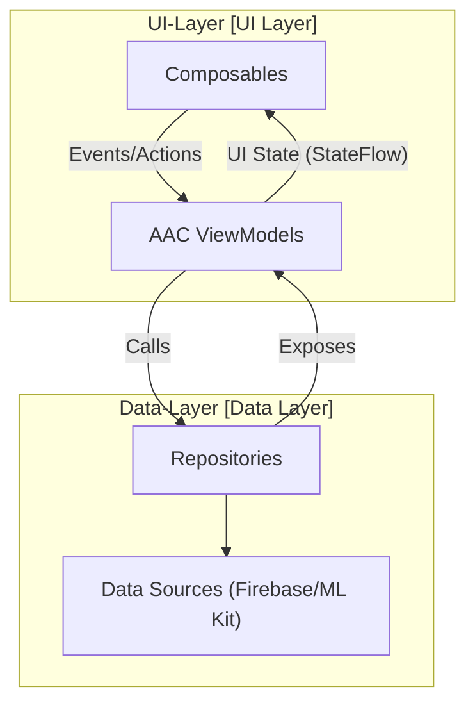

<!-- source: DeepWiki mcp.deepwiki.com · repo android/ai-samples · page 1 Repository Overview · fetched 2026-10-23 -->

# Repository Overview

<details>
<summary>Relevant source files</summary>

The following files were used as context for generating this wiki page:

- [.gemini/styleguide.md](.gemini/styleguide.md)
- [CODEOWNERS](CODEOWNERS)
- [README.md](README.md)

</details>


## Purpose and Scope

This document provides a high-level introduction to the `ai-samples` repository, covering its organizational structure, main projects, and architectural philosophy. The repository serves as a comprehensive showcase of Google AI technologies implemented for Android platforms, demonstrating both cloud-based and on-device AI capabilities.

The repository is divided into two primary projects:
1.  **Android AI Sample Catalog**: A standalone showcase application hosting multiple self-contained AI samples.
2.  **Jetpacker**: A full-stack travel planner reference application demonstrating deep AI integration in a real-world scenario.

For detailed setup instructions and prerequisites, see [Getting Started](#1.1). For the design principles governing these apps, see [Android Architecture Standards](#1.2).

## Repository Structure

The repository follows a clear separation between modular samples and a feature-rich reference application.

### High-Level Project Organization

```mermaid
graph TD
    subgraph "ai-samples-root ["ai-samples/"]"
        ROOT["Repository Root"]
        
        subgraph "ai-sample-catalog-project ["ai-sample-catalog/"]"
            CATALOG_APP[":app"]
            CATALOG_UI[":ui-component"]
            CATALOG_SAMPLES[":samples:*"]
        end
        
        subgraph "jetpacker-project ["jetpacker/android/"]"
            JP_APP[":app"]
            JP_CORE[":core:*"]
            JP_DATA[":data:*"]
            JP_FEATURE[":feature:*"]
        end
    end
    
    ROOT --> CATALOG_APP
    ROOT --> JP_APP
```

Sources: [README.md:7-14]()

| Project | Path | Description |
|-----------|------|-------------|
| **AI Sample Catalog** | `ai-sample-catalog/` | A showcase app for individual Gemini capabilities like hybrid inference, multimodal chat, and summarization. |
| **Jetpacker** | `jetpacker/` | A complete travel planner leveraging ML Kit (on-device) and Firebase AI (cloud) for itinerary management and reviews. |

Sources: [README.md:11-14]()

## Architectural Philosophy

Both projects adhere to modern Android development standards, emphasizing a layered architecture, Unidirectional Data Flow (UDF), and modularization.

### Shared Architectural Standards



The projects enforce the following "Strongly Recommended" practices from the internal style guide:
*   **Layered Architecture**: Separation of UI and Data layers with repositories as the single source of truth [[.gemini/styleguide.md:11-17]()] .
*   **Unidirectional Data Flow (UDF)**: ViewModels expose a single `uiState` using `StateFlow` and receive actions via method calls [[.gemini/styleguide.md:25-26]()] .
*   **Reactive Streams**: Use of Coroutines and Flows for inter-layer communication [[.gemini/styleguide.md:18-18]()] .
*   **Dependency Injection**: Use of Hilt for managing complex dependencies [[.gemini/styleguide.md:95-97]()] .

For a deep dive into these patterns, see [Android Architecture Standards](#1.2).

## Navigation and Sample Distribution

The repository demonstrates a strategic distribution of AI technologies across cloud and on-device processing paradigms.

### AI Capabilities Mapping

| Technology | Implementation Type | Project | Key Samples/Features |
|------------|---------------------|---------|----------------------|
| **Gemini Cloud** | Cloud (Firebase AI) | Catalog & Jetpacker | Chatbots, Multimodal Prompting, Live API, Video Analysis |
| **Gemini Nano** | On-Device (ML Kit) | Catalog & Jetpacker | Summarization, Writing Assistance, Image Description |
| **Hybrid SDK** | Hybrid | Catalog & Jetpacker | InferenceMode.PREFER_ON_DEVICE fallback logic |
| **Imagen** | Cloud | Catalog | Text-to-image generation (Nanobanana) |

Sources: [README.md:13-14](), [.gemini/styleguide.md:65-70]()

## How to Navigate this Wiki

This wiki is structured to take you from high-level concepts to deep implementation details:

*   **[Getting Started](#1.1)**: Your first stop for environment setup and Firebase configuration.
*   **[Android Architecture Standards](#1.2)**: Essential reading for understanding the "why" behind the code structure.
*   **[AI Sample Catalog Application](#2)**: Details on the modular showcase app and its shared components.
*   **[Jetpacker Application](#4)**: Exploration of the reference travel app, including its multi-module data layer and feature integrations.
*   **[Testing Infrastructure](#5)**: Documentation on screenshot testing and unit testing strategies.
*   **[Technical Architecture and Build System](#6)**: Details on Gradle, Version Catalogs, and external service integrations.

Sources: [README.md:18-30]()

---

