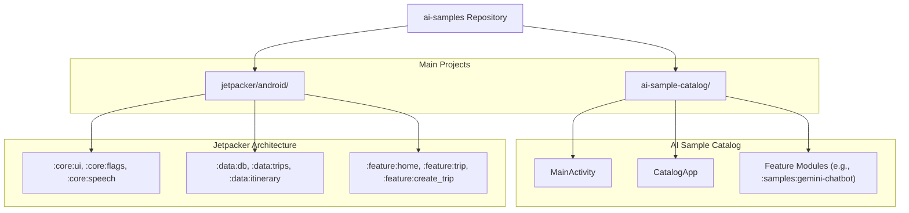
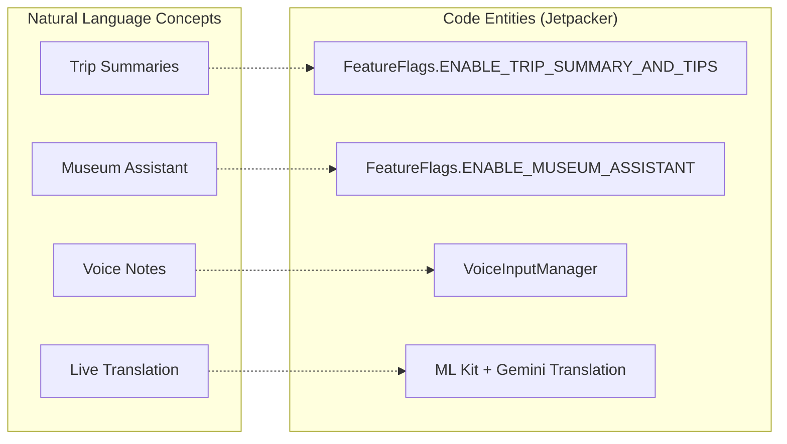

<!-- source: DeepWiki mcp.deepwiki.com · repo android/ai-samples · page 1.1 Getting Started · fetched 2026-10-23 -->

# Getting Started

<details>
<summary>Relevant source files</summary>

The following files were used as context for generating this wiki page:

- [.github/workflows/build-and-test.yml](.github/workflows/build-and-test.yml)
- [README.md](README.md)
- [jetpacker/README.md](jetpacker/README.md)

</details>


This document provides setup instructions, prerequisites, and configuration guidance for working with the `ai-samples` repository. It covers the essential steps to build, configure, and run the two primary projects: the **AI Sample Catalog** and **Jetpacker**.

## Prerequisites and System Requirements

The repository requires specific development environment components and API levels to function properly.

### Development Environment

| Component | Requirement | Notes |
|-----------|-------------|-------|
| Android SDK | API Level 26-35 | Minimum SDK 26, Target SDK 35 |
| Java | Version 17 | Required for Kotlin compilation and CI workflows [ .github/workflows/build-and-test.yml:33-37]() |
| Gradle | 8.0+ | Uses Gradle Wrapper [ .github/workflows/build-and-test.yml:49-58]() |
| Android Studio | 2023.1.1+ | Recommended for Jetpack Compose support |

### Hardware Requirements

- Device or emulator running Android API 26 (Android 8.0) or higher.
- For on-device AI samples: Android device with ML Kit GenAI support.
- For cloud-based samples: Internet connectivity is required.

Sources: [ai-sample-catalog/app/build.gradle.kts:29-42](), [.github/workflows/build-and-test.yml:33-37]()

## Repository Structure and Components

The repository is divided into two main showcase applications, each serving a different purpose.

### 1. Android AI Sample Catalog
A standalone showcase application containing multiple self-contained samples demonstrating various Gemini integration capabilities (hybrid inference, chat, multimodal, summarization, etc.) [README.md:13-13]().

### 2. Jetpacker
A reference travel planner application demonstrating deep, full-stack AI integration. It combines on-device ML Kit (for summaries, speech, and translation) with cloud-based Firebase AI logic for complex tasks like itinerary management and museum assistance [README.md:14-14](), [jetpacker/README.md:16-17]().

### Component Relationship Diagram



Sources: [README.md:1-14](), [jetpacker/README.md:29-51]()

## Development Environment Setup

### Clone and Build Configuration

1. Clone the repository:
```bash
git clone https://github.com/android/ai-samples.git
```

2. **To run the AI Sample Catalog**:
   - Open the `ai-sample-catalog/` directory in Android Studio [README.md:23-23]().
   - Build and run the `app` configuration [README.md:25-25]().

3. **To run Jetpacker**:
   - Open the `jetpacker/android/` directory in Android Studio [README.md:28-28]().
   - Copy `local.properties.example` to `local.properties` and set your `sdk.dir` [jetpacker/README.md:58-64]().
   - Build and run the `:app` configuration [README.md:30-30]().

Sources: [README.md:18-31](), [jetpacker/README.md:52-65]()

## Firebase Configuration

Both projects utilize Firebase for cloud AI features (Vertex AI / Gemini API).

### Setup Steps
1. **Register the Application**: Create a Firebase project in the [Firebase Console](https://console.firebase.google.com) and register your app packages (e.g., `com.android.ai.catalog` or the Jetpacker package).
2. **Download Config**: Download the `google-services.json` file.
3. **Placement**:
   - For AI Sample Catalog: Place in `ai-sample-catalog/app/` [README.md:24-24]().
   - For Jetpacker: Place in `jetpacker/android/app/` [jetpacker/README.md:66-69]().

### Firebase App Check (Jetpacker Specific)
Jetpacker uses Firebase App Check for security. To enable it during development:
1. Run the app and filter Logcat for `DebugAppCheckProvider` [jetpacker/README.md:71-72]().
2. Copy the debug secret token (e.g., `a8c2dd4c-7f7f-4764-b653-ef6c114ba27e`) [jetpacker/README.md:73-75]().
3. Register this token in the Firebase Console under **App Check** -> **Manage Debug Tokens** [jetpacker/README.md:76-76]().

Sources: [jetpacker/README.md:66-77](), [README.md:22-31]()

## Key AI Concepts and Feature Flags

### On-Device vs. Cloud AI
The repository demonstrates two primary AI modalities:
- **On-Device (ML Kit)**: Low latency, privacy-focused, offline-capable. Used for summarization, speech-to-text, and translation [jetpacker/README.md:25-25]().
- **Cloud (Firebase AI / Vertex AI)**: High-reasoning capabilities using Gemini models (Flash, Pro). Used for multimodal chat, video analysis, and complex reasoning [jetpacker/README.md:26-26]().

### Jetpacker Feature Flags
You can toggle specific AI features in Jetpacker by modifying `FeatureFlags.kt` [jetpacker/README.md:94-94]():
- `ENABLE_TRIP_SUMMARY_AND_TIPS`: ML Kit GenAI Prompt for trip summaries [jetpacker/README.md:95-95]().
- `ENABLE_EXPENSE_MANAGEMENT`: Local receipt scanner and parser [jetpacker/README.md:97-97]().
- `ENABLE_MUSEUM_ASSISTANT`: Gemini-powered chatbot with search grounding [jetpacker/README.md:102-102]().

### Natural Language to Code Mapping

This diagram bridges the conceptual AI features to their implementation classes and flags.



Sources: [jetpacker/README.md:93-105]()

## Building and Running Tests

### Gradle Commands
From the project root (or `android/` directory for Jetpacker), you can use the following commands:

```bash
# Build a debug APK
./gradlew :app:assembleDebug

# Run unit tests
./gradlew test

# Apply code formatting (Spotless)
./gradlew spotlessApply
```

Sources: [jetpacker/README.md:79-91](), [.github/workflows/build-and-test.yml:48-58]()

## Next Steps
- For a deep dive into the Sample Catalog's UI components, see **2.1 Application Architecture**.
- To understand how Jetpacker manages data and trips, see **4.2 Core and Data Modules**.
- To learn about the testing strategy, including screenshot tests, see **5. Testing Infrastructure**.

---

