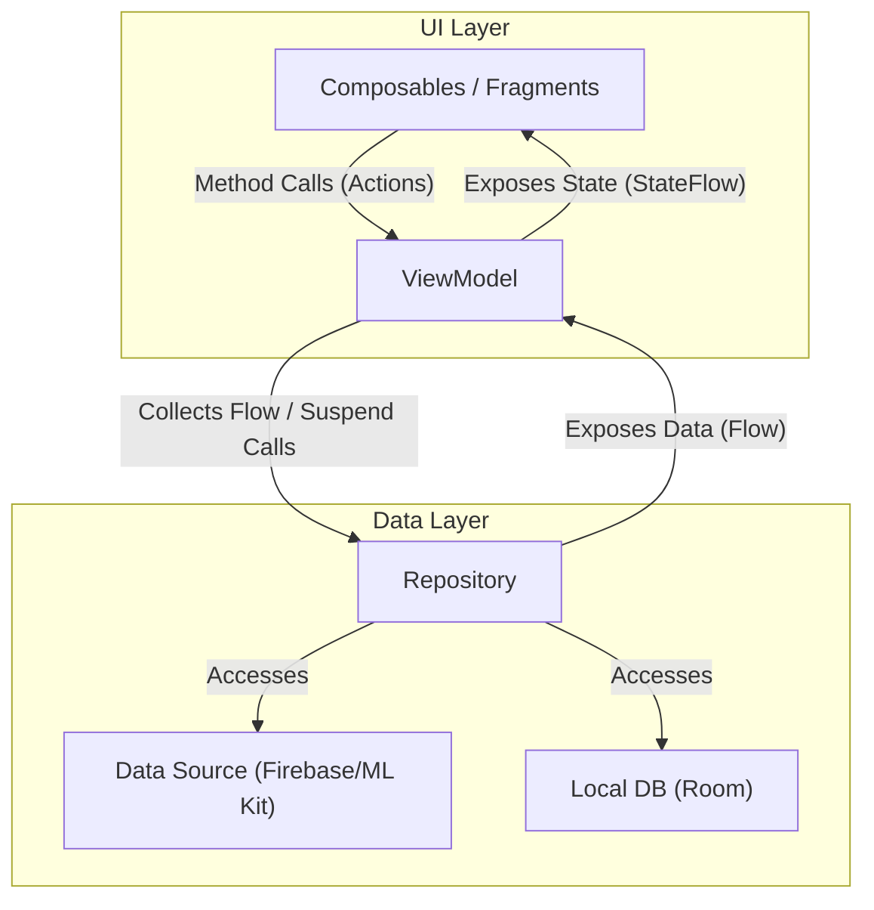
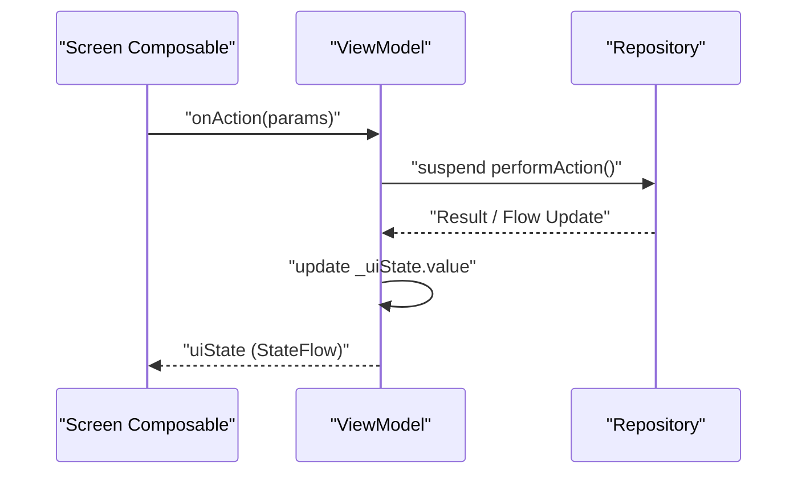
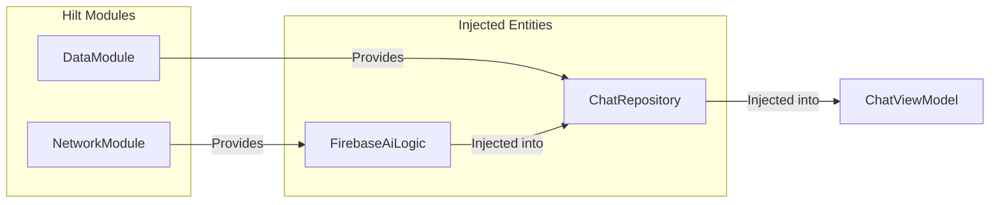

<!-- source: DeepWiki mcp.deepwiki.com · repo android/ai-samples · page 1.2 Android Architecture Standards · fetched 2026-10-23 -->

# Android Architecture Standards

Relevant source files

The following files were used as context for generating this wiki page:

- [.gemini/styleguide.md](.gemini/styleguide.md)

This page documents the shared architectural standards enforced across the `ai-samples` repository. These standards ensure that both the **AI Sample Catalog** and the **Jetpacker** reference application remain maintainable, testable, and scalable by adhering to modern Android development best practices.

## Layered Architecture

The codebase follows a strictly layered architecture to promote separation of concerns and maintain a single source of truth [styleguide.md:11-13]().

*   **Data Layer:** Responsible for exposing application data and containing business logic. It consists of repositories that orchestrate data from various sources (network, database, or AI SDKs) [.gemini/styleguide.md:15-15]().
*   **UI Layer:** Responsible for displaying data and handling user interactions. It is driven by data models and adheres to Unidirectional Data Flow (UDF) [.gemini/styleguide.md:16-16]().
*   **Domain Layer (Optional):** Used in larger modules (like Jetpacker) to encapsulate reusable business logic in "Use Cases" to simplify ViewModels [.gemini/styleguide.md:19-19]().

### Data Flow and Communication
Communication between layers is handled primarily through Kotlin Coroutines and Flows [.gemini/styleguide.md:18-18](). UI components must never interact directly with data sources; they must instead communicate through repositories [.gemini/styleguide.md:17-17]().

**Diagram: Architectural Layer Interaction**

**Sources:** [.gemini/styleguide.md:11-20](), [.gemini/styleguide.md:25-26]()

---

## UI Layer and Unidirectional Data Flow (UDF)

The UI layer follows the UDF pattern where state flows down and events flow up [.gemini/styleguide.md:25-25]().

### ViewModel Standards
ViewModels are the primary state holders for screen-level UI.
*   **Lifecycle Agnostic:** ViewModels must not reference Activities, Fragments, or Context to avoid memory leaks [.gemini/styleguide.md:58-59]().
*   **State Exposure:** ViewModels should only expose a single UI state, typically defined as a `sealed class` or `sealed interface` [.gemini/styleguide.md:63-70]().
*   **No Events:** Events (like navigation or snackbars) should not be sent as one-off "events" from the ViewModel. Instead, they should be processed into the UI state [.gemini/styleguide.md:49-49]().
*   **Initialization:** Developers should avoid calling `fetchData()` in `init {}` blocks; instead, they should use `stateIn()` to trigger data fetching when the state is first collected [.gemini/styleguide.md:82-84]().

### UI State Collection
In Jetpack Compose, state is collected using `collectAsStateWithLifecycle()` to ensure the app does not waste resources when the UI is in the background [.gemini/styleguide.md:27-30]().

**Diagram: UDF State and Event Loop**

**Sources:** [.gemini/styleguide.md:25-49](), [.gemini/styleguide.md:63-76]()

---

## Dependency Injection with Hilt

The projects use Hilt for dependency management to ensure modularity and ease of testing [.gemini/styleguide.md:97-97]().

*   **Constructor Injection:** This is the strongly recommended method for providing dependencies [.gemini/styleguide.md:95-95]().
*   **Scoping:** Mutable data or expensive types are scoped to the appropriate dependency container [.gemini/styleguide.md:96-96]().

**Diagram: Hilt Dependency Mapping**

**Sources:** [.gemini/styleguide.md:93-97]()

---

## Testing Conventions

The architecture is designed to be highly testable by enforcing the use of interfaces and fakes [.gemini/styleguide.md:103-104]().

### Testing Standards
*   **Fakes over Mocks:** The codebase prefers the use of "Fakes" (lightweight implementations of interfaces) over mocking frameworks [.gemini/styleguide.md:104-104]().
*   **ViewModel Testing:** ViewModels are tested by asserting on the `value` property of their `StateFlow` [.gemini/styleguide.md:105-105]().
*   **StateFlows with WhileSubscribed:** When testing `StateFlow` created via `stateIn` with `SharingStarted.WhileSubscribed()`, a `collectJob` must be created in the test to keep the flow active [.gemini/styleguide.md:105-106]().

| Component | Testing Strategy |
| :--- | :--- |
| **ViewModels** | Unit tests asserting on `StateFlow` values. |
| **Repositories** | Unit tests using Fake data sources. |
| **UI Components** | Screenshot testing for visual regressions. |
| **Navigation** | Integration testing for screen-to-screen transitions. |

**Sources:** [.gemini/styleguide.md:101-106]()

---

## Implementation Reference Table

The following table maps architectural requirements to specific implementation patterns used in the samples.

| Requirement | Implementation Pattern | Code Reference |
| :--- | :--- | :--- |
| **UI State** | `sealed class ScreenState` | [.gemini/styleguide.md:65-70]() |
| **Data Exposure** | `StateFlow` via `stateIn` | [.gemini/styleguide.md:76-76]() |
| **Lifecycle** | `repeatOnLifecycle` / `collectAsStateWithLifecycle` | [.gemini/styleguide.md:27-29]() |
| **DI** | `@Inject constructor` | [.gemini/styleguide.md:79-80]() |
| **Composable Params** | `Modifier` as first optional parameter | [.gemini/styleguide.md:50-50]() |

**Sources:** [.gemini/styleguide.md:1-110]()

---

