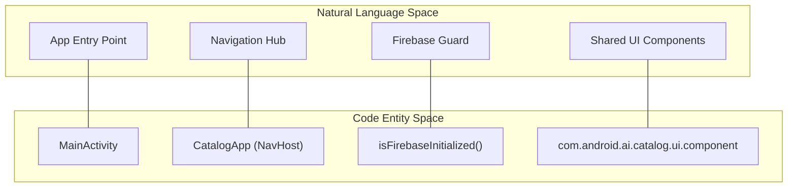
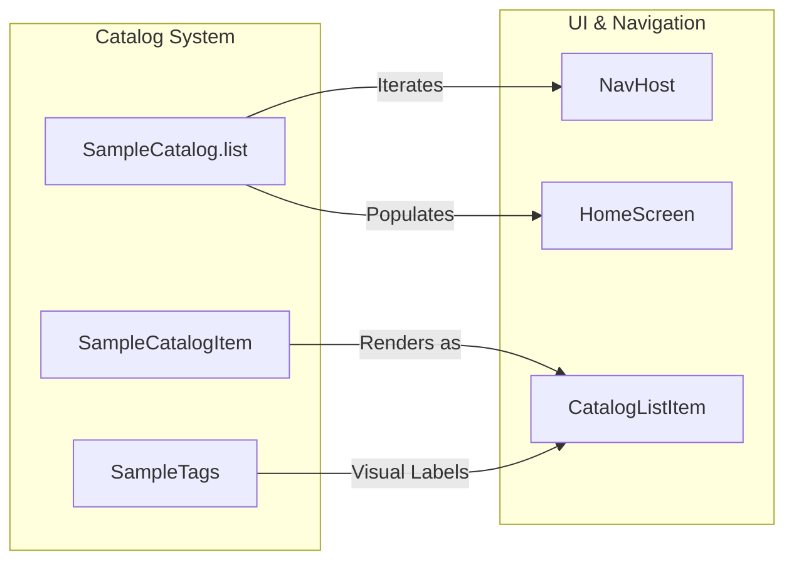

<!-- source: DeepWiki mcp.deepwiki.com · repo android/ai-samples · page 2 AI Sample Catalog Application · fetched 2026-10-23 -->

# AI Sample Catalog Application

Relevant source files

The following files were used as context for generating this wiki page:

- [README.md](README.md)

## Purpose and Scope

The AI Sample Catalog Application is the primary showcase within the `ai-samples` repository, designed to demonstrate Google's AI capabilities on Android. It serves as a centralized host for multiple standalone samples that utilize models such as Gemini 2.0 Flash, Gemini Nano, and Imagen.

This page provides a high-level overview of the catalog's structure and entry points.
- For details on the internal architecture and shared UI components, see [Application Architecture](#2.1).
- For details on the sample registration system and tagging, see [Sample Catalog System](#2.2).
- For technical documentation of the individual AI features (e.g., Gemini Live, Video Analysis), see [AI Sample Documentation](#3).

Sources: [README.md:11-13](), [ai-sample-catalog/README.md:1-20]()

## Application Overview

The application is a single-module Android project located in the `ai-sample-catalog/` directory. It aggregates various AI demonstrations into a unified interface, allowing developers to explore different integration patterns (cloud vs. on-device) in one place.

### Core Component Bridge

The following diagram bridges the high-level application areas to the specific code entities that manage them.

**Application Entity Mapping**

Sources: [ai-sample-catalog/app/src/main/java/com/android/ai/catalog/MainActivity.kt:32-45](), [ai-sample-catalog/app/src/main/java/com/android/ai/catalog/ui/CatalogScreen.kt:64-127]()

## Sample Organization

The catalog categorizes AI samples based on their underlying technology and connectivity requirements. This ensures a clear distinction between cloud-powered features and privacy-focused on-device processing.

| Technology Group | Key Samples | Primary Models |
| :--- | :--- | :--- |
| **Cloud (Firebase)** | Chatbot, Multimodal, Video Analysis, Live API | Gemini 2.0 Flash |
| **On-Device (ML Kit)** | Summarization, Writing Assistant, Image Description | Gemini Nano |
| **Image Generation** | Nanobanana, Magic Selfie | Imagen / Gemini Flash Image |

### Navigation and Sample Registration Flow

Samples are not hard-coded into the UI but are instead registered in a central catalog system. The `CatalogApp` composable iterates through this list to build the navigation graph and the home screen UI.

**Catalog Registration Bridge**

Sources: [ai-sample-catalog/app/src/main/java/com/android/ai/catalog/SampleCatalog.kt:28-100](), [ai-sample-catalog/app/src/main/java/com/android/ai/catalog/ui/CatalogScreen.kt:74-114]()

## Firebase Initialization Guard

A critical feature of the catalog is the `isFirebaseInitialized()` check. Because many samples require a valid `google-services.json` and a connected Firebase project, the application prevents navigation to cloud-based samples if the project is still using the default "mock" configuration.

When a user selects a sample tagged with `SampleTags.FIREBASE`, the application verifies the project ID. If it matches `mock-project-id`, a `firebaseRequiredAlert` dialog is displayed with instructions on how to configure the environment.

Sources: [ai-sample-catalog/app/src/main/java/com/android/ai/catalog/ui/CatalogScreen.kt:221-234](), [ai-sample-catalog/app/google-services.json:1-10]()

## Child Pages
- [Application Architecture](#2.1) — Core structure: `MainActivity`, `CatalogApp`, and the `ui-component` design system.
- [Sample Catalog System](#2.2) — Data models: `SampleCatalogItem`, `SampleTags`, and the dynamic UI generation logic.

---

