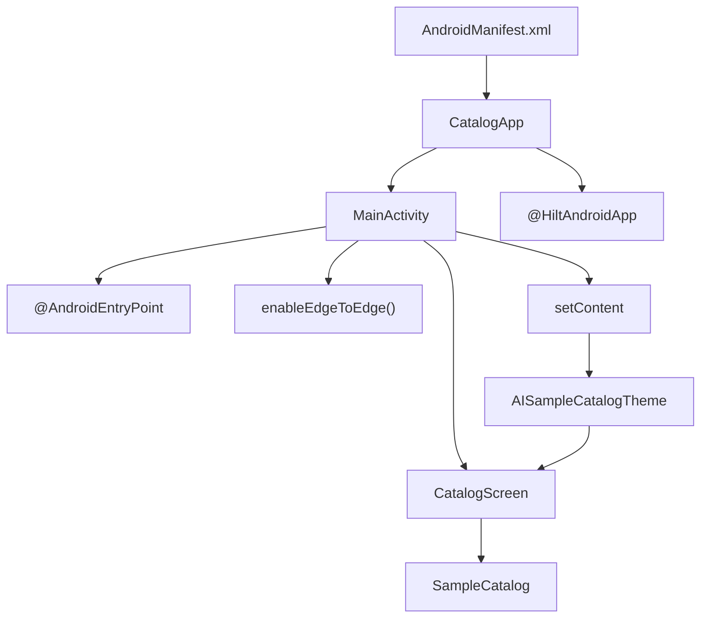
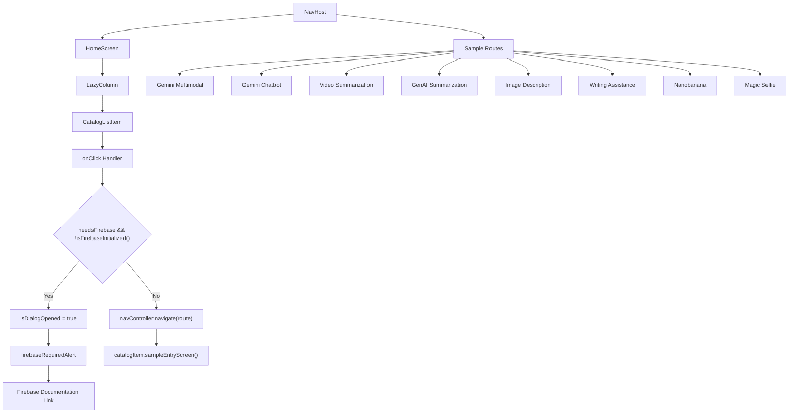
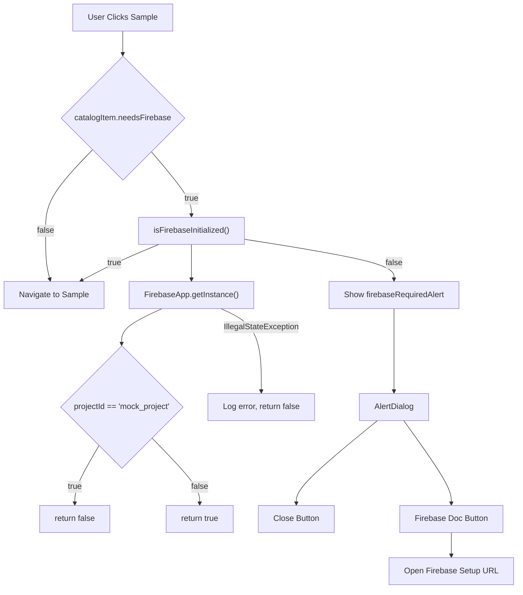

<!-- source: DeepWiki mcp.deepwiki.com · repo android/ai-samples · page 2.1 Application Architecture · fetched 2026-10-23 -->

# Application Architecture

Relevant source files

The following files were used as context for generating this wiki page:

- [README.md](README.md)

This document covers the core application structure, navigation system, and shared UI components for the AI Catalog Android application. It focuses on the architectural foundations that enable the catalog to present and route to individual AI samples.

## Application Structure Overview

The AI Catalog application follows a standard Android architecture pattern with Jetpack Compose for UI and Hilt for dependency injection. The application serves as a launcher and router for various AI sample demonstrations.

**Application Entry Point Architecture**

The application entry point follows this flow:
- `CatalogApp` serves as the Hilt-enabled `Application` class.
- `MainActivity` is a simple `ComponentActivity` that enables edge-to-edge display and sets up Compose content.
- `CatalogScreen` contains the main navigation and UI logic.
- `SampleCatalog` provides the registry of available AI samples.

Sources: [ai-sample-catalog/app/src/main/AndroidManifest.xml:5-26](), [ai-sample-catalog/app/src/main/java/com/android/ai/catalog/CatalogApp.kt:16-22](), [ai-sample-catalog/app/src/main/java/com/android/ai/catalog/MainActivity.kt:30-41]()

## Navigation Architecture

The application uses Jetpack Compose Navigation with a centralized `NavHost` that routes between the home screen and individual sample screens. The navigation system integrates Firebase validation to gate access to cloud-based samples.

**NavHost Structure and Routing**

The navigation system implements these key components:
- `rememberNavController()` creates the navigation controller.
- `HomeScreen` is the `startDestination` marked with `@Serializable`.
- Dynamic route registration occurs by iterating through `catalog.list`.
- Each `SampleCatalogItem` provides its own `route` and `sampleEntryScreen()` composable.

Sources: [ai-sample-catalog/app/src/main/java/com/android/ai/catalog/ui/CatalogScreen.kt:67-114]()

## Firebase Initialization Guard

The application implements a validation pattern to ensure cloud-based AI samples have proper Firebase configuration before allowing access. This prevents runtime errors and provides clear user guidance.

**Firebase Validation Flow**

The Firebase validation implements these behaviors:
- `isFirebaseInitialized()` checks if `FirebaseApp.getInstance()` returns a valid instance.
- Mock configuration with `projectId == "mock_project"` (often the default in template files) is treated as uninitialized.
- `IllegalStateException` indicates Firebase is not properly set up.
- An alert dialog provides a direct link to Firebase setup documentation.

Sources: [ai-sample-catalog/app/src/main/java/com/android/ai/catalog/ui/CatalogScreen.kt:97-101](), [ai-sample-catalog/app/src/main/java/com/android/ai/catalog/ui/CatalogScreen.kt:221-234](), [ai-sample-catalog/app/src/main/java/com/android/ai/catalog/ui/CatalogScreen.kt:117-126]()

## Shared UI Components

The `:ui-component` module provides a unified design system used across all AI samples. This ensures visual consistency and reduces boilerplate for complex UI elements like video players or Markdown rendering.

| Component | File | Purpose |
| :--- | :--- | :--- |
| `MarkdownText` | `MarkdownText.kt` | Renders AI-generated text using Markdown formatting. |
| `VideoPlayer` | `VideoPlayer.kt` | Media3-based player for video analysis and playback samples. |
| `Tag` | `Tag.kt` | Displays metadata like model type (Gemini Flash, Nano) or SDK (Firebase, ML Kit). |
| `Button` | `Buttons.kt` | Standardized primary and secondary buttons for the catalog. |

Sources: [ai-sample-catalog/ui-component/src/main/java/com/android/ai/catalog/ui/component/MarkdownText.kt:25-30](), [ai-sample-catalog/ui-component/src/main/java/com/android/ai/catalog/ui/component/VideoPlayer.kt:35-40](), [ai-sample-catalog/ui-component/src/main/java/com/android/ai/catalog/ui/component/Tag.kt:25-30]()

## Dependency Injection and Build Configuration

The application uses Hilt for dependency injection and a centralized Version Catalog for dependency management.

### Dependency Injection Setup

| Component | Annotation | Purpose |
|-----------|------------|---------|
| `CatalogApp` | `@HiltAndroidApp` | Enables Hilt for the entire application. |
| `MainActivity` | `@AndroidEntryPoint` | Enables injection in the main activity. |

Sources: [ai-sample-catalog/app/src/main/java/com/android/ai/catalog/CatalogApp.kt:21-22](), [ai-sample-catalog/app/src/main/java/com/android/ai/catalog/MainActivity.kt:30]()

### Build Configuration

The project uses Gradle's Version Catalog (`libs.versions.toml`) to manage versions across the `app` and `ui-component` modules. Key configurations include:
- **KSP**: Used for code generation (e.g., Room, Hilt).
- **Compose**: All UI is built using Jetpack Compose.
- **FileProvider**: Configured in `AndroidManifest.xml` to support secure file sharing (e.g., sharing captured images with AI models).

Sources: [ai-sample-catalog/app/src/main/AndroidManifest.xml:27-36](), [README.md:22-25]()

---

