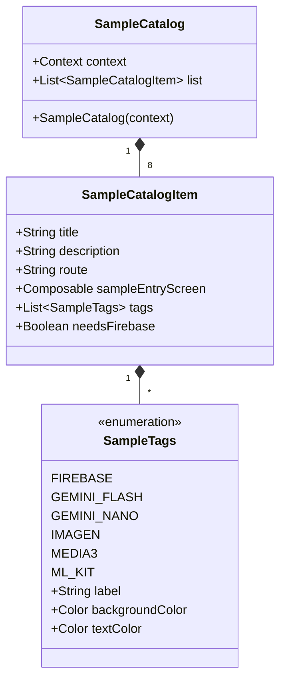
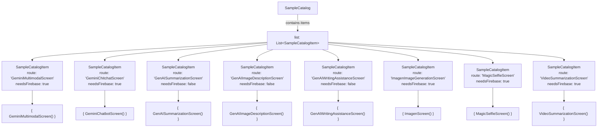
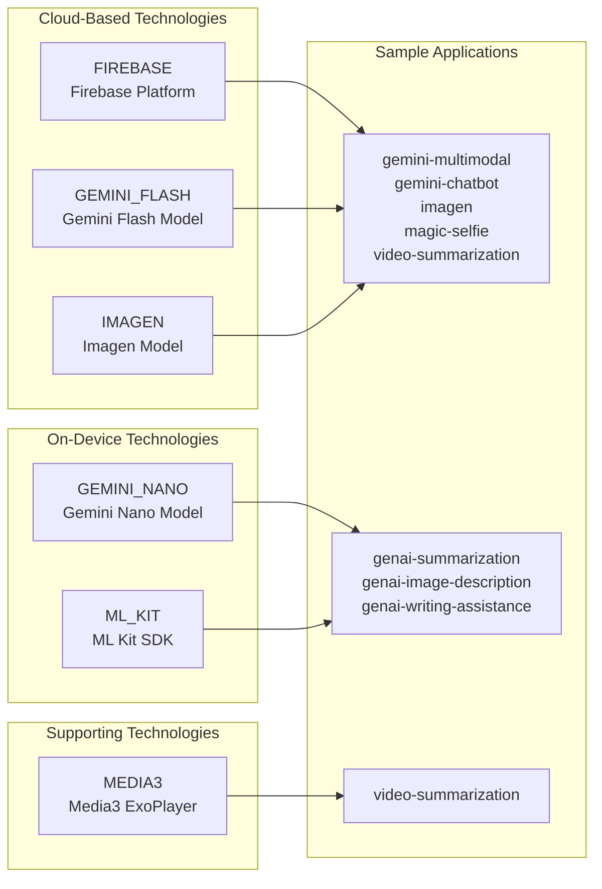
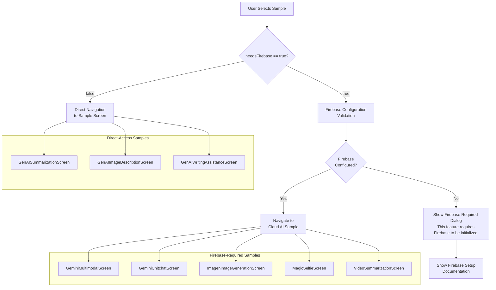
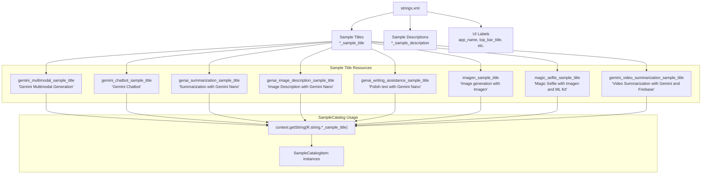

<!-- source: DeepWiki mcp.deepwiki.com · repo android/ai-samples · page 2.2 Sample Catalog System · fetched 2026-10-23 -->

# Sample Catalog System

Relevant source files

The following files were used as context for generating this wiki page:

- [README.md](README.md)

## Purpose and Scope

The Sample Catalog System provides the infrastructure for organizing, categorizing, and presenting AI sample applications within the `ai-sample-catalog` project. This system manages the registration of individual AI samples, their metadata, navigation routes, and classification through a tagging system that distinguishes between cloud-based and on-device AI capabilities.

For information about the overall application architecture and navigation patterns, see [Application Architecture](2.1). For detailed documentation of individual AI samples and their implementations, see [AI Sample Documentation](3).

## Core Catalog Architecture

The catalog system is built around the `SampleCatalog` class which serves as the central registry for all available AI samples in the application.

**Sample Catalog Class Structure**

The `SampleCatalog` class [ai-catalog/app/src/main/java/com/android/ai/catalog/ui/domain/SampleCatalog.kt:33-33]() initializes with a `Context` parameter and maintains a hardcoded list of `SampleCatalogItem` instances [ai-catalog/app/src/main/java/com/android/ai/catalog/ui/domain/SampleCatalog.kt:37-99](), each representing a different AI capability demonstration.

Sources: [ai-catalog/app/src/main/java/com/android/ai/catalog/ui/domain/SampleCatalog.kt:33-125]()

## Sample Registration System

Each AI sample is registered in the catalog through a `SampleCatalogItem` data structure that defines its navigation route, display information, and technical requirements.

**Sample Registration Pattern**

Each sample registration follows a consistent pattern with five required properties and two optional properties [ai-catalog/app/src/main/java/com/android/ai/catalog/ui/domain/SampleCatalog.kt:105-112]():

| Property | Type | Purpose |
|----------|------|---------|
| `title` | `String` | Display name from string resources |
| `description` | `String` | Brief description from string resources |
| `route` | `String` | Unique navigation route identifier |
| `sampleEntryScreen` | `@Composable () -> Unit` | Composable function for sample UI |
| `tags` | `List<SampleTags>` | Technology classification tags |
| `needsFirebase` | `Boolean` | Firebase dependency requirement |

Sources: [ai-catalog/app/src/main/java/com/android/ai/catalog/ui/domain/SampleCatalog.kt:37-112]()

## Technology Classification System

The `SampleTags` enum [ai-catalog/app/src/main/java/com/android/ai/catalog/ui/domain/SampleCatalog.kt:114-125]() provides a comprehensive classification system that categorizes samples by their underlying AI models, platforms, and supporting technologies.

**Tag Classification Matrix**

| Sample | FIREBASE | GEMINI_FLASH | GEMINI_NANO | IMAGEN | ML_KIT | MEDIA3 |
|--------|----------|--------------|-------------|---------|---------|---------|
| `gemini-multimodal` | ✓ | ✓ | | | | |
| `gemini-chatbot` | ✓ | ✓ | | | | |
| `genai-summarization` | | | ✓ | | ✓ | |
| `genai-image-description` | | | ✓ | | ✓ | |
| `genai-writing-assistance` | | | ✓ | | ✓ | |
| `imagen` | ✓ | | | ✓ | | |
| `magic-selfie` | ✓ | | | ✓ | ✓ | |
| `video-summarization` | ✓ | ✓ | | | | ✓ |

Sources: [ai-catalog/app/src/main/java/com/android/ai/catalog/ui/domain/SampleCatalog.kt:43-97](), [ai-catalog/app/src/main/java/com/android/ai/catalog/ui/domain/SampleCatalog.kt:114-125]()

## Firebase Integration Requirements

The catalog system tracks Firebase dependencies through the `needsFirebase` boolean property [ai-catalog/app/src/main/java/com/android/ai/catalog/ui/domain/SampleCatalog.kt:111-111](), which enables conditional access control for cloud-based AI samples.

**Firebase-Dependent Samples**

Five samples require Firebase configuration [ai-catalog/app/src/main/java/com/android/ai/catalog/ui/domain/SampleCatalog.kt:44-97]():
- `GeminiMultimodalScreen` - Gemini Flash multimodal generation
- `GeminiChitchatScreen` - Gemini Flash chatbot 
- `ImagenImageGenerationScreen` - Imagen text-to-image generation
- `MagicSelfieScreen` - Imagen background replacement
- `VideoSummarizationScreen` - Gemini Flash video analysis

Sources: [ai-catalog/app/src/main/java/com/android/ai/catalog/ui/domain/SampleCatalog.kt:44-97](), [ai-catalog/app/src/main/res/values/strings.xml:21-24]()

## String Resource Management

The catalog system uses Android string resources for internationalization and consistent display text across the application.

**String Resource Patterns**

The string resources [ai-catalog/app/src/main/res/values/strings.xml:1-25]() follow consistent naming patterns:

| Pattern | Purpose | Example |
|---------|---------|---------|
| `*_sample_title` | Sample display names | `gemini_multimodal_sample_title` |
| `*_sample_description` | Sample brief descriptions | `gemini_multimodal_sample_description` |
| `firebase_*` | Firebase-related UI text | `firebase_required`, `firebase_doc_button` |
| `app_*` | Application-level labels | `app_name`, `top_bar_title` |

Sources: [ai-catalog/app/src/main/res/values/strings.xml:1-25](), [ai-catalog/app/src/main/java/com/android/ai/catalog/ui/domain/SampleCatalog.kt:39-95]()

## Extension and Maintenance

The catalog system is designed for easy extension. Adding new AI samples requires:

1. Creating a new `SampleCatalogItem` entry in the `list` property [ai-catalog/app/src/main/java/com/android/ai/catalog/ui/domain/SampleCatalog.kt:37-99]().
2. Adding corresponding string resources for title and description [ai-catalog/app/src/main/res/values/strings.xml:1-25]().
3. Importing the sample's entry screen composable.
4. Defining appropriate `SampleTags` for technology classification [ai-catalog/app/src/main/java/com/android/ai/catalog/ui/domain/SampleCatalog.kt:114-125]().
5. Setting `needsFirebase = true` if cloud AI services are required.

The code includes a specific marker for extension: `// To create a new sample entry, add a new SampleCatalogItem here.` [ai-catalog/app/src/main/java/com/android/ai/catalog/ui/domain/SampleCatalog.kt:100-101]().

Sources: [ai-catalog/app/src/main/java/com/android/ai/catalog/ui/domain/SampleCatalog.kt:33-125](), [ai-catalog/app/src/main/res/values/strings.xml:1-25]()

---

