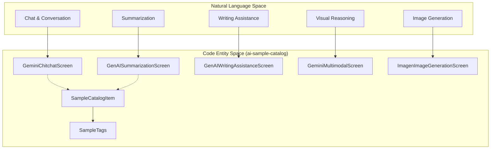
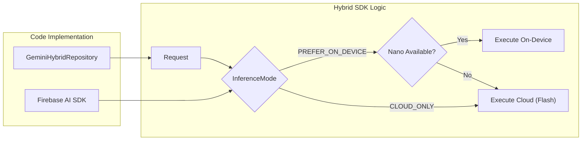

<!-- source: DeepWiki mcp.deepwiki.com · repo android/ai-samples · page 3 AI Sample Documentation · fetched 2026-10-23 -->

# AI Sample Documentation

Relevant source files

The following files were used as context for generating this wiki page:

- [README.md](README.md)

## Purpose and Scope

This document provides a comprehensive overview of the AI samples included in the `ai-samples` repository. It serves as a high-level directory for the individual samples available through the **Android AI Sample Catalog** and the **Jetpacker** reference application. These samples demonstrate a wide range of Generative AI capabilities, from on-device privacy-focused models to powerful cloud-based multimodal reasoning.

For details on the catalog's infrastructure, see [Gemini Cloud Samples](#3.1). For details on specific sample groups, refer to the child pages linked in the sections below.

## Sample Classification and Technology Stack

The repository organizes AI capabilities based on their deployment model (Cloud vs. On-Device) and the specific technology provider (Firebase vs. ML Kit).

### AI Capability Mapping

Sources: [ai-catalog/app/src/main/java/com/android/ai/catalog/ui/domain/SampleCatalog.kt:37-99](), [README.md:1-14]()

## Gemini Cloud Samples

Cloud-based samples leverage the **Firebase AI Logic SDK** to interact with Gemini models hosted in the cloud. These samples provide the highest level of reasoning capability and support multimodal inputs (text, image, and video).

*   **Multimodal & Chat**: Standard chatbot interfaces and image-to-text prompting using Gemini Flash.
*   **Nano Banana Pro**: Advanced image chat that allows for iterative image generation and modification.
*   **Video Analysis**: Tools for summarizing video content and generating metadata (chapters, hashtags) using `Media3` and Gemini.
*   **Live API**: Real-time voice interaction and function calling for task management.

For details, see [Gemini Cloud Samples](#3.1).

Sources: [ai-catalog/app/src/main/res/values/strings.xml:3-20](), [ai-catalog/app/src/main/java/com/android/ai/catalog/ui/domain/SampleCatalog.kt:114-125]()

## GenAI On-Device Samples

On-device samples utilize **Gemini Nano** via **ML Kit**. These samples are optimized for privacy, offline availability, and zero latency from network round-trips.

*   **Summarization**: Condensing long-form text into concise summaries using the GenAI Summarization API.
*   **Writing Assistance**: Proofreading, rewriting, and tone adjustment using the GenAI Rewriting API.
*   **Image Description**: Generating text descriptions of local images directly on the device.

For details, see [GenAI On-Device Samples](#3.2).

Sources: [ai-catalog/app/src/main/java/com/android/ai/catalog/ui/domain/SampleCatalog.kt:59-83]()

## Image Generation and Hybrid Samples

These samples focus on visual creation and the orchestration of multiple model types to achieve complex tasks.

*   **Nanobanana**: Pure text-to-image generation using Imagen models via Firebase.
*   **Magic Selfie**: A complex sample using ML Kit for on-device segmentation and Imagen for cloud-based background replacement.
*   **Hybrid Inference**: Demonstrates the `InferenceMode.PREFER_ON_DEVICE` logic, where the app attempts to use Gemini Nano on-device and falls back to Gemini Flash in the cloud if necessary.

For details, see [Image Generation Samples](#3.3).

### Hybrid Logic Flow

Sources: [ai-catalog/app/src/main/java/com/android/ai/catalog/ui/domain/SampleCatalog.kt:88-100](), [README.md:13-14]()

## Sample Catalog Metadata

Every sample in the `ai-sample-catalog` is registered as a `SampleCatalogItem`. This registration defines the UI presentation, technical requirements (like Firebase), and navigation routes.

| Property | Description | Code Reference |
| :--- | :--- | :--- |
| `route` | The unique navigation string for the screen. | [SampleCatalogItem.kt]() |
| `needsFirebase` | Boolean flag triggering the Firebase initialization check. | [SampleCatalog.kt:38-40]() |
| `tags` | List of `SampleTags` (e.g., `ML_KIT`, `GEMINI_NANO`) for UI filtering. | [SampleCatalog.kt:114-125]() |

Sources: [ai-catalog/app/src/main/java/com/android/ai/catalog/ui/domain/SampleCatalog.kt:37-112]()

---

