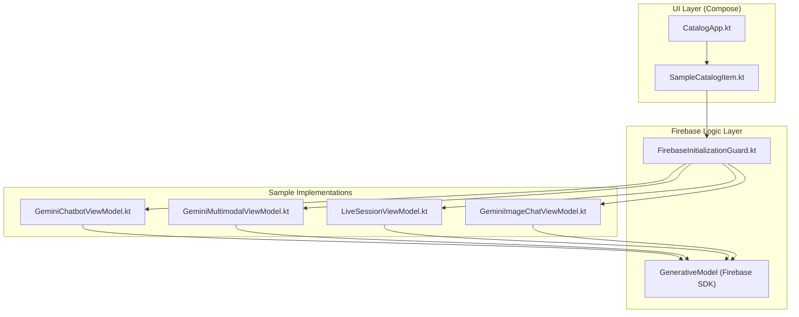
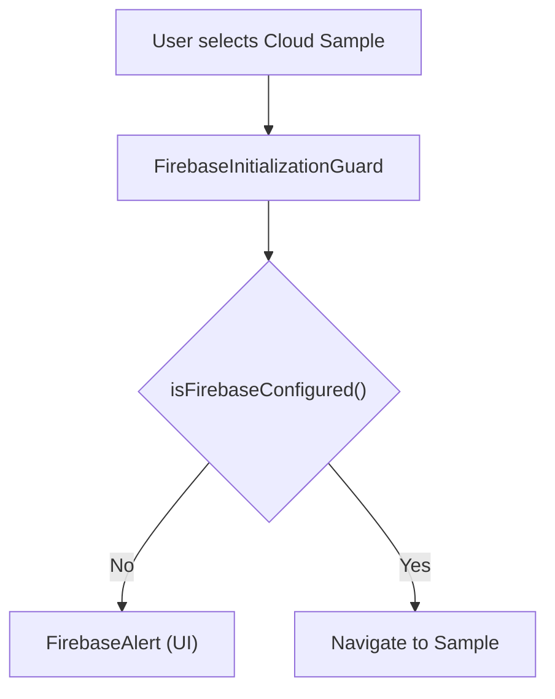

<!-- source: DeepWiki mcp.deepwiki.com · repo android/ai-samples · page 3.1 Gemini Cloud Samples · fetched 2026-10-23 -->

# Gemini Cloud Samples

Relevant source files

The following files were used as context for generating this wiki page:

- [README.md](README.md)

This page provides a high-level overview of the cloud-based AI samples in the `ai-samples` repository. These samples utilize Gemini models via the **Firebase AI Logic SDK**, leveraging cloud infrastructure for advanced multimodal processing, real-time voice interaction, and complex reasoning.

For details on on-device capabilities, see [GenAI On-Device Samples](#3.2). For the overall catalog structure, see [Application Architecture](#2.1).

## Overview

The Gemini Cloud samples demonstrate how to integrate powerful, server-side models into Android applications. Unlike on-device models, these require an active internet connection and a configured Firebase project.

### System Architecture and Code Mapping

The following diagram bridges the high-level system concepts to the specific code entities used to implement cloud-based AI.

**Cloud AI Entity Mapping**

Sources: [README.md:13-14](), [README.md:22-25]()

## Sample Categories

The cloud samples are categorized by their primary interaction model and data modalities:

| Sample Group | Core Features | Key Models |
| :--- | :--- | :--- |
| **Multimodal & Chat** | Text-based conversation, system instructions, and image-to-text analysis. | Gemini 1.5 Flash |
| **Image Generation** | Iterative multimodal chat with image creation (Nano Banana Pro). | Gemini 3 Pro Image |
| **Video Analysis** | Summarization and metadata generation (chapters, tags) from video files. | Gemini 1.5 Flash |
| **Live API** | Real-time voice interaction with function calling and low latency. | Gemini 2.0 Flash |

Sources: [README.md:11-14]()

## Firebase Integration Requirements

Because these samples utilize cloud-based models, they require a valid Firebase project configuration. The `ai-sample-catalog` includes a `FirebaseInitializationGuard` to ensure the app does not attempt to call cloud APIs without a valid `google-services.json`.

**Firebase Guard Logic**

Sources: [README.md:22-25]()

## Detailed Sample Documentation

The following child pages provide deep technical dives into the implementation of each cloud-based feature:

### [Multimodal Generation and Chatbot](#3.1.1)
Covers the implementation of standard text-based chat and multimodal image prompting. This section details how `GenerativeModel` is configured with system instructions to define AI personas and how `Content` objects are used to send mixed media (text and images) to the model.

### [Gemini Image Chat (Nano Banana Pro)](#3.1.2)
Explores the "Nano Banana Pro" sample, which uses the Gemini 3 Pro Image model. It focuses on `responseModalities` for generating images within a chat context and `safetySettings` for content moderation.

### [Video Analysis Samples](#3.1.3)
Details two specific video use cases: `gemini-video-summarization` and `gemini-video-metadata-creation`. It covers integration with **Firebase Cloud Storage** for handling large video files and the use of **ExoPlayer** for synchronized playback of AI-generated insights.

### [Gemini Live API To-Do App](#3.1.4)
Documents the `gemini-live-todo` sample, showcasing the **Live API**. This includes real-time WebSockets-based communication for voice interaction and **Function Calling** (e.g., `addTodo`, `getTodoList`) to bridge natural language commands to local application state.

Sources: [README.md:13-14]()

---

