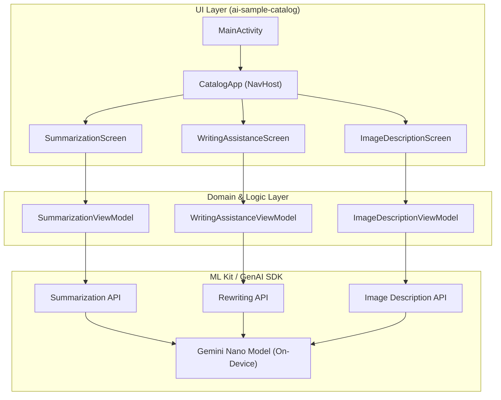
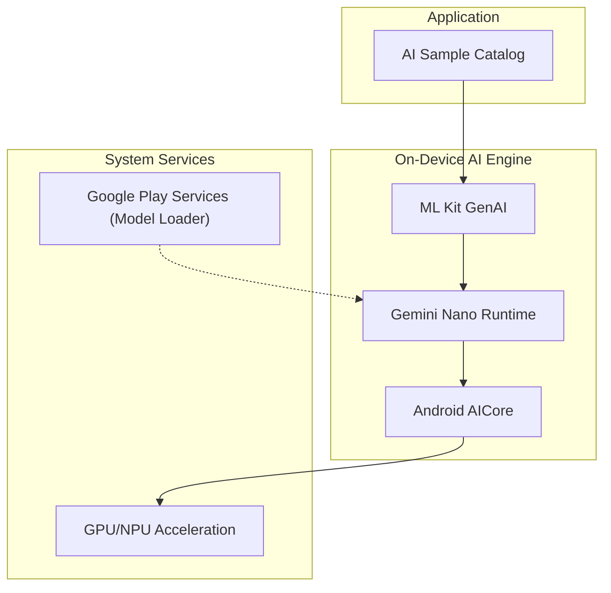
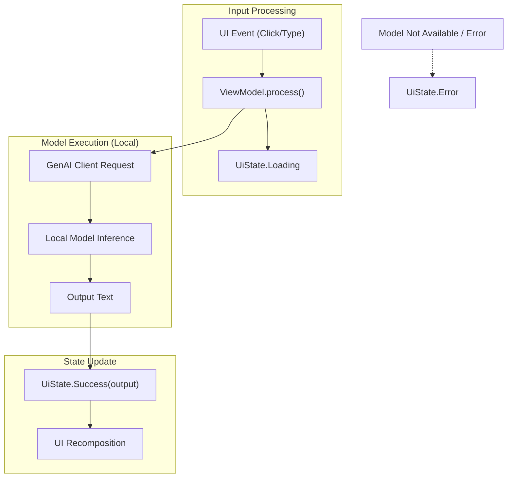

<!-- source: DeepWiki mcp.deepwiki.com · repo android/ai-samples · page 3.2 GenAI On-Device Samples · fetched 2026-10-23 -->

# GenAI On-Device Samples

Relevant source files

The following files were used as context for generating this wiki page:

- [README.md](README.md)

## Purpose and Scope

This document covers the on-device AI sample implementations within the AI Sample Catalog that leverage Gemini Nano through the GenAI API and ML Kit. These samples demonstrate privacy-focused AI processing that runs entirely on the user's device without requiring cloud connectivity or external API calls.

The on-device samples complement the cloud-based capabilities documented in [Gemini Cloud Samples](#3.1) and [Image Generation Samples](#3.3), providing immediate processing with enhanced privacy and offline functionality. For information about the overall catalog architecture, see [Application Architecture](#2.1).

## On-Device Sample Categories

The GenAI on-device samples are organized into three core categories, each showcasing different aspects of local AI processing capabilities through the Gemini Nano model.

| Sample Module | Description | Key Capabilities |
| :--- | :--- | :--- |
| **Text Summarization** | [Text Summarization and Writing Assistance](#3.2.1) | Condensing long-form text into concise summaries using the GenAI Summarization API. |
| **Writing Assistance** | [Text Summarization and Writing Assistance](#3.2.1) | Proofreading and rewriting text with multiple style options (e.g., professional, casual) via the GenAI Rewriting API. |
| **Image Description** | [Image Description](#3.2.2) | Generating descriptive text for local images using the GenAI Image Description API. |

Sources: [README.md:13-14](), [ai-sample-catalog/README.md:7-13]()

## On-Device Processing Architecture

The architecture bridges high-level UI components with low-level model execution handled by ML Kit.

### Sample Integration Flow

Sources: [README.md:13-14](), [ai-sample-catalog/README.md:7-13]()

### Technology Stack and Dependencies

The on-device samples rely on the Google AI Edge SDK and ML Kit to manage the lifecycle and execution of Gemini Nano.

Sources: [README.md:1-14]()

## Sample Implementation Patterns

### Data Flow Architecture

On-device processing follows a Unidirectional Data Flow (UDF) pattern where the ViewModel manages the model's initialization state and processing results.

Sources: [README.md:1-14]()

## Detailed Child Pages

For technical details on implementation, API usage, and specific code examples, refer to the following child pages:

### [Text Summarization and Writing Assistance](#3.2.1)
Covers the implementation of the GenAI Summarization API for creating bulleted or paragraph summaries. It also details the Writing Assistance tools, including proofreading and the Rewriting API for style transformations.

### [Image Description](#3.2.2)
Details the integration of the GenAI Image Description API, including how to pass local image URIs to Gemini Nano for on-device multimodal analysis and accessibility description generation.

Sources: [README.md:1-14]()

---

