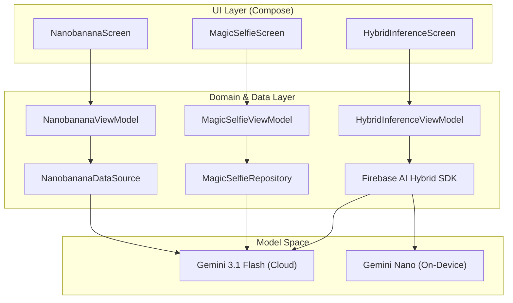
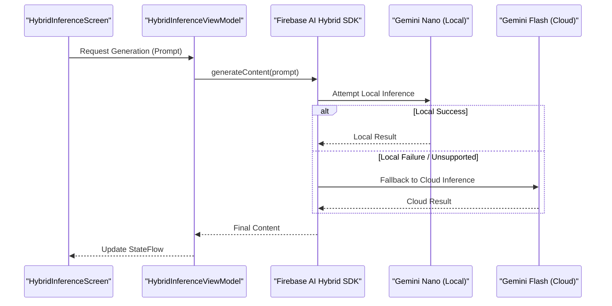

<!-- source: DeepWiki mcp.deepwiki.com · repo android/ai-samples · page 3.3 Image Generation Samples · fetched 2026-10-23 -->

# Image Generation Samples

Relevant source files

The following files were used as context for generating this wiki page:

- [README.md](README.md)

This section documents the visual AI capabilities within the `ai-samples` repository that leverage Google's Gemini and Imagen models for image generation, semantic editing, and hybrid inference. These samples demonstrate how to integrate high-performance cloud models with on-device fallbacks for robust visual AI features.

For details on the specific implementations, see the child pages:
- [Nanobanana Image Generation](#3.3.1) — Text-to-image generation using Gemini 3.1 Flash Image model.
- [Magic Selfie](#3.3.2) — Selfie background replacement using semantic image editing.
- [Hybrid Inference Sample](#3.3.3) — Combining on-device Gemini Nano with cloud Gemini Flash.

## Overview

The image generation samples showcase cloud-based visual AI and hybrid strategies through three primary implementations:

| Sample | Capability | Key Code Entities |
|:---|:---|:---|
| **Nanobanana** | Text-to-image generation | `NanobananaDataSource`, `NanobananaViewModel` |
| **Magic Selfie** | Background replacement | `MagicSelfieViewModel`, `MagicSelfieRepository` |
| **Hybrid Inference** | Fallback-aware generation | `InferenceMode.PREFER_ON_DEVICE`, `GenerativeModel` |

These samples integrate with Firebase Vertex AI to access Gemini models for cloud-based processing while utilizing the Firebase AI Hybrid SDK for intelligent routing between on-device and cloud compute.

Sources: [README.md:1-14](), [ai-sample-catalog/README.md:1-25]()

## Visual AI Architecture

The following diagram illustrates how the visual AI samples bridge user input to specific model implementations in the codebase.

### Visual AI Component Mapping

Sources: [README.md:7-14](), [ai-sample-catalog/README.md:1-15]()

## Core Visual Capabilities

### Nanobanana Text-to-Image
The Nanobanana sample demonstrates basic text-to-image generation. It uses the `NanobananaDataSource` to communicate with the Gemini 3.1 Flash Image model. The implementation focuses on model configuration, including `responseModalities` and safety settings, to transform natural language prompts into visual assets.

For details, see [Nanobanana Image Generation](#3.3.1).

### Magic Selfie Semantic Editing
Magic Selfie moves beyond simple generation into semantic editing. It utilizes the Gemini 3.1 Flash Image model (Nano Banana 2) to perform background replacement. This sample showcases the `MagicSelfieViewModel` and `MagicSelfieRepository` patterns, demonstrating how to handle multimodal prompts where an existing image (the selfie) and a text prompt (the new background) are combined.

For details, see [Magic Selfie](#3.3.2).

### Hybrid Inference Strategy
The `gemini-hybrid` sample demonstrates the "Hybrid AI" philosophy of the repository. It uses the Firebase Hybrid SDK to coordinate between:
1.  **On-device Gemini Nano**: Accessed via the ML Kit Prompt API for privacy and offline availability.
2.  **Cloud Gemini Flash**: Accessed via Firebase Vertex AI for high-fidelity output.

The system uses `InferenceMode.PREFER_ON_DEVICE` to attempt local execution first, falling back to the cloud only when necessary.

For details, see [Hybrid Inference Sample](#3.3.3).

### Hybrid Execution Flow

Sources: [README.md:1-14](), [ai-sample-catalog/README.md:1-25]()

---

