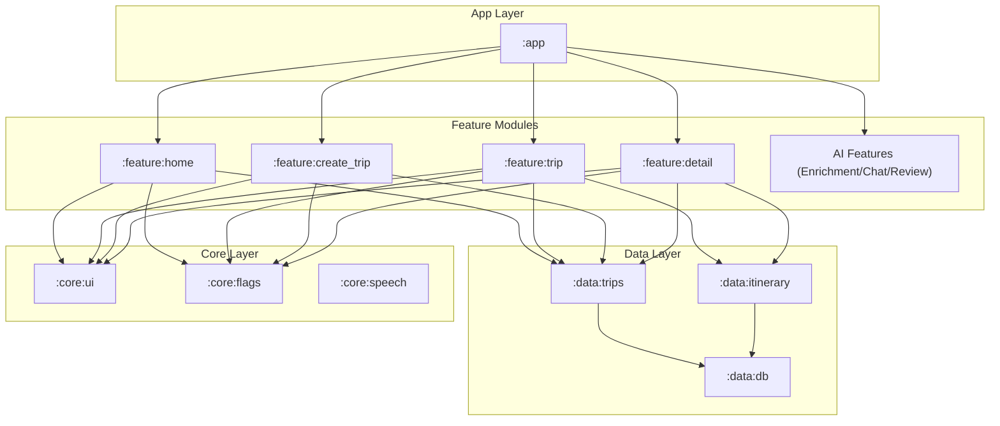
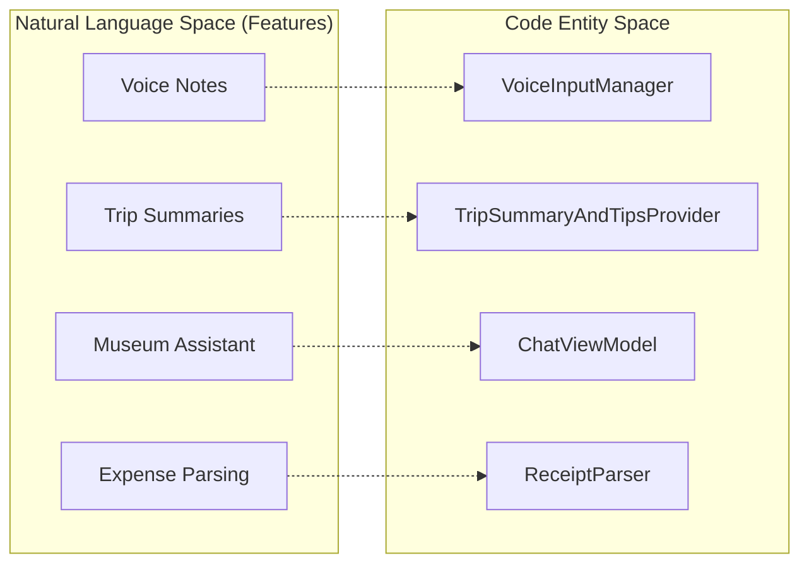

<!-- source: DeepWiki mcp.deepwiki.com · repo android/ai-samples · page 4 Jetpacker Application · fetched 2026-10-23 -->

# Jetpacker Application

Relevant source files

The following files were used as context for generating this wiki page:

- [jetpacker/README.md](jetpacker/README.md)
- [jetpacker/android/app/build.gradle.kts](jetpacker/android/app/build.gradle.kts)
- [jetpacker/android/settings.gradle.kts](jetpacker/android/settings.gradle.kts)

Jetpacker is a comprehensive travel planner reference application that demonstrates deep AI integration within a modern, multi-module Android codebase. It provides users with tools to manage trips, build rich itineraries, record voice notes, and interact with various AI-driven assistants for travel tasks.

The application serves as a showcase for integrating **ML Kit** for on-device processing and **Firebase AI Logic** (Gemini) for cloud and hybrid AI capabilities.

## High-Level System Architecture

Jetpacker is built using a clean, layered, multi-module architecture. It leverages **Jetpack Compose** for the UI, **Dagger/Hilt** for dependency injection, and **Room** for local persistence [jetpacker/README.md:20-25]().

The codebase is organized into three primary module categories:
*   **Core Modules (`:core:*`)**: Shared infrastructure including the design system, feature flags, and speech utilities [jetpacker/README.md:32-35]().
*   **Data Modules (`:data:*`)**: Repository layers and Room database configurations for trips and itineraries [jetpacker/README.md:37-40]().
*   **Feature Modules (`:feature:*`)**: Isolated UI and business logic for specific user journeys like the home dashboard, trip creation, and AI-powered tools [jetpacker/README.md:42-50]().

### Module Dependency Graph

The following diagram illustrates how the main `:app` module aggregates the various functional layers of the system.

**App Module Composition**

**Sources:** [jetpacker/android/app/build.gradle.kts:88-106](), [jetpacker/android/settings.gradle.kts:43-75]()

## AI Integration Strategy

Jetpacker bridges the "Natural Language Space" (user intent) to "Code Entity Space" (app logic) through three distinct AI integration patterns:

1.  **On-Device (Privacy-First)**: Uses ML Kit for tasks like receipt parsing, trip summarization, and speech-to-text [jetpacker/README.md:93-98]().
2.  **Cloud-Grounded**: Uses Firebase AI Logic (Gemini) for complex reasoning, such as the Museum Assistant which is grounded with Search and Maps data [jetpacker/README.md:102]().
3.  **Hybrid**: Implements a fallback mechanism where the app attempts on-device inference first, falling back to the cloud for more complex tasks like review generation [jetpacker/README.md:103]().

### Feature-to-Code Mapping

The following diagram maps high-level AI features to their corresponding code implementation entities.

**AI Feature Mapping**

**Sources:** [jetpacker/README.md:93-104](), [jetpacker/android/app/build.gradle.kts:89-106]()

## Navigation and Routing

The application uses `androidx.navigation3` for routing. The navigation structure is centered around a `TripScreen` container that manages the lifecycle of individual trip sub-tabs (Itinerary, Expenses, Voice Notes) [jetpacker/README.md:46-50]().

For details on the navigation implementation and Hilt setup, see [Jetpacker Architecture and Build System (#4.1)](#).

## Core and Data Infrastructure

The foundation of Jetpacker consists of shared UI components in `:core:ui` and a robust data layer. The `data:trips` and `data:itinerary` modules handle the persistence of `Trip` and `TimelineEvent` entities via the Room database defined in `data:db` [jetpacker/README.md:37-40]().

For details on the design system and data repositories, see [Core and Data Modules (#4.2)](#).

## Functional Capabilities

### Trip Management
The app provides a dashboard (`:feature:home`) for viewing upcoming trips and a unified form (`:feature:create_trip`) for adding or editing trip details [jetpacker/README.md:43-44]().
For details, see [Trip Management Features (#4.3)](#).

### AI-Powered Features
Jetpacker includes several specialized AI modules:
*   **On-Device Enrichment**: Generates trip summaries and daily themes using ML Kit [jetpacker/README.md:95-96](). For details, see [On-Device AI Features (#4.4)](#).
*   **Cloud/Hybrid Assistants**: Includes a grounded Museum Assistant, real-time Hotel Chat translation, and AI Review generation [jetpacker/README.md:102-104](). For details, see [Cloud and Hybrid AI Features (#4.5)](#).
*   **OS Integration**: Exposes trip data to the Android system via the AppFunctions framework [jetpacker/android/app/build.gradle.kts:94](). For details, see [AppFunctions Integration (#4.6)](#).

## Feature Toggles
The system uses a centralized `FeatureFlags` object to control the availability of AI features at runtime [jetpacker/README.md:94]().

| Flag | Description | Module |
| :--- | :--- | :--- |
| `ENABLE_VOICE_NOTES` | Enables on-device speech-to-text | `:feature:trip:voice_notes` |
| `ENABLE_EXPENSE_MANAGEMENT` | Enables receipt scanning/parsing | `:feature:trip:expenses` |
| `ENABLE_MUSEUM_ASSISTANT` | Enables grounded chatbot | `:feature:detail:museum_assistant` |

**Sources:** [jetpacker/README.md:94-103](), [jetpacker/android/app/build.gradle.kts:88-106]()

---

