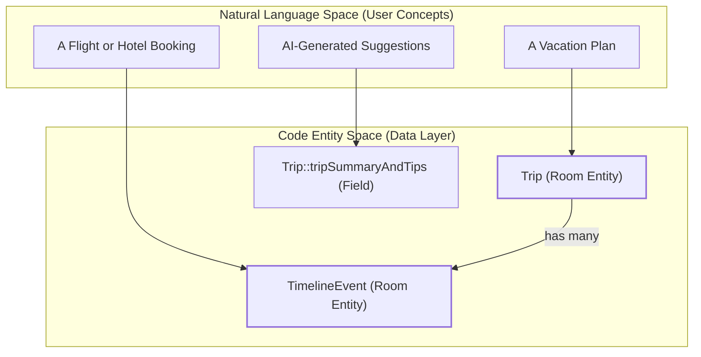
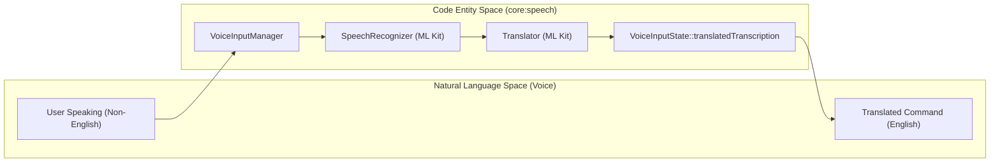

<!-- source: DeepWiki mcp.deepwiki.com · repo android/ai-samples · page 4.2 Core and Data Modules · fetched 2026-10-23 -->

# Core and Data Modules

Relevant source files

The following files were used as context for generating this wiki page:

- [jetpacker/android/core/flags/src/main/kotlin/com/example/jetpacker/core/flags/FeatureFlags.kt](jetpacker/android/core/flags/src/main/kotlin/com/example/jetpacker/core/flags/FeatureFlags.kt)
- [jetpacker/android/core/speech/build.gradle.kts](jetpacker/android/core/speech/build.gradle.kts)
- [jetpacker/android/core/speech/src/main/kotlin/com/example/jetpacker/core/speech/VoiceInputManager.kt](jetpacker/android/core/speech/src/main/kotlin/com/example/jetpacker/core/speech/VoiceInputManager.kt)
- [jetpacker/android/core/speech/src/main/kotlin/com/example/jetpacker/core/speech/VoiceInputState.kt](jetpacker/android/core/speech/src/main/kotlin/com/example/jetpacker/core/speech/VoiceInputState.kt)
- [jetpacker/android/data/trips/src/main/kotlin/com/example/jetpacker/data/trips/Trip.kt](jetpacker/android/data/trips/src/main/kotlin/com/example/jetpacker/data/trips/Trip.kt)

This section documents the shared infrastructure and data persistence layers of the Jetpacker application. These modules provide the foundational utilities for UI components, feature flagging, speech-to-text processing, and the domain models used for trip and itinerary management.

## Core Modules

The core modules contain cross-cutting concerns used by multiple feature modules, including the design system, experimental feature management, and on-device speech capabilities.

### core:flags (FeatureFlags)

The `core:flags` module provides a centralized system for managing experimental features and debug overrides. It uses `SharedPreferences` to persist flag states across application restarts.

*   **Initialization**: The system must be initialized with an application context via `FeatureFlags.initialize(context)` [jetpacker/android/core/flags/src/main/kotlin/com/example/jetpacker/core/flags/FeatureFlags.kt:37-39]().
*   **Storage**: Flags are stored in a file named `debug_settings` [jetpacker/android/core/flags/src/main/kotlin/com/example/jetpacker/core/flags/FeatureFlags.kt:44-44]().
*   **Dynamic Language**: The `DEMO_LANGUAGE` flag allows switching the application's AI and speech recognition target language (defaulting to "nl" for Dutch) [jetpacker/android/core/flags/src/main/kotlin/com/example/jetpacker/core/flags/FeatureFlags.kt:56-59]().

| Flag Constant | Purpose | Default |
| :--- | :--- | :--- |
| `ENABLE_ITINERARY_ENRICHMENT` | Toggles on-device AI enrichment for trips. | `true` |
| `ENABLE_VOICE_NOTES` | Enables the voice recording and transcription feature. | `true` |
| `ENABLE_MUSEUM_ASSISTANT` | Toggles the cloud-based chatbot for museum info. | `true` |
| `OVERRIDE_CURRENT_TIME_MILLIS` | Allows mocking the system time for testing itinerary logic. | `null` |

**Sources:** [jetpacker/android/core/flags/src/main/kotlin/com/example/jetpacker/core/flags/FeatureFlags.kt:21-126]()

### core:speech (VoiceInputManager)

The `core:speech` module leverages ML Kit's GenAI Speech and Translation APIs to provide real-time, on-device transcription and translation.

#### Implementation Detail
The `VoiceInputManager` is a `@Singleton` that manages the lifecycle of the `SpeechRecognizer` and `Translator` [jetpacker/android/core/speech/src/main/kotlin/com/example/jetpacker/core/speech/VoiceInputManager.kt:49-51](). It exposes a `VoiceInputState` Flow to the UI [jetpacker/android/core/speech/src/main/kotlin/com/example/jetpacker/core/speech/VoiceInputManager.kt:53-54]().

*   **Speech Recognition**: Uses `SpeechRecognition.getClient` with `MODE_ADVANCED` for low-latency streaming results [jetpacker/android/core/speech/src/main/kotlin/com/example/jetpacker/core/speech/VoiceInputManager.kt:147-151]().
*   **On-Device Translation**: If the `DEMO_LANGUAGE` is not English, it initializes a `Translator` to convert recognized text into English for downstream AI processing [jetpacker/android/core/speech/src/main/kotlin/com/example/jetpacker/core/speech/VoiceInputManager.kt:123-141]().
*   **Model Management**: The manager handles checking if models are downloaded and triggers downloads if necessary via `recognizer.checkStatus()` and `recognizer.download()` [jetpacker/android/core/speech/src/main/kotlin/com/example/jetpacker/core/speech/VoiceInputManager.kt:182-190]().

#### Voice Input State Flow
The `VoiceInputState` data class tracks the real-time status of the microphone and transcription engine.

| Property | Type | Description |
| :--- | :--- | :--- |
| `isListening` | `Boolean` | True when the microphone is active. |
| `transcription` | `String` | The finalized text from the recognizer. |
| `partialTranscription` | `String` | Real-time text updates as the user speaks. |
| `audioLevel` | `Float` | Used for UI visualizations of voice amplitude. |

**Sources:** [jetpacker/android/core/speech/src/main/kotlin/com/example/jetpacker/core/speech/VoiceInputManager.kt:17-190](), [jetpacker/android/core/speech/src/main/kotlin/com/example/jetpacker/core/speech/VoiceInputState.kt:19-30](), [jetpacker/android/core/speech/build.gradle.kts:42-43]()

---

## Data Modules

The data modules define the schema and persistence logic for the application's primary entities: Trips and Itinerary Events.

### data:trips (Trip Model)

The `Trip` entity represents a travel plan and serves as a parent container for itinerary events.

*   **Entity Definition**: Defined as a Room entity in the `trips` table [jetpacker/android/data/trips/src/main/kotlin/com/example/jetpacker/data/trips/Trip.kt:24-26]().
*   **AI Integration**: Includes a `tripSummaryAndTips` field which stores the output generated by the on-device AI enrichment feature [jetpacker/android/data/trips/src/main/kotlin/com/example/jetpacker/data/trips/Trip.kt:35-35]().

**Sources:** [jetpacker/android/data/trips/src/main/kotlin/com/example/jetpacker/data/trips/Trip.kt:24-36]()

### Natural Language to Code Entity Mapping

The following diagrams bridge the conceptual "Travel Planning" space with the concrete implementation in the Jetpacker codebase.

#### Mapping: Travel Concepts to Data Entities
This diagram shows how user-facing travel concepts are represented as Room entities and Kotlin classes.

**Sources:** [jetpacker/android/data/trips/src/main/kotlin/com/example/jetpacker/data/trips/Trip.kt:24-36]()

#### Mapping: Voice Interaction to Speech Components
This diagram maps the physical act of speaking to the internal components of the `core:speech` module.

**Sources:** [jetpacker/android/core/speech/src/main/kotlin/com/example/jetpacker/core/speech/VoiceInputManager.kt:51-151](), [jetpacker/android/core/speech/src/main/kotlin/com/example/jetpacker/core/speech/VoiceInputState.kt:19-30]()

### Database Infrastructure (data:db)

The application uses Room for local persistence. Complex types (like Lists and Enums) are handled via `Converters`.

*   **Type Converters**: The `Converters` class in `data:itinerary` is registered on the `Trip` entity to handle the `participants` list and other custom types [jetpacker/android/data/trips/src/main/kotlin/com/example/jetpacker/data/trips/Trip.kt:21-22]().

**Sources:** [jetpacker/android/data/trips/src/main/kotlin/com/example/jetpacker/data/trips/Trip.kt:19-22]()

---

