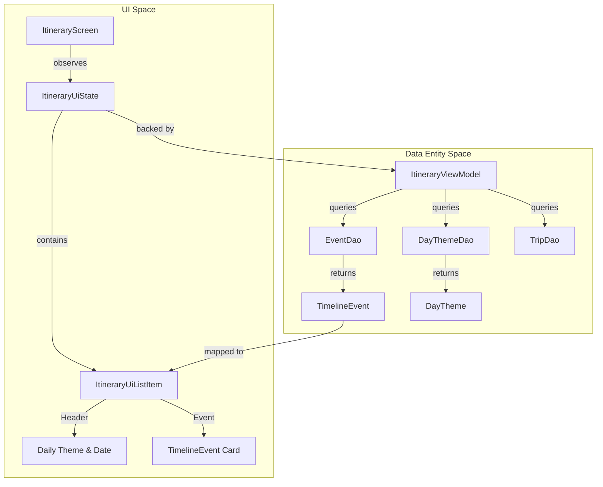
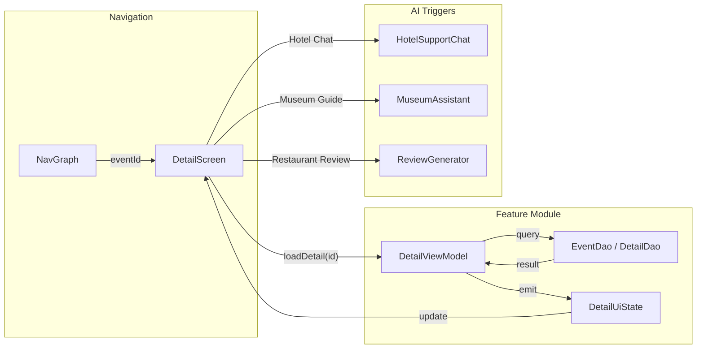

<!-- source: DeepWiki mcp.deepwiki.com · repo android/ai-samples · page 4.3 Trip Management Features · fetched 2026-10-23 -->

# Trip Management Features

Relevant source files

The following files were used as context for generating this wiki page:

- [jetpacker/android/feature/detail/src/main/kotlin/com/example/jetpacker/feature/detail/HotelDetailScreen.kt](jetpacker/android/feature/detail/src/main/kotlin/com/example/jetpacker/feature/detail/HotelDetailScreen.kt)
- [jetpacker/android/feature/detail/src/main/kotlin/com/example/jetpacker/feature/detail/MuseumDetailScreen.kt](jetpacker/android/feature/detail/src/main/kotlin/com/example/jetpacker/feature/detail/MuseumDetailScreen.kt)
- [jetpacker/android/feature/detail/src/main/kotlin/com/example/jetpacker/feature/detail/RestaurantDetailScreen.kt](jetpacker/android/feature/detail/src/main/kotlin/com/example/jetpacker/feature/detail/RestaurantDetailScreen.kt)
- [jetpacker/android/feature/home/build.gradle.kts](jetpacker/android/feature/home/build.gradle.kts)
- [jetpacker/android/feature/home/src/main/kotlin/com/example/jetpacker/feature/home/HomeUiState.kt](jetpacker/android/feature/home/src/main/kotlin/com/example/jetpacker/feature/home/HomeUiState.kt)
- [jetpacker/android/feature/home/src/main/kotlin/com/example/jetpacker/feature/home/HomeViewModel.kt](jetpacker/android/feature/home/src/main/kotlin/com/example/jetpacker/feature/home/HomeViewModel.kt)
- [jetpacker/android/feature/trip/build.gradle.kts](jetpacker/android/feature/trip/build.gradle.kts)
- [jetpacker/android/feature/trip/itinerary/build.gradle.kts](jetpacker/android/feature/trip/itinerary/build.gradle.kts)
- [jetpacker/android/feature/trip/itinerary/src/main/kotlin/com/example/jetpacker/feature/itinerary/ItineraryScreen.kt](jetpacker/android/feature/trip/itinerary/src/main/kotlin/com/example/jetpacker/feature/itinerary/ItineraryScreen.kt)
- [jetpacker/android/feature/trip/itinerary/src/main/kotlin/com/example/jetpacker/feature/itinerary/ItineraryViewModel.kt](jetpacker/android/feature/trip/itinerary/src/main/kotlin/com/example/jetpacker/feature/itinerary/ItineraryViewModel.kt)

This page documents the feature modules responsible for managing travel itineraries within the Jetpacker application. It covers the dashboard (Home), the itinerary timeline, and the specific detail views for various travel events.

## Home Screen and Trip Dashboard

The Home screen serves as the primary entry point for the application, displaying a list of upcoming and past trips. It handles the initial database population and integrates voice-based commands for trip management.

### Implementation Details
*   **HomeViewModel**: Manages the lifecycle of the trip list. It uses `TripDao` to fetch all trips and `DummyData` to prepopulate the database if empty [jetpacker/android/feature/home/src/main/kotlin/com/example/jetpacker/feature/home/HomeViewModel.kt:49-57](). It also listens to the `VoiceInputManager` to update UI state based on speech-to-text interactions [jetpacker/android/feature/home/src/main/kotlin/com/example/jetpacker/feature/home/HomeViewModel.kt:63-79]().
*   **HomeUiState**: A data class representing the state of the dashboard, including the list of `Trip` objects, loading status, and transcription states for voice input [jetpacker/android/feature/home/src/main/kotlin/com/example/jetpacker/feature/home/HomeUiState.kt:21-33]().

### Data Flow: Trip Initialization
The dashboard ensures the user has sample data upon first launch through a prepopulation routine.

| Action | Function | Source |
| :--- | :--- | :--- |
| Fetch Trips | `loadTrips()` | [jetpacker/android/feature/home/src/main/kotlin/com/example/jetpacker/feature/home/HomeViewModel.kt:82-101]() |
| Prepopulate | `prepopulateDatabase()` | [jetpacker/android/feature/home/src/main/kotlin/com/example/jetpacker/feature/home/HomeViewModel.kt:103-115]() |
| Delete Trip | `deleteTrip(trip: Trip)` | [jetpacker/android/feature/home/src/main/kotlin/com/example/jetpacker/feature/home/HomeViewModel.kt:117-122]() |

**Sources:** [jetpacker/android/feature/home/src/main/kotlin/com/example/jetpacker/feature/home/HomeViewModel.kt:1-140](), [jetpacker/android/feature/home/src/main/kotlin/com/example/jetpacker/feature/home/HomeUiState.kt:1-34]()

---

## Itinerary Timeline

The Itinerary feature provides a chronological view of a specific trip's events, organized by day. It supports AI-driven enrichment such as daily themes and trip summaries.

### Architecture and Data Mapping
The `ItineraryViewModel` transforms flat `TimelineEvent` data into a grouped list of `ItineraryUiListItem` objects (Headers and Events) for display in a `LazyColumn` [jetpacker/android/feature/trip/itinerary/src/main/kotlin/com/example/jetpacker/feature/itinerary/ItineraryViewModel.kt:100-135]().

#### Itinerary System Mapping
The following diagram bridges the user-facing timeline to the underlying code entities.

"Itinerary Entity Space"

**Sources:** [jetpacker/android/feature/trip/itinerary/src/main/kotlin/com/example/jetpacker/feature/itinerary/ItineraryViewModel.kt:82-135](), [jetpacker/android/feature/trip/itinerary/src/main/kotlin/com/example/jetpacker/feature/itinerary/ItineraryScreen.kt:68-123]()

### Itinerary Enrichment
If enabled via `FeatureFlags.ENABLE_ITINERARY_ENRICHMENT`, the system generates AI summaries and tips:
*   **TripSummaryAndTipsProvider**: Generates overall trip insights [jetpacker/android/feature/trip/itinerary/src/main/kotlin/com/example/jetpacker/feature/itinerary/ItineraryViewModel.kt:79]().
*   **DailyThemeProvider**: Generates a semantic "theme" for each day based on the scheduled activities [jetpacker/android/feature/trip/itinerary/src/main/kotlin/com/example/jetpacker/feature/itinerary/ItineraryViewModel.kt:80]().

**Sources:** [jetpacker/android/feature/trip/itinerary/src/main/kotlin/com/example/jetpacker/feature/itinerary/ItineraryViewModel.kt:139-180]()

---

## Event Detail Screens

Jetpacker includes specialized detail screens for different types of itinerary events. These screens are designed to provide context-specific information and AI triggers.

### Detail Screen Registry

| Feature | Screen Composable | Key Capabilities |
| :--- | :--- | :--- |
| **Hotel** | `HotelDetailScreen` | Displays check-in/out times, room types, and triggers `onOpenHotelChat` for support [jetpacker/android/feature/detail/src/main/kotlin/com/example/jetpacker/feature/detail/HotelDetailScreen.kt:80-112](). |
| **Museum** | `MuseumDetailScreen` | Shows exhibits, operating hours, and triggers `onOpenAssistant` for an AI guide [jetpacker/android/feature/detail/src/main/kotlin/com/example/jetpacker/feature/detail/MuseumDetailScreen.kt:87-123](). |
| **Restaurant** | `RestaurantDetailScreen` | Displays cuisine, reservation party size, and triggers `onOpenReviewScreen` for AI review generation [jetpacker/android/feature/detail/src/main/kotlin/com/example/jetpacker/feature/detail/RestaurantDetailScreen.kt:81-117](). |

### Common Implementation Pattern
Every detail screen follows a consistent UDF pattern:
1.  **Event Loading**: Uses `LaunchedEffect` to trigger `viewModel.loadDetail(eventId)` when the screen is composed [jetpacker/android/feature/detail/src/main/kotlin/com/example/jetpacker/feature/detail/HotelDetailScreen.kt:86]().
2.  **State Observation**: Collects `uiState` using `collectAsStateWithLifecycle()` [jetpacker/android/feature/detail/src/main/kotlin/com/example/jetpacker/feature/detail/HotelDetailScreen.kt:87]().
3.  **UI Layout**: Utilizes a `Scaffold` with a `TopAppBar` and a `Column` containing themed `Card` components [jetpacker/android/feature/detail/src/main/kotlin/com/example/jetpacker/feature/detail/HotelDetailScreen.kt:112-152]().

#### Detail Screen Navigation and Data Flow
"Detail Screen Data Flow"

**Sources:** [jetpacker/android/feature/detail/src/main/kotlin/com/example/jetpacker/feature/detail/HotelDetailScreen.kt:80-90](), [jetpacker/android/feature/detail/src/main/kotlin/com/example/jetpacker/feature/detail/MuseumDetailScreen.kt:87-94](), [jetpacker/android/feature/detail/src/main/kotlin/com/example/jetpacker/feature/detail/RestaurantDetailScreen.kt:81-88]()

---

## Module Dependencies

The trip management features are split across several Gradle modules to maintain separation of concerns.

*   **`:feature:home`**: Depends on `:data:trips` and `:feature:create_trip` [jetpacker/android/feature/home/build.gradle.kts:44-45]().
*   **`:feature:trip:itinerary`**: Depends on `:data:itinerary` and `:feature:trip:itinerary:enrichment` for AI features [jetpacker/android/feature/trip/itinerary/build.gradle.kts:49-51]().
*   **`:feature:trip`**: Acts as a container module, aggregating itinerary, expenses, and voice notes [jetpacker/android/feature/trip/build.gradle.kts:48-50]().

**Sources:** [jetpacker/android/feature/home/build.gradle.kts:1-66](), [jetpacker/android/feature/trip/itinerary/build.gradle.kts:1-91](), [jetpacker/android/feature/trip/build.gradle.kts:1-81]()

---

