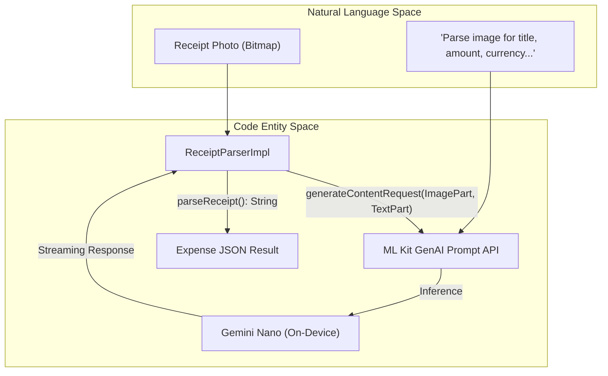
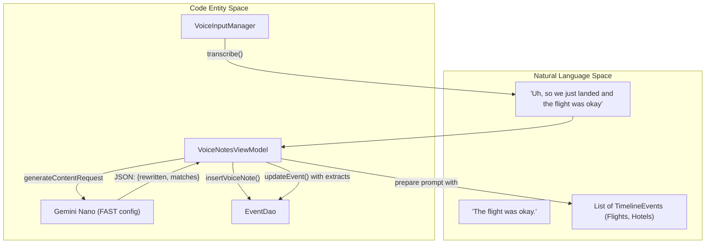

<!-- source: DeepWiki mcp.deepwiki.com · repo android/ai-samples · page 4.4 On-Device AI Features · fetched 2026-10-23 -->

# On-Device AI Features

Relevant source files

The following files were used as context for generating this wiki page:

- [jetpacker/android/feature/trip/expenses/build.gradle.kts](jetpacker/android/feature/trip/expenses/build.gradle.kts)
- [jetpacker/android/feature/trip/expenses/src/main/kotlin/com/example/jetpacker/feature/expenses/ReceiptParser.kt](jetpacker/android/feature/trip/expenses/src/main/kotlin/com/example/jetpacker/feature/expenses/ReceiptParser.kt)
- [jetpacker/android/feature/trip/expenses/src/main/kotlin/com/example/jetpacker/feature/expenses/ReceiptParserImpl.kt](jetpacker/android/feature/trip/expenses/src/main/kotlin/com/example/jetpacker/feature/expenses/ReceiptParserImpl.kt)
- [jetpacker/android/feature/trip/itinerary/enrichment/build.gradle.kts](jetpacker/android/feature/trip/itinerary/enrichment/build.gradle.kts)
- [jetpacker/android/feature/trip/itinerary/enrichment/src/main/kotlin/com/example/jetpacker/feature/itinerary_enrichment/DailyThemeProvider.kt](jetpacker/android/feature/trip/itinerary/enrichment/src/main/kotlin/com/example/jetpacker/feature/itinerary_enrichment/DailyThemeProvider.kt)
- [jetpacker/android/feature/trip/itinerary/enrichment/src/main/kotlin/com/example/jetpacker/feature/itinerary_enrichment/TripSummaryAndTipsProvider.kt](jetpacker/android/feature/trip/itinerary/enrichment/src/main/kotlin/com/example/jetpacker/feature/itinerary_enrichment/TripSummaryAndTipsProvider.kt)
- [jetpacker/android/feature/trip/voice_notes/build.gradle.kts](jetpacker/android/feature/trip/voice_notes/build.gradle.kts)
- [jetpacker/android/feature/trip/voice_notes/src/main/kotlin/com/example/jetpacker/feature/voice_notes/VoiceNotesViewModel.kt](jetpacker/android/feature/trip/voice_notes/src/main/kotlin/com/example/jetpacker/feature/voice_notes/VoiceNotesViewModel.kt)

This page documents the on-device Machine Learning (ML) capabilities integrated into Jetpacker. These features leverage the **ML Kit GenAI Prompt API** (utilizing Gemini Nano) for privacy-focused, offline processing of itinerary data, receipt images, and voice transcriptions.

## Itinerary Enrichment

Itinerary enrichment enhances the user's travel timeline by providing context-aware themes, summaries, and travel tips based on planned events.

### Daily Theme Generation
The `DailyThemeProvider` interface defines the contract for generating thematic titles for specific days in a trip based on the `TimelineEvent` objects scheduled for that day [jetpacker/android/feature/trip/itinerary/enrichment/src/main/kotlin/com/example/jetpacker/feature/itinerary_enrichment/DailyThemeProvider.kt:21-23]().

### Trip Summaries and Tips
The `TripSummaryAndTipsProvider` generates natural language insights from trip data [jetpacker/android/feature/trip/itinerary/enrichment/src/main/kotlin/com/example/jetpacker/feature/itinerary_enrichment/TripSummaryAndTipsProvider.kt:24-32](). Key capabilities include:
*   **Trip Summary:** A narrative overview of the trip based on scheduled events and user-added voice notes [jetpacker/android/feature/trip/itinerary_enrichment/src/main/kotlin/com/example/jetpacker/feature/itinerary_enrichment/TripSummaryAndTipsProvider.kt:29-29]().
*   **Upcoming Tips:** Proactive advice (e.g., packing reminders or transit tips) based on the immediate upcoming `TimelineEvent` [jetpacker/android/feature/trip/itinerary_enrichment/src/main/kotlin/com/example/jetpacker/feature/itinerary_enrichment/TripSummaryAndTipsProvider.kt:31-31]().

**Sources:**
* [jetpacker/android/feature/trip/itinerary/enrichment/src/main/kotlin/com/example/jetpacker/feature/itinerary_enrichment/DailyThemeProvider.kt:17-24]()
* [jetpacker/android/feature/trip/itinerary/enrichment/src/main/kotlin/com/example/jetpacker/feature/itinerary_enrichment/TripSummaryAndTipsProvider.kt:17-32]()

---

## Expense Receipt Parsing

Jetpacker allows users to scan receipts to automatically populate expense reports. This is handled by the `ReceiptParser` interface and its implementation `ReceiptParserImpl`.

### Implementation Detail
`ReceiptParserImpl` uses the ML Kit GenAI Prompt API with a specific `modelConfig` targeting the `PREVIEW` release stage and `FULL` model preference [jetpacker/android/feature/trip/expenses/src/main/kotlin/com/example/jetpacker/feature/expenses/ReceiptParserImpl.kt:36-41]().

### Data Flow: Image to JSON
1.  **Status Check:** The parser verifies if the on-device model is available or needs downloading [jetpacker/android/feature/trip/expenses/src/main/kotlin/com/example/jetpacker/feature/expenses/ReceiptParserImpl.kt:45-53]().
2.  **Prompt Construction:** A detailed system prompt instructs the model to identify if the image is a receipt and extract the `title`, `amount`, `currency` (ISO 4217), and `category` [jetpacker/android/feature/trip/expenses/src/main/kotlin/com/example/jetpacker/feature/expenses/ReceiptParserImpl.kt:65-73]().
3.  **Multimodal Inference:** The `Bitmap` and the text prompt are sent via `generateContentRequest` [jetpacker/android/feature/trip/expenses/src/main/kotlin/com/example/jetpacker/feature/expenses/ReceiptParserImpl.kt:75-75]().
4.  **Streaming Response:** The result is collected as a stream and returned as a JSON string [jetpacker/android/feature/trip/expenses/src/main/kotlin/com/example/jetpacker/feature/expenses/ReceiptParserImpl.kt:79-86]().

### Receipt Parsing Logic Flow
Title: Receipt Parsing Pipeline

**Sources:**
* [jetpacker/android/feature/trip/expenses/src/main/kotlin/com/example/jetpacker/feature/expenses/ReceiptParser.kt:21-25]()
* [jetpacker/android/feature/trip/expenses/src/main/kotlin/com/example/jetpacker/feature/expenses/ReceiptParserImpl.kt:34-88]()

---

## Voice Notes and Transcription Refinement

The Voice Notes feature allows users to record spoken thoughts, which are then transcribed, cleaned, and automatically associated with relevant itinerary events.

### Components
*   **VoiceInputManager:** Handles the audio recording and initial speech-to-text (STT) conversion [jetpacker/android/feature/trip/voice_notes/src/main/kotlin/com/example/jetpacker/feature/voice_notes/VoiceNotesViewModel.kt:62-62]().
*   **VoiceNotesViewModel:** Orchestrates the refinement process. It manages the `processingNotes` state for UI feedback while the AI processes the input [jetpacker/android/feature/trip/voice_notes/src/main/kotlin/com/example/jetpacker/feature/voice_notes/VoiceNotesViewModel.kt:86-86]().
*   **EventDao:** Persists the final `VoiceNoteEntity` and updates associated `TimelineEvent` objects [jetpacker/android/feature/trip/voice_notes/src/main/kotlin/com/example/jetpacker/feature/voice_notes/VoiceNotesViewModel.kt:61-61]().

### AI Refinement Process
The `processVoiceNote` function performs the following steps:
1.  **Context Preparation:** It retrieves all `TimelineEvent` objects for the trip up to the current timestamp to provide context to the model [jetpacker/android/feature/trip/voice_notes/src/main/kotlin/com/example/jetpacker/feature/voice_notes/VoiceNotesViewModel.kt:155-158]().
2.  **Prompt Engineering:** The prompt asks the model to:
    *   Remove filler words and fluff [jetpacker/android/feature/trip/voice_notes/src/main/kotlin/com/example/jetpacker/feature/voice_notes/VoiceNotesViewModel.kt:165-166]().
    *   Identify matching events from the provided list [jetpacker/android/feature/trip/voice_notes/src/main/kotlin/com/example/jetpacker/feature/voice_notes/VoiceNotesViewModel.kt:167-167]().
    *   Extract specific relevant snippets for each event [jetpacker/android/feature/trip/voice_notes/src/main/kotlin/com/example/jetpacker/feature/voice_notes/VoiceNotesViewModel.kt:167-167]().
3.  **JSON Enforcement:** The model is strictly instructed to return a JSON object with `rewritten` and `matches` fields [jetpacker/android/feature/trip/voice_notes/src/main/kotlin/com/example/jetpacker/feature/voice_notes/VoiceNotesViewModel.kt:169-171]().

### Voice Note Processing Architecture
Title: Voice Note Contextual Mapping

**Sources:**
* [jetpacker/android/feature/trip/voice_notes/src/main/kotlin/com/example/jetpacker/feature/voice_notes/VoiceNotesViewModel.kt:57-173]()
* [jetpacker/android/feature/trip/voice_notes/build.gradle.kts:58-59]()

---

## Technical Configuration

### Dependency Injection
Features are modularized and use Hilt for dependency injection. The AI features require the ML Kit GenAI Prompt library:
*   `libs.mlkit.genai.prompt` [jetpacker/android/feature/trip/expenses/build.gradle.kts:57]()
*   `libs.mlkit.genai.speech` (for Voice Notes) [jetpacker/android/feature/trip/voice_notes/build.gradle.kts:59]()

### Model Configuration
The application uses different model configurations based on the use case:
| Feature | Model Preference | Release Stage |
| :--- | :--- | :--- |
| **Receipt Parsing** | `ModelPreference.FULL` | `ModelReleaseStage.PREVIEW` |
| **Voice Notes** | `ModelPreference.FAST` | `ModelReleaseStage.PREVIEW` |

**Sources:**
* [jetpacker/android/feature/trip/expenses/src/main/kotlin/com/example/jetpacker/feature/expenses/ReceiptParserImpl.kt:36-41]()
* [jetpacker/android/feature/trip/voice_notes/src/main/kotlin/com/example/jetpacker/feature/voice_notes/VoiceNotesViewModel.kt:94-99]()

---

