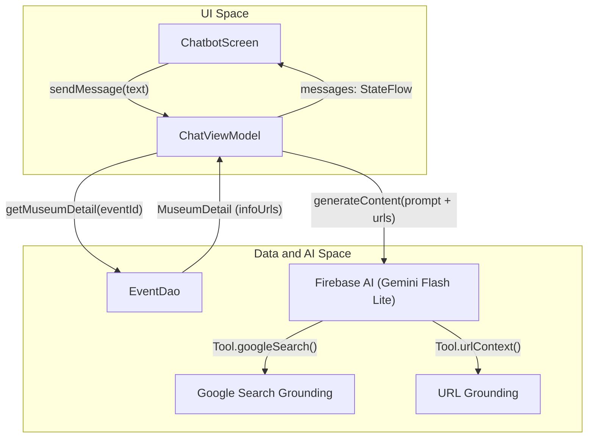
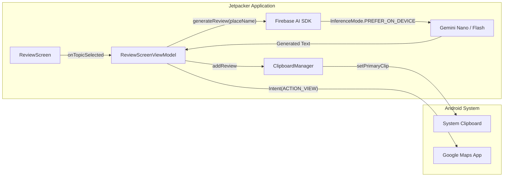

<!-- source: DeepWiki mcp.deepwiki.com · repo android/ai-samples · page 4.5 Cloud and Hybrid AI Features · fetched 2026-10-23 -->

# Cloud and Hybrid AI Features

Relevant source files

The following files were used as context for generating this wiki page:

- [jetpacker/android/app/src/main/kotlin/com/example/jetpacker/JetPackerApplication.kt](jetpacker/android/app/src/main/kotlin/com/example/jetpacker/JetPackerApplication.kt)
- [jetpacker/android/feature/detail/hotel_chat/build.gradle.kts](jetpacker/android/feature/detail/hotel_chat/build.gradle.kts)
- [jetpacker/android/feature/detail/hotel_chat/src/main/kotlin/com/example/jetpacker/feature/detail/hotel_chat/HotelSupportChat.kt](jetpacker/android/feature/detail/hotel_chat/src/main/kotlin/com/example/jetpacker/feature/detail/hotel_chat/HotelSupportChat.kt)
- [jetpacker/android/feature/detail/hotel_chat/src/main/kotlin/com/example/jetpacker/feature/detail/hotel_chat/HotelSupportChatViewModel.kt](jetpacker/android/feature/detail/hotel_chat/src/main/kotlin/com/example/jetpacker/feature/detail/hotel_chat/HotelSupportChatViewModel.kt)
- [jetpacker/android/feature/detail/hotel_chat/src/screenshotTest/kotlin/com/example/jetpacker/feature/detail/hotel_chat/HotelSupportChatScreenshotTest.kt](jetpacker/android/feature/detail/hotel_chat/src/screenshotTest/kotlin/com/example/jetpacker/feature/detail/hotel_chat/HotelSupportChatScreenshotTest.kt)
- [jetpacker/android/feature/detail/museum_assistant/build.gradle.kts](jetpacker/android/feature/detail/museum_assistant/build.gradle.kts)
- [jetpacker/android/feature/detail/museum_assistant/src/main/kotlin/com/example/jetpacker/feature/detail/museum_assistant/ChatViewModel.kt](jetpacker/android/feature/detail/museum_assistant/src/main/kotlin/com/example/jetpacker/feature/detail/museum_assistant/ChatViewModel.kt)
- [jetpacker/android/feature/detail/museum_assistant/src/main/kotlin/com/example/jetpacker/feature/detail/museum_assistant/ChatbotScreen.kt](jetpacker/android/feature/detail/museum_assistant/src/main/kotlin/com/example/jetpacker/feature/detail/museum_assistant/ChatbotScreen.kt)
- [jetpacker/android/feature/detail/review/build.gradle.kts](jetpacker/android/feature/detail/review/build.gradle.kts)
- [jetpacker/android/feature/detail/review/src/main/kotlin/com/example/jetpacker/feature/detail/review/ReviewScreen.kt](jetpacker/android/feature/detail/review/src/main/kotlin/com/example/jetpacker/feature/detail/review/ReviewScreen.kt)
- [jetpacker/android/feature/detail/review/src/main/kotlin/com/example/jetpacker/feature/detail/review/ReviewScreenViewModel.kt](jetpacker/android/feature/detail/review/src/main/kotlin/com/example/jetpacker/feature/detail/review/ReviewScreenViewModel.kt)

This page documents the cloud and hybrid AI capabilities within the Jetpacker application. These features utilize the **Firebase AI Logic SDK** and **ML Kit** to provide advanced natural language processing, real-time translation with custom routing, and grounded chatbot interactions.

## Museum Assistant Chatbot

The Museum Assistant provides a grounded chat experience for museum visitors. It uses the `gemini-3.1-flash-lite` model via Firebase AI to answer questions based on specific museum details and external search capabilities [jetpacker/android/feature/detail/museum_assistant/src/main/kotlin/com/example/jetpacker/feature/detail/museum_assistant/ChatViewModel.kt:67-78]().

### Implementation Details
*   **Grounding**: The assistant uses `Tool.googleSearch()` and `Tool.urlContext()` to ground its responses in real-world data and specific museum URLs [jetpacker/android/feature/detail/museum_assistant/src/main/kotlin/com/example/jetpacker/feature/detail/museum_assistant/ChatViewModel.kt:51-56]().
*   **Data Flow**: The `ChatViewModel` retrieves museum details (such as information URLs) from the `EventDao` [jetpacker/android/feature/detail/museum_assistant/src/main/kotlin/com/example/jetpacker/feature/detail/museum_assistant/ChatViewModel.kt:59-65]() and appends them to the prompt if `ENABLE_URL_GROUNDING` is active [jetpacker/android/feature/detail/museum_assistant/src/main/kotlin/com/example/jetpacker/feature/detail/museum_assistant/ChatViewModel.kt:99-100]().
*   **UI Components**: `ChatbotScreen` uses a `LazyColumn` to display `ChatMessage` items, distinguishing between `UserMessageRow` and `BotMessageRow` [jetpacker/android/feature/detail/museum_assistant/src/main/kotlin/com/example/jetpacker/feature/detail/museum_assistant/ChatbotScreen.kt:143-166]().

### Chatbot Architecture
Title: Museum Assistant Grounding and Logic

**Sources:** [jetpacker/android/feature/detail/museum_assistant/src/main/kotlin/com/example/jetpacker/feature/detail/museum_assistant/ChatViewModel.kt:41-128](), [jetpacker/android/feature/detail/museum_assistant/src/main/kotlin/com/example/jetpacker/feature/detail/museum_assistant/ChatbotScreen.kt:82-166]()

## Hotel Support Chat and Translation

The Hotel Support feature demonstrates a hybrid approach to translation and chat. It utilizes **ML Kit Language Identification** to determine the source language and routes translation requests to either on-device or cloud models based on the detected language [jetpacker/android/feature/detail/hotel_chat/src/main/kotlin/com/example/jetpacker/feature/detail/hotel_chat/HotelSupportChatViewModel.kt:103-123]().

### Hybrid Translation Logic
The `HotelSupportChatViewModel` implements a custom routing strategy:
1.  **Language Detection**: Uses `LanguageIdentification.getClient()` to identify the source text language [jetpacker/android/feature/detail/hotel_chat/src/main/kotlin/com/example/jetpacker/feature/detail/hotel_chat/HotelSupportChatViewModel.kt:61-107]().
2.  **Cloud Routing**: If the detected language is French (`fr`), it routes the request to the `cloudTranslationModel` [jetpacker/android/feature/detail/hotel_chat/src/main/kotlin/com/example/jetpacker/feature/detail/hotel_chat/HotelSupportChatViewModel.kt:112-119]().
3.  **On-Device Routing**: For other languages, it uses the `hybridTranslationModel` configured with `InferenceMode.PREFER_ON_DEVICE` to attempt execution on Gemini Nano [jetpacker/android/feature/detail/hotel_chat/src/main/kotlin/com/example/jetpacker/feature/detail/hotel_chat/HotelSupportChatViewModel.kt:65-70]().

### Components
| Class | Responsibility |
| :--- | :--- |
| `HotelSupportChat` | Main Composable entry point for the chat UI [jetpacker/android/feature/detail/hotel_chat/src/main/kotlin/com/example/jetpacker/feature/detail/hotel_chat/HotelSupportChat.kt:79-101](). |
| `HotelSupportChatViewModel` | Manages chat state, message history, and translation routing [jetpacker/android/feature/detail/hotel_chat/src/main/kotlin/com/example/jetpacker/feature/detail/hotel_chat/HotelSupportChatViewModel.kt:41-42](). |
| `SupportChatMessage` | Data class representing a message with translation support [jetpacker/android/feature/detail/hotel_chat/src/main/kotlin/com/example/jetpacker/feature/detail/hotel_chat/HotelSupportChatViewModel.kt:195-201](). |

**Sources:** [jetpacker/android/feature/detail/hotel_chat/src/main/kotlin/com/example/jetpacker/feature/detail/hotel_chat/HotelSupportChatViewModel.kt:61-138](), [jetpacker/android/feature/detail/hotel_chat/src/main/kotlin/com/example/jetpacker/feature/detail/hotel_chat/HotelSupportChat.kt:79-101]()

## AI Review Generation

The Review feature allows users to generate structured reviews for locations using a hybrid inference model. It combines user-selected topics with AI to draft a review that can be posted directly to Google Maps.

### Implementation
*   **Hybrid Model**: The `ReviewScreenViewModel` initializes a `generativeModel` using `InferenceMode.PREFER_ON_DEVICE`. It targets `gemini-2.5-flash-lite` [jetpacker/android/feature/detail/review/src/main/kotlin/com/example/jetpacker/feature/detail/review/ReviewScreenViewModel.kt:72-77]().
*   **Prompt Construction**: The prompt is dynamically built from a `Set<Topic>`, specifying whether the sentiment for each topic (e.g., "Food Quality", "Service") is positive or negative [jetpacker/android/feature/detail/review/src/main/kotlin/com/example/jetpacker/feature/detail/review/ReviewScreenViewModel.kt:85-89]().
*   **External Integration**: Once generated, `addReview` copies the text to the system clipboard and opens the Google Maps review URL for the specific `placeId` [jetpacker/android/feature/detail/review/src/main/kotlin/com/example/jetpacker/feature/detail/review/ReviewScreenViewModel.kt:101-127]().

### Review Generation Data Flow
Title: Hybrid Review Generation to External Intent

**Sources:** [jetpacker/android/feature/detail/review/src/main/kotlin/com/example/jetpacker/feature/detail/review/ReviewScreenViewModel.kt:43-129](), [jetpacker/android/feature/detail/review/src/main/kotlin/com/example/jetpacker/feature/detail/review/ReviewScreen.kt:74-96]()

## Feature Configuration and Dependencies

These features rely on specific Firebase and ML Kit libraries defined in the module-level `build.gradle.kts` files:
*   **Cloud AI**: `libs.firebase.ai` [jetpacker/android/feature/detail/museum_assistant/build.gradle.kts:58]().
*   **On-Device/Hybrid**: `libs.firebase.ai.ondevice` and `libs.mlkit.genai.prompt` [jetpacker/android/feature/detail/review/build.gradle.kts:54-57]().
*   **Language Services**: `libs.mlkit.language.id` [jetpacker/android/feature/detail/hotel_chat/build.gradle.kts:55]().

Firebase initialization and anonymous authentication are handled at the application level in `JetPackerApplication` to ensure AI services are available upon feature entry [jetpacker/android/app/src/main/kotlin/com/example/jetpacker/JetPackerApplication.kt:39-43]().

**Sources:** [jetpacker/android/feature/detail/hotel_chat/build.gradle.kts:54-59](), [jetpacker/android/feature/detail/review/build.gradle.kts:54-57](), [jetpacker/android/app/src/main/kotlin/com/example/jetpacker/JetPackerApplication.kt:32-51]()

---

