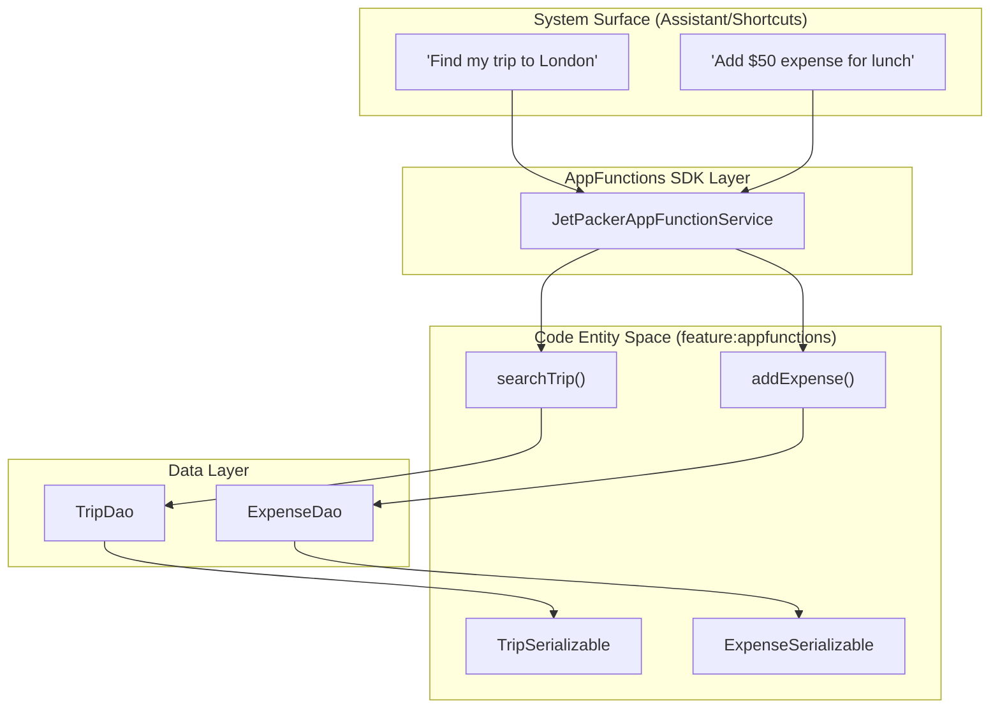
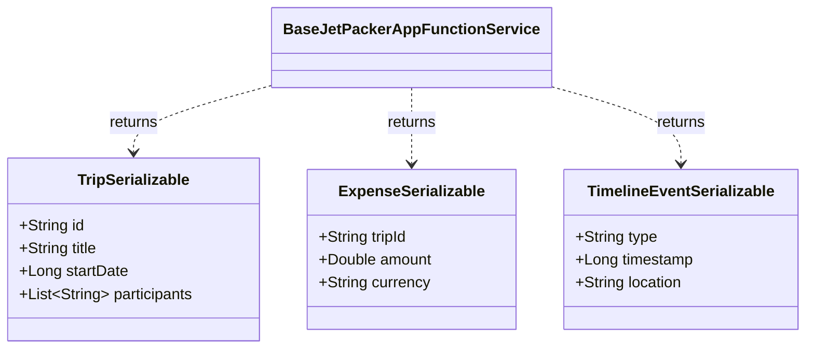

<!-- source: DeepWiki mcp.deepwiki.com · repo android/ai-samples · page 4.6 AppFunctions Integration · fetched 2026-10-23 -->

# AppFunctions Integration

Relevant source files

The following files were used as context for generating this wiki page:

- [jetpacker/android/feature/appfunctions/build.gradle.kts](jetpacker/android/feature/appfunctions/build.gradle.kts)
- [jetpacker/android/feature/appfunctions/src/main/AndroidManifest.xml](jetpacker/android/feature/appfunctions/src/main/AndroidManifest.xml)
- [jetpacker/android/feature/appfunctions/src/main/java/com/example/jetpacker/feature/appfunctions/JetPackerAppFunctionService.kt](jetpacker/android/feature/appfunctions/src/main/java/com/example/jetpacker/feature/appfunctions/JetPackerAppFunctionService.kt)
- [jetpacker/android/feature/appfunctions/src/main/java/com/example/jetpacker/feature/appfunctions/TripSerializable.kt](jetpacker/android/feature/appfunctions/src/main/java/com/example/jetpacker/feature/appfunctions/TripSerializable.kt)

The `:feature:appfunctions` module implements the Android AppFunctions framework to expose JetPacker's travel data and capabilities to the Android OS. This integration allows system surfaces, such as the Android Assistant and Shortcuts, to interact directly with the application's underlying data layer (Trips, Expenses, Itineraries) using natural language or system-level triggers.

### Module Configuration

The module leverages the `androidx.appfunctions` library and uses KSP (Kotlin Symbol Processing) to generate the necessary boilerplate for function registration and parameter mapping.

*   **Namespace**: `com.example.jetpacker.feature.appfunctions` [jetpacker/android/feature/appfunctions/build.gradle.kts:24-24]()
*   **Dependencies**: The module depends on `:data:trips` and `:data:itinerary` to perform database operations via injected DAOs [jetpacker/android/feature/appfunctions/build.gradle.kts:34-35]().
*   **Compiler**: Uses `androidx.appfunctions.compiler` via KSP to process `@AppFunction` and `@AppFunctionSerializable` annotations [jetpacker/android/feature/appfunctions/build.gradle.kts:38-38]().

Sources: [jetpacker/android/feature/appfunctions/build.gradle.kts:17-46]()

---

### AppFunction Service Implementation

The core of the integration is `BaseJetPackerAppFunctionService`, which extends `AppFunctionService`. This service is marked with `@AppFunctionServiceEntryPoint`, specifying the generated XML configuration file `jetpacker_app_function_service` [jetpacker/android/feature/appfunctions/src/main/java/com/example/jetpacker/feature/appfunctions/JetPackerAppFunctionService.kt:43-46]().

The service uses Hilt for dependency injection to access the application's data layer:
*   `TripDao`: For managing trip metadata [jetpacker/android/feature/appfunctions/src/main/java/com/example/jetpacker/feature/appfunctions/JetPackerAppFunctionService.kt:48-48]().
*   `ExpenseDao`: For financial tracking [jetpacker/android/feature/appfunctions/src/main/java/com/example/jetpacker/feature/appfunctions/JetPackerAppFunctionService.kt:49-49]().
*   `EventDao`: For itinerary timeline management [jetpacker/android/feature/appfunctions/src/main/java/com/example/jetpacker/feature/appfunctions/JetPackerAppFunctionService.kt:50-50]().

#### Data Flow: Natural Language to Code Entity

The following diagram illustrates how a system request (e.g., from Android Assistant) maps to the code entities within the `AppFunctionService`.

**Natural Language Mapping to AppFunction Entities**

Sources: [jetpacker/android/feature/appfunctions/src/main/java/com/example/jetpacker/feature/appfunctions/JetPackerAppFunctionService.kt:63-142]()

---

### Exposed Functions

The service exposes several high-level functions annotated with `@AppFunction`. These functions are asynchronous and typically execute on `Dispatchers.IO` [jetpacker/android/feature/appfunctions/src/main/java/com/example/jetpacker/feature/appfunctions/JetPackerAppFunctionService.kt:71-71]().

| Function Name | Parameters | Return Type | Description |
| :--- | :--- | :--- | :--- |
| `searchTrip` | `id`, `title`, `location`, `startDate`, `endDate` | `List<TripSerializable>` | Filters trips based on optional criteria [64-82](). |
| `createTrip` | `title`, `location`, `startDate`, `endDate` | `TripSerializable` | Generates a new `Trip` with a random UUID [94-111](). |
| `addExpense` | `tripId`, `title`, `amount`, `currency`, `category` | `ExpenseSerializable` | Persists a new expense to the `ExpenseDao` [124-142](). |
| `getExpenses` | `tripId` | `List<ExpenseSerializable>` | Retrieves all expenses for a specific trip [151-155](). |
| `getItinerary` | `tripId` | `List<TimelineEventSerializable>` | Retrieves timeline events via `EventDao` [164-168](). |

Sources: [jetpacker/android/feature/appfunctions/src/main/java/com/example/jetpacker/feature/appfunctions/JetPackerAppFunctionService.kt:63-169]()

---

### Data Models (Serializables)

Because the AppFunctions framework operates across process boundaries, data must be modeled using classes annotated with `@AppFunctionSerializable`. These classes act as the "Contract" between the Android OS and the JetPacker app.

*   **`TripSerializable`**: Captures core trip details including `id`, `title`, `location`, and dates [jetpacker/android/feature/appfunctions/src/main/java/com/example/jetpacker/feature/appfunctions/TripSerializable.kt:24-38]().
*   **`ExpenseSerializable`**: Maps to the `Expense` entity, including `amount` and `currency` [jetpacker/android/feature/appfunctions/src/main/java/com/example/jetpacker/feature/appfunctions/TripSerializable.kt:43-59]().
*   **`TimelineEventSerializable`**: Represents an itinerary item, mapping the `EventType` enum to a `String` for serialization [jetpacker/android/feature/appfunctions/src/main/java/com/example/jetpacker/feature/appfunctions/TripSerializable.kt:64-80]().

**AppFunction Serialization Architecture**

Sources: [jetpacker/android/feature/appfunctions/src/main/java/com/example/jetpacker/feature/appfunctions/TripSerializable.kt:1-112]()

---

### Manifest Registration

The service must be registered in the `AndroidManifest.xml` of the `:feature:appfunctions` module. Although the provided snippet shows an empty manifest shell [jetpacker/android/feature/appfunctions/src/main/xml:1-21](), the framework requires the `AppFunctionService` to be declared with the appropriate intent filters to be discoverable by the Android system. The actual registration is handled by the `@AppFunctionServiceEntryPoint` annotation which triggers code generation for the service declaration.

Sources: [jetpacker/android/feature/appfunctions/src/main/java/com/example/jetpacker/feature/appfunctions/JetPackerAppFunctionService.kt:43-46](), [jetpacker/android/feature/appfunctions/src/main/xml:1-21]()

---

