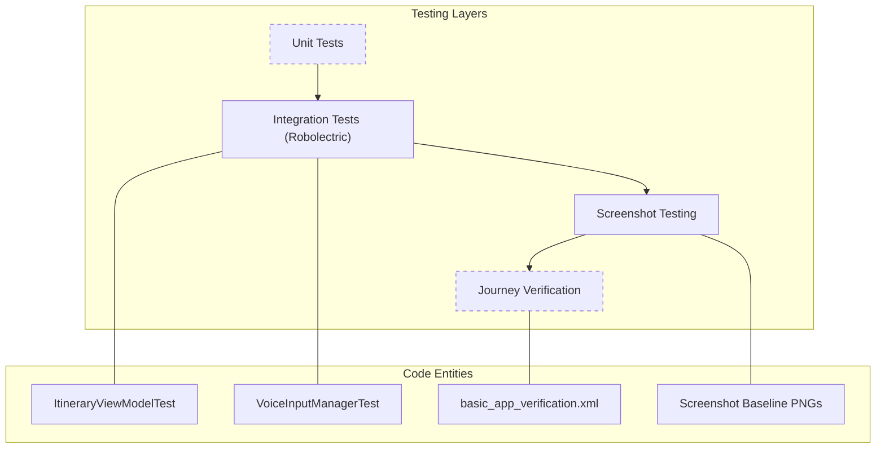
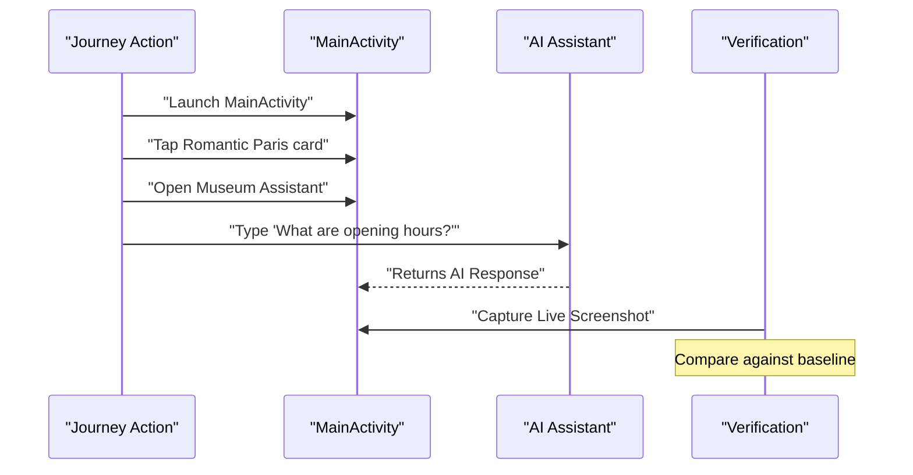

<!-- source: DeepWiki mcp.deepwiki.com · repo android/ai-samples · page 5 Testing Infrastructure · fetched 2026-10-23 -->

# Testing Infrastructure

Relevant source files

The following files were used as context for generating this wiki page:

- [.github/workflows/build-and-test.yml](.github/workflows/build-and-test.yml)
- [jetpacker/android/core/speech/src/test/kotlin/com/example/jetpacker/core/speech/VoiceInputManagerTest.kt](jetpacker/android/core/speech/src/test/kotlin/com/example/jetpacker/core/speech/VoiceInputManagerTest.kt)
- [jetpacker/android/feature/trip/itinerary/enrichment/src/test/kotlin/com/example/jetpacker/feature/itinerary_enrichment/TripSummaryAndTipsCardTest.kt](jetpacker/android/feature/trip/itinerary/enrichment/src/test/kotlin/com/example/jetpacker/feature/itinerary_enrichment/TripSummaryAndTipsCardTest.kt)
- [jetpacker/android/feature/trip/itinerary/src/test/kotlin/com/example/jetpacker/feature/itinerary/ItineraryViewModelTest.kt](jetpacker/android/feature/trip/itinerary/src/test/kotlin/com/example/jetpacker/feature/itinerary/ItineraryViewModelTest.kt)
- [jetpacker/android/feature/trip/voice_notes/src/test/kotlin/com/example/jetpacker/feature/voice_notes/VoiceNotesViewModelTest.kt](jetpacker/android/feature/trip/voice_notes/src/test/kotlin/com/example/jetpacker/feature/voice_notes/VoiceNotesViewModelTest.kt)
- [jetpacker/journeys/basic_app_verification.xml](jetpacker/journeys/basic_app_verification.xml)
- [jetpacker/journeys/cloud_hybrid_features_verification.xml](jetpacker/journeys/cloud_hybrid_features_verification.xml)
- [jetpacker/journeys/intelligent_features_verification.xml](jetpacker/journeys/intelligent_features_verification.xml)

The AI Samples repository employs a multi-layered testing strategy designed to verify both traditional application logic and complex AI-driven features. This infrastructure spans local unit tests, Robolectric-based ViewModel tests, and a sophisticated screenshot testing pipeline for visual regression.

### Testing Strategy Overview

The codebase balances fast-feedback unit tests with comprehensive integration verifications. While the **AI Sample Catalog** focuses on standard Android instrumentation tests, the **Jetpacker** project utilizes advanced screenshot testing and "Journey Verification" scripts to validate AI interactions.

#### Testing Components
| Level | Technology | Scope |
| :--- | :--- | :--- |
| **Unit Testing** | JUnit 4, Truth, Kotlin Coroutines Test | Pure logic, Markdown parsing, state transformations. |
| **Integration** | Robolectric, Hilt, Room | ViewModel state flows, DAO interactions, complex business logic. |
| **Visual/UI** | `android.compose.screenshot`, Espresso | Pixel-perfect UI verification, component layout. |
| **End-to-End** | Journey Verification XMLs | High-level user flows (e.g., creating a trip, AI chat sessions). |

**Sources:** 
- [jetpacker/android/feature/trip/itinerary/src/test/kotlin/com/example/jetpacker/feature/itinerary/ItineraryViewModelTest.kt:60-150]()
- [jetpacker/journeys/basic_app_verification.xml:2-6]()
- [.github/workflows/build-and-test.yml:60-64]()

---

### Screenshot Testing
Jetpacker uses a visual regression pipeline to ensure that AI-generated content (like summaries and tips) is rendered correctly without layout overlap or text truncation. This is particularly important for dynamic UI elements like the `TripSummaryAndTipsCard`.

The system relies on the `android.compose.screenshot` plugin and maintains reference PNG baselines. A key configuration is the `imageDifferenceThreshold`, typically set to `0.05f`, which allows for minor rendering variances across different environments while catching significant UI regressions.

For details on the pipeline and updating golden images, see [Screenshot Testing](#5.1).

**Sources:**
- [jetpacker/journeys/intelligent_features_verification.xml:17-18]()
- [jetpacker/journeys/cloud_hybrid_features_verification.xml:4-5]()

---

### Unit and Integration Testing
The repository emphasizes testing `ViewModel` state flows and repository logic using **Robolectric** and `kotlinx-coroutines-test`. 

#### Key Testing Patterns:
- **Coroutines Testing:** Use of `StandardTestDispatcher` and `setMain` to control execution in `runTest` blocks [jetpacker/android/core/speech/src/test/kotlin/com/example/jetpacker/core/speech/VoiceInputManagerTest.kt:40-50]().
- **StateFlow Verification:** Using `advanceUntilIdle()` to ensure all asynchronous state updates are processed before assertions [jetpacker/android/feature/trip/voice_notes/src/test/kotlin/com/example/jetpacker/feature/voice_notes/VoiceNotesViewModelTest.kt:174-177]().
- **Fake vs. Mock:** The codebase prefers "Fakes" for complex dependencies like `EventDao` and `TripSummaryAndTipsProvider` to simulate realistic data layer behavior [jetpacker/android/feature/trip/itinerary/src/test/kotlin/com/example/jetpacker/feature/itinerary/ItineraryViewModelTest.kt:91-169]().

For detailed patterns and class-specific examples, see [Unit and Integration Testing](#5.2).

**Sources:**
- [jetpacker/android/core/speech/src/test/kotlin/com/example/jetpacker/core/speech/VoiceInputManagerTest.kt:52-63]()
- [jetpacker/android/feature/trip/itinerary/enrichment/src/test/kotlin/com/example/jetpacker/feature/itinerary_enrichment/TripSummaryAndTipsCardTest.kt:32-42]()

---

### Journey Verification XMLs
Unique to this repository is the use of "Journey" XML files. These files document end-to-end user flows that are verified via automated or manual screenshot comparisons. They bridge the gap between natural language requirements and technical verification.

#### Verification Flow Example

#### Major Journeys:
- **Basic App Verification:** Core UI, timeline navigation, and trip CRUD operations [jetpacker/journeys/basic_app_verification.xml:2-70]().
- **Intelligent Features Verification:** On-device AI features like Voice Notes and Expense Management [jetpacker/journeys/intelligent_features_verification.xml:2-31]().
- **Cloud Hybrid Verification:** Online features including Museum Assistant chat and real-time translation [jetpacker/journeys/cloud_hybrid_features_verification.xml:2-70]().

**Sources:**
- [jetpacker/journeys/cloud_hybrid_features_verification.xml:1-71]()
- [jetpacker/journeys/basic_app_verification.xml:1-71]()
- [jetpacker/journeys/intelligent_features_verification.xml:1-32]()

---

