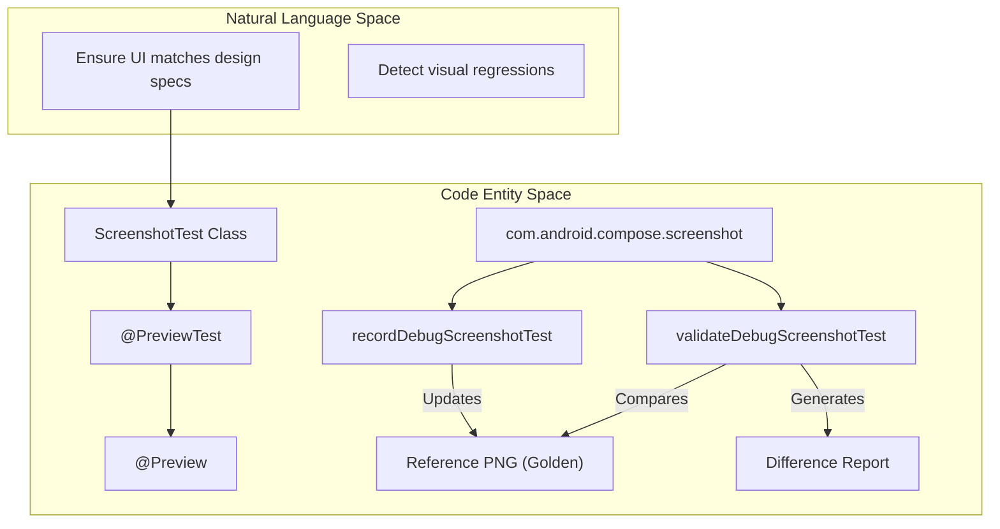
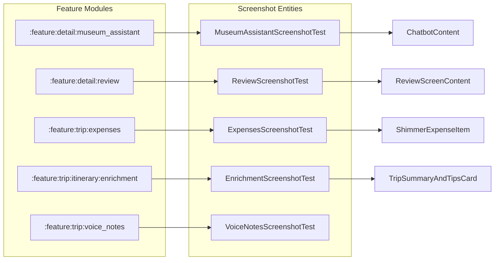

<!-- source: DeepWiki mcp.deepwiki.com · repo android/ai-samples · page 5.1 Screenshot Testing · fetched 2026-10-23 -->

# Screenshot Testing

<details>
<summary>Relevant source files</summary>

The following files were used as context for generating this wiki page:

- [jetpacker/android/feature/detail/museum_assistant/src/screenshotTest/kotlin/com/example/jetpacker/feature/detail/museum_assistant/MuseumAssistantScreenshotTest.kt](jetpacker/android/feature/detail/museum_assistant/src/screenshotTest/kotlin/com/example/jetpacker/feature/detail/museum_assistant/MuseumAssistantScreenshotTest.kt)
- [jetpacker/android/feature/detail/review/src/screenshotTest/kotlin/com/example/jetpacker/feature/detail/review/ReviewScreenshotTest.kt](jetpacker/android/feature/detail/review/src/screenshotTest/kotlin/com/example/jetpacker/feature/detail/review/ReviewScreenshotTest.kt)
- [jetpacker/android/feature/trip/expenses/src/screenshotTest/kotlin/com/example/jetpacker/feature/expenses/ExpensesScreenshotTest.kt](jetpacker/android/feature/trip/expenses/src/screenshotTest/kotlin/com/example/jetpacker/feature/expenses/ExpensesScreenshotTest.kt)
- [jetpacker/android/feature/trip/itinerary/enrichment/src/screenshotTest/kotlin/com/example/jetpacker/feature/itinerary_enrichment/EnrichmentScreenshotTest.kt](jetpacker/android/feature/trip/itinerary/enrichment/src/screenshotTest/kotlin/com/example/jetpacker/feature/itinerary_enrichment/EnrichmentScreenshotTest.kt)
- [jetpacker/android/feature/trip/voice_notes/src/screenshotTest/kotlin/com/example/jetpacker/feature/voice_notes/VoiceNotesScreenshotTest.kt](jetpacker/android/feature/trip/voice_notes/src/screenshotTest/kotlin/com/example/jetpacker/feature/voice_notes/VoiceNotesScreenshotTest.kt)

</details>


Screenshot testing in Jetpacker provides an automated mechanism to verify the visual integrity of UI components. By leveraging the Compose Screenshot Testing library, the pipeline captures images of `@Composable` previews and compares them against established "golden" reference images to detect regressions.

## Pipeline Overview

The screenshot testing pipeline is built upon the `com.android.compose.screenshot` Gradle plugin. It operates by executing tests annotated with `@PreviewTest`, which render standard Compose `@Preview` functions in a controlled environment.

### Data Flow and Execution

The following diagram illustrates the transition from Natural Language requirements (UI consistency) to the Code Entity Space (Gradle tasks and Kotlin annotations).

**Screenshot Test Execution Flow**

**Sources:**
* [jetpacker/android/feature/detail/museum_assistant/src/screenshotTest/kotlin/com/example/jetpacker/feature/detail/museum_assistant/MuseumAssistantScreenshotTest.kt:21-27]()
* [jetpacker/android/feature/detail/review/src/screenshotTest/kotlin/com/example/jetpacker/feature/detail/review/ReviewScreenshotTest.kt:21-27]()

---

## Configuration and Implementation

### Plugin and Block Configuration
The project utilizes the `screenshotTests` configuration block within the module-level `build.gradle.kts` files. A critical parameter in this configuration is the `imageDifferenceThreshold`, set to `0.05f`. This threshold allows for minor anti-aliasing differences or sub-pixel rendering variances (up to 5%) before a test is marked as failed.

### Test Implementation Pattern
Screenshot tests are located in the `src/screenshotTest/kotlin` directory of their respective modules. They follow a specific pattern:
1.  **Class Definition**: A standard Kotlin class containing test methods.
2.  **Annotations**: Each test method must be annotated with both `@PreviewTest` (from `com.android.tools.screenshot`) and `@Preview`.
3.  **Content**: The method calls the Composable under test, often wrapped in the `JetPackerTheme`.

**Example: Museum Assistant Screenshot Test**
[jetpacker/android/feature/detail/museum_assistant/src/screenshotTest/kotlin/com/example/jetpacker/feature/detail/museum_assistant/MuseumAssistantScreenshotTest.kt:24-44]()

| Entity | Role |
| :--- | :--- |
| `@PreviewTest` | Marks the function as a screenshot test candidate for the plugin. |
| `@Preview` | Defines the rendering parameters (e.g., `showBackground = true`). |
| `JetPackerTheme` | Ensures the component is rendered with the application's design system tokens. |
| `ChatbotContent` | The target UI component being verified. |

**Sources:**
* [jetpacker/android/feature/detail/museum_assistant/src/screenshotTest/kotlin/com/example/jetpacker/feature/detail/museum_assistant/MuseumAssistantScreenshotTest.kt:21-44]()
* [jetpacker/android/feature/detail/review/src/screenshotTest/kotlin/com/example/jetpacker/feature/detail/review/ReviewScreenshotTest.kt:21-51]()

---

## Key Test Suites

Jetpacker implements screenshot tests across several feature modules to ensure that AI-generated content and complex UI states (like shimmers) render correctly.

### Feature Coverage Map


### 1. Museum Assistant and Reviews
These tests verify the layout of chat bubbles and AI-generated review summaries.
*   **Museum Assistant**: Tests the `ChatbotContent` with a list of `ChatMessage` objects [jetpacker/android/feature/detail/museum_assistant/src/screenshotTest/kotlin/com/example/jetpacker/feature/detail/museum_assistant/MuseumAssistantScreenshotTest.kt:29-43]().
*   **Review Generation**: Tests `ReviewScreenContent` including selected topics and the generated text area [jetpacker/android/feature/detail/review/src/screenshotTest/kotlin/com/example/jetpacker/feature/detail/review/ReviewScreenshotTest.kt:29-50]().

### 2. Itinerary Enrichment and Expenses
These tests focus on data-driven cards and loading states.
*   **Enrichment**: Captures both the populated `TripSummaryAndTipsCard` and its loading state [jetpacker/android/feature/trip/itinerary/enrichment/src/screenshotTest/kotlin/com/example/jetpacker/feature/itinerary_enrichment/EnrichmentScreenshotTest.kt:24-36]().
*   **Expenses**: Captures standard expense items and shimmer placeholders used during receipt parsing [jetpacker/android/feature/trip/expenses/src/screenshotTest/kotlin/com/example/jetpacker/feature/expenses/ExpensesScreenshotTest.kt:24-36]().

**Sources:**
* [jetpacker/android/feature/trip/itinerary/enrichment/src/screenshotTest/kotlin/com/example/jetpacker/feature/itinerary_enrichment/EnrichmentScreenshotTest.kt:23-37]()
* [jetpacker/android/feature/trip/expenses/src/screenshotTest/kotlin/com/example/jetpacker/feature/expenses/ExpensesScreenshotTest.kt:23-37]()
* [jetpacker/android/feature/trip/voice_notes/src/screenshotTest/kotlin/com/example/jetpacker/feature/voice_notes/VoiceNotesScreenshotTest.kt:23-30]()

---

## Managing Golden Images

Reference images (baselines) are stored as PNG files within the source tree of each module.

### Recording Baselines
To generate or update the golden images, use the `record` task:
```bash
./gradlew recordDebugScreenshotTest
```
This command renders the previews and saves the output to the reference directory. These files should be committed to version control.

### Validating Changes
To compare the current UI against the baselines:
```bash
./gradlew validateDebugScreenshotTest
```
If the difference exceeds the `0.05f` threshold, the task fails and generates an HTML report showing the expected image, the actual image, and a "diff" highlighting the discrepancies.

**Sources:**
* [jetpacker/android/feature/detail/museum_assistant/src/screenshotTest/kotlin/com/example/jetpacker/feature/detail/museum_assistant/MuseumAssistantScreenshotTest.kt:21-21]()
* [jetpacker/android/feature/detail/review/src/screenshotTest/kotlin/com/example/jetpacker/feature/detail/review/ReviewScreenshotTest.kt:21-21]()

---

