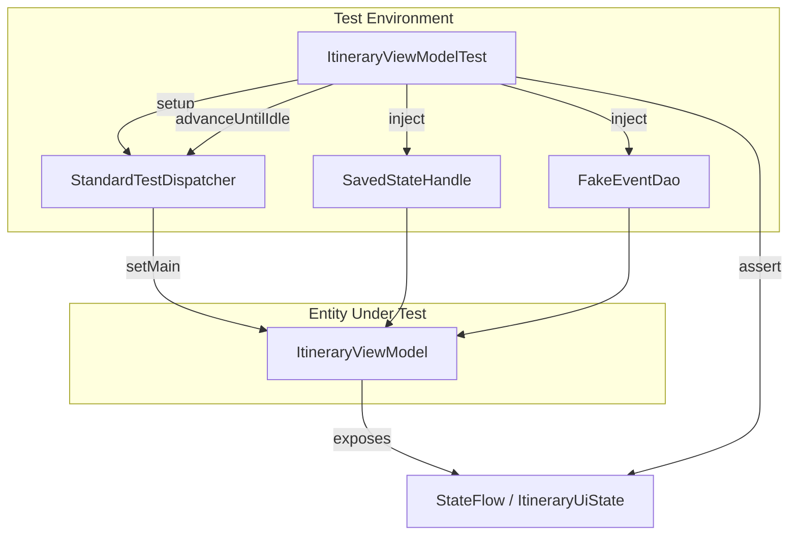
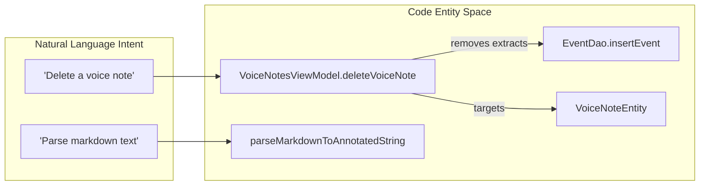

<!-- source: DeepWiki mcp.deepwiki.com · repo android/ai-samples · page 5.2 Unit and Integration Testing · fetched 2026-10-23 -->

# Unit and Integration Testing

Relevant source files

The following files were used as context for generating this wiki page:

- [jetpacker/android/core/speech/src/test/kotlin/com/example/jetpacker/core/speech/VoiceInputManagerTest.kt](jetpacker/android/core/speech/src/test/kotlin/com/example/jetpacker/core/speech/VoiceInputManagerTest.kt)
- [jetpacker/android/feature/trip/itinerary/enrichment/src/test/kotlin/com/example/jetpacker/feature/itinerary_enrichment/TripSummaryAndTipsCardTest.kt](jetpacker/android/feature/trip/itinerary/enrichment/src/test/kotlin/com/example/jetpacker/feature/itinerary_enrichment/TripSummaryAndTipsCardTest.kt)
- [jetpacker/android/feature/trip/itinerary/src/test/kotlin/com/example/jetpacker/feature/itinerary/ItineraryViewModelTest.kt](jetpacker/android/feature/trip/itinerary/src/test/kotlin/com/example/jetpacker/feature/itinerary/ItineraryViewModelTest.kt)
- [jetpacker/android/feature/trip/voice_notes/src/test/kotlin/com/example/jetpacker/feature/voice_notes/VoiceNotesViewModelTest.kt](jetpacker/android/feature/trip/voice_notes/src/test/kotlin/com/example/jetpacker/feature/voice_notes/VoiceNotesViewModelTest.kt)

This section documents the unit and integration testing patterns employed across the Jetpacker application. The testing strategy focuses on verifying `ViewModel` state transitions, repository logic, and utility functions using a combination of **Robolectric**, **Kotlin Coroutines Test**, and **Fake** implementations of Data Access Objects (DAOs).

## Testing Strategy and Infrastructure

The codebase prioritizes high-fidelity unit tests that run on the JVM but utilize Android-specific components where necessary.

*   **Robolectric**: Used for tests requiring Android framework dependencies (e.g., `SavedStateHandle`, `Context`) to run on the JVM [jetpacker/android/feature/trip/itinerary/src/test/kotlin/com/example/jetpacker/feature/itinerary/ItineraryViewModelTest.kt:58-58]().
*   **Coroutines Test**: `StandardTestDispatcher` and `runTest` are used to manage asynchronous execution and verify `StateFlow` updates [jetpacker/android/core/speech/src/test/kotlin/com/example/jetpacker/core/speech/VoiceInputManagerTest.kt:40-40]().
*   **Fake vs. Mock**: The project favors "Fakes" (manual implementations of interfaces like `EventDao` or `TripDao`) over dynamic mocking frameworks to ensure type safety and predictable behavior in complex data flows [jetpacker/android/feature/trip/itinerary/src/test/kotlin/com/example/jetpacker/feature/itinerary/ItineraryViewModelTest.kt:91-151]().

### Data Flow: ViewModel Testing Pattern

The following diagram illustrates how a `ViewModel` test interacts with fake dependencies and the `TestDispatcher` to verify UI state.

**ViewModel Testing Architecture**

Sources: [jetpacker/android/feature/trip/itinerary/src/test/kotlin/com/example/jetpacker/feature/itinerary/ItineraryViewModelTest.kt:60-70](), [jetpacker/android/feature/trip/itinerary/src/test/kotlin/com/example/jetpacker/feature/itinerary/ItineraryViewModelTest.kt:91-151]()

---

## ViewModel and Manager Testing

### VoiceInputManagerTest
Tests for `VoiceInputManager` verify the robust handling of speech recognition lifecycle and error states. A key pattern here is simulating an environment where the speech service fails to bind by explicitly avoiding `MlKitContext` initialization [jetpacker/android/core/speech/src/test/kotlin/com/example/jetpacker/core/speech/VoiceInputManagerTest.kt:46-49]().

*   **Error Mapping**: Tests verify that internal exceptions (like `ERROR_TYPE_AICORE_NOT_ENABLED_RUNTIME_LIMITS`) are correctly translated into user-friendly strings [jetpacker/android/core/speech/src/test/kotlin/com/example/jetpacker/core/speech/VoiceInputManagerTest.kt:83-100]().
*   **State Management**: Ensures that `cancelListening()` correctly resets the `uiState` and clears error flags [jetpacker/android/core/speech/src/test/kotlin/com/example/jetpacker/core/speech/VoiceInputManagerTest.kt:66-80]().

### ItineraryViewModelTest
This test suite validates the integration between the itinerary timeline and AI-generated enrichment.

*   **AI Summary Generation**: Verifies that when a `TripSummaryAndTipsProvider` is supported, the `ItineraryViewModel` triggers generation and updates the `UiState` with the resulting stream [jetpacker/android/feature/trip/itinerary/src/test/kotlin/com/example/jetpacker/feature/itinerary/ItineraryViewModelTest.kt:70-159]().
*   **Dependency Injection**: Uses `FakeEventDao`, `FakeTripDao`, and `FakeTripSummaryAndTipsProvider` to simulate a full data layer without a database [jetpacker/android/feature/trip/itinerary/src/test/kotlin/com/example/jetpacker/feature/itinerary/ItineraryViewModelTest.kt:153-204]().

### VoiceNotesViewModelTest
Focuses on the processing of voice transcriptions and their relationship with `TimelineEvent` entities.

*   **Data Integrity**: Verifies that deleting a `VoiceNoteEntity` correctly removes the associated "extracts" from the relevant `TimelineEvent` within the `EventDao` [jetpacker/android/feature/voice_notes/src/test/kotlin/com/example/jetpacker/feature/voice_notes/VoiceNotesViewModelTest.kt:69-182]().
*   **State Observation**: Uses `launch { viewModel.events.collect {} }` to make `StateFlow` objects "hot" during the test, ensuring they react to background data changes [jetpacker/android/feature/voice_notes/src/test/kotlin/com/example/jetpacker/feature/voice_notes/VoiceNotesViewModelTest.kt:173-174]().

---

## Utility and UI Component Testing

### TripSummaryAndTipsCardTest
Unlike ViewModel tests, these are pure JUnit tests focusing on logic inside UI-adjacent utility functions.

*   **Markdown Parsing**: Tests the `parseMarkdownToAnnotatedString` function to ensure that standard Markdown syntax (e.g., `**bold**`, `*italic*`) is correctly converted into Compose `SpanStyle` ranges [jetpacker/android/feature/trip/itinerary/enrichment/src/test/kotlin/com/example/jetpacker/feature/itinerary_enrichment/TripSummaryAndTipsCardTest.kt:32-72]().
*   **Business Logic**: Validates `getTripMessage` logic which determines the header text based on whether a trip is upcoming, current, or in the past relative to a specific timestamp [jetpacker/android/feature/trip/itinerary/enrichment/src/test/kotlin/com/example/jetpacker/feature/itinerary_enrichment/TripSummaryAndTipsCardTest.kt:99-183]().

**Natural Language to Code Entity Mapping: Voice Note Processing**

Sources: [jetpacker/android/feature/voice_notes/src/test/kotlin/com/example/jetpacker/feature/voice_notes/VoiceNotesViewModelTest.kt:176-180](), [jetpacker/android/feature/trip/itinerary/enrichment/src/test/kotlin/com/example/jetpacker/feature/itinerary_enrichment/TripSummaryAndTipsCardTest.kt:32-35]()

## Key Classes and Functions

| Class/Function | Purpose | Test File |
| :--- | :--- | :--- |
| `VoiceInputManager` | Manages Speech-to-Text lifecycle and error mapping. | `VoiceInputManagerTest.kt` |
| `ItineraryViewModel` | Coordinates timeline data and AI enrichment providers. | `ItineraryViewModelTest.kt` |
| `VoiceNotesViewModel` | Processes transcriptions and links them to events. | `VoiceNotesViewModelTest.kt` |
| `parseMarkdownToAnnotatedString` | Converts Markdown strings to Jetpack Compose `AnnotatedString`. | `TripSummaryAndTipsCardTest.kt` |
| `getTripMessage` | Determines UI messaging based on `Trip` dates. | `TripSummaryAndTipsCardTest.kt` |

Sources: [jetpacker/android/core/speech/src/test/kotlin/com/example/jetpacker/core/speech/VoiceInputManagerTest.kt:41-41](), [jetpacker/android/feature/trip/itinerary/src/test/kotlin/com/example/jetpacker/feature/itinerary/ItineraryViewModelTest.kt:60-60](), [jetpacker/android/feature/voice_notes/src/test/kotlin/com/example/jetpacker/feature/voice_notes/VoiceNotesViewModelTest.kt:59-59](), [jetpacker/android/feature/trip/itinerary/enrichment/src/test/kotlin/com/example/jetpacker/feature/itinerary_enrichment/TripSummaryAndTipsCardTest.kt:35-35](), [jetpacker/android/feature/trip/itinerary/enrichment/src/test/kotlin/com/example/jetpacker/feature/itinerary_enrichment/TripSummaryAndTipsCardTest.kt:100-100]()

---

