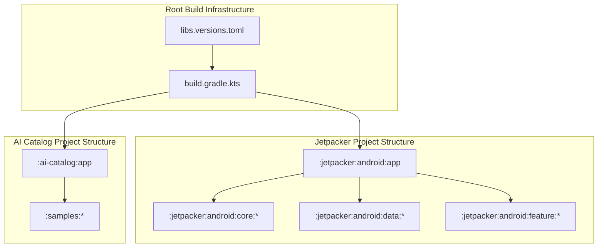
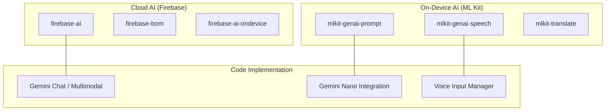

<!-- source: DeepWiki mcp.deepwiki.com · repo android/ai-samples · page 6 Technical Architecture and Build System · fetched 2026-10-23 -->

# Technical Architecture and Build System

Relevant source files

The following files were used as context for generating this wiki page:

- [jetpacker/android/build.gradle.kts](jetpacker/android/build.gradle.kts)
- [jetpacker/android/gradle/libs.versions.toml](jetpacker/android/gradle/libs.versions.toml)

This document provides a comprehensive overview of the technical architecture for the `ai-samples` repository, focusing on the shared build infrastructure, dependency management, and technology stack across both the **AI Sample Catalog** and **Jetpacker** projects. It details the structural foundations that enable the repository to showcase diverse AI capabilities through a unified platform.

For detailed implementation details, see the child pages:
- [Gradle Build Configuration](#6.1) — Plugin management, KSP, JVM targets, and the Version Catalog.
- [Firebase and External Services](#6.2) — SDK integration, Authentication, and App Check configuration.

## Build System Architecture

The repository utilizes a multi-module Gradle build system with centralized dependency management. The root configuration enforces consistency across all subprojects, including JVM targets and resolution strategies.

The build system enforces **JVM 17** for all Kotlin compilation tasks [jetpacker/android/build.gradle.kts:30-35](). It also implements a specific resolution strategy to pin `firebase-ai` to version `17.10.1` [jetpacker/android/build.gradle.kts:41-45]() and excludes `protobuf-java` to prevent dependency conflicts [jetpacker/android/build.gradle.kts:40-40]().

**Sources:** [jetpacker/android/build.gradle.kts:17-47](), [jetpacker/android/gradle/libs.versions.toml:1-55]()

## Dependency Management Strategy

The repository implements centralized dependency management using **Gradle Version Catalogs** (`libs.versions.toml`). This ensures that both the showcase catalog and the reference application use identical versions of the AI SDKs and AndroidX components.

### Core Technology Stack

| Category | Key Code Entities / Libraries | Version / Source |
|----------|------------------|-------------------|
| **Language & Target** | `jvmTarget = JVM_17`, `compileSdk = 37` | [libs.versions.toml:10](), [build.gradle.kts:32]() |
| **UI Framework** | `androidx.compose.bom`, `material3` | [libs.versions.toml:12](), [libs.versions.toml:66]() |
| **Dependency Injection** | `com.google.dagger:hilt-android` | [libs.versions.toml:97](), [libs.versions.toml:25]() |
| **Navigation** | `androidx.navigation3:navigation3-runtime` | [libs.versions.toml:83](), [libs.versions.toml:41]() |
| **Local Data** | `androidx.room:room-runtime` | [libs.versions.toml:87](), [libs.versions.toml:48]() |

**Sources:** [jetpacker/android/gradle/libs.versions.toml:1-113](), [jetpacker/android/build.gradle.kts:29-35]()

## AI/ML Integration Layers

The architecture bridges "Natural Language Space" to "Code Entity Space" by categorizing AI capabilities into Cloud-based (Firebase) and On-Device (ML Kit) layers.

### AI Service Mapping

The `firebase-bom` (Bill of Materials) is used to manage all Firebase-related dependencies, ensuring compatibility between Auth, Firestore, and the AI Logic SDKs [jetpacker/android/gradle/libs.versions.toml:94-95](). For details on service configuration, see [Firebase and External Services](#6.2).

**Sources:** [jetpacker/android/gradle/libs.versions.toml:91-95](), [jetpacker/android/gradle/libs.versions.toml:107-109]()

## Build Features and Automation

The build system includes several specialized plugins and tasks to support the development lifecycle:

*   **KSP (Kotlin Symbol Processing):** Used for code generation in Hilt, Room, and Moshi [jetpacker/android/build.gradle.kts:24-24]().
*   **Screenshot Testing:** Integrated via the `com.android.compose.screenshot` plugin to verify UI consistency [jetpacker/android/build.gradle.kts:22-22]().
*   **License Reporting:** A custom `licenseReport` task generates a `licenses.json` file for all subprojects to ensure legal compliance [jetpacker/android/build.gradle.kts:49-53]().
*   **AppFunctions:** Integration with the `androidx.appfunctions` library allows exposing application logic to the Android system [jetpacker/android/gradle/libs.versions.toml:54-54]().

For a deep dive into the plugin application patterns and Version Catalog definitions, see [Gradle Build Configuration](#6.1).

**Sources:** [jetpacker/android/build.gradle.kts:17-53](), [jetpacker/android/gradle/libs.versions.toml:1-55]()

---

