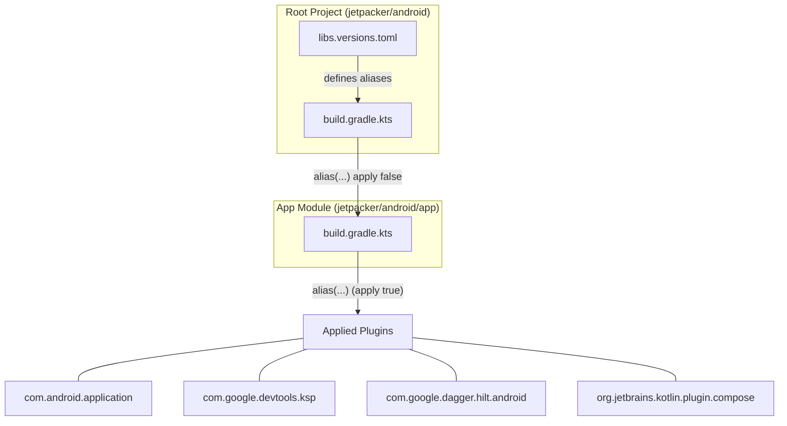
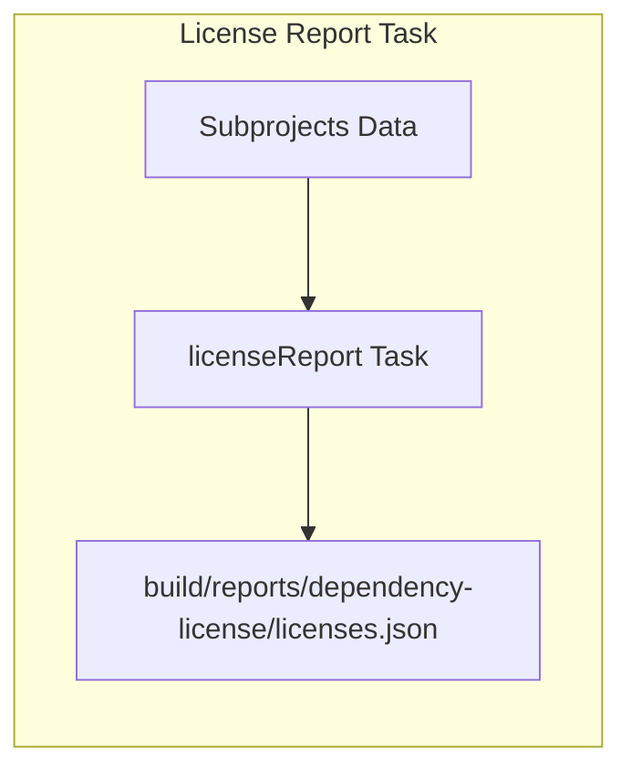

<!-- source: DeepWiki mcp.deepwiki.com · repo android/ai-samples · page 6.1 Gradle Build Configuration · fetched 2026-10-23 -->

# Gradle Build Configuration

Relevant source files

The following files were used as context for generating this wiki page:

- [jetpacker/android/app/build.gradle.kts](jetpacker/android/app/build.gradle.kts)
- [jetpacker/android/build.gradle.kts](jetpacker/android/build.gradle.kts)
- [jetpacker/android/gradle/libs.versions.toml](jetpacker/android/gradle/libs.versions.toml)

This document provides a detailed technical breakdown of the Gradle build system used in the repository, specifically focusing on the `jetpacker` project. It covers plugin management, code generation via KSP, versioning strategies, and specialized build-time tasks like license reporting.

## Project Structure and Plugin Management

The repository utilizes a multi-module Gradle structure with a "plugins-apply-false" pattern in the root `build.gradle.kts`. This pattern declares plugin versions and availability at the root level without applying them to the root project itself, ensuring version consistency across all submodules.

### Plugin Declaration and Application

The root `build.gradle.kts` manages the following key plugins using the `alias` syntax from the Version Catalog:
*   **Android Application/Library**: `libs.plugins.android.application` and `libs.plugins.android.library` [jetpacker/android/build.gradle.kts:18-19]().
*   **Kotlin/Compose**: `libs.plugins.kotlin.compose` and `libs.plugins.kotlin.serialization` [jetpacker/android/build.gradle.kts:20-21]().
*   **Code Generation**: `libs.plugins.google.devtools.ksp` and `libs.plugins.hilt.android` [jetpacker/android/build.gradle.kts:23-24]().
*   **Testing**: `libs.plugins.android.compose.screenshot` [jetpacker/android/build.gradle.kts:22()].

Sources: [jetpacker/android/build.gradle.kts:17-27](), [jetpacker/android/app/build.gradle.kts:18-26]()

## JVM and Compiler Enforcement

The build system enforces strict Java toolchain and compiler options across all subprojects to ensure compatibility with modern Android development standards.

### JVM 17 Target Enforcement
The project targets **Java 17** for both source and target compatibility. This is configured in two locations:
1.  **Subproject Configuration**: A `subprojects` block in the root build file configures `KotlinCompile` tasks to use `JvmTarget.JVM_17` [jetpacker/android/build.gradle.kts:29-35]().
2.  **Kotlin Toolchain**: The `app` module explicitly sets `kotlin { jvmToolchain(17) }` [jetpacker/android/app/build.gradle.kts:81]().

### Compiler Arguments
A specific compiler argument `-Xannotation-default-target=param-property` is added to all Kotlin compilation tasks to handle default values in annotation parameters correctly [jetpacker/android/build.gradle.kts:33]().

Sources: [jetpacker/android/build.gradle.kts:29-35](), [jetpacker/android/app/build.gradle.kts:53-56](), [jetpacker/android/app/build.gradle.kts:81]()

## Code Generation (KSP)

The project heavily relies on **Kotlin Symbol Processing (KSP)** for compile-time code generation, replacing slower kapt-based workflows.

| Processor | Usage | Library Reference |
|-----------|-------|-------------------|
| **Room Compiler** | Generates DAO and Database implementations | `libs.androidx.room.compiler` [jetpacker/android/app/build.gradle.kts:127]() |
| **Hilt Compiler** | Dependency injection graph generation | `libs.hilt.compiler` [jetpacker/android/app/build.gradle.kts:133]() |
| **Moshi Codegen** | JSON serialization adapters | `libs.moshi.kotlin.codegen` [jetpacker/android/app/build.gradle.kts:140]() |

Hilt is further configured with `enableAggregatingTask = false` in the `app` module to optimize build performance [jetpacker/android/app/build.gradle.kts:83]().

Sources: [jetpacker/android/app/build.gradle.kts:127-140](), [jetpacker/android/app/build.gradle.kts:83]()

## Dependency Management and Version Catalog

All dependencies and plugin versions are centralized in `jetpacker/android/gradle/libs.versions.toml`. This "Version Catalog" provides a single source of truth.

### Key Version Definitions
*   **Android SDKs**: `compileSdk = "37"`, `targetSdk = "36"`, `minSdk = "26"` [jetpacker/android/gradle/libs.versions.toml:10, 50, 38]().
*   **Firebase BOM**: The project uses the Firebase Bill of Materials (BOM) `34.12.0` to ensure compatible versions of all Firebase libraries [jetpacker/android/gradle/libs.versions.toml:22]().

### Firebase Version Pinning and Exclusions
The build system includes logic to resolve specific dependency conflicts:
*   **Protobuf Exclusion**: `protobuf-java` is explicitly excluded from all configurations to prevent duplicate class issues when multiple libraries bundle different versions of Protobuf [jetpacker/android/build.gradle.kts:40]().
*   **Firebase AI Pinning**: A `resolutionStrategy` is used to force `com.google.firebase:firebase-ai` to version `17.10.1` regardless of what sub-dependencies might request [jetpacker/android/build.gradle.kts:41-45]().

Sources: [jetpacker/android/gradle/libs.versions.toml:1-55](), [jetpacker/android/build.gradle.kts:39-46]()

## Specialized Build Tasks

### License Report Generation
The project uses the `com.github.jk1.dependency-license-report` plugin to generate a comprehensive audit of all third-party licenses used in the project.

The configuration specifies:
*   **Output Directory**: `build/reports/dependency-license` [jetpacker/android/build.gradle.kts:50]().
*   **Renderer**: `JsonReportRenderer`, producing a file named `licenses.json` [jetpacker/android/build.gradle.kts:52]().
*   **Scope**: Includes all subprojects [jetpacker/android/build.gradle.kts:51]().

### Resource Packaging
The `app` module's `packaging` block defines extensive resource exclusions (e.g., `META-INF/LICENSE`, `META-INF/NOTICE`) to minimize the final APK size and prevent duplicate file errors during the assembly phase [jetpacker/android/app/build.gradle.kts:67-77]().

Sources: [jetpacker/android/build.gradle.kts:49-53](), [jetpacker/android/app/build.gradle.kts:63-78]()

---

