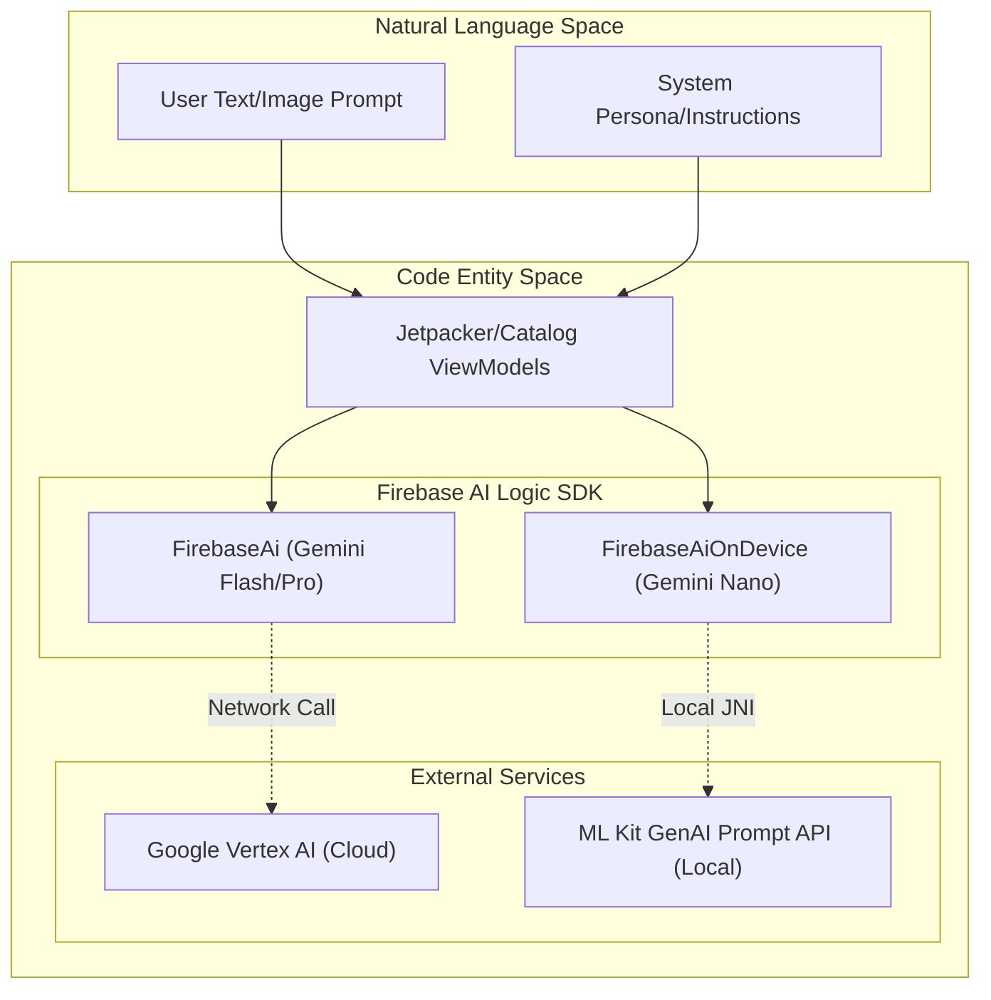
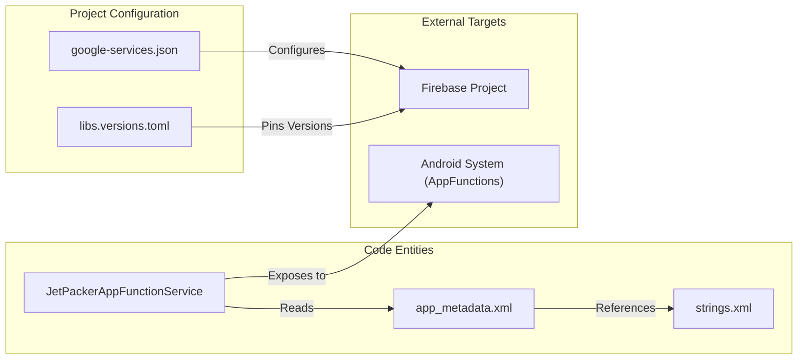

<!-- source: DeepWiki mcp.deepwiki.com · repo android/ai-samples · page 6.2 Firebase and External Services · fetched 2026-10-23 -->

# Firebase and External Services

Relevant source files

The following files were used as context for generating this wiki page:

- [jetpacker/android/app/src/main/res/values/strings.xml](jetpacker/android/app/src/main/res/values/strings.xml)
- [jetpacker/android/app/src/main/res/xml/app_metadata.xml](jetpacker/android/app/src/main/res/xml/app_metadata.xml)
- [jetpacker/android/gradle/libs.versions.toml](jetpacker/android/gradle/libs.versions.toml)

This page documents the integration and configuration of external services within the `ai-samples` repository, with a primary focus on the **Jetpacker** reference application and the **AI Sample Catalog**. The architecture leverages the Firebase ecosystem for cloud-based AI, authentication, real-time data, and application integrity.

## Firebase SDK and BOM Management

The project utilizes the **Firebase Bill of Materials (BOM)** to ensure compatible versions across all Firebase libraries. This prevents dependency conflicts and simplifies version upgrades by pinning the BOM version in the central version catalog.

| Component | Library Reference | Version/Source |
| :--- | :--- | :--- |
| **Firebase BOM** | `firebase-bom` | `34.12.0` [jetpacker/android/gradle/libs.versions.toml:22-22]() |
| **Firebase AI** | `firebase-ai` | `17.10.1` [jetpacker/android/gradle/libs.versions.toml:20-20]() |
| **Firebase AI On-Device** | `firebase-ai-ondevice` | `16.0.0-beta01` [jetpacker/android/gradle/libs.versions.toml:21-21]() |
| **Firebase Auth** | `firebase-auth-ktx` | Managed via BOM [jetpacker/android/gradle/libs.versions.toml:93-93]() |
| **Firebase Firestore** | `firebase-firestore` | Managed via BOM [jetpacker/android/gradle/libs.versions.toml:95-95]() |

**Sources:** [jetpacker/android/gradle/libs.versions.toml:20-22](), [jetpacker/android/gradle/libs.versions.toml:91-95]()

---

## AI Logic SDK Integration

The repository demonstrates a hybrid approach to AI, utilizing the **Firebase AI Logic SDK** for both cloud-based Gemini models and on-device inference via ML Kit.

### Cloud and On-Device Data Flow

The following diagram illustrates how the codebase bridges the "Natural Language Space" (prompts) to "Code Entity Space" (SDKs and Repositories).

**AI SDK Integration Flow**

**Sources:** [jetpacker/android/gradle/libs.versions.toml:91-92](), [jetpacker/android/gradle/libs.versions.toml:107-107]()

---

## Firebase Authentication and Firestore

Jetpacker uses **Firebase Auth** for user session management and **Cloud Firestore** for synchronizing trip data across devices.

*   **Firebase Auth**: Handles anonymous or identity-based authentication to secure backend requests.
*   **Firebase Firestore**: Used as the primary cloud data store for the `:data:trips` and `:data:itinerary` modules in Jetpacker, providing real-time updates for travel plans.

**Sources:** [jetpacker/android/gradle/libs.versions.toml:93-95]()

---

## App Integrity and Security

To ensure that AI model requests and sensitive data operations originate from genuine, untampered versions of the app, the project integrates **Firebase App Check**.

### Implementation Components

1.  **Play Integrity Provider**: Used for production builds to verify the device and app binary.
2.  **Debug Provider**: Utilized during development to allow developers to bypass integrity checks on emulators or debug hardware.
3.  **google-services.json**: The core configuration file (required but typically git-ignored in private projects) that links the Android application to the Firebase project resources.

**Sources:** [jetpacker/android/gradle/libs.versions.toml:24-24]()

---

## Service Configuration Mapping

The following diagram maps the external service configuration to the specific code entities and resource files responsible for their initialization.

**Service Configuration and Resource Mapping**

### Metadata and Identity
*   **App Identity**: Defined in `strings.xml` via `app_name` and `user_visible_description` [jetpacker/android/app/src/main/res/values/strings.xml:18-19]().
*   **AppFunctions Metadata**: The `app_metadata.xml` file provides the Android System with operational patterns and constraints for AI-driven assistant interactions [jetpacker/android/app/src/main/res/xml/app_metadata.xml:2-8]().

**Sources:** [jetpacker/android/app/src/main/res/values/strings.xml:17-20](), [jetpacker/android/app/src/main/res/xml/app_metadata.xml:1-9]()

---

