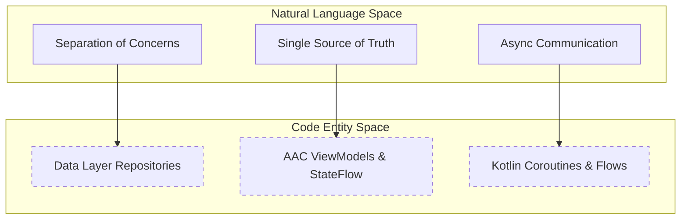
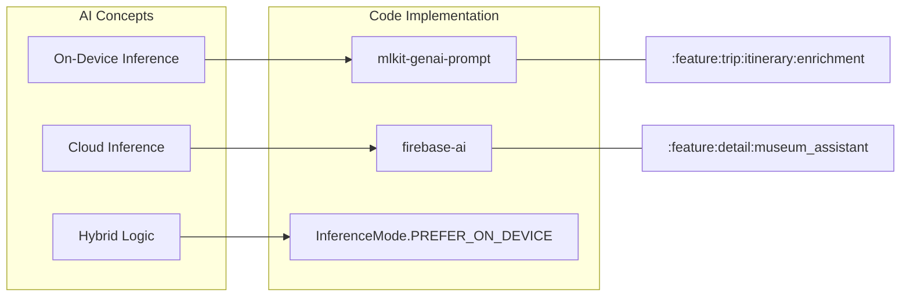

<!-- source: DeepWiki mcp.deepwiki.com · repo android/ai-samples · page 7 Glossary · fetched 2026-10-23 -->

# Glossary

Relevant source files

The following files were used as context for generating this wiki page:

- [.gemini/styleguide.md](.gemini/styleguide.md)
- [README.md](README.md)
- [jetpacker/android/core/flags/src/main/kotlin/com/example/jetpacker/core/flags/FeatureFlags.kt](jetpacker/android/core/flags/src/main/kotlin/com/example/jetpacker/core/flags/FeatureFlags.kt)
- [jetpacker/android/gradle/libs.versions.toml](jetpacker/android/gradle/libs.versions.toml)
- [jetpacker/android/settings.gradle.kts](jetpacker/android/settings.gradle.kts)

This page provides definitions for codebase-specific terms, abbreviations, and domain concepts used throughout the `ai-samples` repository. It serves as a technical reference for onboarding engineers to understand the mapping between conceptual AI terms and their specific implementations in the code.

## Core Architectural Terms

The repository follows a strict layered architecture and Unidirectional Data Flow (UDF) pattern as defined in the styleguide [ .gemini/styleguide.md:11-13]().

| Term | Definition | Code Pointers |
| :--- | :--- | :--- |
| **UDF** | Unidirectional Data Flow. A pattern where state flows down and events flow up. | [.gemini/styleguide.md:25-25]() |
| **UI State** | A single source of truth for the UI, typically exposed as a `StateFlow` of a `sealed class`. | [.gemini/styleguide.md:63-70]() |
| **Repository** | A class in the data layer that mediates between data sources and the rest of the app. | [.gemini/styleguide.md:15-17]() |
| **Feature Flag** | A mechanism to enable or disable specific AI capabilities at runtime, stored in `SharedPreferences`. | [jetpacker/android/core/flags/src/main/kotlin/com/example/jetpacker/core/flags/FeatureFlags.kt:21-34]() |

### Architecture Mapping: Natural Language to Code
This diagram illustrates how standard architectural concepts are realized as specific code entities within the samples.

**Sources:** [.gemini/styleguide.md:11-19](), [.gemini/styleguide.md:25-27](), [.gemini/styleguide.md:60-60]()

## AI & Machine Learning Domain Terms

The codebase distinguishes between on-device inference (local) and cloud-based inference (remote).

### On-Device AI (ML Kit)
Refers to AI models running directly on the Android device hardware, providing privacy and offline availability.

*   **Gemini Nano:** The most efficient model built for on-device tasks, accessed via the ML Kit GenAI Prompt API [jetpacker/android/gradle/libs.versions.toml:107-107]().
*   **ML Kit GenAI Prompt:** The SDK used to interact with on-device LLMs [jetpacker/android/gradle/libs.versions.toml:107-107]().
*   **Enrichment:** The process of using AI to add metadata or summaries to existing data, such as itinerary items [jetpacker/android/settings.gradle.kts:74-74]().

### Cloud AI (Firebase AI)
Refers to larger models running on Google's infrastructure, accessed via Firebase.

*   **Gemini Flash:** A lightweight, fast cloud model used for multimodal tasks and real-time interactions [README.md:13-13]().
*   **Firebase AI Logic SDK:** The primary SDK for integrating cloud-based Gemini models into the Android applications [jetpacker/android/gradle/libs.versions.toml:91-91]().
*   **Grounding:** Connecting the AI model to real-world data sources (e.g., Search or URLs) to reduce hallucinations [jetpacker/android/core/flags/src/main/kotlin/com/example/jetpacker/core/flags/FeatureFlags.kt:32-33]().

### AI Implementation Mapping
This diagram maps AI concepts to the specific SDKs and modules used in the repository.

**Sources:** [jetpacker/android/gradle/libs.versions.toml:91-92](), [jetpacker/android/gradle/libs.versions.toml:107-107](), [jetpacker/android/settings.gradle.kts:60-60](), [jetpacker/android/settings.gradle.kts:74-74]()

## Project-Specific Jargon

### Jetpacker Modules
Jetpacker uses a multi-module Gradle structure to separate features and core utilities.

*   **`:core:flags`**: Manages runtime feature toggles for AI capabilities [jetpacker/android/settings.gradle.kts:45-45]().
*   **`:core:speech`**: Handles voice input and transcription logic [jetpacker/android/settings.gradle.kts:47-47]().
*   **`:feature:appfunctions`**: Exposes application data to the Android System via the AppFunctions framework [jetpacker/android/settings.gradle.kts:75-75]().
*   **`:feature:detail:museum_assistant`**: A specific AI feature implementing a chatbot for museum information [jetpacker/android/settings.gradle.kts:60-60]().

### Testing Terminology
*   **Screenshot Testing**: Visual regression testing using the `compose-screenshot` plugin to compare UI against "golden" images [jetpacker/android/gradle/libs.versions.toml:13-13]().
*   **Fakes**: Test doubles that have working implementations but are simplified for testing (preferred over Mocks) [.gemini/styleguide.md:104-104]().

## Summary Table of Key Classes

| Class/Object | Role | File Path |
| :--- | :--- | :--- |
| `FeatureFlags` | Singleton managing `debug_settings` SharedPreferences for feature toggles. | [jetpacker/android/core/flags/src/main/kotlin/com/example/jetpacker/core/flags/FeatureFlags.kt:21-21]() |
| `ViewModel` | AAC class handling UI logic and inter-layer communication via `viewModelScope`. | [.gemini/styleguide.md:58-61]() |
| `StateFlow` | Used to expose immutable UI state from ViewModels to Composables. | [.gemini/styleguide.md:75-76]() |

**Sources:** [README.md:1-37](), [.gemini/styleguide.md:1-115](), [jetpacker/android/settings.gradle.kts:1-76](), [jetpacker/android/gradle/libs.versions.toml:1-120](), [jetpacker/android/core/flags/src/main/kotlin/com/example/jetpacker/core/flags/FeatureFlags.kt:1-127]()