# Page: Repository Overview

# Repository Overview

<details>
<summary>Relevant source files</summary>

The following files were used as context for generating this wiki page:

- [.gemini/styleguide.md](.gemini/styleguide.md)
- [CODEOWNERS](CODEOWNERS)
- [README.md](README.md)

</details>


## Purpose and Scope

This document provides a high-level introduction to the `ai-samples` repository, covering its organizational structure, main projects, and architectural philosophy. The repository serves as a comprehensive showcase of Google AI technologies implemented for Android platforms, demonstrating both cloud-based and on-device AI capabilities.

The repository is divided into two primary projects:
1.  **Android AI Sample Catalog**: A standalone showcase application hosting multiple self-contained AI samples.
2.  **Jetpacker**: A full-stack travel planner reference application demonstrating deep AI integration in a real-world scenario.

For detailed setup instructions and prerequisites, see [Getting Started](#1.1). For the design principles governing these apps, see [Android Architecture Standards](#1.2).

## Repository Structure

The repository follows a clear separation between modular samples and a feature-rich reference application.

### High-Level Project Organization

```mermaid
graph TD
    subgraph "ai-samples-root ["ai-samples/"]"
        ROOT["Repository Root"]
        
        subgraph "ai-sample-catalog-project ["ai-sample-catalog/"]"
            CATALOG_APP[":app"]
            CATALOG_UI[":ui-component"]
            CATALOG_SAMPLES[":samples:*"]
        end
        
        subgraph "jetpacker-project ["jetpacker/android/"]"
            JP_APP[":app"]
            JP_CORE[":core:*"]
            JP_DATA[":data:*"]
            JP_FEATURE[":feature:*"]
        end
    end
    
    ROOT --> CATALOG_APP
    ROOT --> JP_APP
```

Sources: [README.md:7-14]()

| Project | Path | Description |
|-----------|------|-------------|
| **AI Sample Catalog** | `ai-sample-catalog/` | A showcase app for individual Gemini capabilities like hybrid inference, multimodal chat, and summarization. |
| **Jetpacker** | `jetpacker/` | A complete travel planner leveraging ML Kit (on-device) and Firebase AI (cloud) for itinerary management and reviews. |

Sources: [README.md:11-14]()

## Architectural Philosophy

Both projects adhere to modern Android development standards, emphasizing a layered architecture, Unidirectional Data Flow (UDF), and modularization.

### Shared Architectural Standards

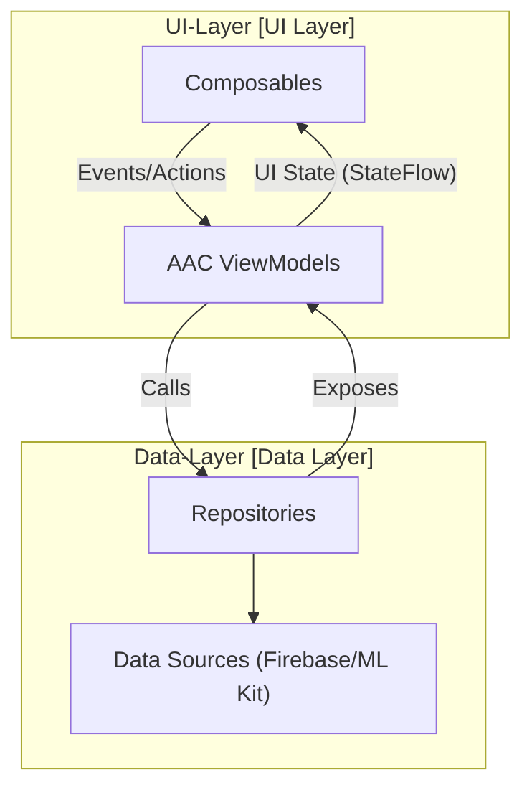

The projects enforce the following "Strongly Recommended" practices from the internal style guide:
*   **Layered Architecture**: Separation of UI and Data layers with repositories as the single source of truth [[.gemini/styleguide.md:11-17]()] .
*   **Unidirectional Data Flow (UDF)**: ViewModels expose a single `uiState` using `StateFlow` and receive actions via method calls [[.gemini/styleguide.md:25-26]()] .
*   **Reactive Streams**: Use of Coroutines and Flows for inter-layer communication [[.gemini/styleguide.md:18-18]()] .
*   **Dependency Injection**: Use of Hilt for managing complex dependencies [[.gemini/styleguide.md:95-97]()] .

For a deep dive into these patterns, see [Android Architecture Standards](#1.2).

## Navigation and Sample Distribution

The repository demonstrates a strategic distribution of AI technologies across cloud and on-device processing paradigms.

### AI Capabilities Mapping

| Technology | Implementation Type | Project | Key Samples/Features |
|------------|---------------------|---------|----------------------|
| **Gemini Cloud** | Cloud (Firebase AI) | Catalog & Jetpacker | Chatbots, Multimodal Prompting, Live API, Video Analysis |
| **Gemini Nano** | On-Device (ML Kit) | Catalog & Jetpacker | Summarization, Writing Assistance, Image Description |
| **Hybrid SDK** | Hybrid | Catalog & Jetpacker | InferenceMode.PREFER_ON_DEVICE fallback logic |
| **Imagen** | Cloud | Catalog | Text-to-image generation (Nanobanana) |

Sources: [README.md:13-14](), [.gemini/styleguide.md:65-70]()

## How to Navigate this Wiki

This wiki is structured to take you from high-level concepts to deep implementation details:

*   **[Getting Started](#1.1)**: Your first stop for environment setup and Firebase configuration.
*   **[Android Architecture Standards](#1.2)**: Essential reading for understanding the "why" behind the code structure.
*   **[AI Sample Catalog Application](#2)**: Details on the modular showcase app and its shared components.
*   **[Jetpacker Application](#4)**: Exploration of the reference travel app, including its multi-module data layer and feature integrations.
*   **[Testing Infrastructure](#5)**: Documentation on screenshot testing and unit testing strategies.
*   **[Technical Architecture and Build System](#6)**: Details on Gradle, Version Catalogs, and external service integrations.

Sources: [README.md:18-30]()

---

# Page: Getting Started

# Getting Started

<details>
<summary>Relevant source files</summary>

The following files were used as context for generating this wiki page:

- [.github/workflows/build-and-test.yml](.github/workflows/build-and-test.yml)
- [README.md](README.md)
- [jetpacker/README.md](jetpacker/README.md)

</details>


This document provides setup instructions, prerequisites, and configuration guidance for working with the `ai-samples` repository. It covers the essential steps to build, configure, and run the two primary projects: the **AI Sample Catalog** and **Jetpacker**.

## Prerequisites and System Requirements

The repository requires specific development environment components and API levels to function properly.

### Development Environment

| Component | Requirement | Notes |
|-----------|-------------|-------|
| Android SDK | API Level 26-35 | Minimum SDK 26, Target SDK 35 |
| Java | Version 17 | Required for Kotlin compilation and CI workflows [ .github/workflows/build-and-test.yml:33-37]() |
| Gradle | 8.0+ | Uses Gradle Wrapper [ .github/workflows/build-and-test.yml:49-58]() |
| Android Studio | 2023.1.1+ | Recommended for Jetpack Compose support |

### Hardware Requirements

- Device or emulator running Android API 26 (Android 8.0) or higher.
- For on-device AI samples: Android device with ML Kit GenAI support.
- For cloud-based samples: Internet connectivity is required.

Sources: [ai-sample-catalog/app/build.gradle.kts:29-42](), [.github/workflows/build-and-test.yml:33-37]()

## Repository Structure and Components

The repository is divided into two main showcase applications, each serving a different purpose.

### 1. Android AI Sample Catalog
A standalone showcase application containing multiple self-contained samples demonstrating various Gemini integration capabilities (hybrid inference, chat, multimodal, summarization, etc.) [README.md:13-13]().

### 2. Jetpacker
A reference travel planner application demonstrating deep, full-stack AI integration. It combines on-device ML Kit (for summaries, speech, and translation) with cloud-based Firebase AI logic for complex tasks like itinerary management and museum assistance [README.md:14-14](), [jetpacker/README.md:16-17]().

### Component Relationship Diagram

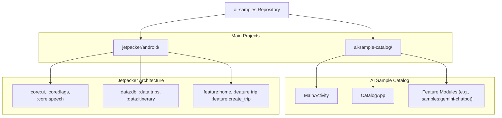

Sources: [README.md:1-14](), [jetpacker/README.md:29-51]()

## Development Environment Setup

### Clone and Build Configuration

1. Clone the repository:
```bash
git clone https://github.com/android/ai-samples.git
```

2. **To run the AI Sample Catalog**:
   - Open the `ai-sample-catalog/` directory in Android Studio [README.md:23-23]().
   - Build and run the `app` configuration [README.md:25-25]().

3. **To run Jetpacker**:
   - Open the `jetpacker/android/` directory in Android Studio [README.md:28-28]().
   - Copy `local.properties.example` to `local.properties` and set your `sdk.dir` [jetpacker/README.md:58-64]().
   - Build and run the `:app` configuration [README.md:30-30]().

Sources: [README.md:18-31](), [jetpacker/README.md:52-65]()

## Firebase Configuration

Both projects utilize Firebase for cloud AI features (Vertex AI / Gemini API).

### Setup Steps
1. **Register the Application**: Create a Firebase project in the [Firebase Console](https://console.firebase.google.com) and register your app packages (e.g., `com.android.ai.catalog` or the Jetpacker package).
2. **Download Config**: Download the `google-services.json` file.
3. **Placement**:
   - For AI Sample Catalog: Place in `ai-sample-catalog/app/` [README.md:24-24]().
   - For Jetpacker: Place in `jetpacker/android/app/` [jetpacker/README.md:66-69]().

### Firebase App Check (Jetpacker Specific)
Jetpacker uses Firebase App Check for security. To enable it during development:
1. Run the app and filter Logcat for `DebugAppCheckProvider` [jetpacker/README.md:71-72]().
2. Copy the debug secret token (e.g., `a8c2dd4c-7f7f-4764-b653-ef6c114ba27e`) [jetpacker/README.md:73-75]().
3. Register this token in the Firebase Console under **App Check** -> **Manage Debug Tokens** [jetpacker/README.md:76-76]().

Sources: [jetpacker/README.md:66-77](), [README.md:22-31]()

## Key AI Concepts and Feature Flags

### On-Device vs. Cloud AI
The repository demonstrates two primary AI modalities:
- **On-Device (ML Kit)**: Low latency, privacy-focused, offline-capable. Used for summarization, speech-to-text, and translation [jetpacker/README.md:25-25]().
- **Cloud (Firebase AI / Vertex AI)**: High-reasoning capabilities using Gemini models (Flash, Pro). Used for multimodal chat, video analysis, and complex reasoning [jetpacker/README.md:26-26]().

### Jetpacker Feature Flags
You can toggle specific AI features in Jetpacker by modifying `FeatureFlags.kt` [jetpacker/README.md:94-94]():
- `ENABLE_TRIP_SUMMARY_AND_TIPS`: ML Kit GenAI Prompt for trip summaries [jetpacker/README.md:95-95]().
- `ENABLE_EXPENSE_MANAGEMENT`: Local receipt scanner and parser [jetpacker/README.md:97-97]().
- `ENABLE_MUSEUM_ASSISTANT`: Gemini-powered chatbot with search grounding [jetpacker/README.md:102-102]().

### Natural Language to Code Mapping

This diagram bridges the conceptual AI features to their implementation classes and flags.

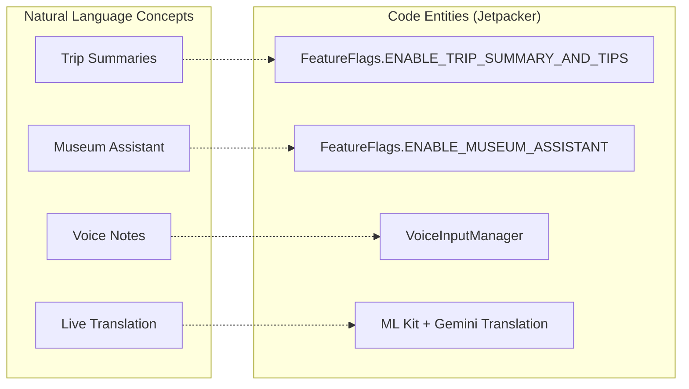

Sources: [jetpacker/README.md:93-105]()

## Building and Running Tests

### Gradle Commands
From the project root (or `android/` directory for Jetpacker), you can use the following commands:

```bash
# Build a debug APK
./gradlew :app:assembleDebug

# Run unit tests
./gradlew test

# Apply code formatting (Spotless)
./gradlew spotlessApply
```

Sources: [jetpacker/README.md:79-91](), [.github/workflows/build-and-test.yml:48-58]()

## Next Steps
- For a deep dive into the Sample Catalog's UI components, see **2.1 Application Architecture**.
- To understand how Jetpacker manages data and trips, see **4.2 Core and Data Modules**.
- To learn about the testing strategy, including screenshot tests, see **5. Testing Infrastructure**.

---

# Page: Android Architecture Standards

# Android Architecture Standards

<details>
<summary>Relevant source files</summary>

The following files were used as context for generating this wiki page:

- [.gemini/styleguide.md](.gemini/styleguide.md)

</details>


This page documents the shared architectural standards enforced across the `ai-samples` repository. These standards ensure that both the **AI Sample Catalog** and the **Jetpacker** reference application remain maintainable, testable, and scalable by adhering to modern Android development best practices.

## Layered Architecture

The codebase follows a strictly layered architecture to promote separation of concerns and maintain a single source of truth [styleguide.md:11-13]().

*   **Data Layer:** Responsible for exposing application data and containing business logic. It consists of repositories that orchestrate data from various sources (network, database, or AI SDKs) [.gemini/styleguide.md:15-15]().
*   **UI Layer:** Responsible for displaying data and handling user interactions. It is driven by data models and adheres to Unidirectional Data Flow (UDF) [.gemini/styleguide.md:16-16]().
*   **Domain Layer (Optional):** Used in larger modules (like Jetpacker) to encapsulate reusable business logic in "Use Cases" to simplify ViewModels [.gemini/styleguide.md:19-19]().

### Data Flow and Communication
Communication between layers is handled primarily through Kotlin Coroutines and Flows [.gemini/styleguide.md:18-18](). UI components must never interact directly with data sources; they must instead communicate through repositories [.gemini/styleguide.md:17-17]().

**Diagram: Architectural Layer Interaction**
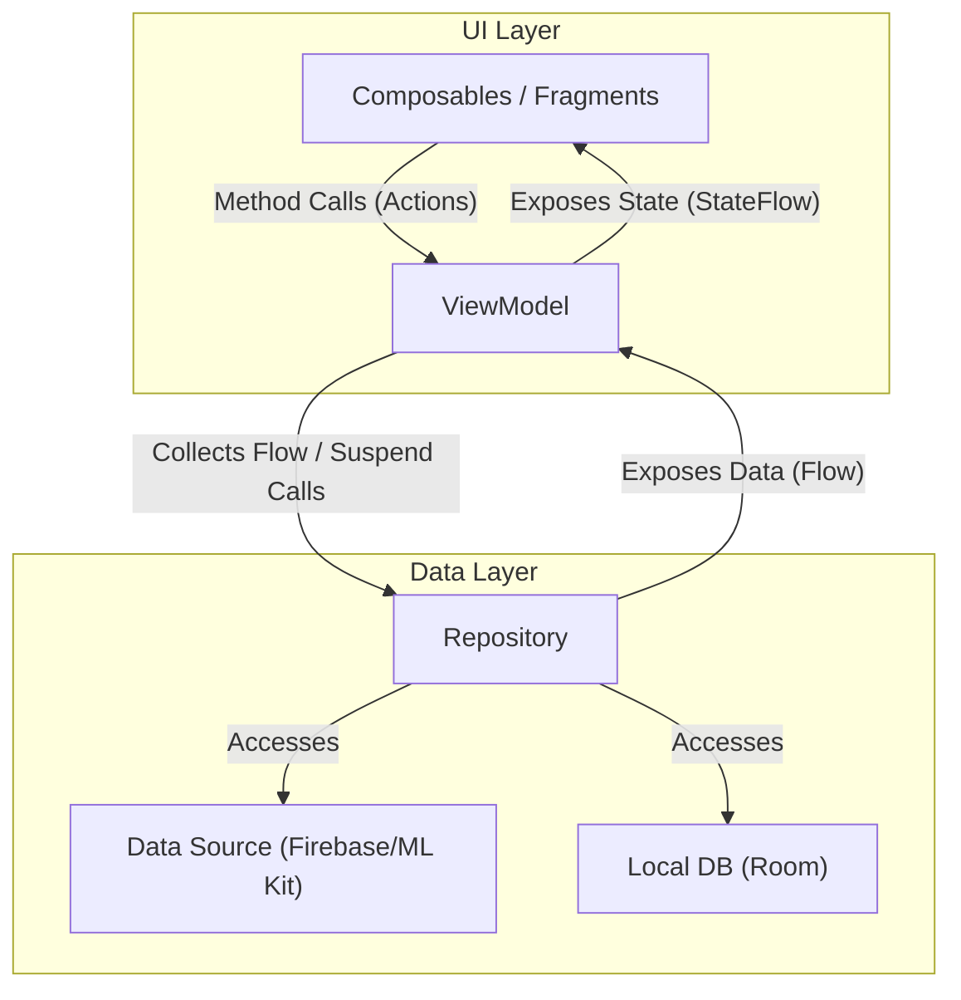
**Sources:** [.gemini/styleguide.md:11-20](), [.gemini/styleguide.md:25-26]()

---

## UI Layer and Unidirectional Data Flow (UDF)

The UI layer follows the UDF pattern where state flows down and events flow up [.gemini/styleguide.md:25-25]().

### ViewModel Standards
ViewModels are the primary state holders for screen-level UI.
*   **Lifecycle Agnostic:** ViewModels must not reference Activities, Fragments, or Context to avoid memory leaks [.gemini/styleguide.md:58-59]().
*   **State Exposure:** ViewModels should only expose a single UI state, typically defined as a `sealed class` or `sealed interface` [.gemini/styleguide.md:63-70]().
*   **No Events:** Events (like navigation or snackbars) should not be sent as one-off "events" from the ViewModel. Instead, they should be processed into the UI state [.gemini/styleguide.md:49-49]().
*   **Initialization:** Developers should avoid calling `fetchData()` in `init {}` blocks; instead, they should use `stateIn()` to trigger data fetching when the state is first collected [.gemini/styleguide.md:82-84]().

### UI State Collection
In Jetpack Compose, state is collected using `collectAsStateWithLifecycle()` to ensure the app does not waste resources when the UI is in the background [.gemini/styleguide.md:27-30]().

**Diagram: UDF State and Event Loop**
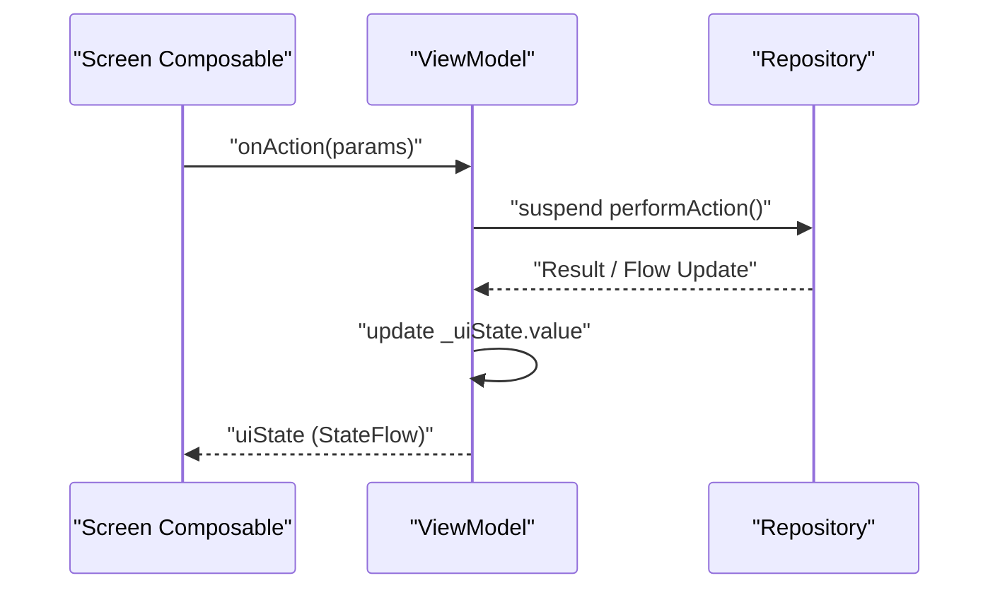
**Sources:** [.gemini/styleguide.md:25-49](), [.gemini/styleguide.md:63-76]()

---

## Dependency Injection with Hilt

The projects use Hilt for dependency management to ensure modularity and ease of testing [.gemini/styleguide.md:97-97]().

*   **Constructor Injection:** This is the strongly recommended method for providing dependencies [.gemini/styleguide.md:95-95]().
*   **Scoping:** Mutable data or expensive types are scoped to the appropriate dependency container [.gemini/styleguide.md:96-96]().

**Diagram: Hilt Dependency Mapping**
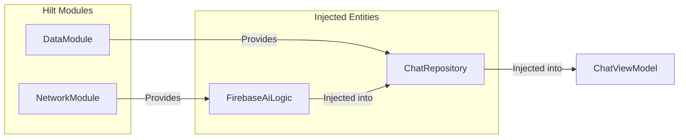
**Sources:** [.gemini/styleguide.md:93-97]()

---

## Testing Conventions

The architecture is designed to be highly testable by enforcing the use of interfaces and fakes [.gemini/styleguide.md:103-104]().

### Testing Standards
*   **Fakes over Mocks:** The codebase prefers the use of "Fakes" (lightweight implementations of interfaces) over mocking frameworks [.gemini/styleguide.md:104-104]().
*   **ViewModel Testing:** ViewModels are tested by asserting on the `value` property of their `StateFlow` [.gemini/styleguide.md:105-105]().
*   **StateFlows with WhileSubscribed:** When testing `StateFlow` created via `stateIn` with `SharingStarted.WhileSubscribed()`, a `collectJob` must be created in the test to keep the flow active [.gemini/styleguide.md:105-106]().

| Component | Testing Strategy |
| :--- | :--- |
| **ViewModels** | Unit tests asserting on `StateFlow` values. |
| **Repositories** | Unit tests using Fake data sources. |
| **UI Components** | Screenshot testing for visual regressions. |
| **Navigation** | Integration testing for screen-to-screen transitions. |

**Sources:** [.gemini/styleguide.md:101-106]()

---

## Implementation Reference Table

The following table maps architectural requirements to specific implementation patterns used in the samples.

| Requirement | Implementation Pattern | Code Reference |
| :--- | :--- | :--- |
| **UI State** | `sealed class ScreenState` | [.gemini/styleguide.md:65-70]() |
| **Data Exposure** | `StateFlow` via `stateIn` | [.gemini/styleguide.md:76-76]() |
| **Lifecycle** | `repeatOnLifecycle` / `collectAsStateWithLifecycle` | [.gemini/styleguide.md:27-29]() |
| **DI** | `@Inject constructor` | [.gemini/styleguide.md:79-80]() |
| **Composable Params** | `Modifier` as first optional parameter | [.gemini/styleguide.md:50-50]() |

**Sources:** [.gemini/styleguide.md:1-110]()

---

# Page: AI Sample Catalog Application

# AI Sample Catalog Application

<details>
<summary>Relevant source files</summary>

The following files were used as context for generating this wiki page:

- [README.md](README.md)

</details>


## Purpose and Scope

The AI Sample Catalog Application is the primary showcase within the `ai-samples` repository, designed to demonstrate Google's AI capabilities on Android. It serves as a centralized host for multiple standalone samples that utilize models such as Gemini 2.0 Flash, Gemini Nano, and Imagen.

This page provides a high-level overview of the catalog's structure and entry points.
- For details on the internal architecture and shared UI components, see [Application Architecture](#2.1).
- For details on the sample registration system and tagging, see [Sample Catalog System](#2.2).
- For technical documentation of the individual AI features (e.g., Gemini Live, Video Analysis), see [AI Sample Documentation](#3).

Sources: [README.md:11-13](), [ai-sample-catalog/README.md:1-20]()

## Application Overview

The application is a single-module Android project located in the `ai-sample-catalog/` directory. It aggregates various AI demonstrations into a unified interface, allowing developers to explore different integration patterns (cloud vs. on-device) in one place.

### Core Component Bridge

The following diagram bridges the high-level application areas to the specific code entities that manage them.

**Application Entity Mapping**
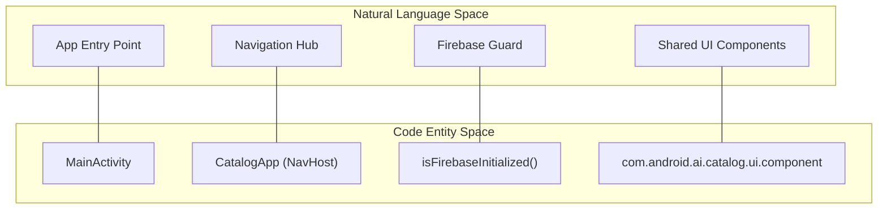

Sources: [ai-sample-catalog/app/src/main/java/com/android/ai/catalog/MainActivity.kt:32-45](), [ai-sample-catalog/app/src/main/java/com/android/ai/catalog/ui/CatalogScreen.kt:64-127]()

## Sample Organization

The catalog categorizes AI samples based on their underlying technology and connectivity requirements. This ensures a clear distinction between cloud-powered features and privacy-focused on-device processing.

| Technology Group | Key Samples | Primary Models |
| :--- | :--- | :--- |
| **Cloud (Firebase)** | Chatbot, Multimodal, Video Analysis, Live API | Gemini 2.0 Flash |
| **On-Device (ML Kit)** | Summarization, Writing Assistant, Image Description | Gemini Nano |
| **Image Generation** | Nanobanana, Magic Selfie | Imagen / Gemini Flash Image |

### Navigation and Sample Registration Flow

Samples are not hard-coded into the UI but are instead registered in a central catalog system. The `CatalogApp` composable iterates through this list to build the navigation graph and the home screen UI.

**Catalog Registration Bridge**
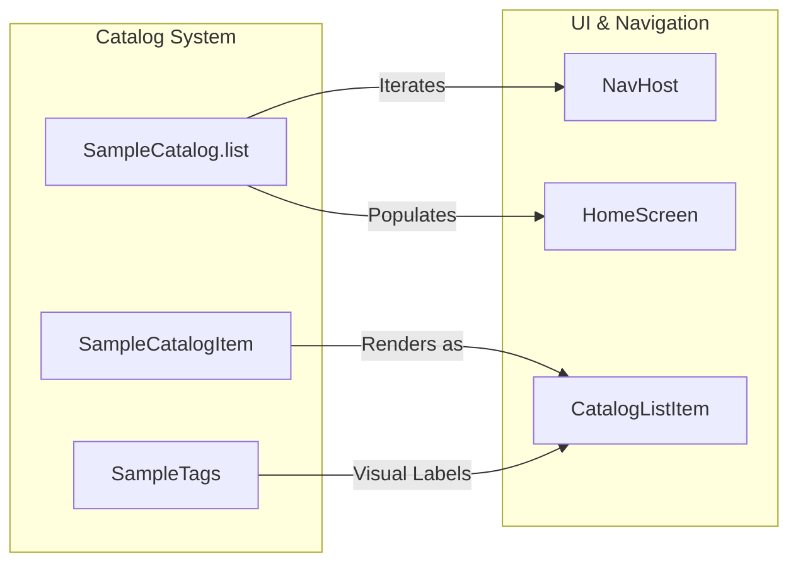

Sources: [ai-sample-catalog/app/src/main/java/com/android/ai/catalog/SampleCatalog.kt:28-100](), [ai-sample-catalog/app/src/main/java/com/android/ai/catalog/ui/CatalogScreen.kt:74-114]()

## Firebase Initialization Guard

A critical feature of the catalog is the `isFirebaseInitialized()` check. Because many samples require a valid `google-services.json` and a connected Firebase project, the application prevents navigation to cloud-based samples if the project is still using the default "mock" configuration.

When a user selects a sample tagged with `SampleTags.FIREBASE`, the application verifies the project ID. If it matches `mock-project-id`, a `firebaseRequiredAlert` dialog is displayed with instructions on how to configure the environment.

Sources: [ai-sample-catalog/app/src/main/java/com/android/ai/catalog/ui/CatalogScreen.kt:221-234](), [ai-sample-catalog/app/google-services.json:1-10]()

## Child Pages
- [Application Architecture](#2.1) — Core structure: `MainActivity`, `CatalogApp`, and the `ui-component` design system.
- [Sample Catalog System](#2.2) — Data models: `SampleCatalogItem`, `SampleTags`, and the dynamic UI generation logic.

---

# Page: Application Architecture

# Application Architecture

<details>
<summary>Relevant source files</summary>

The following files were used as context for generating this wiki page:

- [README.md](README.md)

</details>


This document covers the core application structure, navigation system, and shared UI components for the AI Catalog Android application. It focuses on the architectural foundations that enable the catalog to present and route to individual AI samples.

## Application Structure Overview

The AI Catalog application follows a standard Android architecture pattern with Jetpack Compose for UI and Hilt for dependency injection. The application serves as a launcher and router for various AI sample demonstrations.

**Application Entry Point Architecture**

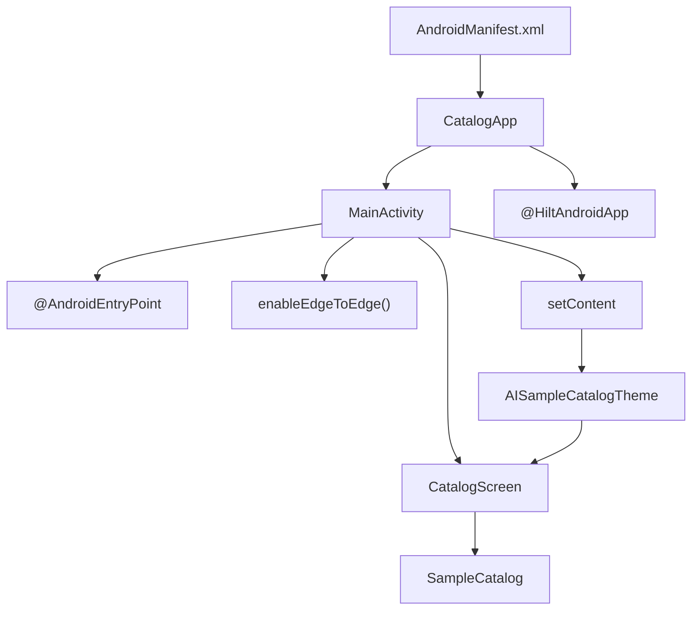

The application entry point follows this flow:
- `CatalogApp` serves as the Hilt-enabled `Application` class.
- `MainActivity` is a simple `ComponentActivity` that enables edge-to-edge display and sets up Compose content.
- `CatalogScreen` contains the main navigation and UI logic.
- `SampleCatalog` provides the registry of available AI samples.

Sources: [ai-sample-catalog/app/src/main/AndroidManifest.xml:5-26](), [ai-sample-catalog/app/src/main/java/com/android/ai/catalog/CatalogApp.kt:16-22](), [ai-sample-catalog/app/src/main/java/com/android/ai/catalog/MainActivity.kt:30-41]()

## Navigation Architecture

The application uses Jetpack Compose Navigation with a centralized `NavHost` that routes between the home screen and individual sample screens. The navigation system integrates Firebase validation to gate access to cloud-based samples.

**NavHost Structure and Routing**

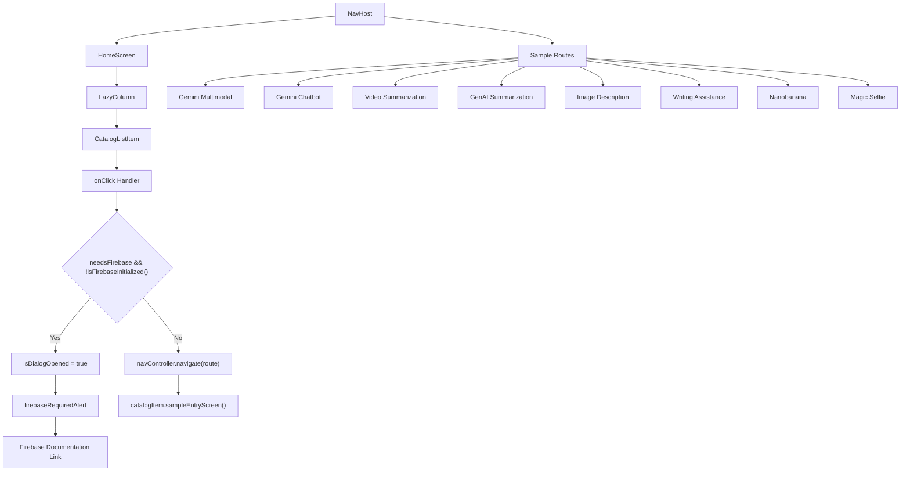

The navigation system implements these key components:
- `rememberNavController()` creates the navigation controller.
- `HomeScreen` is the `startDestination` marked with `@Serializable`.
- Dynamic route registration occurs by iterating through `catalog.list`.
- Each `SampleCatalogItem` provides its own `route` and `sampleEntryScreen()` composable.

Sources: [ai-sample-catalog/app/src/main/java/com/android/ai/catalog/ui/CatalogScreen.kt:67-114]()

## Firebase Initialization Guard

The application implements a validation pattern to ensure cloud-based AI samples have proper Firebase configuration before allowing access. This prevents runtime errors and provides clear user guidance.

**Firebase Validation Flow**

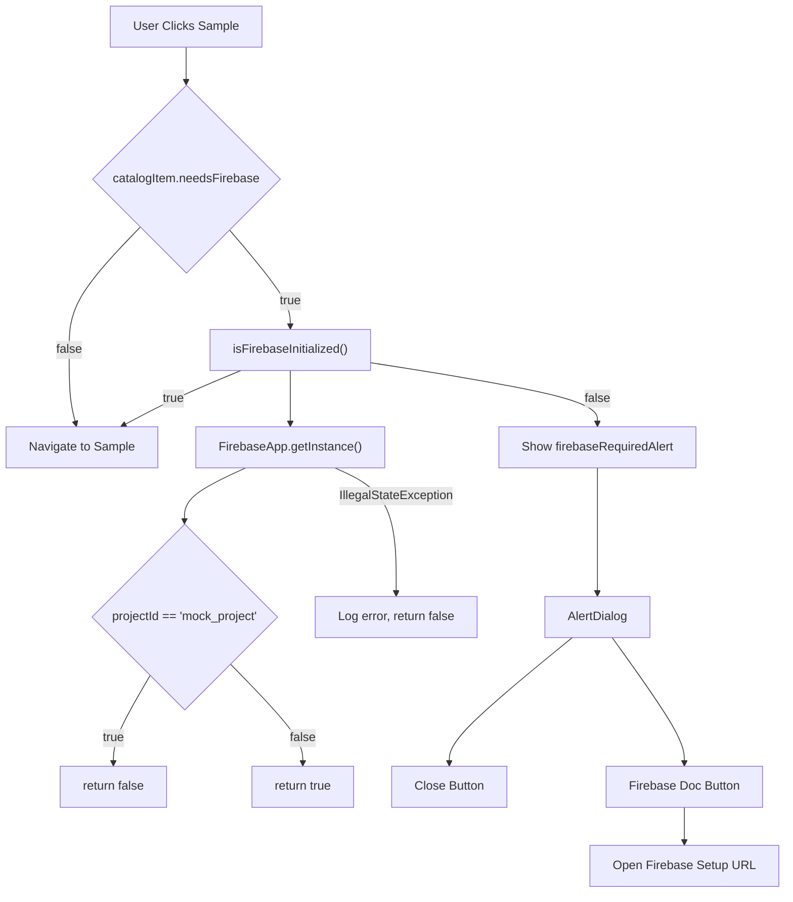

The Firebase validation implements these behaviors:
- `isFirebaseInitialized()` checks if `FirebaseApp.getInstance()` returns a valid instance.
- Mock configuration with `projectId == "mock_project"` (often the default in template files) is treated as uninitialized.
- `IllegalStateException` indicates Firebase is not properly set up.
- An alert dialog provides a direct link to Firebase setup documentation.

Sources: [ai-sample-catalog/app/src/main/java/com/android/ai/catalog/ui/CatalogScreen.kt:97-101](), [ai-sample-catalog/app/src/main/java/com/android/ai/catalog/ui/CatalogScreen.kt:221-234](), [ai-sample-catalog/app/src/main/java/com/android/ai/catalog/ui/CatalogScreen.kt:117-126]()

## Shared UI Components

The `:ui-component` module provides a unified design system used across all AI samples. This ensures visual consistency and reduces boilerplate for complex UI elements like video players or Markdown rendering.

| Component | File | Purpose |
| :--- | :--- | :--- |
| `MarkdownText` | `MarkdownText.kt` | Renders AI-generated text using Markdown formatting. |
| `VideoPlayer` | `VideoPlayer.kt` | Media3-based player for video analysis and playback samples. |
| `Tag` | `Tag.kt` | Displays metadata like model type (Gemini Flash, Nano) or SDK (Firebase, ML Kit). |
| `Button` | `Buttons.kt` | Standardized primary and secondary buttons for the catalog. |

Sources: [ai-sample-catalog/ui-component/src/main/java/com/android/ai/catalog/ui/component/MarkdownText.kt:25-30](), [ai-sample-catalog/ui-component/src/main/java/com/android/ai/catalog/ui/component/VideoPlayer.kt:35-40](), [ai-sample-catalog/ui-component/src/main/java/com/android/ai/catalog/ui/component/Tag.kt:25-30]()

## Dependency Injection and Build Configuration

The application uses Hilt for dependency injection and a centralized Version Catalog for dependency management.

### Dependency Injection Setup

| Component | Annotation | Purpose |
|-----------|------------|---------|
| `CatalogApp` | `@HiltAndroidApp` | Enables Hilt for the entire application. |
| `MainActivity` | `@AndroidEntryPoint` | Enables injection in the main activity. |

Sources: [ai-sample-catalog/app/src/main/java/com/android/ai/catalog/CatalogApp.kt:21-22](), [ai-sample-catalog/app/src/main/java/com/android/ai/catalog/MainActivity.kt:30]()

### Build Configuration

The project uses Gradle's Version Catalog (`libs.versions.toml`) to manage versions across the `app` and `ui-component` modules. Key configurations include:
- **KSP**: Used for code generation (e.g., Room, Hilt).
- **Compose**: All UI is built using Jetpack Compose.
- **FileProvider**: Configured in `AndroidManifest.xml` to support secure file sharing (e.g., sharing captured images with AI models).

Sources: [ai-sample-catalog/app/src/main/AndroidManifest.xml:27-36](), [README.md:22-25]()

---

# Page: Sample Catalog System

# Sample Catalog System

<details>
<summary>Relevant source files</summary>

The following files were used as context for generating this wiki page:

- [README.md](README.md)

</details>


## Purpose and Scope

The Sample Catalog System provides the infrastructure for organizing, categorizing, and presenting AI sample applications within the `ai-sample-catalog` project. This system manages the registration of individual AI samples, their metadata, navigation routes, and classification through a tagging system that distinguishes between cloud-based and on-device AI capabilities.

For information about the overall application architecture and navigation patterns, see [Application Architecture](2.1). For detailed documentation of individual AI samples and their implementations, see [AI Sample Documentation](3).

## Core Catalog Architecture

The catalog system is built around the `SampleCatalog` class which serves as the central registry for all available AI samples in the application.

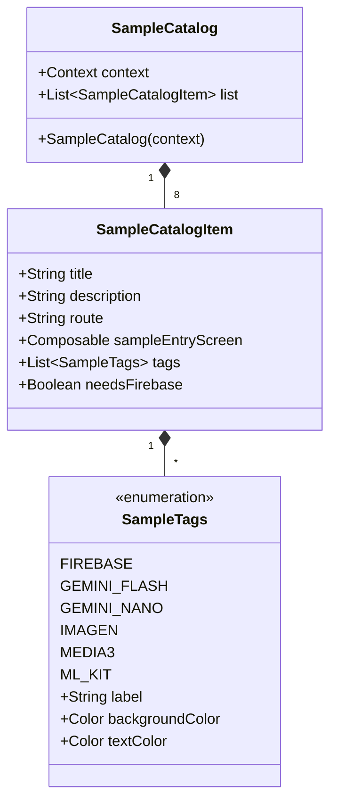

**Sample Catalog Class Structure**

The `SampleCatalog` class [ai-catalog/app/src/main/java/com/android/ai/catalog/ui/domain/SampleCatalog.kt:33-33]() initializes with a `Context` parameter and maintains a hardcoded list of `SampleCatalogItem` instances [ai-catalog/app/src/main/java/com/android/ai/catalog/ui/domain/SampleCatalog.kt:37-99](), each representing a different AI capability demonstration.

Sources: [ai-catalog/app/src/main/java/com/android/ai/catalog/ui/domain/SampleCatalog.kt:33-125]()

## Sample Registration System

Each AI sample is registered in the catalog through a `SampleCatalogItem` data structure that defines its navigation route, display information, and technical requirements.

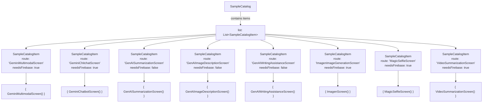

**Sample Registration Pattern**

Each sample registration follows a consistent pattern with five required properties and two optional properties [ai-catalog/app/src/main/java/com/android/ai/catalog/ui/domain/SampleCatalog.kt:105-112]():

| Property | Type | Purpose |
|----------|------|---------|
| `title` | `String` | Display name from string resources |
| `description` | `String` | Brief description from string resources |
| `route` | `String` | Unique navigation route identifier |
| `sampleEntryScreen` | `@Composable () -> Unit` | Composable function for sample UI |
| `tags` | `List<SampleTags>` | Technology classification tags |
| `needsFirebase` | `Boolean` | Firebase dependency requirement |

Sources: [ai-catalog/app/src/main/java/com/android/ai/catalog/ui/domain/SampleCatalog.kt:37-112]()

## Technology Classification System

The `SampleTags` enum [ai-catalog/app/src/main/java/com/android/ai/catalog/ui/domain/SampleCatalog.kt:114-125]() provides a comprehensive classification system that categorizes samples by their underlying AI models, platforms, and supporting technologies.

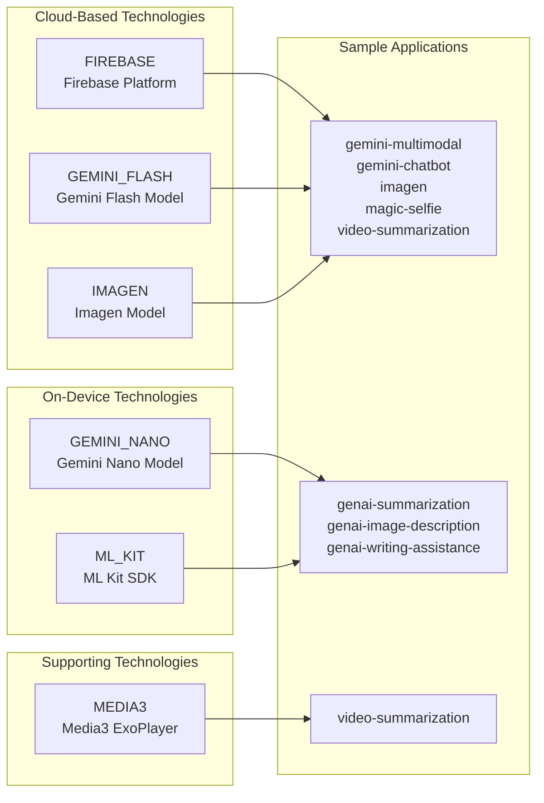

**Tag Classification Matrix**

| Sample | FIREBASE | GEMINI_FLASH | GEMINI_NANO | IMAGEN | ML_KIT | MEDIA3 |
|--------|----------|--------------|-------------|---------|---------|---------|
| `gemini-multimodal` | ✓ | ✓ | | | | |
| `gemini-chatbot` | ✓ | ✓ | | | | |
| `genai-summarization` | | | ✓ | | ✓ | |
| `genai-image-description` | | | ✓ | | ✓ | |
| `genai-writing-assistance` | | | ✓ | | ✓ | |
| `imagen` | ✓ | | | ✓ | | |
| `magic-selfie` | ✓ | | | ✓ | ✓ | |
| `video-summarization` | ✓ | ✓ | | | | ✓ |

Sources: [ai-catalog/app/src/main/java/com/android/ai/catalog/ui/domain/SampleCatalog.kt:43-97](), [ai-catalog/app/src/main/java/com/android/ai/catalog/ui/domain/SampleCatalog.kt:114-125]()

## Firebase Integration Requirements

The catalog system tracks Firebase dependencies through the `needsFirebase` boolean property [ai-catalog/app/src/main/java/com/android/ai/catalog/ui/domain/SampleCatalog.kt:111-111](), which enables conditional access control for cloud-based AI samples.

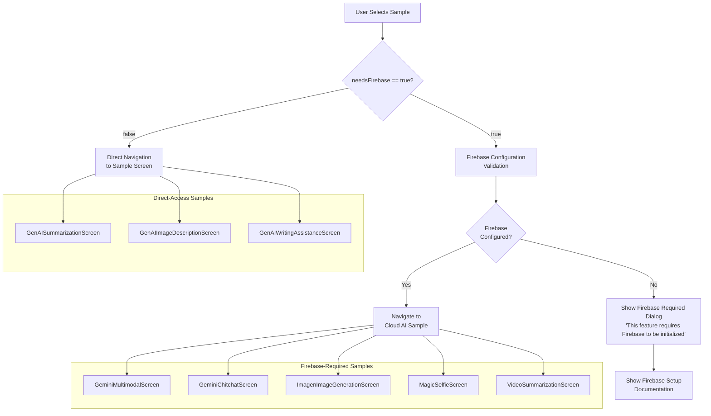

**Firebase-Dependent Samples**

Five samples require Firebase configuration [ai-catalog/app/src/main/java/com/android/ai/catalog/ui/domain/SampleCatalog.kt:44-97]():
- `GeminiMultimodalScreen` - Gemini Flash multimodal generation
- `GeminiChitchatScreen` - Gemini Flash chatbot 
- `ImagenImageGenerationScreen` - Imagen text-to-image generation
- `MagicSelfieScreen` - Imagen background replacement
- `VideoSummarizationScreen` - Gemini Flash video analysis

Sources: [ai-catalog/app/src/main/java/com/android/ai/catalog/ui/domain/SampleCatalog.kt:44-97](), [ai-catalog/app/src/main/res/values/strings.xml:21-24]()

## String Resource Management

The catalog system uses Android string resources for internationalization and consistent display text across the application.

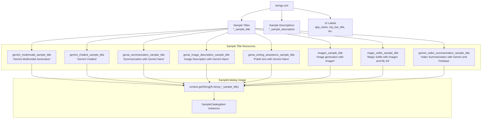

**String Resource Patterns**

The string resources [ai-catalog/app/src/main/res/values/strings.xml:1-25]() follow consistent naming patterns:

| Pattern | Purpose | Example |
|---------|---------|---------|
| `*_sample_title` | Sample display names | `gemini_multimodal_sample_title` |
| `*_sample_description` | Sample brief descriptions | `gemini_multimodal_sample_description` |
| `firebase_*` | Firebase-related UI text | `firebase_required`, `firebase_doc_button` |
| `app_*` | Application-level labels | `app_name`, `top_bar_title` |

Sources: [ai-catalog/app/src/main/res/values/strings.xml:1-25](), [ai-catalog/app/src/main/java/com/android/ai/catalog/ui/domain/SampleCatalog.kt:39-95]()

## Extension and Maintenance

The catalog system is designed for easy extension. Adding new AI samples requires:

1. Creating a new `SampleCatalogItem` entry in the `list` property [ai-catalog/app/src/main/java/com/android/ai/catalog/ui/domain/SampleCatalog.kt:37-99]().
2. Adding corresponding string resources for title and description [ai-catalog/app/src/main/res/values/strings.xml:1-25]().
3. Importing the sample's entry screen composable.
4. Defining appropriate `SampleTags` for technology classification [ai-catalog/app/src/main/java/com/android/ai/catalog/ui/domain/SampleCatalog.kt:114-125]().
5. Setting `needsFirebase = true` if cloud AI services are required.

The code includes a specific marker for extension: `// To create a new sample entry, add a new SampleCatalogItem here.` [ai-catalog/app/src/main/java/com/android/ai/catalog/ui/domain/SampleCatalog.kt:100-101]().

Sources: [ai-catalog/app/src/main/java/com/android/ai/catalog/ui/domain/SampleCatalog.kt:33-125](), [ai-catalog/app/src/main/res/values/strings.xml:1-25]()

---

# Page: AI Sample Documentation

# AI Sample Documentation

<details>
<summary>Relevant source files</summary>

The following files were used as context for generating this wiki page:

- [README.md](README.md)

</details>


## Purpose and Scope

This document provides a comprehensive overview of the AI samples included in the `ai-samples` repository. It serves as a high-level directory for the individual samples available through the **Android AI Sample Catalog** and the **Jetpacker** reference application. These samples demonstrate a wide range of Generative AI capabilities, from on-device privacy-focused models to powerful cloud-based multimodal reasoning.

For details on the catalog's infrastructure, see [Gemini Cloud Samples](#3.1). For details on specific sample groups, refer to the child pages linked in the sections below.

## Sample Classification and Technology Stack

The repository organizes AI capabilities based on their deployment model (Cloud vs. On-Device) and the specific technology provider (Firebase vs. ML Kit).

### AI Capability Mapping

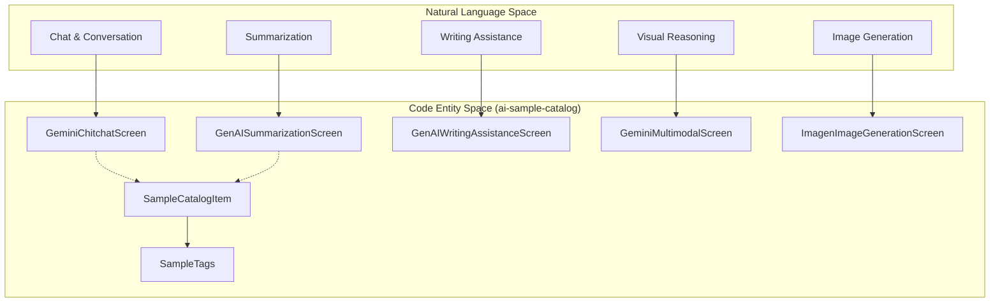

Sources: [ai-catalog/app/src/main/java/com/android/ai/catalog/ui/domain/SampleCatalog.kt:37-99](), [README.md:1-14]()

## Gemini Cloud Samples

Cloud-based samples leverage the **Firebase AI Logic SDK** to interact with Gemini models hosted in the cloud. These samples provide the highest level of reasoning capability and support multimodal inputs (text, image, and video).

*   **Multimodal & Chat**: Standard chatbot interfaces and image-to-text prompting using Gemini Flash.
*   **Nano Banana Pro**: Advanced image chat that allows for iterative image generation and modification.
*   **Video Analysis**: Tools for summarizing video content and generating metadata (chapters, hashtags) using `Media3` and Gemini.
*   **Live API**: Real-time voice interaction and function calling for task management.

For details, see [Gemini Cloud Samples](#3.1).

Sources: [ai-catalog/app/src/main/res/values/strings.xml:3-20](), [ai-catalog/app/src/main/java/com/android/ai/catalog/ui/domain/SampleCatalog.kt:114-125]()

## GenAI On-Device Samples

On-device samples utilize **Gemini Nano** via **ML Kit**. These samples are optimized for privacy, offline availability, and zero latency from network round-trips.

*   **Summarization**: Condensing long-form text into concise summaries using the GenAI Summarization API.
*   **Writing Assistance**: Proofreading, rewriting, and tone adjustment using the GenAI Rewriting API.
*   **Image Description**: Generating text descriptions of local images directly on the device.

For details, see [GenAI On-Device Samples](#3.2).

Sources: [ai-catalog/app/src/main/java/com/android/ai/catalog/ui/domain/SampleCatalog.kt:59-83]()

## Image Generation and Hybrid Samples

These samples focus on visual creation and the orchestration of multiple model types to achieve complex tasks.

*   **Nanobanana**: Pure text-to-image generation using Imagen models via Firebase.
*   **Magic Selfie**: A complex sample using ML Kit for on-device segmentation and Imagen for cloud-based background replacement.
*   **Hybrid Inference**: Demonstrates the `InferenceMode.PREFER_ON_DEVICE` logic, where the app attempts to use Gemini Nano on-device and falls back to Gemini Flash in the cloud if necessary.

For details, see [Image Generation Samples](#3.3).

### Hybrid Logic Flow

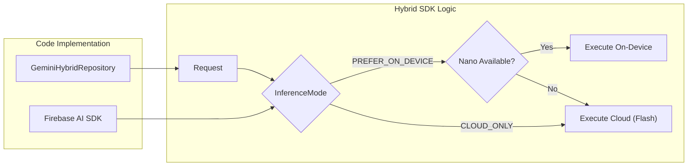

Sources: [ai-catalog/app/src/main/java/com/android/ai/catalog/ui/domain/SampleCatalog.kt:88-100](), [README.md:13-14]()

## Sample Catalog Metadata

Every sample in the `ai-sample-catalog` is registered as a `SampleCatalogItem`. This registration defines the UI presentation, technical requirements (like Firebase), and navigation routes.

| Property | Description | Code Reference |
| :--- | :--- | :--- |
| `route` | The unique navigation string for the screen. | [SampleCatalogItem.kt]() |
| `needsFirebase` | Boolean flag triggering the Firebase initialization check. | [SampleCatalog.kt:38-40]() |
| `tags` | List of `SampleTags` (e.g., `ML_KIT`, `GEMINI_NANO`) for UI filtering. | [SampleCatalog.kt:114-125]() |

Sources: [ai-catalog/app/src/main/java/com/android/ai/catalog/ui/domain/SampleCatalog.kt:37-112]()

---

# Page: Gemini Cloud Samples

# Gemini Cloud Samples

<details>
<summary>Relevant source files</summary>

The following files were used as context for generating this wiki page:

- [README.md](README.md)

</details>


This page provides a high-level overview of the cloud-based AI samples in the `ai-samples` repository. These samples utilize Gemini models via the **Firebase AI Logic SDK**, leveraging cloud infrastructure for advanced multimodal processing, real-time voice interaction, and complex reasoning.

For details on on-device capabilities, see [GenAI On-Device Samples](#3.2). For the overall catalog structure, see [Application Architecture](#2.1).

## Overview

The Gemini Cloud samples demonstrate how to integrate powerful, server-side models into Android applications. Unlike on-device models, these require an active internet connection and a configured Firebase project.

### System Architecture and Code Mapping

The following diagram bridges the high-level system concepts to the specific code entities used to implement cloud-based AI.

**Cloud AI Entity Mapping**

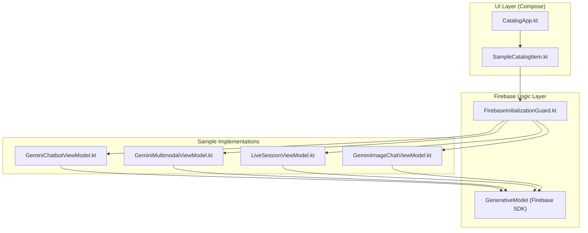

Sources: [README.md:13-14](), [README.md:22-25]()

## Sample Categories

The cloud samples are categorized by their primary interaction model and data modalities:

| Sample Group | Core Features | Key Models |
| :--- | :--- | :--- |
| **Multimodal & Chat** | Text-based conversation, system instructions, and image-to-text analysis. | Gemini 1.5 Flash |
| **Image Generation** | Iterative multimodal chat with image creation (Nano Banana Pro). | Gemini 3 Pro Image |
| **Video Analysis** | Summarization and metadata generation (chapters, tags) from video files. | Gemini 1.5 Flash |
| **Live API** | Real-time voice interaction with function calling and low latency. | Gemini 2.0 Flash |

Sources: [README.md:11-14]()

## Firebase Integration Requirements

Because these samples utilize cloud-based models, they require a valid Firebase project configuration. The `ai-sample-catalog` includes a `FirebaseInitializationGuard` to ensure the app does not attempt to call cloud APIs without a valid `google-services.json`.

**Firebase Guard Logic**

```mermaid
graph TD
    Start["User selects Cloud Sample"]
    Guard["FirebaseInitializationGuard"]
    Check{"isFirebaseConfigured()"}
    Dialog["FirebaseAlert (UI)"]
    Launch["Navigate to Sample"]

    Start --> Guard
    Guard --> Check
    Check -- "No" --> Dialog
    Check -- "Yes" --> Launch
```

Sources: [README.md:22-25]()

## Detailed Sample Documentation

The following child pages provide deep technical dives into the implementation of each cloud-based feature:

### [Multimodal Generation and Chatbot](#3.1.1)
Covers the implementation of standard text-based chat and multimodal image prompting. This section details how `GenerativeModel` is configured with system instructions to define AI personas and how `Content` objects are used to send mixed media (text and images) to the model.

### [Gemini Image Chat (Nano Banana Pro)](#3.1.2)
Explores the "Nano Banana Pro" sample, which uses the Gemini 3 Pro Image model. It focuses on `responseModalities` for generating images within a chat context and `safetySettings` for content moderation.

### [Video Analysis Samples](#3.1.3)
Details two specific video use cases: `gemini-video-summarization` and `gemini-video-metadata-creation`. It covers integration with **Firebase Cloud Storage** for handling large video files and the use of **ExoPlayer** for synchronized playback of AI-generated insights.

### [Gemini Live API To-Do App](#3.1.4)
Documents the `gemini-live-todo` sample, showcasing the **Live API**. This includes real-time WebSockets-based communication for voice interaction and **Function Calling** (e.g., `addTodo`, `getTodoList`) to bridge natural language commands to local application state.

Sources: [README.md:13-14]()

---

# Page: Multimodal Generation and Chatbot

# Multimodal Generation and Chatbot

<details>
<summary>Relevant source files</summary>

The following files were used as context for generating this wiki page:

- [README.md](README.md)

</details>


## Purpose and Scope

This document provides a detailed technical overview of two primary Gemini cloud-based samples within the AI Catalog: **Multimodal Generation** and the **Chatbot**. 

The **Multimodal Generation** sample demonstrates how to combine image and text inputs to generate AI-powered responses using Google's Gemini 2.0 Flash model via Firebase Vertex AI [ai-catalog/samples/gemini-multimodal/src/main/java/com/android/ai/samples/geminimultimodal/GeminiMultimodalViewModel.kt:43-46](). 

The **Chatbot** sample showcases conversation management, persona configuration using system instructions, and state-driven UI for a turn-based chat interface [ai-catalog/samples/chatbot/src/main/java/com/android/ai/samples/chatbot/ChatViewModel.kt:1-111]().

## 1. Multimodal Generation

This sample implements a complete flow for capturing a photo, providing a text prompt, and receiving a contextual response from Gemini Flash.

### System Architecture

The Multimodal sample follows a standard MVVM pattern.

```mermaid
graph TD
    subgraph "UI Layer [GeminiMultimodalScreen.kt]"
        GMS["GeminiMultimodalScreen"]
        CL["cameraLauncher (ActivityResult)"]
    end
    
    subgraph "ViewModel Layer [GeminiMultimodalViewModel.kt]"
        GMVM["GeminiMultimodalViewModel"]
        GMVM_GEN["generate(bitmap, prompt)"]
    end
    
    subgraph "Firebase Vertex AI SDK"
        F_VAI["Firebase.vertexAI"]
        GEN_MOD["GenerativeModel"]
        CONT_BLD["content { ... }"]
    end
    
    GMS -- "Triggers" --> CL
    CL -- "Returns Bitmap" --> GMS
    GMS -- "Calls" --> GMVM_GEN
    GMVM_GEN -- "Uses" --> CONT_BLD
    CONT_BLD -- "Requests" --> GEN_MOD
    GEN_MOD -- "Network" --> F_VAI
    
    GMVM -- "StateFlow<String>" --> GMS
    GMVM -- "LiveData<Boolean>" --> GMS
```

**Sources:** [ai-catalog/samples/gemini-multimodal/src/main/java/com/android/ai/samples/geminimultimodal/GeminiMultimodalScreen.kt:88-93](), [ai-catalog/samples/gemini-multimodal/src/main/java/com/android/ai/samples/geminimultimodal/GeminiMultimodalViewModel.kt:35-78]()

### Implementation Details

*   **Camera Integration**: Uses `rememberLauncherForActivityResult` with the `TakePicturePreview()` contract to obtain a thumbnail-sized `Bitmap` [ai-catalog/samples/gemini-multimodal/src/main/java/com/android/ai/samples/geminimultimodal/GeminiMultimodalScreen.kt:88-93]().
*   **Model Configuration**: The `GenerativeModel` is configured with `gemini-2.0-flash` and specific `generationConfig` parameters including `temperature = 0.9f` and `maxOutputTokens = 4096` [ai-catalog/samples/gemini-multimodal/src/main/java/com/android/ai/samples/geminimultimodal/GeminiMultimodalViewModel.kt:43-58]().
*   **Content Construction**: The SDK's `content` DSL is used to wrap both the `Bitmap` and the `String` prompt into a single multimodal request [ai-catalog/samples/gemini-multimodal/src/main/java/com/android/ai/samples/geminimultimodal/GeminiMultimodalViewModel.kt:66-69]().

**Sources:** [ai-catalog/samples/gemini-multimodal/src/main/java/com/android/ai/samples/geminimultimodal/GeminiMultimodalViewModel.kt:43-78]()

---

## 2. Gemini Chatbot

The Chatbot sample demonstrates a conversational interface with a persistent history and a specific AI persona defined via system instructions.

### Conversation Data Flow

The `ChatViewModel` manages the lifecycle of a `ChatSession`.

```mermaid
sequenceDiagram
    participant UI as ChatScreen.kt
    participant VM as ChatViewModel
    participant CS as ChatSession (Vertex AI)
    participant SDK as GenerativeModel
    
    UI->>VM: sendMessage(userText)
    Note over VM: Add user message to _uiState
    VM->>CS: sendMessage(userText)
    CS->>SDK: generateContent(history + message)
    SDK-->>CS: GenerateContentResponse
    CS-->>VM: Response text
    Note over VM: Update _uiState with AI response
    VM-->>UI: StateFlow Update (List<ChatMessage>)
```

**Sources:** [ai-catalog/samples/chatbot/src/main/java/com/android/ai/samples/chatbot/ChatViewModel.kt:86-109](), [ai-catalog/samples/chatbot/src/main/java/com/android/ai/samples/chatbot/ChatScreen.kt:111-125]()

### Persona and System Instructions

The chatbot is configured with a "Cat" persona using `systemInstruction`. This tells the model how to behave before the conversation even begins.

| Component | Value / Implementation |
| :--- | :--- |
| **Model** | `gemini-1.5-flash` [ai-catalog/samples/chatbot/src/main/java/com/android/ai/samples/chatbot/ChatViewModel.kt:45]() |
| **System Instruction** | "You are a cat. Your name is Meow. You are a very grumpy cat..." [ai-catalog/samples/chatbot/src/main/java/com/android/ai/samples/chatbot/ChatViewModel.kt:47-51]() |
| **Session Initialization** | `generativeModel.startChat(history = emptyList())` [ai-catalog/samples/chatbot/src/main/java/com/android/ai/samples/chatbot/ChatViewModel.kt:65]() |

**Sources:** [ai-catalog/samples/chatbot/src/main/java/com/android/ai/samples/chatbot/ChatViewModel.kt:43-65]()

### Key Classes and Roles

*   **`ChatViewModel`**: Responsible for initializing the `GenerativeModel`, starting the `ChatSession`, and maintaining the `uiState` which is a `MutableStateFlow` of `ChatUiState` [ai-catalog/samples/chatbot/src/main/java/com/android/ai/samples/chatbot/ChatViewModel.kt:34-41]().
*   **`ChatMessage`**: A UI-layer data class representing a single turn in the conversation, including the `author` (USER or MODEL) and the `text` [ai-catalog/samples/chatbot/src/main/java/com/android/ai/samples/chatbot/ChatUiState.kt:32-35]().
*   **`ChatScreen`**: A Composable that renders the message list using a `LazyColumn` and handles user input via a `TextField` [ai-catalog/samples/chatbot/src/main/java/com/android/ai/samples/chatbot/ChatScreen.kt:81-125]().

**Sources:** [ai-catalog/samples/chatbot/src/main/java/com/android/ai/samples/chatbot/ChatViewModel.kt:34-41](), [ai-catalog/samples/chatbot/src/main/java/com/android/ai/samples/chatbot/ChatUiState.kt:21-36](), [ai-catalog/samples/chatbot/src/main/java/com/android/ai/samples/chatbot/ChatScreen.kt:81-125]()

### Error Handling

The `ChatViewModel` utilizes a `try-catch` block during the `sendMessage` execution. If an exception occurs (e.g., network failure or safety filter trigger), the error message is captured and displayed in the UI as a message from the "MODEL" author to inform the user [ai-catalog/samples/chatbot/src/main/java/com/android/ai/samples/chatbot/ChatViewModel.kt:101-107]().

**Sources:** [ai-catalog/samples/chatbot/src/main/java/com/android/ai/samples/chatbot/ChatViewModel.kt:101-107]()

---

# Page: Gemini Image Chat (Nano Banana Pro)

# Gemini Image Chat (Nano Banana Pro)

<details>
<summary>Relevant source files</summary>

The following files were used as context for generating this wiki page:

- [README.md](README.md)

</details>


The Gemini Image Chat sample (internally referred to as "Nano Banana Pro") demonstrates a multimodal conversational interface where users can generate images from text and then iterate on those images through natural language chat. It utilizes the Gemini 3 Pro Image model via Firebase Vertex AI, showcasing advanced model configurations including response modalities and safety settings.

## Architecture Overview

The sample follows a clean MVVM architecture, separating UI concerns from model interaction logic. The `GeminiImageChatViewModel` serves as the central orchestrator, managing the conversation state and communicating with the Gemini model.

```mermaid
graph TD
    subgraph "UI Layer"
        Screen["GeminiImageChatScreen"]
        List["MessageList"]
        Input["InputBar"]
    end

    subgraph "State Management"
        VM["GeminiImageChatViewModel"]
        UiState["GeminiImageChatUiState"]
    end

    subgraph "AI Logic Layer"
        Model["GenerativeModel (Gemini 3 Pro)"]
        Chat["ChatSession"]
    end

    Screen --> VM
    VM --> UiState
    UiState --> Screen
    VM --> Chat
    Chat --> Model
    Input --> VM
    List --> UiState
```

**System-to-Code Mapping**

| System Component | Code Entity | Role |
| :--- | :--- | :--- |
| **View** | `GeminiImageChatScreen` | Renders the chat UI and handles user interactions. [ai-catalog/samples/gemini-image-chat/src/main/java/com/android/ai/samples/geminiimagechat/GeminiImageChatScreen.kt:65-117]() |
| **ViewModel** | `GeminiImageChatViewModel` | Manages the `ChatSession` and UI state. [ai-catalog/samples/gemini-image-chat/src/main/java/com/android/ai/samples/geminiimagechat/GeminiImageChatViewModel.kt:41-43]() |
| **Model Configuration** | `GenerativeModel` | Defines the Gemini model, safety settings, and modalities. [ai-catalog/samples/gemini-image-chat/src/main/java/com/android/ai/samples/geminiimagechat/GeminiImageChatViewModel.kt:50-70]() |
| **Conversation State** | `GeminiImageChatUiState` | A data class holding the list of messages and loading status. [ai-catalog/samples/gemini-image-chat/src/main/java/com/android/ai/samples/geminiimagechat/GeminiImageChatViewModel.kt:113-116]() |

Sources: [ai-catalog/samples/gemini-image-chat/src/main/java/com/android/ai/samples/geminiimagechat/GeminiImageChatScreen.kt:65-117](), [ai-catalog/samples/gemini-image-chat/src/main/java/com/android/ai/samples/geminiimagechat/GeminiImageChatViewModel.kt:41-116]()

## Model Configuration

The sample uses a specific configuration for the Gemini model to enable multimodal responses (text and images) and ensure content safety.

### Response Modalities and Safety
The model is initialized with `responseModalities` set to include both `IMAGE` and `TEXT`. This allows the model to generate visual content in response to user prompts. Additionally, it implements `SafetySetting` to block high-risk content across various categories.

```mermaid
graph LR
    Config["GenerativeModel Configuration"]
    Modalities["Response Modalities"]
    Safety["Safety Settings"]
    
    Config --> Modalities
    Config --> Safety
    
    Modalities --> M1["IMAGE"]
    Modalities --> M2["TEXT"]
    
    Safety --> S1["HATE_SPEECH: BLOCK_LOW_AND_ABOVE"]
    Safety --> S2["HARASSMENT: BLOCK_LOW_AND_ABOVE"]
    Safety --> S3["DANGEROUS_CONTENT: BLOCK_LOW_AND_ABOVE"]
    Safety --> S4["SEXUALLY_EXPLICIT: BLOCK_LOW_AND_ABOVE"]
```

**Key Configuration Details:**
- **Model Name**: `gemini-3-pro-image` [ai-catalog/samples/gemini-image-chat/src/main/java/com/android/ai/samples/geminiimagechat/GeminiImageChatViewModel.kt:51]()
- **Response Modalities**: Configured via `generationConfig` to support `IMAGE` and `TEXT`. [ai-catalog/samples/gemini-image-chat/src/main/java/com/android/ai/samples/geminiimagechat/GeminiImageChatViewModel.kt:52-54]()
- **Safety Threshold**: Uses `BlockThreshold.BLOCK_LOW_AND_ABOVE` for all categories. [ai-catalog/samples/gemini-image-chat/src/main/java/com/android/ai/samples/geminiimagechat/GeminiImageChatViewModel.kt:57-68]()

Sources: [ai-catalog/samples/gemini-image-chat/src/main/java/com/android/ai/samples/geminiimagechat/GeminiImageChatViewModel.kt:50-70]()

## Implementation Details

### Message Data Flow
The `GeminiImageChatViewModel` maintains a `ChatSession` which tracks the history of the conversation. When a user sends a message, the following sequence occurs:

1.  The user's text is added to the local `_uiState`. [ai-catalog/samples/gemini-image-chat/src/main/java/com/android/ai/samples/geminiimagechat/GeminiImageChatViewModel.kt:80-83]()
2.  `chatSession.sendMessage(userMessage)` is called. [ai-catalog/samples/gemini-image-chat/src/main/java/com/android/ai/samples/geminiimagechat/GeminiImageChatViewModel.kt:87]()
3.  The model returns a response containing text and/or images.
4.  The response is parsed into a `ChatMessage` object and added to the UI state. [ai-catalog/samples/gemini-image-chat/src/main/java/com/android/ai/samples/geminiimagechat/GeminiImageChatViewModel.kt:88-100]()

```mermaid
sequenceDiagram
    participant UI as GeminiImageChatScreen
    participant VM as GeminiImageChatViewModel
    participant CS as ChatSession
    participant GM as GenerativeModel

    UI->>VM: sendMessage(prompt)
    VM->>VM: Update UI (User Message)
    VM->>CS: sendMessage(prompt)
    CS->>GM: Process multimodal prompt
    GM-->>CS: Generate Text + Image
    CS-->>VM: GenerateContentResponse
    VM->>VM: Parse response parts
    VM->>UI: Update UI (AI Response)
```

### UI Components
- **`MessageList`**: A `LazyColumn` that renders `ChatMessage` items. It handles different content types (text vs. image) within the message bubbles. [ai-catalog/samples/gemini-image-chat/src/main/java/com/android/ai/samples/geminiimagechat/GeminiImageChatScreen.kt:133-163]()
- **`MessageBubble`**: Displays text using `MarkdownText` and images using `AsyncImage`. [ai-catalog/samples/gemini-image-chat/src/main/java/com/android/ai/samples/geminiimagechat/GeminiImageChatScreen.kt:165-200]()
- **`InputBar`**: A custom text input field with a send button, optimized for chat interactions. [ai-catalog/samples/gemini-image-chat/src/main/java/com/android/ai/samples/geminiimagechat/InputBar.kt:47-102]()

Sources: [ai-catalog/samples/gemini-image-chat/src/main/java/com/android/ai/samples/geminiimagechat/GeminiImageChatScreen.kt:133-200](), [ai-catalog/samples/gemini-image-chat/src/main/java/com/android/ai/samples/geminiimagechat/InputBar.kt:47-102](), [ai-catalog/samples/gemini-image-chat/src/main/java/com/android/ai/samples/geminiimagechat/GeminiImageChatViewModel.kt:76-108]()

## Summary of Data Structures

| Class | Description | Key Fields |
| :--- | :--- | :--- |
| `ChatMessage` | Represents a single turn in the conversation. | `text`, `images`, `isIncoming`, `timestamp` |
| `GeminiImageChatUiState` | The state consumed by the Compose UI. | `messages` (List), `isLoading` (Boolean) |

Sources: [ai-catalog/samples/gemini-image-chat/src/main/java/com/android/ai/samples/geminiimagechat/GeminiImageChatViewModel.kt:113-125]()

---

# Page: Video Analysis Samples

# Video Analysis Samples

<details>
<summary>Relevant source files</summary>

The following files were used as context for generating this wiki page:

- [README.md](README.md)

</details>


## Purpose and Scope

The Video Analysis samples demonstrate advanced cloud-based video processing capabilities using Gemini models via Firebase Vertex AI. These samples illustrate two primary use cases:

1.  **Video Summarization**: Utilizing Gemini Flash with Cloud Storage for large file support, integrated with ExoPlayer for playback and multilingual Text-to-Speech (TTS) for accessibility.
2.  **Video Metadata Creation**: Generating structured metadata including descriptions, hashtags, chapters, thumbnails, and account tags from either YouTube URLs or local video files.

These samples highlight the integration of the Firebase AI Logic SDK with standard Android media components like `Media3` (ExoPlayer).

**Sources:** [README.md:1-37](), [ai-catalog/samples/gemini-video-summarization/src/main/java/com/android/ai/samples/geminivideosummary/VideoSummarizationScreen.kt:1-278]()

---

## Video Summarization Implementation

The `gemini-video-summarization` sample provides a comprehensive workflow for analyzing video content and providing an audio-visual summary.

### Architecture Overview

The system bridges standard Android media playback with Gemini's multimodal reasoning capabilities.

```mermaid
graph TB
    subgraph "VideoSummarizationScreen (UI Layer)"
        VSS["VideoSummarizationScreen"]
        VP["VideoPlayer (Media3)"]
        TTSC["TextToSpeechControls"]
        OTD["OutputTextDisplay (Markdown)"]
    end
    
    subgraph "Logic Layer"
        VSVM["VideoSummarizationViewModel"]
        TTSM["TextToSpeech Manager"]
    end
    
    subgraph "Cloud AI Layer"
        FAI["Firebase AI Logic SDK"]
        G2F["Gemini 2.0 Flash"]
        GCS["Google Cloud Storage"]
    end
    
    VSS --> VSVM
    VSVM --> FAI
    FAI --> GCS
    GCS --> G2F
    G2F -- "Summary Text" --> VSVM
    VSVM -- "StateFlow" --> OTD
    OTD --> TTSM
    TTSM --> TTSC
```

**Sources:** [ai-catalog/samples/gemini-video-summarization/src/main/java/com/android/ai/samples/geminivideosummary/VideoSummarizationScreen.kt:70-120]()

### Video Playback and Selection

The sample uses `ExoPlayer` for video rendering. It supports a selection of pre-defined videos or custom URIs. The `VideoPlayer` component is a reusable UI element from the `ui-component` module.

| Function/Class | Role | File Reference |
| :--- | :--- | :--- |
| `VideoPlayer` | Composable wrapper for `PlayerView` and `ExoPlayer` | [ai-sample-catalog/ui-component/...]() |
| `onSelectedVideoChange` | Updates `ExoPlayer` media items and resets TTS | [VideoSummarizationScreen.kt:217-233]() |
| `VideoSelectionDropdown` | UI for selecting input video sources | [VideoSummarizationScreen.kt:135-155]() |

**Sources:** [ai-catalog/samples/gemini-video-summarization/src/main/java/com/android/ai/samples/geminivideosummary/VideoSummarizationScreen.kt:89-103](), [ai-catalog/samples/gemini-video-summarization/src/main/java/com/android/ai/samples/geminivideosummary/VideoSummarizationScreen.kt:217-233]()

### Multilingual Text-to-Speech (TTS)

A key feature is the ability to read the generated summary aloud using the Android `TextToSpeech` engine with support for various accents.

```mermaid
graph LR
    subgraph "TTS State Management"
        SA["selectedAccent (Locale)"]
        IS["isSpeaking (Boolean)"]
        II["isInitialized (Boolean)"]
    end

    subgraph "Engine Calls"
        INIT["textToSpeech.initialize()"]
        SPEAK["textToSpeech.speak()"]
        STOP["textToSpeech.stop()"]
    end

    SA --> SPEAK
    IS --> STOP
    II --> SPEAK
```

The system supports several locales including `Locale.UK`, `Locale.FRANCE`, `Locale.GERMANY`, `Locale.ITALY`, `Locale.JAPAN`, `Locale.KOREA`, and `Locale.US`.

**Sources:** [ai-catalog/samples/gemini-video-summarization/src/main/java/com/android/ai/samples/geminivideosummary/VideoSummarizationScreen.kt:248-261](), [ai-catalog/samples/gemini-video-summarization/src/main/java/com/android/ai/samples/geminivideosummary/ui/TextToSpeechControls.kt:100-119]()

---

## Video Metadata Creation

The `gemini-video-metadata-creation` sample focuses on extracting structured data from videos to automate content management tasks.

### Metadata Extraction Workflow

This sample demonstrates how to prompt Gemini to return specific structured information about a video file or a YouTube link.

```mermaid
sequenceDiagram
    participant User
    participant VM as "VideoMetadataViewModel"
    participant Gemini as "Gemini Flash (Cloud)"
    
    User->>VM: Provide Video (Local/URL)
    VM->>Gemini: Prompt: "Generate description, hashtags, chapters"
    Gemini-->>VM: Structured Text Response
    VM->>VM: Parse Response into Metadata Object
    VM->>User: Display Chapters, Tags, and Summary
```

### Key Metadata Features

1.  **Description Generation**: A natural language summary of the video content.
2.  **Hashtag Suggestion**: Relevant tags for social media discovery.
3.  **Chaptering**: Time-stamped segments of the video for navigation.
4.  **Thumbnail Analysis**: Identifying key frames or describing the visual style.
5.  **Account Tags**: Identifying potential creators or entities mentioned.

**Sources:** [README.md:13-14](), [ai-catalog/samples/gemini-video-summarization/src/main/java/com/android/ai/samples/geminivideosummary/VideoSummarizationScreen.kt:1-50]()

---

## Technical Implementation Details

### State Management

Both samples utilize `StateFlow` within ViewModels to manage the asynchronous nature of AI processing and video loading.

| State Property | Type | Description |
| :--- | :--- | :--- |
| `uiState` | `StateFlow<UiState>` | Manages Loading, Success, and Error states for the AI request. |
| `outputText` | `StateFlow<String>` | The raw or parsed text returned by Gemini. |
| `isPlaying` | `Boolean` | Current playback state of the video player. |

### AI Configuration

The samples use Gemini 2.0 Flash for its balance of speed and multimodal performance. Large videos are typically handled by uploading to Cloud Storage before inference, allowing the model to process high-resolution content without client-side memory constraints.

**Sources:** [ai-catalog/samples/gemini-video-summarization/src/main/java/com/android/ai/samples/geminivideosummary/VideoSummarizationScreen.kt:77-86](), [ai-catalog/samples/gemini-video-summarization/src/main/java/com/android/ai/samples/geminivideosummary/ui/TextToSpeechControls.kt:36-48]()

---

# Page: Gemini Live API To-Do App

# Gemini Live API To-Do App

<details>
<summary>Relevant source files</summary>

The following files were used as context for generating this wiki page:

- [README.md](README.md)

</details>


The `gemini-live-todo` sample demonstrates real-time, bidirectional voice interaction using the Gemini Live API. It enables users to manage a task list through natural language conversations with Gemini Flash. The application leverages function calling to bridge the gap between natural language intent and structured code execution, allowing the model to perform operations such as adding, removing, and toggling the status of to-do items.

### System Architecture and Data Flow

The application follows a reactive architecture where the `LiveTodoViewModel` manages the state of the voice session and the to-do list. The communication with the Gemini Live API is handled via a `LiveSession` object, which facilitates the streaming of audio data and tool call exchanges.

#### Natural Language to Code Mapping
The following diagram illustrates how natural language requests from the user are transformed into executable code within the application.

**Diagram: Intent-to-Function Mapping**
```mermaid
graph TD
    subgraph "Natural Language Space (User Voice)"
        A["'Add buy milk to my list'"]
        B["'Check off buy milk'"]
        C["'Delete the milk task'"]
    end

    subgraph "Gemini Live API (Cloud)"
        D["Gemini Flash Model"]
        E["Function Declaration Dispatcher"]
    end

    subgraph "Code Entity Space (gemini-live-todo)"
        F["addTodo(task: String)"]
        G["toggleTodoStatus(id: String)"]
        H["removeTodo(id: String)"]
        I["getTodoList()"]
        J["LiveTodoViewModel"]
        K["TodoRepository"]
    end

    A --> D
    B --> D
    C --> D
    D --> E
    
    E -- "calls" --> F
    E -- "calls" --> G
    E -- "calls" --> H
    
    F --> J
    G --> J
    H --> J
    J --> K
```
**Sources:** [ai-sample-catalog/gemini-live-todo/src/main/java/com/google/android/aisamples/live/LiveTodoViewModel.kt:35-150](), [ai-sample-catalog/gemini-live-todo/src/main/java/com/google/android/aisamples/live/LiveTodoScreen.kt:40-100]()

---

### Live Session Management

The core of the interaction is managed by the `LiveSession` class provided by the Firebase AI Logic SDK. The `LiveTodoViewModel` initializes this session with specific configurations, including the model selection (Gemini Flash) and the set of available tools (functions).

#### Session Lifecycle and State
The UI observes the `LiveSessionState` to update the microphone icon, status text, and visual feedback for the user.

| State | Description | UI Representation |
| :--- | :--- | :--- |
| `INITIALIZING` | The WebSocket connection is being established. | Loading Spinner |
| `CONNECTED` | Session is active; model is listening or responding. | Active Mic Waveform |
| `DISCONNECTED` | Session has ended or failed. | Start Button |
| `ERROR` | An exception occurred during the session. | Error Message Snackbar |

**Diagram: Session State Transitions**
```mermaid
stateDiagram-v2
    [*] --> DISCONNECTED
    DISCONNECTED --> INITIALIZING : "startLiveSession()"
    INITIALIZING --> CONNECTED : "onSessionStarted"
    CONNECTED --> CONNECTED : "Process Audio / Tool Calls"
    CONNECTED --> DISCONNECTED : "stopLiveSession()"
    INITIALIZING --> ERROR : "Connection Failed"
    CONNECTED --> ERROR : "Stream Interrupted"
    ERROR --> DISCONNECTED : "Reset"
```
**Sources:** [ai-sample-catalog/gemini-live-todo/src/main/java/com/google/android/aisamples/live/LiveTodoViewModel.kt:60-95](), [ai-sample-catalog/gemini-live-todo/src/main/java/com/google/android/aisamples/live/LiveTodoScreen.kt:110-140]()

---

### Function Declarations and Tool Use

The Gemini model is provided with a set of `FunctionDeclaration` objects. These define the schema that the model must follow when it decides to interact with the application's data.

#### Supported Functions
The following functions are registered in the `LiveTodoViewModel`:

1.  **`addTodo`**: Takes a `task` string. It creates a new `TodoItem` and adds it to the list.
    *   Defined in: [ai-sample-catalog/gemini-live-todo/src/main/java/com/google/android/aisamples/live/LiveTodoViewModel.kt:120-125]()
2.  **`removeTodo`**: Takes an `id`. It removes the corresponding item from the state.
    *   Defined in: [ai-sample-catalog/gemini-live-todo/src/main/java/com/google/android/aisamples/live/LiveTodoViewModel.kt:130-135]()
3.  **`toggleTodoStatus`**: Takes an `id`. It flips the `isCompleted` boolean of the task.
    *   Defined in: [ai-sample-catalog/gemini-live-todo/src/main/java/com/google/android/aisamples/live/LiveTodoViewModel.kt:140-145]()
4.  **`getTodoList`**: Returns the current list of tasks to the model so it can answer questions like "What is on my list?".
    *   Defined in: [ai-sample-catalog/gemini-live-todo/src/main/java/com/google/android/aisamples/live/LiveTodoViewModel.kt:110-115]()

#### Implementation of Tool Calls
When the model emits a `ToolCall`, the `LiveTodoViewModel` intercepts it within the `liveSession.start()` block. The application executes the local logic and sends back a `ToolResponse` to the model, allowing the conversation to continue seamlessly.

**Diagram: Tool Call Execution Loop**
```mermaid
sequenceDiagram
    participant User
    participant LiveTodoViewModel
    participant GeminiAPI as "Gemini Live API"
    participant State as "TodoUiState"

    User->>LiveTodoViewModel: "I finished the milk task"
    LiveTodoViewModel->>GeminiAPI: Audio Stream (PCM)
    GeminiAPI->>LiveTodoViewModel: ToolCall: toggleTodoStatus(id="123")
    LiveTodoViewModel->>State: Update item 123 to completed
    LiveTodoViewModel->>GeminiAPI: ToolResponse: {status: "success"}
    GeminiAPI->>LiveTodoViewModel: Audio Stream (Response: "Great, I've checked that off.")
    LiveTodoViewModel->>User: Playback Audio
```
**Sources:** [ai-sample-catalog/gemini-live-todo/src/main/java/com/google/android/aisamples/live/LiveTodoViewModel.kt:75-110](), [ai-sample-catalog/gemini-live-todo/src/main/java/com/google/android/aisamples/live/LiveTodoScreen.kt:150-180]()

---

### Implementation Details

#### Audio Processing
The sample uses `AudioRecord` for capturing user voice and `AudioTrack` for playing back the model's responses. The audio is streamed in real-time as 16-bit Linear PCM at 16kHz, which is the standard requirement for the Gemini Live API.

#### ViewModel and State Management
The `LiveTodoViewModel` exposes a `StateFlow<LiveTodoUiState>` which contains:
*   `todoList`: The current list of `TodoItem` objects.
*   `sessionState`: The current `LiveSessionState`.
*   `isRecording`: A boolean indicating if the microphone is active.

**Sources:** [ai-sample-catalog/gemini-live-todo/src/main/java/com/google/android/aisamples/live/LiveTodoViewModel.kt:40-55](), [ai-sample-catalog/gemini-live-todo/src/main/java/com/google/android/aisamples/live/LiveTodoScreen.kt:60-85]()

---

# Page: GenAI On-Device Samples

# GenAI On-Device Samples

<details>
<summary>Relevant source files</summary>

The following files were used as context for generating this wiki page:

- [README.md](README.md)

</details>


## Purpose and Scope

This document covers the on-device AI sample implementations within the AI Sample Catalog that leverage Gemini Nano through the GenAI API and ML Kit. These samples demonstrate privacy-focused AI processing that runs entirely on the user's device without requiring cloud connectivity or external API calls.

The on-device samples complement the cloud-based capabilities documented in [Gemini Cloud Samples](#3.1) and [Image Generation Samples](#3.3), providing immediate processing with enhanced privacy and offline functionality. For information about the overall catalog architecture, see [Application Architecture](#2.1).

## On-Device Sample Categories

The GenAI on-device samples are organized into three core categories, each showcasing different aspects of local AI processing capabilities through the Gemini Nano model.

| Sample Module | Description | Key Capabilities |
| :--- | :--- | :--- |
| **Text Summarization** | [Text Summarization and Writing Assistance](#3.2.1) | Condensing long-form text into concise summaries using the GenAI Summarization API. |
| **Writing Assistance** | [Text Summarization and Writing Assistance](#3.2.1) | Proofreading and rewriting text with multiple style options (e.g., professional, casual) via the GenAI Rewriting API. |
| **Image Description** | [Image Description](#3.2.2) | Generating descriptive text for local images using the GenAI Image Description API. |

Sources: [README.md:13-14](), [ai-sample-catalog/README.md:7-13]()

## On-Device Processing Architecture

The architecture bridges high-level UI components with low-level model execution handled by ML Kit.

### Sample Integration Flow

```mermaid
graph TD
    subgraph "UI Layer (ai-sample-catalog)"
        MainActivity["MainActivity"] --> CatalogApp["CatalogApp (NavHost)"]
        CatalogApp --> SummarizationScreen["SummarizationScreen"]
        CatalogApp --> WritingScreen["WritingAssistanceScreen"]
        CatalogApp --> ImageDescScreen["ImageDescriptionScreen"]
    end
    
    subgraph "Domain & Logic Layer"
        SummarizationScreen --> SumVM["SummarizationViewModel"]
        WritingScreen --> WriteVM["WritingAssistanceViewModel"]
        ImageDescScreen --> ImageVM["ImageDescriptionViewModel"]
    end

    subgraph "ML Kit / GenAI SDK"
        SumVM --> SumAPI["Summarization API"]
        WriteVM --> RewriteAPI["Rewriting API"]
        ImageVM --> ImageDescAPI["Image Description API"]
        
        SumAPI --> Nano["Gemini Nano Model (On-Device)"]
        RewriteAPI --> Nano
        ImageDescAPI --> Nano
    end
```

Sources: [README.md:13-14](), [ai-sample-catalog/README.md:7-13]()

### Technology Stack and Dependencies

The on-device samples rely on the Google AI Edge SDK and ML Kit to manage the lifecycle and execution of Gemini Nano.

```mermaid
graph TB
    subgraph "Application"
        CatalogApp["AI Sample Catalog"]
    end
    
    subgraph "On-Device AI Engine"
        MLKit["ML Kit GenAI"]
        GeminiNano["Gemini Nano Runtime"]
        AICore["Android AICore"]
    end
    
    subgraph "System Services"
        GPU["GPU/NPU Acceleration"]
        ModelUpdater["Google Play Services (Model Loader)"]
    end
    
    CatalogApp --> MLKit
    MLKit --> GeminiNano
    GeminiNano --> AICore
    AICore --> GPU
    ModelUpdater -.-> GeminiNano
```

Sources: [README.md:1-14]()

## Sample Implementation Patterns

### Data Flow Architecture

On-device processing follows a Unidirectional Data Flow (UDF) pattern where the ViewModel manages the model's initialization state and processing results.

```mermaid
flowchart TD
    subgraph "Input Processing"
        UI["UI Event (Click/Type)"] --> VM["ViewModel.process()"]
        VM --> StatePending["UiState.Loading"]
    end
    
    subgraph "Model Execution (Local)"
        VM --> GenAISDK["GenAI Client Request"]
        GenAISDK --> LocalInference["Local Model Inference"]
        LocalInference --> Result["Output Text"]
    end
    
    subgraph "State Update"
        Result --> StateSuccess["UiState.Success(output)"]
        StateSuccess --> UI_Update["UI Recomposition"]
    end

    Error["Model Not Available / Error"] -.-> StateError["UiState.Error"]
```

Sources: [README.md:1-14]()

## Detailed Child Pages

For technical details on implementation, API usage, and specific code examples, refer to the following child pages:

### [Text Summarization and Writing Assistance](#3.2.1)
Covers the implementation of the GenAI Summarization API for creating bulleted or paragraph summaries. It also details the Writing Assistance tools, including proofreading and the Rewriting API for style transformations.

### [Image Description](#3.2.2)
Details the integration of the GenAI Image Description API, including how to pass local image URIs to Gemini Nano for on-device multimodal analysis and accessibility description generation.

Sources: [README.md:1-14]()

---

# Page: Text Summarization and Writing Assistance

# Text Summarization and Writing Assistance

<details>
<summary>Relevant source files</summary>

The following files were used as context for generating this wiki page:

- [README.md](README.md)

</details>


This document covers the on-device text processing samples that demonstrate Gemini Nano capabilities through ML Kit. These samples provide complete Android implementations for text summarization and writing assistance (proofreading and rewriting), utilizing local processing for privacy and offline functionality.

For cloud-based text processing capabilities, see [3.1 Gemini Cloud Samples](). For other on-device GenAI capabilities, see [3.2.2 Image Description]().

## Architecture Overview

The text summarization and writing assistance samples implement a standard Android MVVM architecture using Jetpack Compose for the UI layer and Hilt for dependency injection. The systems process text input locally using Gemini Nano through the ML Kit GenAI Summarization and Rewriting APIs.

### Component Architecture Diagram

```mermaid
graph TB
    subgraph "UI Layer [Compose]"
        GSS["GenAISummarizationScreen"]
        GRS["GenAIRewritingScreen"]
        MBS["ModalBottomSheet"]
        TF["TextField"]
    end
    
    subgraph "ViewModel Layer"
        GSVM["GenAISummarizationViewModel"]
        GRVM["GenAIRewritingViewModel"]
        SS["summarizationGenerated StateFlow"]
        RS["rewritingGenerated StateFlow"]
    end
    
    subgraph "ML Kit GenAI Service"
        MLK_S["Summarization API"]
        MLK_R["Rewriting API"]
        GN["Gemini Nano Model"]
    end
    
    GSS --> GSVM
    GRS --> GRVM
    
    GSVM --> SS
    GRVM --> RS
    
    GSVM --> MLK_S
    GRVM --> MLK_R
    
    MLK_S --> GN
    MLK_R --> GN
    
    GSS & GRS --> MBS
    GSS & GRS --> TF
```

Sources: [ai-sample-catalog/samples/genai-summarization/src/main/java/com/android/ai/samples/genai_summarization/GenAISummarizationScreen.kt:1-157](), [ai-sample-catalog/samples/genai-rewriting/src/main/java/com/android/ai/samples/genai_rewriting/GenAIRewritingScreen.kt:1-196]()

## 1. Text Summarization Implementation

The `GenAISummarizationScreen` composable implements the user interface for condensing long-form text into concise summaries using on-device inference.

### Summarization Process Flow

```mermaid
sequenceDiagram
    participant U as "User"
    participant GSS as "GenAISummarizationScreen"
    participant GSVM as "GenAISummarizationViewModel"
    participant MLK as "ML Kit Summarization"
    
    U->>GSS: "Enter text or add sample"
    GSS->>GSS: "Update textInput state"
    U->>GSS: "Tap Summarize button"
    GSS->>GSS: "Set showBottomSheet = true"
    GSS->>GSVM: "summarize(textInput, context)"
    GSVM->>MLK: "Process text with Gemini Nano"
    MLK-->>GSVM: "Return summary"
    GSVM->>GSVM: "Update summarizationGenerated"
    GSS->>GSS: "Observe state change"
    GSS->>U: "Display result in ModalBottomSheet"
```

### Key UI Components (Summarization)

| Component | Purpose | Implementation |
|-----------|---------|----------------|
| `TextField` | Text input for content to summarize | [ai-sample-catalog/samples/genai-summarization/src/main/java/com/android/ai/samples/genai_summarization/GenAISummarizationScreen.kt:84-91]() |
| `Button` (Summarize) | Triggers the summarization process | [ai-sample-catalog/samples/genai-summarization/src/main/java/com/android/ai/samples/genai_summarization/GenAISummarizationScreen.kt:97-108]() |
| `ModalBottomSheet` | Displays the generated summary results | [ai-sample-catalog/samples/genai-summarization/src/main/java/com/android/ai/samples/genai_summarization/GenAISummarizationScreen.kt:129-141]() |

Sources: [ai-sample-catalog/samples/genai-summarization/src/main/java/com/android/ai/samples/genai_summarization/GenAISummarizationScreen.kt:67-141]()

## 2. Writing Assistance (Rewriting) Implementation

The `GenAIRewritingScreen` provides tools for proofreading and rewriting text in different styles (Professional, Casual, or Concise) using the ML Kit GenAI Rewriting API.

### Rewriting UI and Logic

The rewriting interface includes a style selector (`RewriteOption`) that determines how Gemini Nano transforms the input text.

```mermaid
graph TD
    subgraph "Rewriting Options"
        PO["Professional"]
        CO["Casual"]
        CN["Concise"]
        PR["Proofread"]
    end
    
    subgraph "GenAIRewritingViewModel"
        RW_FUNC["rewrite(text, option, context)"]
    end
    
    PO & CO & CN & PR --> RW_FUNC
    RW_FUNC --> MLK["ML Kit Rewriting API"]
```

### Rewrite Styles

The sample utilizes several rewriting configurations:
- **Professional**: Adjusts tone for formal communication.
- **Casual**: Makes text more conversational.
- **Concise**: Shortens text while maintaining meaning.
- **Proofread**: Fixes grammar and spelling without significant style changes.

Sources: [ai-sample-catalog/samples/genai-rewriting/src/main/java/com/android/ai/samples/genai_rewriting/GenAIRewritingScreen.kt:100-146](), [ai-sample-catalog/samples/genai-rewriting/src/main/java/com/android/ai/samples/genai_rewriting/GenAIRewritingScreen.kt:177-196]()

## State Management and Data Flow

Both screens maintain UI state through their respective ViewModels and local `mutableStateOf` variables.

### Shared Patterns

1.  **Input State**: `textInput` tracks user-entered text [GenAISummarizationScreen.kt:64](), [GenAIRewritingScreen.kt:68]().
2.  **Result Observation**: Results are collected from a `StateFlow` (e.g., `summarizationGenerated`) in the ViewModel [GenAISummarizationScreen.kt:66]().
3.  **Result Display**: A `ModalBottomSheet` is triggered upon clicking the action button to show the output [GenAISummarizationScreen.kt:129](), [GenAIRewritingScreen.kt:151]().
4.  **Helper Actions**: Both screens include "Add Text" (randomly selects from `R.array`) and "Reset" buttons [GenAISummarizationScreen.kt:113-125](), [GenAIRewritingScreen.kt:137-148]().

### SecondaryButton Component

A reusable `SecondaryButton` is used for helper actions like resetting input or adding sample text:

```kotlin
@Composable
fun SecondaryButton(
    buttonText: String,
    onClick: () -> Unit,
) {
    Button(
        onClick = onClick,
        colors = ButtonDefaults.buttonColors(
            containerColor = MaterialTheme.colorScheme.secondaryContainer,
            contentColor = MaterialTheme.colorScheme.onSecondaryContainer
        ),
        shape = RoundedCornerShape(10.dp),
        modifier = Modifier.fillMaxWidth()
    ) {
        Text(text = buttonText)
    }
}
```

Sources: [ai-sample-catalog/samples/genai-summarization/src/main/java/com/android/ai/samples/genai_summarization/GenAISummarizationScreen.kt:145-157](), [ai-sample-catalog/samples/genai-rewriting/src/main/java/com/android/ai/samples/genai_rewriting/GenAIRewritingScreen.kt:177-196]()

## Resource Configuration

The implementations rely on string resources for internationalization and sample content:

| Resource | Purpose |
|----------|---------|
| `R.array.summarization_sample_text` | Array of sample strings for summarization testing [GenAISummarizationScreen.kt:58]() |
| `R.array.rewriting_sample_text` | Array of sample strings for rewriting testing [GenAIRewritingScreen.kt:61]() |
| `R.string.genai_summarization_title_bar` | Header for the summarization screen [GenAISummarizationScreen.kt:74]() |
| `R.string.genai_rewriting_title_bar` | Header for the rewriting screen [GenAIRewritingScreen.kt:78]() |

Sources: [ai-sample-catalog/samples/genai-summarization/src/main/java/com/android/ai/samples/genai_summarization/GenAISummarizationScreen.kt:58-74](), [ai-sample-catalog/samples/genai-rewriting/src/main/java/com/android/ai/samples/genai_rewriting/GenAIRewritingScreen.kt:61-78]()

---

# Page: Image Description

# Image Description

<details>
<summary>Relevant source files</summary>

The following files were used as context for generating this wiki page:

- [README.md](README.md)

</details>


This document covers the on-device image description sample implementation that uses Gemini Nano through ML Kit to generate text descriptions of images. This sample demonstrates privacy-focused AI processing by performing image analysis entirely on the user's device without requiring cloud connectivity.

For cloud-based multimodal capabilities using Gemini models, see **3.1.1 Multimodal Generation and Chatbot**. For other on-device GenAI samples, see **3.2.1 Text Summarization and Writing Assistance**.

## System Architecture

The image description system follows a standard Android MVVM pattern with Jetpack Compose UI and Hilt dependency injection. The architecture emphasizes on-device processing using ML Kit's GenAI capabilities.

### Component Overview

```mermaid
graph TD
    subgraph "UI Layer"
        GenAIImageDescriptionScreen["GenAIImageDescriptionScreen"]
        GenAIImageDescriptionViewModel["GenAIImageDescriptionViewModel"]
    end

    subgraph "System & SDKs"
        PhotoPicker["PickVisualMedia (Activity Result)"]
        MLKitGenAI["ML Kit GenAI API"]
        GeminiNano["Gemini Nano Model"]
    end
    
    GenAIImageDescriptionScreen --> GenAIImageDescriptionViewModel
    GenAIImageDescriptionScreen --> PhotoPicker
    GenAIImageDescriptionViewModel --> MLKitGenAI
    MLKitGenAI --> GeminiNano
    
    PhotoPicker --> |"Uri"| GenAIImageDescriptionScreen
    GenAIImageDescriptionViewModel --> |"StateFlow&lt;String&gt;"| GenAIImageDescriptionScreen
```

**Sources:** [ai-sample-catalog/samples/genai-image-description/src/main/java/com/android/ai/samples/genai_image_description/GenAIImageDescriptionScreen.kt:54-67]()

### Data Flow Architecture

The data flow bridges the user's local media selection with the on-device inference engine.

```mermaid
sequenceDiagram
    participant User
    participant Screen as "GenAIImageDescriptionScreen"
    participant ViewModel as "GenAIImageDescriptionViewModel"
    participant Picker as "ActivityResultLauncher<PickVisualMediaRequest>"
    participant MLKit as "ML Kit GenAI"
    
    User->>Screen: Tap "Add Image"
    Screen->>Picker: launch(PickVisualMediaRequest(ImageOnly))
    Picker->>Screen: return Uri
    Screen->>Screen: Update imageUri state
    
    User->>Screen: Tap "Run Inference"
    Screen->>ViewModel: getImageDescription(imageUri, context)
    Screen->>Screen: showBottomSheet = true
    ViewModel->>MLKit: Process image with Gemini Nano
    MLKit->>ViewModel: Generated description string
    ViewModel->>Screen: Update resultGenerated StateFlow
    Screen->>User: Display in ModalBottomSheet
```

**Sources:** [ai-sample-catalog/samples/genai-image-description/src/main/java/com/android/ai/samples/genai_image_description/GenAIImageDescriptionScreen.kt:70-74, 128-131]()

## UI Components and Implementation

### Main Screen Structure

The `GenAIImageDescriptionScreen` composable implements the primary user interface using Material 3 components within a `Scaffold` layout.

```mermaid
graph TD
    Scaffold["Scaffold"]
    TopAppBar["TopAppBar"]
    Column["Column Layout"]
    Card["Image Display Card"]
    AsyncImage["Coil AsyncImage"]
    SelectButton["Button (Add Image)"]
    InferenceButton["Button (Run Inference)"]
    ModalBottomSheet["ModalBottomSheet"]
    
    Scaffold --> TopAppBar
    Scaffold --> Column
    Column --> Card
    Card --> AsyncImage
    Column --> SelectButton
    Column --> InferenceButton
    Scaffold --> ModalBottomSheet
    
    SelectButton --> |"launch()"| photoPickerLauncher
    InferenceButton --> |"showBottomSheet = true"| ModalBottomSheet
```

**Sources:** [ai-sample-catalog/samples/genai-image-description/src/main/java/com/android/ai/samples/genai_image_description/GenAIImageDescriptionScreen.kt:76-139]()

### Image Display and Selection

The image selection utilizes the modern Android `PickVisualMedia` contract, ensuring the app only accesses the specific image selected by the user.

| Component | Implementation | Configuration |
|-----------|---------------|---------------|
| Image Card | `Card` with fixed dimensions | 450dp × 450dp with 20dp padding [ai-sample-catalog/samples/genai-image-description/src/main/java/com/android/ai/samples/genai_image_description/GenAIImageDescriptionScreen.kt:90-91]() |
| Image Loader | Coil3 `AsyncImage` | `ContentScale.Fit` for aspect ratio preservation [ai-sample-catalog/samples/genai-image-description/src/main/java/com/android/ai/samples/genai_image_description/GenAIImageDescriptionScreen.kt:97-101]() |
| Photo Picker | `PickVisualMedia()` contract | `ImageOnly` media type restriction [ai-sample-catalog/samples/genai-image-description/src/main/java/com/android/ai/samples/genai_image_description/GenAIImageDescriptionScreen.kt:70-74]() |

**Sources:** [ai-sample-catalog/samples/genai-image-description/src/main/java/com/android/ai/samples/genai_image_description/GenAIImageDescriptionScreen.kt:70-101]()

### Results Display Pattern

The generated description appears in a `ModalBottomSheet` that provides a dismissible overlay interface. This pattern is consistent with other GenAI samples in the catalog to denote an "AI generation" event.

```mermaid
graph LR
    showBottomSheet["showBottomSheet (MutableState)"]
    ModalBottomSheet["ModalBottomSheet"]
    resultGenerated["resultGenerated (StateFlow)"]
    clearGeneratedText["viewModel.clearGeneratedText()"]
    
    showBottomSheet --> |"true"| ModalBottomSheet
    resultGenerated --> |"collectAsStateWithLifecycle()"| ModalBottomSheet
    ModalBottomSheet --> |"onDismissRequest"| clearGeneratedText
    ModalBottomSheet --> |"onDismissRequest"| showBottomSheet
```

**Sources:** [ai-sample-catalog/samples/genai-image-description/src/main/java/com/android/ai/samples/genai_image_description/GenAIImageDescriptionScreen.kt:141-153]()

## Image Processing Pipeline

### ViewModel Integration

The `GenAIImageDescriptionViewModel` (referenced in the Screen) handles the core image processing logic. The ViewModel exposes a `StateFlow` for reactive UI updates.

| Method | Purpose | Parameters |
|--------|---------|------------|
| `getImageDescription()` | Initiates image analysis via ML Kit | `Uri`, `Context` [ai-sample-catalog/samples/genai-image-description/src/main/java/com/android/ai/samples/genai_image_description/GenAIImageDescriptionScreen.kt:130]() |
| `clearGeneratedText()` | Resets result state to empty | None [ai-sample-catalog/samples/genai-image-description/src/main/java/com/android/ai/samples/genai_image_description/GenAIImageDescriptionScreen.kt:145]() |
| `resultGenerated` | Exposes results to the UI | `StateFlow<String>` [ai-sample-catalog/samples/genai-image-description/src/main/java/com/android/ai/samples/genai_image_description/GenAIImageDescriptionScreen.kt:60]() |

**Sources:** [ai-sample-catalog/samples/genai-image-description/src/main/java/com/android/ai/samples/genai_image_description/GenAIImageDescriptionScreen.kt:60-145]()

## Dependencies and Configuration

### Module Configuration

The image description sample is configured as an Android library module (`:samples:genai-image-description`).

| Dependency Category | Library | Purpose |
|-------------------|---------|---------|
| GenAI Processing | `libs.mlkit.genai.image.description` | ML Kit GenAI image analysis [ai-sample-catalog/samples/genai-image-description/build.gradle.kts:73]() |
| Image Loading | `libs.coil.compose` | Async image loading and caching [ai-sample-catalog/samples/genai-image-description/build.gradle.kts:75]() |
| DI | `libs.hilt.android` | Dependency injection [ai-sample-catalog/samples/genai-image-description/build.gradle.kts:76]() |
| Coroutines | `libs.kotlinx.coroutines.guava` | Async processing support for ML Kit's ListenableFuture results [ai-sample-catalog/samples/genai-image-description/build.gradle.kts:74]() |

**Sources:** [ai-sample-catalog/samples/genai-image-description/build.gradle.kts:73-76]()

### Build Standards

The module requires minimum SDK 26 and targets compilation SDK 35, ensuring compatibility with the Gemini Nano availability requirements via ML Kit.

**Sources:** [ai-sample-catalog/samples/genai-image-description/build.gradle.kts:27, 34]()

---

# Page: Image Generation Samples

# Image Generation Samples

<details>
<summary>Relevant source files</summary>

The following files were used as context for generating this wiki page:

- [README.md](README.md)

</details>


This section documents the visual AI capabilities within the `ai-samples` repository that leverage Google's Gemini and Imagen models for image generation, semantic editing, and hybrid inference. These samples demonstrate how to integrate high-performance cloud models with on-device fallbacks for robust visual AI features.

For details on the specific implementations, see the child pages:
- [Nanobanana Image Generation](#3.3.1) — Text-to-image generation using Gemini 3.1 Flash Image model.
- [Magic Selfie](#3.3.2) — Selfie background replacement using semantic image editing.
- [Hybrid Inference Sample](#3.3.3) — Combining on-device Gemini Nano with cloud Gemini Flash.

## Overview

The image generation samples showcase cloud-based visual AI and hybrid strategies through three primary implementations:

| Sample | Capability | Key Code Entities |
|:---|:---|:---|
| **Nanobanana** | Text-to-image generation | `NanobananaDataSource`, `NanobananaViewModel` |
| **Magic Selfie** | Background replacement | `MagicSelfieViewModel`, `MagicSelfieRepository` |
| **Hybrid Inference** | Fallback-aware generation | `InferenceMode.PREFER_ON_DEVICE`, `GenerativeModel` |

These samples integrate with Firebase Vertex AI to access Gemini models for cloud-based processing while utilizing the Firebase AI Hybrid SDK for intelligent routing between on-device and cloud compute.

Sources: [README.md:1-14](), [ai-sample-catalog/README.md:1-25]()

## Visual AI Architecture

The following diagram illustrates how the visual AI samples bridge user input to specific model implementations in the codebase.

### Visual AI Component Mapping
```mermaid
graph TD
    subgraph "UI Layer (Compose)"
        NanobananaScreen["NanobananaScreen"]
        MagicSelfieScreen["MagicSelfieScreen"]
        HybridScreen["HybridInferenceScreen"]
    end
    
    subgraph "Domain & Data Layer"
        NanobananaVM["NanobananaViewModel"]
        MagicSelfieVM["MagicSelfieViewModel"]
        HybridVM["HybridInferenceViewModel"]
        
        NanobananaDS["NanobananaDataSource"]
        MagicSelfieRepo["MagicSelfieRepository"]
        HybridSDK["Firebase AI Hybrid SDK"]
    end
    
    subgraph "Model Space"
        GeminiFlash["Gemini 3.1 Flash (Cloud)"]
        GeminiNano["Gemini Nano (On-Device)"]
    end
    
    NanobananaScreen --> NanobananaVM
    MagicSelfieScreen --> MagicSelfieVM
    HybridScreen --> HybridVM
    
    NanobananaVM --> NanobananaDS
    MagicSelfieVM --> MagicSelfieRepo
    HybridVM --> HybridSDK
    
    NanobananaDS --> GeminiFlash
    MagicSelfieRepo --> GeminiFlash
    HybridSDK --> GeminiFlash
    HybridSDK --> GeminiNano
```

Sources: [README.md:7-14](), [ai-sample-catalog/README.md:1-15]()

## Core Visual Capabilities

### Nanobanana Text-to-Image
The Nanobanana sample demonstrates basic text-to-image generation. It uses the `NanobananaDataSource` to communicate with the Gemini 3.1 Flash Image model. The implementation focuses on model configuration, including `responseModalities` and safety settings, to transform natural language prompts into visual assets.

For details, see [Nanobanana Image Generation](#3.3.1).

### Magic Selfie Semantic Editing
Magic Selfie moves beyond simple generation into semantic editing. It utilizes the Gemini 3.1 Flash Image model (Nano Banana 2) to perform background replacement. This sample showcases the `MagicSelfieViewModel` and `MagicSelfieRepository` patterns, demonstrating how to handle multimodal prompts where an existing image (the selfie) and a text prompt (the new background) are combined.

For details, see [Magic Selfie](#3.3.2).

### Hybrid Inference Strategy
The `gemini-hybrid` sample demonstrates the "Hybrid AI" philosophy of the repository. It uses the Firebase Hybrid SDK to coordinate between:
1.  **On-device Gemini Nano**: Accessed via the ML Kit Prompt API for privacy and offline availability.
2.  **Cloud Gemini Flash**: Accessed via Firebase Vertex AI for high-fidelity output.

The system uses `InferenceMode.PREFER_ON_DEVICE` to attempt local execution first, falling back to the cloud only when necessary.

For details, see [Hybrid Inference Sample](#3.3.3).

### Hybrid Execution Flow
```mermaid
sequenceDiagram
    participant UI as "HybridInferenceScreen"
    participant VM as "HybridInferenceViewModel"
    participant SDK as "Firebase AI Hybrid SDK"
    participant Nano as "Gemini Nano (Local)"
    participant Flash as "Gemini Flash (Cloud)"

    UI->>VM: Request Generation (Prompt)
    VM->>SDK: generateContent(prompt)
    SDK->>Nano: Attempt Local Inference
    alt Local Success
        Nano-->>SDK: Local Result
    else Local Failure / Unsupported
        SDK->>Flash: Fallback to Cloud Inference
        Flash-->>SDK: Cloud Result
    end
    SDK-->>VM: Final Content
    VM-->>UI: Update StateFlow
```

Sources: [README.md:1-14](), [ai-sample-catalog/README.md:1-25]()

---

# Page: Nanobanana Image Generation

# Nanobanana Image Generation

<details>
<summary>Relevant source files</summary>

The following files were used as context for generating this wiki page:

- [README.md](README.md)

</details>


This document covers the "Nanobanana" text-to-image generation sample within the AI Catalog application. The Nanobanana integration demonstrates how to implement prompt-based image generation using the Gemini 3.1 Flash Image model (internally referred to as Nano Banana) through the Firebase AI Logic SDK.

## Architecture Overview

The Nanobanana implementation follows a layered architecture that bridges the UI layer with cloud-based generative models via a dedicated data source and repository pattern.

### Component Structure

```mermaid
graph TD
    subgraph "UI Layer"
        NanobananaScreen["NanobananaScreen"]
        NanobananaViewModel["NanobananaViewModel"]
    end

    subgraph "Domain/Data Layer"
        NanobananaRepository["NanobananaRepository"]
        NanobananaDataSource["NanobananaDataSource"]
    end

    subgraph "Cloud / SDK"
        FirebaseAI["Firebase AI Logic SDK"]
        GeminiModel["Gemini 3.1 Flash Image (Nano Banana)"]
    end

    NanobananaScreen --> NanobananaViewModel
    NanobananaViewModel --> NanobananaRepository
    NanobananaRepository --> NanobananaDataSource
    NanobananaDataSource --> FirebaseAI
    FirebaseAI --> GeminiModel
```

**Component Architecture**
The sample utilizes `NanobananaDataSource` as the primary interface for model configuration and request execution, while `NanobananaViewModel` manages the UI state and lifecycle of the generation process.

Sources: [README.md:13-13]()

### Data Flow for Image Generation

```mermaid
sequenceDiagram
    participant UI as NanobananaScreen
    participant VM as NanobananaViewModel
    participant DS as NanobananaDataSource
    participant SDK as Firebase AI Logic SDK

    UI->>VM: "generateImage(prompt)"
    VM->>VM: "Set UiState to Loading"
    VM->>DS: "generateImage(prompt)"
    DS->>SDK: "Call generateContent(prompt)"
    SDK-->>DS: "Return GenerateContentResponse"
    DS->>DS: "Extract Bitmap from response"
    DS-->>VM: "Return Result<Bitmap>"
    VM->>VM: "Update UiState with Bitmap or Error"
    VM-->>UI: "Collect StateFlow updates"
    UI-->>UI: "Render Image or Error Message"
```

**Generation Workflow**
The flow begins with a user-provided text prompt. The `NanobananaDataSource` wraps the SDK calls, ensuring that the raw model output (typically a list of parts) is correctly parsed into a displayable Android `Bitmap`.

Sources: [README.md:1-3]()

## Implementation Details

### NanobananaDataSource and Model Configuration

The `NanobananaDataSource` is responsible for initializing the Gemini model with specific configurations optimized for image generation.

| Configuration Property | Value / Purpose |
| :--- | :--- |
| **Model Name** | `gemini-3.1-flash-image` |
| **Response Modality** | Configured to return image data |
| **Functionality** | Converts text descriptions into visual assets |

### ViewModel Logic

The `NanobananaViewModel` acts as the state holder for the screen. It exposes a `StateFlow` that represents the current status of the generation request.

*   **Idle State**: Initial state where the user can enter a prompt.
*   **Loading State**: Triggered when the "Generate" button is clicked; displays a progress indicator.
*   **Success State**: Contains the generated `Bitmap` for display in the UI.
*   **Error State**: Handles API failures or safety filter triggers, providing feedback to the user.

Sources: [README.md:1-3]()

## User Interface

The `NanobananaScreen` provides a high-level interface for interacting with the Nano Banana model.

### Key UI Components

1.  **Prompt Input**: A `TextField` where users describe the image they wish to create.
2.  **Generation Trigger**: A button that initiates the `generateImage` call in the ViewModel.
3.  **Image Display**: A dedicated area (often a `Card` or `Box`) that renders the resulting `Bitmap` using Compose's `Image` component.
4.  **Status Feedback**: Visual cues for loading states and error handling.

### Navigation and Code Access

As part of the AI Sample Catalog, this screen includes a `SeeCodeButton`. This button allows developers to jump directly to the implementation on GitHub, facilitating a "learn-by-example" workflow.

Sources: [README.md:20-25]()

---

# Page: Magic Selfie

# Magic Selfie

<details>
<summary>Relevant source files</summary>

The following files were used as context for generating this wiki page:

- [README.md](README.md)

</details>


The Magic Selfie sample demonstrates semantic image editing by performing selfie background replacement. It utilizes the Gemini 3.1 Flash Image model (Nano Banana 2) for multimodal prompting and background generation, combined with ML Kit for foreground segmentation. The implementation follows the `MagicSelfieViewModel` and `MagicSelfieRepository` patterns to orchestrate complex image processing pipelines.

## System Overview

The Magic Selfie implementation bridges the gap between natural language prompts and pixel-level image manipulation. It transforms a user's selfie by isolating the subject and generating a new background based on a text description.

```mermaid
graph TD
    subgraph "Natural Language Space"
        UserPrompt["User Text Prompt (String)"]
        SystemInstruction["'Replace the background with...'"]
    end

    subgraph "Code Entity Space"
        MSV["MagicSelfieViewModel"]
        MSR["MagicSelfieRepository"]
        MDS["MagicSelfieDataSource"]
        G31F["Gemini 3.1 Flash (Nano Banana 2)"]
        MLK["ML Kit Subject Segmentation"]
    end

    UserPrompt --> MSV
    MSV -- "dispatch" --> MSR
    MSR -- "isolate foreground" --> MLK
    MLK -- "Bitmap (Subject Only)" --> MSR
    MSR -- "request generation" --> MDS
    MDS -- "multimodal prompt" --> G31F
    G31F -- "Generated Image" --> MSV
    MSV -- "StateFlow" --> MagicSelfieScreen["MagicSelfieScreen.kt"]
```

**Magic Selfie Architectural Bridge**

Sources: [ai-sample-catalog/samples/magic-selfie/src/main/java/com/android/ai/samples/magicselfie/MagicSelfieViewModel.kt:28-35](), [ai-sample-catalog/samples/magic-selfie/src/main/java/com/android/ai/samples/magicselfie/MagicSelfieRepository.kt:25-30]()

## Implementation Architecture

The sample is built using a layered architecture that separates UI concerns from the heavy lifting of AI inference and image processing.

### Data Flow and Coordination

The `MagicSelfieViewModel` manages the UI state and triggers the generation process, while the `MagicSelfieRepository` coordinates the sequential execution of ML Kit segmentation and Gemini cloud inference.

```mermaid
sequenceDiagram
    participant UI as MagicSelfieScreen
    participant VM as MagicSelfieViewModel
    participant Repo as MagicSelfieRepository
    participant MLK as ML Kit (SubjectSegmenter)
    participant Cloud as MagicSelfieDataSource (Gemini)

    UI->>VM: createMagicSelfie(bitmap, prompt)
    VM->>VM: _uiState.value = Loading
    VM->>Repo: generateMagicSelfie(bitmap, prompt)
    
    Repo->>MLK: segment(bitmap)
    MLK-->>Repo: foregroundBitmap (Masked)
    
    Note over Repo, Cloud: Prepare Multimodal Request
    Repo->>Cloud: replaceBackground(foreground, prompt)
    Cloud-->>Repo: finalMagicSelfieBitmap
    
    Repo-->>VM: Result<Bitmap>
    VM->>VM: _uiState.value = Success(Bitmap)
    VM-->>UI: Collect StateFlow
```

**Processing Pipeline Sequence**

Sources: [ai-sample-catalog/samples/magic-selfie/src/main/java/com/android/ai/samples/magicselfie/MagicSelfieViewModel.kt:42-60](), [ai-sample-catalog/samples/magic-selfie/src/main/java/com/android/ai/samples/magicselfie/MagicSelfieRepository.kt:35-55]()

## Key Components

### MagicSelfieViewModel
The ViewModel acts as the entry point for the UI. It maintains a `StateFlow` of `MagicSelfieUiState` which tracks the current image, any generated results, and the loading status.

*   **Function:** `createMagicSelfie(bitmap: Bitmap, prompt: String)`
*   **Role:** Validates inputs, launches a coroutine in `viewModelScope`, and updates the UI state based on the repository's response.

Sources: [ai-sample-catalog/samples/magic-selfie/src/main/java/com/android/ai/samples/magicselfie/MagicSelfieViewModel.kt:30-58]()

### MagicSelfieRepository
The repository encapsulates the logic for "semantic editing." It first uses ML Kit's `SubjectSegmenter` to remove the existing background. This ensures the Gemini model focuses on generating a background that fits the existing subject.

*   **Function:** `generateMagicSelfie(original: Bitmap, prompt: String)`
*   **Logic:**
    1.  Calls `SubjectSegmenter.process()` to get a subject mask.
    2.  Applies the mask to the original bitmap to create a transparent-background foreground.
    3.  Passes the isolated foreground and the text prompt to the `MagicSelfieDataSource`.

Sources: [ai-sample-catalog/samples/magic-selfie/src/main/java/com/android/ai/samples/magicselfie/MagicSelfieRepository.kt:32-60]()

### MagicSelfieDataSource (Gemini 3.1 Flash)
This component handles the cloud interaction with the Gemini 3.1 Flash Image model (Nano Banana 2). It constructs a multimodal prompt containing the isolated foreground image and the user's background description.

```mermaid
graph LR
    subgraph "Multimodal Prompt Construction"
        Foreground["Isolated Subject Bitmap"]
        PromptText["'In the style of [Prompt]'"]
        SystemInstruction["'Generate a background for this subject'"]
    end

    subgraph "Gemini Inference"
        Model["Gemini 3.1 Flash Image"]
        Config["ModelConfig (temperature, etc.)"]
    end

    Foreground --> Model
    PromptText --> Model
    SystemInstruction --> Model
    Config --> Model
    Model --> Result["Final Composite Bitmap"]
```

**Gemini Multimodal Input Mapping**

Sources: [ai-sample-catalog/samples/magic-selfie/src/main/java/com/android/ai/samples/magicselfie/MagicSelfieDataSource.kt:25-45]()

## Camera and Image Handling

The UI layer in `MagicSelfieScreen.kt` handles the complex task of capturing a selfie and ensuring it is correctly oriented before processing.

### Image Orientation Correction
Since mobile cameras often save images with EXIF orientation metadata rather than rotating the pixel buffer, the app includes a `rotateImageIfRequired` utility.

| EXIF Constant | Action Taken |
| :--- | :--- |
| `ORIENTATION_ROTATE_90` | Rotate 90° Clockwise |
| `ORIENTATION_ROTATE_180` | Rotate 180° |
| `ORIENTATION_ROTATE_270` | Rotate 270° Clockwise |
| `ORIENTATION_FLIP_HORIZONTAL` | Mirror Image |

Sources: [ai-sample-catalog/samples/magic-selfie/src/main/java/com/android/ai/samples/magicselfie/MagicSelfieScreen.kt:206-237]()

### Camera Intent Configuration
The app uses a `ActivityResultContracts.TakePicture()` contract with a `FileProvider` URI. It specifically requests the front camera using intent extras to provide a seamless "selfie" experience.

Sources: [ai-sample-catalog/samples/magic-selfie/src/main/java/com/android/ai/samples/magicselfie/MagicSelfieScreen.kt:85-115]()

---

# Page: Hybrid Inference Sample

# Hybrid Inference Sample

<details>
<summary>Relevant source files</summary>

The following files were used as context for generating this wiki page:

- [README.md](README.md)

</details>


The **Hybrid Inference Sample** (`gemini-hybrid`) demonstrates the implementation of a unified AI strategy that balances on-device privacy and latency with cloud-based model capabilities. It utilizes the **Firebase Hybrid SDK** to generate hotel reviews, employing a fallback logic that prioritizes **Gemini Nano** (via ML Kit) while falling back to **Gemini Flash** (via Firebase) when local resources are unavailable or insufficient.

## Architectural Overview

The sample is built around the `InferenceMode.PREFER_ON_DEVICE` strategy. This approach attempts to run the inference locally on the user's hardware to reduce costs and improve response times. If the device does not support Gemini Nano or the model is not yet downloaded, the SDK automatically routes the request to the cloud.

### System Flow: Natural Language to Code Entities

The following diagram maps the logical flow of a review generation request from the user interface through the hybrid routing logic to the respective model providers.

**Hybrid Inference Data Flow**
```mermaid
graph TD
    subgraph "UI Layer"
        UI["ReviewScreen.kt"] -- "triggers" --> VM["ReviewScreenViewModel"]
    end

    subgraph "Domain & Data Layer"
        VM -- "calls" --> REPO["ReviewRepository"]
        REPO -- "invokes" --> GEN["FirebaseGenAI.instance.model()"]
    end

    subgraph "Firebase Hybrid SDK Routing"
        GEN -- "InferenceMode.PREFER_ON_DEVICE" --> ROUTER{"Hybrid Router"}
        ROUTER -- "Success" --> NANO["ML Kit: Gemini Nano"]
        ROUTER -- "Fallback / Unavailable" --> FLASH["Firebase AI: Gemini Flash"]
    end

    NANO -- "result" --> UI
    FLASH -- "result" --> UI
```
Sources: [ai-sample-catalog/samples/gemini-hybrid/src/main/java/com/google/android/aisamples/hybrid/ReviewScreenViewModel.kt:34-45](), [ai-sample-catalog/samples/gemini-hybrid/src/main/java/com/google/android/aisamples/hybrid/ReviewScreen.kt:45-55]()

## Key Implementation Details

### Hybrid Model Configuration
The core of the hybrid logic is defined in the `ReviewScreenViewModel`. The model is initialized using a specific configuration that links a cloud model name with a local inference mode.

*   **Cloud Model**: `gemini-1.5-flash` is used as the remote fallback.
*   **Inference Mode**: `InferenceMode.PREFER_ON_DEVICE` [ai-sample-catalog/samples/gemini-hybrid/src/main/java/com/google/android/aisamples/hybrid/ReviewScreenViewModel.kt:41-41]().

```kotlin
// Example initialization pattern used in the sample
val model = FirebaseGenAI.instance.model(
    modelName = "gemini-1.5-flash",
    config = generationConfig { 
        inferenceMode = InferenceMode.PREFER_ON_DEVICE 
    }
)
```
Sources: [ai-sample-catalog/samples/gemini-hybrid/src/main/java/com/google/android/aisamples/hybrid/ReviewScreenViewModel.kt:37-43]()

### Review Generation Logic
The application takes structured input (Hotel Name, Rating, and User Comments) and constructs a prompt for the model. The `generateReview` function manages the `UiState` and handles the asynchronous stream of content.

| Component | Role | File Reference |
| :--- | :--- | :--- |
| `ReviewScreen` | Composable function for user input and displaying the generated review. | [ReviewScreen.kt:45-45]() |
| `ReviewScreenViewModel` | Manages the `uiState` and model interaction logic. | [ReviewScreenViewModel.kt:25-25]() |
| `generateReview()` | Function that triggers the hybrid inference process. | [ReviewScreenViewModel.kt:53-53]() |
| `ReviewUiState` | Sealed interface representing `Initial`, `Loading`, `Success`, and `Error` states. | [ReviewScreenViewModel.kt:80-80]() |

### Code Entity Interaction
The following diagram illustrates how the code entities interact during the lifecycle of a review generation event.

**Code Entity Interaction Diagram**
```mermaid
sequenceDiagram
    participant UI as ReviewScreen
    participant VM as ReviewScreenViewModel
    participant SDK as FirebaseGenAI (Hybrid)

    UI->>VM: generateReview(hotelName, rating, comments)
    VM->>VM: update uiState to Loading
    VM->>SDK: generateContentStream(prompt)
    
    alt On-Device Available
        SDK->>SDK: Route to ML Kit (Gemini Nano)
    else On-Device Unavailable
        SDK->>SDK: Route to Firebase (Gemini Flash)
    end

    SDK-->>VM: Flow<GenerateContentResponse>
    loop for each chunk
        VM->>UI: Update uiState with partial text
    end
    VM->>VM: update uiState to Success
```
Sources: [ai-sample-catalog/samples/gemini-hybrid/src/main/java/com/google/android/aisamples/hybrid/ReviewScreenViewModel.kt:53-76](), [ai-sample-catalog/samples/gemini-hybrid/src/main/java/com/google/android/aisamples/hybrid/ReviewScreen.kt:114-125]()

## Use Case: Hotel Review Generation
The sample demonstrates a practical "writing assistant" use case. It converts raw user notes into a polished review.

1.  **Input Collection**: The user enters a hotel name, selects a star rating (1-5), and provides brief comments (e.g., "Great pool, but slow check-in"). [ai-sample-catalog/samples/gemini-hybrid/src/main/java/com/google/android/aisamples/hybrid/ReviewScreen.kt:70-110]()
2.  **Prompt Engineering**: The `ReviewScreenViewModel` formats these inputs into a structured prompt:
    *   `"Write a review for $hotelName with a rating of $rating stars based on these comments: $comments"` [ai-sample-catalog/samples/gemini-hybrid/src/main/java/com/google/android/aisamples/hybrid/ReviewScreenViewModel.kt:59-60]()
3.  **Streaming Output**: The result is streamed back to the UI, allowing the user to see the review being written in real-time, which improves the perceived performance of the hybrid model. [ai-sample-catalog/samples/gemini-hybrid/src/main/java/com/google/android/aisamples/hybrid/ReviewScreenViewModel.kt:63-71]()

Sources: [ai-sample-catalog/samples/gemini-hybrid/src/main/java/com/google/android/aisamples/hybrid/ReviewScreenViewModel.kt:53-78](), [ai-sample-catalog/samples/gemini-hybrid/src/main/java/com/google/android/aisamples/hybrid/ReviewScreen.kt:45-130]()

---

# Page: Jetpacker Application

# Jetpacker Application

<details>
<summary>Relevant source files</summary>

The following files were used as context for generating this wiki page:

- [jetpacker/README.md](jetpacker/README.md)
- [jetpacker/android/app/build.gradle.kts](jetpacker/android/app/build.gradle.kts)
- [jetpacker/android/settings.gradle.kts](jetpacker/android/settings.gradle.kts)

</details>


Jetpacker is a comprehensive travel planner reference application that demonstrates deep AI integration within a modern, multi-module Android codebase. It provides users with tools to manage trips, build rich itineraries, record voice notes, and interact with various AI-driven assistants for travel tasks.

The application serves as a showcase for integrating **ML Kit** for on-device processing and **Firebase AI Logic** (Gemini) for cloud and hybrid AI capabilities.

## High-Level System Architecture

Jetpacker is built using a clean, layered, multi-module architecture. It leverages **Jetpack Compose** for the UI, **Dagger/Hilt** for dependency injection, and **Room** for local persistence [jetpacker/README.md:20-25]().

The codebase is organized into three primary module categories:
*   **Core Modules (`:core:*`)**: Shared infrastructure including the design system, feature flags, and speech utilities [jetpacker/README.md:32-35]().
*   **Data Modules (`:data:*`)**: Repository layers and Room database configurations for trips and itineraries [jetpacker/README.md:37-40]().
*   **Feature Modules (`:feature:*`)**: Isolated UI and business logic for specific user journeys like the home dashboard, trip creation, and AI-powered tools [jetpacker/README.md:42-50]().

### Module Dependency Graph

The following diagram illustrates how the main `:app` module aggregates the various functional layers of the system.

**App Module Composition**
```mermaid
graph TD
    subgraph "App Layer"
        APP[":app"]
    end

    subgraph "Feature Modules"
        HOME[":feature:home"]
        TRIP[":feature:trip"]
        CREATE[":feature:create_trip"]
        DETAIL[":feature:detail"]
        AI_FEAT["AI Features (Enrichment/Chat/Review)"]
    end

    subgraph "Data Layer"
        D_TRIPS[":data:trips"]
        D_ITIN[":data:itinerary"]
        D_DB[":data:db"]
    end

    subgraph "Core Layer"
        C_UI[":core:ui"]
        C_FLAGS[":core:flags"]
        C_SPEECH[":core:speech"]
    end

    APP --> HOME
    APP --> TRIP
    APP --> CREATE
    APP --> DETAIL
    APP --> AI_FEAT
    
    HOME & TRIP & CREATE & DETAIL --> D_TRIPS
    TRIP & DETAIL --> D_ITIN
    D_TRIPS & D_ITIN --> D_DB
    
    HOME & TRIP & CREATE & DETAIL --> C_UI
    HOME & TRIP & CREATE & DETAIL --> C_FLAGS
```
**Sources:** [jetpacker/android/app/build.gradle.kts:88-106](), [jetpacker/android/settings.gradle.kts:43-75]()

## AI Integration Strategy

Jetpacker bridges the "Natural Language Space" (user intent) to "Code Entity Space" (app logic) through three distinct AI integration patterns:

1.  **On-Device (Privacy-First)**: Uses ML Kit for tasks like receipt parsing, trip summarization, and speech-to-text [jetpacker/README.md:93-98]().
2.  **Cloud-Grounded**: Uses Firebase AI Logic (Gemini) for complex reasoning, such as the Museum Assistant which is grounded with Search and Maps data [jetpacker/README.md:102]().
3.  **Hybrid**: Implements a fallback mechanism where the app attempts on-device inference first, falling back to the cloud for more complex tasks like review generation [jetpacker/README.md:103]().

### Feature-to-Code Mapping

The following diagram maps high-level AI features to their corresponding code implementation entities.

**AI Feature Mapping**
```mermaid
graph LR
    subgraph "Natural Language Space (Features)"
        F1["Voice Notes"]
        F2["Trip Summaries"]
        F3["Museum Assistant"]
        F4["Expense Parsing"]
    end

    subgraph "Code Entity Space"
        C1["VoiceInputManager"]
        C2["TripSummaryAndTipsProvider"]
        C3["ChatViewModel"]
        C4["ReceiptParser"]
    end

    F1 -.-> C1
    F2 -.-> C2
    F3 -.-> C3
    F4 -.-> C4
```
**Sources:** [jetpacker/README.md:93-104](), [jetpacker/android/app/build.gradle.kts:89-106]()

## Navigation and Routing

The application uses `androidx.navigation3` for routing. The navigation structure is centered around a `TripScreen` container that manages the lifecycle of individual trip sub-tabs (Itinerary, Expenses, Voice Notes) [jetpacker/README.md:46-50]().

For details on the navigation implementation and Hilt setup, see [Jetpacker Architecture and Build System (#4.1)](#).

## Core and Data Infrastructure

The foundation of Jetpacker consists of shared UI components in `:core:ui` and a robust data layer. The `data:trips` and `data:itinerary` modules handle the persistence of `Trip` and `TimelineEvent` entities via the Room database defined in `data:db` [jetpacker/README.md:37-40]().

For details on the design system and data repositories, see [Core and Data Modules (#4.2)](#).

## Functional Capabilities

### Trip Management
The app provides a dashboard (`:feature:home`) for viewing upcoming trips and a unified form (`:feature:create_trip`) for adding or editing trip details [jetpacker/README.md:43-44]().
For details, see [Trip Management Features (#4.3)](#).

### AI-Powered Features
Jetpacker includes several specialized AI modules:
*   **On-Device Enrichment**: Generates trip summaries and daily themes using ML Kit [jetpacker/README.md:95-96](). For details, see [On-Device AI Features (#4.4)](#).
*   **Cloud/Hybrid Assistants**: Includes a grounded Museum Assistant, real-time Hotel Chat translation, and AI Review generation [jetpacker/README.md:102-104](). For details, see [Cloud and Hybrid AI Features (#4.5)](#).
*   **OS Integration**: Exposes trip data to the Android system via the AppFunctions framework [jetpacker/android/app/build.gradle.kts:94](). For details, see [AppFunctions Integration (#4.6)](#).

## Feature Toggles
The system uses a centralized `FeatureFlags` object to control the availability of AI features at runtime [jetpacker/README.md:94]().

| Flag | Description | Module |
| :--- | :--- | :--- |
| `ENABLE_VOICE_NOTES` | Enables on-device speech-to-text | `:feature:trip:voice_notes` |
| `ENABLE_EXPENSE_MANAGEMENT` | Enables receipt scanning/parsing | `:feature:trip:expenses` |
| `ENABLE_MUSEUM_ASSISTANT` | Enables grounded chatbot | `:feature:detail:museum_assistant` |

**Sources:** [jetpacker/README.md:94-103](), [jetpacker/android/app/build.gradle.kts:88-106]()

---

# Page: Jetpacker Architecture and Build System

# Jetpacker Architecture and Build System

<details>
<summary>Relevant source files</summary>

The following files were used as context for generating this wiki page:

- [jetpacker/android/app/build.gradle.kts](jetpacker/android/app/build.gradle.kts)
- [jetpacker/android/app/src/main/AndroidManifest.xml](jetpacker/android/app/src/main/AndroidManifest.xml)
- [jetpacker/android/app/src/main/kotlin/com/example/jetpacker/ui/navigation/NavGraph.kt](jetpacker/android/app/src/main/kotlin/com/example/jetpacker/ui/navigation/NavGraph.kt)
- [jetpacker/android/build.gradle.kts](jetpacker/android/build.gradle.kts)
- [jetpacker/android/core/flags/src/main/kotlin/com/example/jetpacker/core/flags/FeatureFlags.kt](jetpacker/android/core/flags/src/main/kotlin/com/example/jetpacker/core/flags/FeatureFlags.kt)
- [jetpacker/android/gradle/libs.versions.toml](jetpacker/android/gradle/libs.versions.toml)
- [jetpacker/android/settings.gradle.kts](jetpacker/android/settings.gradle.kts)

</details>


Jetpacker is a multi-module Android reference application built with a modern technology stack. It demonstrates deep AI integration within a layered architecture, utilizing the latest Jetpack libraries, Hilt for dependency injection, and a robust Gradle build system.

## Multi-Module Architecture

Jetpacker follows a modularized structure to promote separation of concerns, scalability, and faster build times. The project is divided into three primary layers: `:app`, `:feature`, and `:data`/`:core`.

### Module Categories

| Layer | Module Path | Purpose |
| :--- | :--- | :--- |
| **App** | `:app` | The main entry point, hosting `MainActivity`, `JetPackerApplication`, and global navigation. |
| **Feature** | `:feature:*` | Independent modules for specific user flows (e.g., `:feature:home`, `:feature:itinerary`). |
| **Data** | `:data:*` | Infrastructure for data persistence and external communication (e.g., `:data:db`, `:data:trips`). |
| **Core** | `:core:*` | Shared utilities and foundational components (e.g., `:core:ui`, `:core:flags`). |

### Data Flow and Dependency Graph

The following diagram illustrates the relationship between the application entry point, feature modules, and the underlying data/core infrastructure.

**Jetpacker Module Dependencies**
```mermaid
graph TD
    subgraph "App Layer"
        [":app"]
    end

    subgraph "Feature Layer"
        [":feature:home"]
        [":feature:trip"]
        [":feature:detail"]
        [":feature:appfunctions"]
    end

    subgraph "Data Layer"
        [":data:db"]
        [":data:trips"]
        [":data:itinerary"]
    end

    subgraph "Core Layer"
        [":core:ui"]
        [":core:flags"]
        [":core:speech"]
    end

    [":app"] --> [":feature:home"]
    [":app"] --> [":feature:trip"]
    [":app"] --> [":feature:detail"]
    [":app"] --> [":feature:appfunctions"]
    [":app"] --> [":core:flags"]
    
    [":feature:home"] --> [":data:trips"]
    [":feature:trip"] --> [":data:itinerary"]
    [":feature:trip"] --> [":core:ui"]
    
    [":data:trips"] --> [":data:db"]
    [":data:itinerary"] --> [":data:db"]
    [":data:db"] --> [":core:flags"]
```
Sources: [jetpacker/android/app/build.gradle.kts:88-106](), [jetpacker/android/settings.gradle.kts:43-75]()

## Build System Configuration

The build system is managed via Gradle with Version Catalogs (`libs.versions.toml`) and Kotlin DSL (`build.gradle.kts`).

### Version Catalog and Dependency Management
Dependencies are centralized in `jetpacker/android/gradle/libs.versions.toml`. This ensures version consistency across all modules.
*   **Target SDK**: 36 [jetpacker/android/gradle/libs.versions.toml:50]()
*   **Min SDK**: 26 [jetpacker/android/gradle/libs.versions.toml:38]()
*   **Java Version**: JVM 17 [jetpacker/android/app/build.gradle.kts:54-55]()

### Root and Subproject Configuration
The root `build.gradle.kts` manages plugins without applying them globally [jetpacker/android/build.gradle.kts:18-26](). It also enforces common compiler options, such as the JVM 17 target for all subprojects [jetpacker/android/build.gradle.kts:30-35]().

A custom `resolutionStrategy` is used to pin specific versions of Firebase AI components to ensure compatibility with the AI Logic SDK [jetpacker/android/build.gradle.kts:41-46]().

Sources: [jetpacker/android/build.gradle.kts:1-55](), [jetpacker/android/gradle/libs.versions.toml:1-113](), [jetpacker/android/app/build.gradle.kts:18-81]()

## Navigation and Routing

Jetpacker utilizes **Navigation3**, a modern, type-safe navigation framework for Jetpack Compose.

### Screen Definitions
Routes are defined as a `sealed interface Screen` using Kotlin Serialization. Each route is a `data object` or `data class` representing a specific destination and its arguments.
*   `Screen.Timeline(val tripId: String)`: Navigates to the itinerary of a specific trip [jetpacker/android/app/src/main/kotlin/com/example/jetpacker/ui/navigation/NavGraph.kt:58]().
*   `Screen.MuseumDetail(val eventId: String)`: Navigates to details for a museum event [jetpacker/android/app/src/main/kotlin/com/example/jetpacker/ui/navigation/NavGraph.kt:55]().

### NavGraph Implementation
The `JetPackerNavGraph` function uses an `entryProvider` to map `Screen` types to Composable screens [jetpacker/android/app/src/main/kotlin/com/example/jetpacker/ui/navigation/NavGraph.kt:72]().

**Navigation Routing Logic**
```mermaid
graph LR
    subgraph "Navigation Actions"
        A["navigator.navigate(Screen.Timeline)"]
        B["navigator.navigate(Screen.Assistant)"]
    end

    subgraph "NavGraph Mapping"
        [NavGraph.kt]
        EntryTimeline["entry<Screen.Timeline>"]
        EntryAssistant["entry<Screen.Assistant>"]
    end

    subgraph "UI Destinations"
        [TripScreen]
        [ChatbotScreen]
    end

    A --> EntryTimeline
    B --> EntryAssistant
    EntryTimeline --> [TripScreen]
    EntryAssistant --> [ChatbotScreen]
```
Sources: [jetpacker/android/app/src/main/kotlin/com/example/jetpacker/ui/navigation/NavGraph.kt:48-167]()

## Core Infrastructure

### Dependency Injection (Hilt)
Hilt is configured at the application level in `JetPackerApplication`. Every feature and data module uses Hilt for providing repositories, ViewModels, and database instances. The `:app` module includes the `hilt.android` plugin [jetpacker/android/app/build.gradle.kts:24]() and the necessary KSP compiler [jetpacker/android/app/build.gradle.kts:133]().

### Networking and Persistence
*   **Room Database**: Located in `:data:db`, providing local storage for trips and itinerary events [jetpacker/android/app/build.gradle.kts:127-129]().
*   **Retrofit/Moshi**: Used for networking and JSON parsing. Moshi code generation is handled via KSP [jetpacker/android/app/build.gradle.kts:139-143]().

### Firebase Integration
Jetpacker integrates several Firebase services for AI and security:
*   **Firebase AI Logic SDK**: For cloud-based Gemini model interactions [jetpacker/android/app/build.gradle.kts:146]().
*   **Firebase App Check**: Implements Play Integrity and a Debug provider to protect backend resources [jetpacker/android/app/build.gradle.kts:149-150]().

Sources: [jetpacker/android/app/build.gradle.kts:127-150](), [jetpacker/android/app/src/main/AndroidManifest.xml:26-35]()

## FeatureFlags System

The `FeatureFlags` object in `:core:flags` manages the runtime behavior of the application. It uses `SharedPreferences` to persist debug settings and feature toggles [jetpacker/android/core/flags/src/main/kotlin/com/example/jetpacker/core/flags/FeatureFlags.kt:41-46]().

### Key Flags
*   `ENABLE_ITINERARY_ENRICHMENT`: Toggles AI-driven itinerary suggestions [jetpacker/android/core/flags/src/main/kotlin/com/example/jetpacker/core/flags/FeatureFlags.kt:69-70]().
*   `ENABLE_MUSEUM_ASSISTANT`: Controls access to the Gemini-powered chatbot [jetpacker/android/core/flags/src/main/kotlin/com/example/jetpacker/core/flags/FeatureFlags.kt:82-83]().
*   `DEMO_LANGUAGE`: Allows overriding the language for speech recognition and AI prompts [jetpacker/android/core/flags/src/main/kotlin/com/example/jetpacker/core/flags/FeatureFlags.kt:58-59]().

**Feature Flag Data Flow**
```mermaid
graph TD
    subgraph "Core Flags"
        [FeatureFlags.kt]
        SP["SharedPreferences ('debug_settings')"]
    end

    subgraph "Feature Access"
        [ItineraryViewModel]
        [ChatViewModel]
    end

    [FeatureFlags.kt] -- "readFlag()" --> SP
    [ItineraryViewModel] -- "ENABLE_ITINERARY_ENRICHMENT" --> [FeatureFlags.kt]
    [ChatViewModel] -- "ENABLE_MUSEUM_ASSISTANT" --> [FeatureFlags.kt]
```
Sources: [jetpacker/android/core/flags/src/main/kotlin/com/example/jetpacker/core/flags/FeatureFlags.kt:21-126]()

---

# Page: Core and Data Modules

# Core and Data Modules

<details>
<summary>Relevant source files</summary>

The following files were used as context for generating this wiki page:

- [jetpacker/android/core/flags/src/main/kotlin/com/example/jetpacker/core/flags/FeatureFlags.kt](jetpacker/android/core/flags/src/main/kotlin/com/example/jetpacker/core/flags/FeatureFlags.kt)
- [jetpacker/android/core/speech/build.gradle.kts](jetpacker/android/core/speech/build.gradle.kts)
- [jetpacker/android/core/speech/src/main/kotlin/com/example/jetpacker/core/speech/VoiceInputManager.kt](jetpacker/android/core/speech/src/main/kotlin/com/example/jetpacker/core/speech/VoiceInputManager.kt)
- [jetpacker/android/core/speech/src/main/kotlin/com/example/jetpacker/core/speech/VoiceInputState.kt](jetpacker/android/core/speech/src/main/kotlin/com/example/jetpacker/core/speech/VoiceInputState.kt)
- [jetpacker/android/data/trips/src/main/kotlin/com/example/jetpacker/data/trips/Trip.kt](jetpacker/android/data/trips/src/main/kotlin/com/example/jetpacker/data/trips/Trip.kt)

</details>


This section documents the shared infrastructure and data persistence layers of the Jetpacker application. These modules provide the foundational utilities for UI components, feature flagging, speech-to-text processing, and the domain models used for trip and itinerary management.

## Core Modules

The core modules contain cross-cutting concerns used by multiple feature modules, including the design system, experimental feature management, and on-device speech capabilities.

### core:flags (FeatureFlags)

The `core:flags` module provides a centralized system for managing experimental features and debug overrides. It uses `SharedPreferences` to persist flag states across application restarts.

*   **Initialization**: The system must be initialized with an application context via `FeatureFlags.initialize(context)` [jetpacker/android/core/flags/src/main/kotlin/com/example/jetpacker/core/flags/FeatureFlags.kt:37-39]().
*   **Storage**: Flags are stored in a file named `debug_settings` [jetpacker/android/core/flags/src/main/kotlin/com/example/jetpacker/core/flags/FeatureFlags.kt:44-44]().
*   **Dynamic Language**: The `DEMO_LANGUAGE` flag allows switching the application's AI and speech recognition target language (defaulting to "nl" for Dutch) [jetpacker/android/core/flags/src/main/kotlin/com/example/jetpacker/core/flags/FeatureFlags.kt:56-59]().

| Flag Constant | Purpose | Default |
| :--- | :--- | :--- |
| `ENABLE_ITINERARY_ENRICHMENT` | Toggles on-device AI enrichment for trips. | `true` |
| `ENABLE_VOICE_NOTES` | Enables the voice recording and transcription feature. | `true` |
| `ENABLE_MUSEUM_ASSISTANT` | Toggles the cloud-based chatbot for museum info. | `true` |
| `OVERRIDE_CURRENT_TIME_MILLIS` | Allows mocking the system time for testing itinerary logic. | `null` |

**Sources:** [jetpacker/android/core/flags/src/main/kotlin/com/example/jetpacker/core/flags/FeatureFlags.kt:21-126]()

### core:speech (VoiceInputManager)

The `core:speech` module leverages ML Kit's GenAI Speech and Translation APIs to provide real-time, on-device transcription and translation.

#### Implementation Detail
The `VoiceInputManager` is a `@Singleton` that manages the lifecycle of the `SpeechRecognizer` and `Translator` [jetpacker/android/core/speech/src/main/kotlin/com/example/jetpacker/core/speech/VoiceInputManager.kt:49-51](). It exposes a `VoiceInputState` Flow to the UI [jetpacker/android/core/speech/src/main/kotlin/com/example/jetpacker/core/speech/VoiceInputManager.kt:53-54]().

*   **Speech Recognition**: Uses `SpeechRecognition.getClient` with `MODE_ADVANCED` for low-latency streaming results [jetpacker/android/core/speech/src/main/kotlin/com/example/jetpacker/core/speech/VoiceInputManager.kt:147-151]().
*   **On-Device Translation**: If the `DEMO_LANGUAGE` is not English, it initializes a `Translator` to convert recognized text into English for downstream AI processing [jetpacker/android/core/speech/src/main/kotlin/com/example/jetpacker/core/speech/VoiceInputManager.kt:123-141]().
*   **Model Management**: The manager handles checking if models are downloaded and triggers downloads if necessary via `recognizer.checkStatus()` and `recognizer.download()` [jetpacker/android/core/speech/src/main/kotlin/com/example/jetpacker/core/speech/VoiceInputManager.kt:182-190]().

#### Voice Input State Flow
The `VoiceInputState` data class tracks the real-time status of the microphone and transcription engine.

| Property | Type | Description |
| :--- | :--- | :--- |
| `isListening` | `Boolean` | True when the microphone is active. |
| `transcription` | `String` | The finalized text from the recognizer. |
| `partialTranscription` | `String` | Real-time text updates as the user speaks. |
| `audioLevel` | `Float` | Used for UI visualizations of voice amplitude. |

**Sources:** [jetpacker/android/core/speech/src/main/kotlin/com/example/jetpacker/core/speech/VoiceInputManager.kt:17-190](), [jetpacker/android/core/speech/src/main/kotlin/com/example/jetpacker/core/speech/VoiceInputState.kt:19-30](), [jetpacker/android/core/speech/build.gradle.kts:42-43]()

---

## Data Modules

The data modules define the schema and persistence logic for the application's primary entities: Trips and Itinerary Events.

### data:trips (Trip Model)

The `Trip` entity represents a travel plan and serves as a parent container for itinerary events.

*   **Entity Definition**: Defined as a Room entity in the `trips` table [jetpacker/android/data/trips/src/main/kotlin/com/example/jetpacker/data/trips/Trip.kt:24-26]().
*   **AI Integration**: Includes a `tripSummaryAndTips` field which stores the output generated by the on-device AI enrichment feature [jetpacker/android/data/trips/src/main/kotlin/com/example/jetpacker/data/trips/Trip.kt:35-35]().

**Sources:** [jetpacker/android/data/trips/src/main/kotlin/com/example/jetpacker/data/trips/Trip.kt:24-36]()

### Natural Language to Code Entity Mapping

The following diagrams bridge the conceptual "Travel Planning" space with the concrete implementation in the Jetpacker codebase.

#### Mapping: Travel Concepts to Data Entities
This diagram shows how user-facing travel concepts are represented as Room entities and Kotlin classes.

```mermaid
graph TD
    subgraph "Natural Language Space (User Concepts)"
        A["A Vacation Plan"]
        B["A Flight or Hotel Booking"]
        C["AI-Generated Suggestions"]
    end

    subgraph "Code Entity Space (Data Layer)"
        A --> D["Trip (Room Entity)"]
        B --> E["TimelineEvent (Room Entity)"]
        C --> F["Trip::tripSummaryAndTips (Field)"]
        
        D -- "has many" --> E
    end

    style D stroke-width:2px
    style E stroke-width:2px
```
**Sources:** [jetpacker/android/data/trips/src/main/kotlin/com/example/jetpacker/data/trips/Trip.kt:24-36]()

#### Mapping: Voice Interaction to Speech Components
This diagram maps the physical act of speaking to the internal components of the `core:speech` module.

```mermaid
graph LR
    subgraph "Natural Language Space (Voice)"
        Input["User Speaking (Non-English)"]
        Output["Translated Command (English)"]
    end

    subgraph "Code Entity Space (core:speech)"
        Input --> VIM["VoiceInputManager"]
        VIM --> SR["SpeechRecognizer (ML Kit)"]
        SR --> T["Translator (ML Kit)"]
        T --> VIS["VoiceInputState::translatedTranscription"]
        VIS --> Output
    end
```
**Sources:** [jetpacker/android/core/speech/src/main/kotlin/com/example/jetpacker/core/speech/VoiceInputManager.kt:51-151](), [jetpacker/android/core/speech/src/main/kotlin/com/example/jetpacker/core/speech/VoiceInputState.kt:19-30]()

### Database Infrastructure (data:db)

The application uses Room for local persistence. Complex types (like Lists and Enums) are handled via `Converters`.

*   **Type Converters**: The `Converters` class in `data:itinerary` is registered on the `Trip` entity to handle the `participants` list and other custom types [jetpacker/android/data/trips/src/main/kotlin/com/example/jetpacker/data/trips/Trip.kt:21-22]().

**Sources:** [jetpacker/android/data/trips/src/main/kotlin/com/example/jetpacker/data/trips/Trip.kt:19-22]()

---

# Page: Trip Management Features

# Trip Management Features

<details>
<summary>Relevant source files</summary>

The following files were used as context for generating this wiki page:

- [jetpacker/android/feature/detail/src/main/kotlin/com/example/jetpacker/feature/detail/HotelDetailScreen.kt](jetpacker/android/feature/detail/src/main/kotlin/com/example/jetpacker/feature/detail/HotelDetailScreen.kt)
- [jetpacker/android/feature/detail/src/main/kotlin/com/example/jetpacker/feature/detail/MuseumDetailScreen.kt](jetpacker/android/feature/detail/src/main/kotlin/com/example/jetpacker/feature/detail/MuseumDetailScreen.kt)
- [jetpacker/android/feature/detail/src/main/kotlin/com/example/jetpacker/feature/detail/RestaurantDetailScreen.kt](jetpacker/android/feature/detail/src/main/kotlin/com/example/jetpacker/feature/detail/RestaurantDetailScreen.kt)
- [jetpacker/android/feature/home/build.gradle.kts](jetpacker/android/feature/home/build.gradle.kts)
- [jetpacker/android/feature/home/src/main/kotlin/com/example/jetpacker/feature/home/HomeUiState.kt](jetpacker/android/feature/home/src/main/kotlin/com/example/jetpacker/feature/home/HomeUiState.kt)
- [jetpacker/android/feature/home/src/main/kotlin/com/example/jetpacker/feature/home/HomeViewModel.kt](jetpacker/android/feature/home/src/main/kotlin/com/example/jetpacker/feature/home/HomeViewModel.kt)
- [jetpacker/android/feature/trip/build.gradle.kts](jetpacker/android/feature/trip/build.gradle.kts)
- [jetpacker/android/feature/trip/itinerary/build.gradle.kts](jetpacker/android/feature/trip/itinerary/build.gradle.kts)
- [jetpacker/android/feature/trip/itinerary/src/main/kotlin/com/example/jetpacker/feature/itinerary/ItineraryScreen.kt](jetpacker/android/feature/trip/itinerary/src/main/kotlin/com/example/jetpacker/feature/itinerary/ItineraryScreen.kt)
- [jetpacker/android/feature/trip/itinerary/src/main/kotlin/com/example/jetpacker/feature/itinerary/ItineraryViewModel.kt](jetpacker/android/feature/trip/itinerary/src/main/kotlin/com/example/jetpacker/feature/itinerary/ItineraryViewModel.kt)

</details>


This page documents the feature modules responsible for managing travel itineraries within the Jetpacker application. It covers the dashboard (Home), the itinerary timeline, and the specific detail views for various travel events.

## Home Screen and Trip Dashboard

The Home screen serves as the primary entry point for the application, displaying a list of upcoming and past trips. It handles the initial database population and integrates voice-based commands for trip management.

### Implementation Details
*   **HomeViewModel**: Manages the lifecycle of the trip list. It uses `TripDao` to fetch all trips and `DummyData` to prepopulate the database if empty [jetpacker/android/feature/home/src/main/kotlin/com/example/jetpacker/feature/home/HomeViewModel.kt:49-57](). It also listens to the `VoiceInputManager` to update UI state based on speech-to-text interactions [jetpacker/android/feature/home/src/main/kotlin/com/example/jetpacker/feature/home/HomeViewModel.kt:63-79]().
*   **HomeUiState**: A data class representing the state of the dashboard, including the list of `Trip` objects, loading status, and transcription states for voice input [jetpacker/android/feature/home/src/main/kotlin/com/example/jetpacker/feature/home/HomeUiState.kt:21-33]().

### Data Flow: Trip Initialization
The dashboard ensures the user has sample data upon first launch through a prepopulation routine.

| Action | Function | Source |
| :--- | :--- | :--- |
| Fetch Trips | `loadTrips()` | [jetpacker/android/feature/home/src/main/kotlin/com/example/jetpacker/feature/home/HomeViewModel.kt:82-101]() |
| Prepopulate | `prepopulateDatabase()` | [jetpacker/android/feature/home/src/main/kotlin/com/example/jetpacker/feature/home/HomeViewModel.kt:103-115]() |
| Delete Trip | `deleteTrip(trip: Trip)` | [jetpacker/android/feature/home/src/main/kotlin/com/example/jetpacker/feature/home/HomeViewModel.kt:117-122]() |

**Sources:** [jetpacker/android/feature/home/src/main/kotlin/com/example/jetpacker/feature/home/HomeViewModel.kt:1-140](), [jetpacker/android/feature/home/src/main/kotlin/com/example/jetpacker/feature/home/HomeUiState.kt:1-34]()

---

## Itinerary Timeline

The Itinerary feature provides a chronological view of a specific trip's events, organized by day. It supports AI-driven enrichment such as daily themes and trip summaries.

### Architecture and Data Mapping
The `ItineraryViewModel` transforms flat `TimelineEvent` data into a grouped list of `ItineraryUiListItem` objects (Headers and Events) for display in a `LazyColumn` [jetpacker/android/feature/trip/itinerary/src/main/kotlin/com/example/jetpacker/feature/itinerary/ItineraryViewModel.kt:100-135]().

#### Itinerary System Mapping
The following diagram bridges the user-facing timeline to the underlying code entities.

"Itinerary Entity Space"
```mermaid
graph TD
    subgraph "UI Space"
        A["ItineraryScreen"] -- "observes" --> B["ItineraryUiState"]
        B -- "contains" --> C["ItineraryUiListItem"]
        C -- "Header" --> D["Daily Theme & Date"]
        C -- "Event" --> E["TimelineEvent Card"]
    end

    subgraph "Data Entity Space"
        F["ItineraryViewModel"] -- "queries" --> G["EventDao"]
        F -- "queries" --> H["DayThemeDao"]
        F -- "queries" --> I["TripDao"]
        G -- "returns" --> J["TimelineEvent"]
        H -- "returns" --> K["DayTheme"]
    end

    B -- "backed by" --> F
    J -- "mapped to" --> C
```
**Sources:** [jetpacker/android/feature/trip/itinerary/src/main/kotlin/com/example/jetpacker/feature/itinerary/ItineraryViewModel.kt:82-135](), [jetpacker/android/feature/trip/itinerary/src/main/kotlin/com/example/jetpacker/feature/itinerary/ItineraryScreen.kt:68-123]()

### Itinerary Enrichment
If enabled via `FeatureFlags.ENABLE_ITINERARY_ENRICHMENT`, the system generates AI summaries and tips:
*   **TripSummaryAndTipsProvider**: Generates overall trip insights [jetpacker/android/feature/trip/itinerary/src/main/kotlin/com/example/jetpacker/feature/itinerary/ItineraryViewModel.kt:79]().
*   **DailyThemeProvider**: Generates a semantic "theme" for each day based on the scheduled activities [jetpacker/android/feature/trip/itinerary/src/main/kotlin/com/example/jetpacker/feature/itinerary/ItineraryViewModel.kt:80]().

**Sources:** [jetpacker/android/feature/trip/itinerary/src/main/kotlin/com/example/jetpacker/feature/itinerary/ItineraryViewModel.kt:139-180]()

---

## Event Detail Screens

Jetpacker includes specialized detail screens for different types of itinerary events. These screens are designed to provide context-specific information and AI triggers.

### Detail Screen Registry

| Feature | Screen Composable | Key Capabilities |
| :--- | :--- | :--- |
| **Hotel** | `HotelDetailScreen` | Displays check-in/out times, room types, and triggers `onOpenHotelChat` for support [jetpacker/android/feature/detail/src/main/kotlin/com/example/jetpacker/feature/detail/HotelDetailScreen.kt:80-112](). |
| **Museum** | `MuseumDetailScreen` | Shows exhibits, operating hours, and triggers `onOpenAssistant` for an AI guide [jetpacker/android/feature/detail/src/main/kotlin/com/example/jetpacker/feature/detail/MuseumDetailScreen.kt:87-123](). |
| **Restaurant** | `RestaurantDetailScreen` | Displays cuisine, reservation party size, and triggers `onOpenReviewScreen` for AI review generation [jetpacker/android/feature/detail/src/main/kotlin/com/example/jetpacker/feature/detail/RestaurantDetailScreen.kt:81-117](). |

### Common Implementation Pattern
Every detail screen follows a consistent UDF pattern:
1.  **Event Loading**: Uses `LaunchedEffect` to trigger `viewModel.loadDetail(eventId)` when the screen is composed [jetpacker/android/feature/detail/src/main/kotlin/com/example/jetpacker/feature/detail/HotelDetailScreen.kt:86]().
2.  **State Observation**: Collects `uiState` using `collectAsStateWithLifecycle()` [jetpacker/android/feature/detail/src/main/kotlin/com/example/jetpacker/feature/detail/HotelDetailScreen.kt:87]().
3.  **UI Layout**: Utilizes a `Scaffold` with a `TopAppBar` and a `Column` containing themed `Card` components [jetpacker/android/feature/detail/src/main/kotlin/com/example/jetpacker/feature/detail/HotelDetailScreen.kt:112-152]().

#### Detail Screen Navigation and Data Flow
"Detail Screen Data Flow"
```mermaid
graph LR
    subgraph "Navigation"
        N["NavGraph"] -- "eventId" --> S["DetailScreen"]
    end

    subgraph "Feature Module"
        S -- "loadDetail(id)" --> VM["DetailViewModel"]
        VM -- "query" --> DAO["EventDao / DetailDao"]
        DAO -- "result" --> VM
        VM -- "emit" --> STATE["DetailUiState"]
        STATE -- "update" --> S
    end

    subgraph "AI Triggers"
        S -- "Hotel Chat" --> HC["HotelSupportChat"]
        S -- "Museum Guide" --> MA["MuseumAssistant"]
        S -- "Restaurant Review" --> RG["ReviewGenerator"]
    end
```
**Sources:** [jetpacker/android/feature/detail/src/main/kotlin/com/example/jetpacker/feature/detail/HotelDetailScreen.kt:80-90](), [jetpacker/android/feature/detail/src/main/kotlin/com/example/jetpacker/feature/detail/MuseumDetailScreen.kt:87-94](), [jetpacker/android/feature/detail/src/main/kotlin/com/example/jetpacker/feature/detail/RestaurantDetailScreen.kt:81-88]()

---

## Module Dependencies

The trip management features are split across several Gradle modules to maintain separation of concerns.

*   **`:feature:home`**: Depends on `:data:trips` and `:feature:create_trip` [jetpacker/android/feature/home/build.gradle.kts:44-45]().
*   **`:feature:trip:itinerary`**: Depends on `:data:itinerary` and `:feature:trip:itinerary:enrichment` for AI features [jetpacker/android/feature/trip/itinerary/build.gradle.kts:49-51]().
*   **`:feature:trip`**: Acts as a container module, aggregating itinerary, expenses, and voice notes [jetpacker/android/feature/trip/build.gradle.kts:48-50]().

**Sources:** [jetpacker/android/feature/home/build.gradle.kts:1-66](), [jetpacker/android/feature/trip/itinerary/build.gradle.kts:1-91](), [jetpacker/android/feature/trip/build.gradle.kts:1-81]()

---

# Page: On-Device AI Features

# On-Device AI Features

<details>
<summary>Relevant source files</summary>

The following files were used as context for generating this wiki page:

- [jetpacker/android/feature/trip/expenses/build.gradle.kts](jetpacker/android/feature/trip/expenses/build.gradle.kts)
- [jetpacker/android/feature/trip/expenses/src/main/kotlin/com/example/jetpacker/feature/expenses/ReceiptParser.kt](jetpacker/android/feature/trip/expenses/src/main/kotlin/com/example/jetpacker/feature/expenses/ReceiptParser.kt)
- [jetpacker/android/feature/trip/expenses/src/main/kotlin/com/example/jetpacker/feature/expenses/ReceiptParserImpl.kt](jetpacker/android/feature/trip/expenses/src/main/kotlin/com/example/jetpacker/feature/expenses/ReceiptParserImpl.kt)
- [jetpacker/android/feature/trip/itinerary/enrichment/build.gradle.kts](jetpacker/android/feature/trip/itinerary/enrichment/build.gradle.kts)
- [jetpacker/android/feature/trip/itinerary/enrichment/src/main/kotlin/com/example/jetpacker/feature/itinerary_enrichment/DailyThemeProvider.kt](jetpacker/android/feature/trip/itinerary/enrichment/src/main/kotlin/com/example/jetpacker/feature/itinerary_enrichment/DailyThemeProvider.kt)
- [jetpacker/android/feature/trip/itinerary/enrichment/src/main/kotlin/com/example/jetpacker/feature/itinerary_enrichment/TripSummaryAndTipsProvider.kt](jetpacker/android/feature/trip/itinerary/enrichment/src/main/kotlin/com/example/jetpacker/feature/itinerary_enrichment/TripSummaryAndTipsProvider.kt)
- [jetpacker/android/feature/trip/voice_notes/build.gradle.kts](jetpacker/android/feature/trip/voice_notes/build.gradle.kts)
- [jetpacker/android/feature/trip/voice_notes/src/main/kotlin/com/example/jetpacker/feature/voice_notes/VoiceNotesViewModel.kt](jetpacker/android/feature/trip/voice_notes/src/main/kotlin/com/example/jetpacker/feature/voice_notes/VoiceNotesViewModel.kt)

</details>


This page documents the on-device Machine Learning (ML) capabilities integrated into Jetpacker. These features leverage the **ML Kit GenAI Prompt API** (utilizing Gemini Nano) for privacy-focused, offline processing of itinerary data, receipt images, and voice transcriptions.

## Itinerary Enrichment

Itinerary enrichment enhances the user's travel timeline by providing context-aware themes, summaries, and travel tips based on planned events.

### Daily Theme Generation
The `DailyThemeProvider` interface defines the contract for generating thematic titles for specific days in a trip based on the `TimelineEvent` objects scheduled for that day [jetpacker/android/feature/trip/itinerary/enrichment/src/main/kotlin/com/example/jetpacker/feature/itinerary_enrichment/DailyThemeProvider.kt:21-23]().

### Trip Summaries and Tips
The `TripSummaryAndTipsProvider` generates natural language insights from trip data [jetpacker/android/feature/trip/itinerary/enrichment/src/main/kotlin/com/example/jetpacker/feature/itinerary_enrichment/TripSummaryAndTipsProvider.kt:24-32](). Key capabilities include:
*   **Trip Summary:** A narrative overview of the trip based on scheduled events and user-added voice notes [jetpacker/android/feature/trip/itinerary_enrichment/src/main/kotlin/com/example/jetpacker/feature/itinerary_enrichment/TripSummaryAndTipsProvider.kt:29-29]().
*   **Upcoming Tips:** Proactive advice (e.g., packing reminders or transit tips) based on the immediate upcoming `TimelineEvent` [jetpacker/android/feature/trip/itinerary_enrichment/src/main/kotlin/com/example/jetpacker/feature/itinerary_enrichment/TripSummaryAndTipsProvider.kt:31-31]().

**Sources:**
* [jetpacker/android/feature/trip/itinerary/enrichment/src/main/kotlin/com/example/jetpacker/feature/itinerary_enrichment/DailyThemeProvider.kt:17-24]()
* [jetpacker/android/feature/trip/itinerary/enrichment/src/main/kotlin/com/example/jetpacker/feature/itinerary_enrichment/TripSummaryAndTipsProvider.kt:17-32]()

---

## Expense Receipt Parsing

Jetpacker allows users to scan receipts to automatically populate expense reports. This is handled by the `ReceiptParser` interface and its implementation `ReceiptParserImpl`.

### Implementation Detail
`ReceiptParserImpl` uses the ML Kit GenAI Prompt API with a specific `modelConfig` targeting the `PREVIEW` release stage and `FULL` model preference [jetpacker/android/feature/trip/expenses/src/main/kotlin/com/example/jetpacker/feature/expenses/ReceiptParserImpl.kt:36-41]().

### Data Flow: Image to JSON
1.  **Status Check:** The parser verifies if the on-device model is available or needs downloading [jetpacker/android/feature/trip/expenses/src/main/kotlin/com/example/jetpacker/feature/expenses/ReceiptParserImpl.kt:45-53]().
2.  **Prompt Construction:** A detailed system prompt instructs the model to identify if the image is a receipt and extract the `title`, `amount`, `currency` (ISO 4217), and `category` [jetpacker/android/feature/trip/expenses/src/main/kotlin/com/example/jetpacker/feature/expenses/ReceiptParserImpl.kt:65-73]().
3.  **Multimodal Inference:** The `Bitmap` and the text prompt are sent via `generateContentRequest` [jetpacker/android/feature/trip/expenses/src/main/kotlin/com/example/jetpacker/feature/expenses/ReceiptParserImpl.kt:75-75]().
4.  **Streaming Response:** The result is collected as a stream and returned as a JSON string [jetpacker/android/feature/trip/expenses/src/main/kotlin/com/example/jetpacker/feature/expenses/ReceiptParserImpl.kt:79-86]().

### Receipt Parsing Logic Flow
Title: Receipt Parsing Pipeline
```mermaid
graph TD
    subgraph "Natural Language Space"
        UserImage["Receipt Photo (Bitmap)"]
        SystemPrompt["'Parse image for title, amount, currency...'"]
    end

    subgraph "Code Entity Space"
        RP["ReceiptParserImpl"]
        MLK["ML Kit GenAI Prompt API"]
        Model["Gemini Nano (On-Device)"]
        JSON["Expense JSON Result"]
    end

    UserImage --> RP
    RP -- "generateContentRequest(ImagePart, TextPart)" --> MLK
    SystemPrompt --> MLK
    MLK -- "Inference" --> Model
    Model -- "Streaming Response" --> RP
    RP -- "parseReceipt(): String" --> JSON
```

**Sources:**
* [jetpacker/android/feature/trip/expenses/src/main/kotlin/com/example/jetpacker/feature/expenses/ReceiptParser.kt:21-25]()
* [jetpacker/android/feature/trip/expenses/src/main/kotlin/com/example/jetpacker/feature/expenses/ReceiptParserImpl.kt:34-88]()

---

## Voice Notes and Transcription Refinement

The Voice Notes feature allows users to record spoken thoughts, which are then transcribed, cleaned, and automatically associated with relevant itinerary events.

### Components
*   **VoiceInputManager:** Handles the audio recording and initial speech-to-text (STT) conversion [jetpacker/android/feature/trip/voice_notes/src/main/kotlin/com/example/jetpacker/feature/voice_notes/VoiceNotesViewModel.kt:62-62]().
*   **VoiceNotesViewModel:** Orchestrates the refinement process. It manages the `processingNotes` state for UI feedback while the AI processes the input [jetpacker/android/feature/trip/voice_notes/src/main/kotlin/com/example/jetpacker/feature/voice_notes/VoiceNotesViewModel.kt:86-86]().
*   **EventDao:** Persists the final `VoiceNoteEntity` and updates associated `TimelineEvent` objects [jetpacker/android/feature/trip/voice_notes/src/main/kotlin/com/example/jetpacker/feature/voice_notes/VoiceNotesViewModel.kt:61-61]().

### AI Refinement Process
The `processVoiceNote` function performs the following steps:
1.  **Context Preparation:** It retrieves all `TimelineEvent` objects for the trip up to the current timestamp to provide context to the model [jetpacker/android/feature/trip/voice_notes/src/main/kotlin/com/example/jetpacker/feature/voice_notes/VoiceNotesViewModel.kt:155-158]().
2.  **Prompt Engineering:** The prompt asks the model to:
    *   Remove filler words and fluff [jetpacker/android/feature/trip/voice_notes/src/main/kotlin/com/example/jetpacker/feature/voice_notes/VoiceNotesViewModel.kt:165-166]().
    *   Identify matching events from the provided list [jetpacker/android/feature/trip/voice_notes/src/main/kotlin/com/example/jetpacker/feature/voice_notes/VoiceNotesViewModel.kt:167-167]().
    *   Extract specific relevant snippets for each event [jetpacker/android/feature/trip/voice_notes/src/main/kotlin/com/example/jetpacker/feature/voice_notes/VoiceNotesViewModel.kt:167-167]().
3.  **JSON Enforcement:** The model is strictly instructed to return a JSON object with `rewritten` and `matches` fields [jetpacker/android/feature/trip/voice_notes/src/main/kotlin/com/example/jetpacker/feature/voice_notes/VoiceNotesViewModel.kt:169-171]().

### Voice Note Processing Architecture
Title: Voice Note Contextual Mapping
```mermaid
graph TD
    subgraph "Natural Language Space"
        RawSTT["'Uh, so we just landed and the flight was okay'"]
        CleanText["'The flight was okay.'"]
        Context["List of TimelineEvents (Flights, Hotels)"]
    end

    subgraph "Code Entity Space"
        VVM["VoiceNotesViewModel"]
        VIM["VoiceInputManager"]
        Model["Gemini Nano (FAST config)"]
        ED["EventDao"]
    end

    VIM -- "transcribe()" --> RawSTT
    RawSTT --> VVM
    VVM -- "prepare prompt with" --> Context
    VVM -- "generateContentRequest" --> Model
    Model -- "JSON: {rewritten, matches}" --> VVM
    VVM -- "insertVoiceNote()" --> ED
    VVM -- "updateEvent() with extracts" --> ED
```

**Sources:**
* [jetpacker/android/feature/trip/voice_notes/src/main/kotlin/com/example/jetpacker/feature/voice_notes/VoiceNotesViewModel.kt:57-173]()
* [jetpacker/android/feature/trip/voice_notes/build.gradle.kts:58-59]()

---

## Technical Configuration

### Dependency Injection
Features are modularized and use Hilt for dependency injection. The AI features require the ML Kit GenAI Prompt library:
*   `libs.mlkit.genai.prompt` [jetpacker/android/feature/trip/expenses/build.gradle.kts:57]()
*   `libs.mlkit.genai.speech` (for Voice Notes) [jetpacker/android/feature/trip/voice_notes/build.gradle.kts:59]()

### Model Configuration
The application uses different model configurations based on the use case:
| Feature | Model Preference | Release Stage |
| :--- | :--- | :--- |
| **Receipt Parsing** | `ModelPreference.FULL` | `ModelReleaseStage.PREVIEW` |
| **Voice Notes** | `ModelPreference.FAST` | `ModelReleaseStage.PREVIEW` |

**Sources:**
* [jetpacker/android/feature/trip/expenses/src/main/kotlin/com/example/jetpacker/feature/expenses/ReceiptParserImpl.kt:36-41]()
* [jetpacker/android/feature/trip/voice_notes/src/main/kotlin/com/example/jetpacker/feature/voice_notes/VoiceNotesViewModel.kt:94-99]()

---

# Page: Cloud and Hybrid AI Features

# Cloud and Hybrid AI Features

<details>
<summary>Relevant source files</summary>

The following files were used as context for generating this wiki page:

- [jetpacker/android/app/src/main/kotlin/com/example/jetpacker/JetPackerApplication.kt](jetpacker/android/app/src/main/kotlin/com/example/jetpacker/JetPackerApplication.kt)
- [jetpacker/android/feature/detail/hotel_chat/build.gradle.kts](jetpacker/android/feature/detail/hotel_chat/build.gradle.kts)
- [jetpacker/android/feature/detail/hotel_chat/src/main/kotlin/com/example/jetpacker/feature/detail/hotel_chat/HotelSupportChat.kt](jetpacker/android/feature/detail/hotel_chat/src/main/kotlin/com/example/jetpacker/feature/detail/hotel_chat/HotelSupportChat.kt)
- [jetpacker/android/feature/detail/hotel_chat/src/main/kotlin/com/example/jetpacker/feature/detail/hotel_chat/HotelSupportChatViewModel.kt](jetpacker/android/feature/detail/hotel_chat/src/main/kotlin/com/example/jetpacker/feature/detail/hotel_chat/HotelSupportChatViewModel.kt)
- [jetpacker/android/feature/detail/hotel_chat/src/screenshotTest/kotlin/com/example/jetpacker/feature/detail/hotel_chat/HotelSupportChatScreenshotTest.kt](jetpacker/android/feature/detail/hotel_chat/src/screenshotTest/kotlin/com/example/jetpacker/feature/detail/hotel_chat/HotelSupportChatScreenshotTest.kt)
- [jetpacker/android/feature/detail/museum_assistant/build.gradle.kts](jetpacker/android/feature/detail/museum_assistant/build.gradle.kts)
- [jetpacker/android/feature/detail/museum_assistant/src/main/kotlin/com/example/jetpacker/feature/detail/museum_assistant/ChatViewModel.kt](jetpacker/android/feature/detail/museum_assistant/src/main/kotlin/com/example/jetpacker/feature/detail/museum_assistant/ChatViewModel.kt)
- [jetpacker/android/feature/detail/museum_assistant/src/main/kotlin/com/example/jetpacker/feature/detail/museum_assistant/ChatbotScreen.kt](jetpacker/android/feature/detail/museum_assistant/src/main/kotlin/com/example/jetpacker/feature/detail/museum_assistant/ChatbotScreen.kt)
- [jetpacker/android/feature/detail/review/build.gradle.kts](jetpacker/android/feature/detail/review/build.gradle.kts)
- [jetpacker/android/feature/detail/review/src/main/kotlin/com/example/jetpacker/feature/detail/review/ReviewScreen.kt](jetpacker/android/feature/detail/review/src/main/kotlin/com/example/jetpacker/feature/detail/review/ReviewScreen.kt)
- [jetpacker/android/feature/detail/review/src/main/kotlin/com/example/jetpacker/feature/detail/review/ReviewScreenViewModel.kt](jetpacker/android/feature/detail/review/src/main/kotlin/com/example/jetpacker/feature/detail/review/ReviewScreenViewModel.kt)

</details>


This page documents the cloud and hybrid AI capabilities within the Jetpacker application. These features utilize the **Firebase AI Logic SDK** and **ML Kit** to provide advanced natural language processing, real-time translation with custom routing, and grounded chatbot interactions.

## Museum Assistant Chatbot

The Museum Assistant provides a grounded chat experience for museum visitors. It uses the `gemini-3.1-flash-lite` model via Firebase AI to answer questions based on specific museum details and external search capabilities [jetpacker/android/feature/detail/museum_assistant/src/main/kotlin/com/example/jetpacker/feature/detail/museum_assistant/ChatViewModel.kt:67-78]().

### Implementation Details
*   **Grounding**: The assistant uses `Tool.googleSearch()` and `Tool.urlContext()` to ground its responses in real-world data and specific museum URLs [jetpacker/android/feature/detail/museum_assistant/src/main/kotlin/com/example/jetpacker/feature/detail/museum_assistant/ChatViewModel.kt:51-56]().
*   **Data Flow**: The `ChatViewModel` retrieves museum details (such as information URLs) from the `EventDao` [jetpacker/android/feature/detail/museum_assistant/src/main/kotlin/com/example/jetpacker/feature/detail/museum_assistant/ChatViewModel.kt:59-65]() and appends them to the prompt if `ENABLE_URL_GROUNDING` is active [jetpacker/android/feature/detail/museum_assistant/src/main/kotlin/com/example/jetpacker/feature/detail/museum_assistant/ChatViewModel.kt:99-100]().
*   **UI Components**: `ChatbotScreen` uses a `LazyColumn` to display `ChatMessage` items, distinguishing between `UserMessageRow` and `BotMessageRow` [jetpacker/android/feature/detail/museum_assistant/src/main/kotlin/com/example/jetpacker/feature/detail/museum_assistant/ChatbotScreen.kt:143-166]().

### Chatbot Architecture
Title: Museum Assistant Grounding and Logic
```mermaid
graph TD
    subgraph "UI Space"
        A["ChatbotScreen"] -- "sendMessage(text)" --> B["ChatViewModel"]
        B -- "messages: StateFlow" --> A
    end

    subgraph "Data and AI Space"
        B -- "getMuseumDetail(eventId)" --> C["EventDao"]
        C -- "MuseumDetail (infoUrls)" --> B
        B -- "generateContent(prompt + urls)" --> D["Firebase AI (Gemini Flash Lite)"]
        D -- "Tool.googleSearch()" --> E["Google Search Grounding"]
        D -- "Tool.urlContext()" --> F["URL Grounding"]
    end
```
**Sources:** [jetpacker/android/feature/detail/museum_assistant/src/main/kotlin/com/example/jetpacker/feature/detail/museum_assistant/ChatViewModel.kt:41-128](), [jetpacker/android/feature/detail/museum_assistant/src/main/kotlin/com/example/jetpacker/feature/detail/museum_assistant/ChatbotScreen.kt:82-166]()

## Hotel Support Chat and Translation

The Hotel Support feature demonstrates a hybrid approach to translation and chat. It utilizes **ML Kit Language Identification** to determine the source language and routes translation requests to either on-device or cloud models based on the detected language [jetpacker/android/feature/detail/hotel_chat/src/main/kotlin/com/example/jetpacker/feature/detail/hotel_chat/HotelSupportChatViewModel.kt:103-123]().

### Hybrid Translation Logic
The `HotelSupportChatViewModel` implements a custom routing strategy:
1.  **Language Detection**: Uses `LanguageIdentification.getClient()` to identify the source text language [jetpacker/android/feature/detail/hotel_chat/src/main/kotlin/com/example/jetpacker/feature/detail/hotel_chat/HotelSupportChatViewModel.kt:61-107]().
2.  **Cloud Routing**: If the detected language is French (`fr`), it routes the request to the `cloudTranslationModel` [jetpacker/android/feature/detail/hotel_chat/src/main/kotlin/com/example/jetpacker/feature/detail/hotel_chat/HotelSupportChatViewModel.kt:112-119]().
3.  **On-Device Routing**: For other languages, it uses the `hybridTranslationModel` configured with `InferenceMode.PREFER_ON_DEVICE` to attempt execution on Gemini Nano [jetpacker/android/feature/detail/hotel_chat/src/main/kotlin/com/example/jetpacker/feature/detail/hotel_chat/HotelSupportChatViewModel.kt:65-70]().

### Components
| Class | Responsibility |
| :--- | :--- |
| `HotelSupportChat` | Main Composable entry point for the chat UI [jetpacker/android/feature/detail/hotel_chat/src/main/kotlin/com/example/jetpacker/feature/detail/hotel_chat/HotelSupportChat.kt:79-101](). |
| `HotelSupportChatViewModel` | Manages chat state, message history, and translation routing [jetpacker/android/feature/detail/hotel_chat/src/main/kotlin/com/example/jetpacker/feature/detail/hotel_chat/HotelSupportChatViewModel.kt:41-42](). |
| `SupportChatMessage` | Data class representing a message with translation support [jetpacker/android/feature/detail/hotel_chat/src/main/kotlin/com/example/jetpacker/feature/detail/hotel_chat/HotelSupportChatViewModel.kt:195-201](). |

**Sources:** [jetpacker/android/feature/detail/hotel_chat/src/main/kotlin/com/example/jetpacker/feature/detail/hotel_chat/HotelSupportChatViewModel.kt:61-138](), [jetpacker/android/feature/detail/hotel_chat/src/main/kotlin/com/example/jetpacker/feature/detail/hotel_chat/HotelSupportChat.kt:79-101]()

## AI Review Generation

The Review feature allows users to generate structured reviews for locations using a hybrid inference model. It combines user-selected topics with AI to draft a review that can be posted directly to Google Maps.

### Implementation
*   **Hybrid Model**: The `ReviewScreenViewModel` initializes a `generativeModel` using `InferenceMode.PREFER_ON_DEVICE`. It targets `gemini-2.5-flash-lite` [jetpacker/android/feature/detail/review/src/main/kotlin/com/example/jetpacker/feature/detail/review/ReviewScreenViewModel.kt:72-77]().
*   **Prompt Construction**: The prompt is dynamically built from a `Set<Topic>`, specifying whether the sentiment for each topic (e.g., "Food Quality", "Service") is positive or negative [jetpacker/android/feature/detail/review/src/main/kotlin/com/example/jetpacker/feature/detail/review/ReviewScreenViewModel.kt:85-89]().
*   **External Integration**: Once generated, `addReview` copies the text to the system clipboard and opens the Google Maps review URL for the specific `placeId` [jetpacker/android/feature/detail/review/src/main/kotlin/com/example/jetpacker/feature/detail/review/ReviewScreenViewModel.kt:101-127]().

### Review Generation Data Flow
Title: Hybrid Review Generation to External Intent
```mermaid
graph LR
    subgraph "Jetpacker Application"
        A["ReviewScreen"] -- "onTopicSelected" --> B["ReviewScreenViewModel"]
        B -- "generateReview(placeName)" --> C["Firebase AI SDK"]
        C -- "InferenceMode.PREFER_ON_DEVICE" --> D["Gemini Nano / Flash"]
        D -- "Generated Text" --> B
        B -- "addReview" --> E["ClipboardManager"]
    end

    subgraph "Android System"
        E -- "setPrimaryClip" --> F["System Clipboard"]
        B -- "Intent(ACTION_VIEW)" --> G["Google Maps App"]
    end
```
**Sources:** [jetpacker/android/feature/detail/review/src/main/kotlin/com/example/jetpacker/feature/detail/review/ReviewScreenViewModel.kt:43-129](), [jetpacker/android/feature/detail/review/src/main/kotlin/com/example/jetpacker/feature/detail/review/ReviewScreen.kt:74-96]()

## Feature Configuration and Dependencies

These features rely on specific Firebase and ML Kit libraries defined in the module-level `build.gradle.kts` files:
*   **Cloud AI**: `libs.firebase.ai` [jetpacker/android/feature/detail/museum_assistant/build.gradle.kts:58]().
*   **On-Device/Hybrid**: `libs.firebase.ai.ondevice` and `libs.mlkit.genai.prompt` [jetpacker/android/feature/detail/review/build.gradle.kts:54-57]().
*   **Language Services**: `libs.mlkit.language.id` [jetpacker/android/feature/detail/hotel_chat/build.gradle.kts:55]().

Firebase initialization and anonymous authentication are handled at the application level in `JetPackerApplication` to ensure AI services are available upon feature entry [jetpacker/android/app/src/main/kotlin/com/example/jetpacker/JetPackerApplication.kt:39-43]().

**Sources:** [jetpacker/android/feature/detail/hotel_chat/build.gradle.kts:54-59](), [jetpacker/android/feature/detail/review/build.gradle.kts:54-57](), [jetpacker/android/app/src/main/kotlin/com/example/jetpacker/JetPackerApplication.kt:32-51]()

---

# Page: AppFunctions Integration

# AppFunctions Integration

<details>
<summary>Relevant source files</summary>

The following files were used as context for generating this wiki page:

- [jetpacker/android/feature/appfunctions/build.gradle.kts](jetpacker/android/feature/appfunctions/build.gradle.kts)
- [jetpacker/android/feature/appfunctions/src/main/AndroidManifest.xml](jetpacker/android/feature/appfunctions/src/main/AndroidManifest.xml)
- [jetpacker/android/feature/appfunctions/src/main/java/com/example/jetpacker/feature/appfunctions/JetPackerAppFunctionService.kt](jetpacker/android/feature/appfunctions/src/main/java/com/example/jetpacker/feature/appfunctions/JetPackerAppFunctionService.kt)
- [jetpacker/android/feature/appfunctions/src/main/java/com/example/jetpacker/feature/appfunctions/TripSerializable.kt](jetpacker/android/feature/appfunctions/src/main/java/com/example/jetpacker/feature/appfunctions/TripSerializable.kt)

</details>


The `:feature:appfunctions` module implements the Android AppFunctions framework to expose JetPacker's travel data and capabilities to the Android OS. This integration allows system surfaces, such as the Android Assistant and Shortcuts, to interact directly with the application's underlying data layer (Trips, Expenses, Itineraries) using natural language or system-level triggers.

### Module Configuration

The module leverages the `androidx.appfunctions` library and uses KSP (Kotlin Symbol Processing) to generate the necessary boilerplate for function registration and parameter mapping.

*   **Namespace**: `com.example.jetpacker.feature.appfunctions` [jetpacker/android/feature/appfunctions/build.gradle.kts:24-24]()
*   **Dependencies**: The module depends on `:data:trips` and `:data:itinerary` to perform database operations via injected DAOs [jetpacker/android/feature/appfunctions/build.gradle.kts:34-35]().
*   **Compiler**: Uses `androidx.appfunctions.compiler` via KSP to process `@AppFunction` and `@AppFunctionSerializable` annotations [jetpacker/android/feature/appfunctions/build.gradle.kts:38-38]().

Sources: [jetpacker/android/feature/appfunctions/build.gradle.kts:17-46]()

---

### AppFunction Service Implementation

The core of the integration is `BaseJetPackerAppFunctionService`, which extends `AppFunctionService`. This service is marked with `@AppFunctionServiceEntryPoint`, specifying the generated XML configuration file `jetpacker_app_function_service` [jetpacker/android/feature/appfunctions/src/main/java/com/example/jetpacker/feature/appfunctions/JetPackerAppFunctionService.kt:43-46]().

The service uses Hilt for dependency injection to access the application's data layer:
*   `TripDao`: For managing trip metadata [jetpacker/android/feature/appfunctions/src/main/java/com/example/jetpacker/feature/appfunctions/JetPackerAppFunctionService.kt:48-48]().
*   `ExpenseDao`: For financial tracking [jetpacker/android/feature/appfunctions/src/main/java/com/example/jetpacker/feature/appfunctions/JetPackerAppFunctionService.kt:49-49]().
*   `EventDao`: For itinerary timeline management [jetpacker/android/feature/appfunctions/src/main/java/com/example/jetpacker/feature/appfunctions/JetPackerAppFunctionService.kt:50-50]().

#### Data Flow: Natural Language to Code Entity

The following diagram illustrates how a system request (e.g., from Android Assistant) maps to the code entities within the `AppFunctionService`.

**Natural Language Mapping to AppFunction Entities**
```mermaid
graph TD
    subgraph "System Surface (Assistant/Shortcuts)"
        A["'Find my trip to London'"]
        B["'Add $50 expense for lunch'"]
    end

    subgraph "AppFunctions SDK Layer"
        C["JetPackerAppFunctionService"]
    end

    subgraph "Code Entity Space (feature:appfunctions)"
        D["searchTrip()"]
        E["addExpense()"]
        F["TripSerializable"]
        G["ExpenseSerializable"]
    end

    subgraph "Data Layer"
        H["TripDao"]
        I["ExpenseDao"]
    end

    A --> C
    B --> C
    C --> D
    C --> E
    D --> H
    E --> I
    H --> F
    I --> G
```
Sources: [jetpacker/android/feature/appfunctions/src/main/java/com/example/jetpacker/feature/appfunctions/JetPackerAppFunctionService.kt:63-142]()

---

### Exposed Functions

The service exposes several high-level functions annotated with `@AppFunction`. These functions are asynchronous and typically execute on `Dispatchers.IO` [jetpacker/android/feature/appfunctions/src/main/java/com/example/jetpacker/feature/appfunctions/JetPackerAppFunctionService.kt:71-71]().

| Function Name | Parameters | Return Type | Description |
| :--- | :--- | :--- | :--- |
| `searchTrip` | `id`, `title`, `location`, `startDate`, `endDate` | `List<TripSerializable>` | Filters trips based on optional criteria [64-82](). |
| `createTrip` | `title`, `location`, `startDate`, `endDate` | `TripSerializable` | Generates a new `Trip` with a random UUID [94-111](). |
| `addExpense` | `tripId`, `title`, `amount`, `currency`, `category` | `ExpenseSerializable` | Persists a new expense to the `ExpenseDao` [124-142](). |
| `getExpenses` | `tripId` | `List<ExpenseSerializable>` | Retrieves all expenses for a specific trip [151-155](). |
| `getItinerary` | `tripId` | `List<TimelineEventSerializable>` | Retrieves timeline events via `EventDao` [164-168](). |

Sources: [jetpacker/android/feature/appfunctions/src/main/java/com/example/jetpacker/feature/appfunctions/JetPackerAppFunctionService.kt:63-169]()

---

### Data Models (Serializables)

Because the AppFunctions framework operates across process boundaries, data must be modeled using classes annotated with `@AppFunctionSerializable`. These classes act as the "Contract" between the Android OS and the JetPacker app.

*   **`TripSerializable`**: Captures core trip details including `id`, `title`, `location`, and dates [jetpacker/android/feature/appfunctions/src/main/java/com/example/jetpacker/feature/appfunctions/TripSerializable.kt:24-38]().
*   **`ExpenseSerializable`**: Maps to the `Expense` entity, including `amount` and `currency` [jetpacker/android/feature/appfunctions/src/main/java/com/example/jetpacker/feature/appfunctions/TripSerializable.kt:43-59]().
*   **`TimelineEventSerializable`**: Represents an itinerary item, mapping the `EventType` enum to a `String` for serialization [jetpacker/android/feature/appfunctions/src/main/java/com/example/jetpacker/feature/appfunctions/TripSerializable.kt:64-80]().

**AppFunction Serialization Architecture**
```mermaid
classDiagram
    class TripSerializable {
        +String id
        +String title
        +Long startDate
        +List~String~ participants
    }
    class ExpenseSerializable {
        +String tripId
        +Double amount
        +String currency
    }
    class TimelineEventSerializable {
        +String type
        +Long timestamp
        +String location
    }
    
    BaseJetPackerAppFunctionService ..> TripSerializable : returns
    BaseJetPackerAppFunctionService ..> ExpenseSerializable : returns
    BaseJetPackerAppFunctionService ..> TimelineEventSerializable : returns
```
Sources: [jetpacker/android/feature/appfunctions/src/main/java/com/example/jetpacker/feature/appfunctions/TripSerializable.kt:1-112]()

---

### Manifest Registration

The service must be registered in the `AndroidManifest.xml` of the `:feature:appfunctions` module. Although the provided snippet shows an empty manifest shell [jetpacker/android/feature/appfunctions/src/main/xml:1-21](), the framework requires the `AppFunctionService` to be declared with the appropriate intent filters to be discoverable by the Android system. The actual registration is handled by the `@AppFunctionServiceEntryPoint` annotation which triggers code generation for the service declaration.

Sources: [jetpacker/android/feature/appfunctions/src/main/java/com/example/jetpacker/feature/appfunctions/JetPackerAppFunctionService.kt:43-46](), [jetpacker/android/feature/appfunctions/src/main/xml:1-21]()

---

# Page: Testing Infrastructure

# Testing Infrastructure

<details>
<summary>Relevant source files</summary>

The following files were used as context for generating this wiki page:

- [.github/workflows/build-and-test.yml](.github/workflows/build-and-test.yml)
- [jetpacker/android/core/speech/src/test/kotlin/com/example/jetpacker/core/speech/VoiceInputManagerTest.kt](jetpacker/android/core/speech/src/test/kotlin/com/example/jetpacker/core/speech/VoiceInputManagerTest.kt)
- [jetpacker/android/feature/trip/itinerary/enrichment/src/test/kotlin/com/example/jetpacker/feature/itinerary_enrichment/TripSummaryAndTipsCardTest.kt](jetpacker/android/feature/trip/itinerary/enrichment/src/test/kotlin/com/example/jetpacker/feature/itinerary_enrichment/TripSummaryAndTipsCardTest.kt)
- [jetpacker/android/feature/trip/itinerary/src/test/kotlin/com/example/jetpacker/feature/itinerary/ItineraryViewModelTest.kt](jetpacker/android/feature/trip/itinerary/src/test/kotlin/com/example/jetpacker/feature/itinerary/ItineraryViewModelTest.kt)
- [jetpacker/android/feature/trip/voice_notes/src/test/kotlin/com/example/jetpacker/feature/voice_notes/VoiceNotesViewModelTest.kt](jetpacker/android/feature/trip/voice_notes/src/test/kotlin/com/example/jetpacker/feature/voice_notes/VoiceNotesViewModelTest.kt)
- [jetpacker/journeys/basic_app_verification.xml](jetpacker/journeys/basic_app_verification.xml)
- [jetpacker/journeys/cloud_hybrid_features_verification.xml](jetpacker/journeys/cloud_hybrid_features_verification.xml)
- [jetpacker/journeys/intelligent_features_verification.xml](jetpacker/journeys/intelligent_features_verification.xml)

</details>


The AI Samples repository employs a multi-layered testing strategy designed to verify both traditional application logic and complex AI-driven features. This infrastructure spans local unit tests, Robolectric-based ViewModel tests, and a sophisticated screenshot testing pipeline for visual regression.

### Testing Strategy Overview

The codebase balances fast-feedback unit tests with comprehensive integration verifications. While the **AI Sample Catalog** focuses on standard Android instrumentation tests, the **Jetpacker** project utilizes advanced screenshot testing and "Journey Verification" scripts to validate AI interactions.

#### Testing Components
| Level | Technology | Scope |
| :--- | :--- | :--- |
| **Unit Testing** | JUnit 4, Truth, Kotlin Coroutines Test | Pure logic, Markdown parsing, state transformations. |
| **Integration** | Robolectric, Hilt, Room | ViewModel state flows, DAO interactions, complex business logic. |
| **Visual/UI** | `android.compose.screenshot`, Espresso | Pixel-perfect UI verification, component layout. |
| **End-to-End** | Journey Verification XMLs | High-level user flows (e.g., creating a trip, AI chat sessions). |

```mermaid
graph TD
    subgraph "Testing Layers"
        A["Unit Tests"] --> B["Integration Tests (Robolectric)"]
        B --> C["Screenshot Testing"]
        C --> D["Journey Verification"]
    end

    subgraph "Code Entities"
        B --- VM["ItineraryViewModelTest"]
        B --- VIM["VoiceInputManagerTest"]
        D --- JV["basic_app_verification.xml"]
        C --- ST["Screenshot Baseline PNGs"]
    end

    style A stroke-dasharray: 5 5
    style D stroke-dasharray: 5 5
```

**Sources:** 
- [jetpacker/android/feature/trip/itinerary/src/test/kotlin/com/example/jetpacker/feature/itinerary/ItineraryViewModelTest.kt:60-150]()
- [jetpacker/journeys/basic_app_verification.xml:2-6]()
- [.github/workflows/build-and-test.yml:60-64]()

---

### Screenshot Testing
Jetpacker uses a visual regression pipeline to ensure that AI-generated content (like summaries and tips) is rendered correctly without layout overlap or text truncation. This is particularly important for dynamic UI elements like the `TripSummaryAndTipsCard`.

The system relies on the `android.compose.screenshot` plugin and maintains reference PNG baselines. A key configuration is the `imageDifferenceThreshold`, typically set to `0.05f`, which allows for minor rendering variances across different environments while catching significant UI regressions.

For details on the pipeline and updating golden images, see [Screenshot Testing](#5.1).

**Sources:**
- [jetpacker/journeys/intelligent_features_verification.xml:17-18]()
- [jetpacker/journeys/cloud_hybrid_features_verification.xml:4-5]()

---

### Unit and Integration Testing
The repository emphasizes testing `ViewModel` state flows and repository logic using **Robolectric** and `kotlinx-coroutines-test`. 

#### Key Testing Patterns:
- **Coroutines Testing:** Use of `StandardTestDispatcher` and `setMain` to control execution in `runTest` blocks [jetpacker/android/core/speech/src/test/kotlin/com/example/jetpacker/core/speech/VoiceInputManagerTest.kt:40-50]().
- **StateFlow Verification:** Using `advanceUntilIdle()` to ensure all asynchronous state updates are processed before assertions [jetpacker/android/feature/trip/voice_notes/src/test/kotlin/com/example/jetpacker/feature/voice_notes/VoiceNotesViewModelTest.kt:174-177]().
- **Fake vs. Mock:** The codebase prefers "Fakes" for complex dependencies like `EventDao` and `TripSummaryAndTipsProvider` to simulate realistic data layer behavior [jetpacker/android/feature/trip/itinerary/src/test/kotlin/com/example/jetpacker/feature/itinerary/ItineraryViewModelTest.kt:91-169]().

For detailed patterns and class-specific examples, see [Unit and Integration Testing](#5.2).

**Sources:**
- [jetpacker/android/core/speech/src/test/kotlin/com/example/jetpacker/core/speech/VoiceInputManagerTest.kt:52-63]()
- [jetpacker/android/feature/trip/itinerary/enrichment/src/test/kotlin/com/example/jetpacker/feature/itinerary_enrichment/TripSummaryAndTipsCardTest.kt:32-42]()

---

### Journey Verification XMLs
Unique to this repository is the use of "Journey" XML files. These files document end-to-end user flows that are verified via automated or manual screenshot comparisons. They bridge the gap between natural language requirements and technical verification.

#### Verification Flow Example
```mermaid
sequenceDiagram
    participant User as "Journey Action"
    participant App as "MainActivity"
    participant AI as "AI Assistant"
    participant Test as "Verification"

    User->>App: "Launch MainActivity"
    User->>App: "Tap Romantic Paris card"
    User->>App: "Open Museum Assistant"
    User->>AI: "Type 'What are opening hours?'"
    AI-->>App: "Returns AI Response"
    Test->>App: "Capture Live Screenshot"
    Note over Test: Compare against baseline
```

#### Major Journeys:
- **Basic App Verification:** Core UI, timeline navigation, and trip CRUD operations [jetpacker/journeys/basic_app_verification.xml:2-70]().
- **Intelligent Features Verification:** On-device AI features like Voice Notes and Expense Management [jetpacker/journeys/intelligent_features_verification.xml:2-31]().
- **Cloud Hybrid Verification:** Online features including Museum Assistant chat and real-time translation [jetpacker/journeys/cloud_hybrid_features_verification.xml:2-70]().

**Sources:**
- [jetpacker/journeys/cloud_hybrid_features_verification.xml:1-71]()
- [jetpacker/journeys/basic_app_verification.xml:1-71]()
- [jetpacker/journeys/intelligent_features_verification.xml:1-32]()

---

# Page: Screenshot Testing

# Screenshot Testing

<details>
<summary>Relevant source files</summary>

The following files were used as context for generating this wiki page:

- [jetpacker/android/feature/detail/museum_assistant/src/screenshotTest/kotlin/com/example/jetpacker/feature/detail/museum_assistant/MuseumAssistantScreenshotTest.kt](jetpacker/android/feature/detail/museum_assistant/src/screenshotTest/kotlin/com/example/jetpacker/feature/detail/museum_assistant/MuseumAssistantScreenshotTest.kt)
- [jetpacker/android/feature/detail/review/src/screenshotTest/kotlin/com/example/jetpacker/feature/detail/review/ReviewScreenshotTest.kt](jetpacker/android/feature/detail/review/src/screenshotTest/kotlin/com/example/jetpacker/feature/detail/review/ReviewScreenshotTest.kt)
- [jetpacker/android/feature/trip/expenses/src/screenshotTest/kotlin/com/example/jetpacker/feature/expenses/ExpensesScreenshotTest.kt](jetpacker/android/feature/trip/expenses/src/screenshotTest/kotlin/com/example/jetpacker/feature/expenses/ExpensesScreenshotTest.kt)
- [jetpacker/android/feature/trip/itinerary/enrichment/src/screenshotTest/kotlin/com/example/jetpacker/feature/itinerary_enrichment/EnrichmentScreenshotTest.kt](jetpacker/android/feature/trip/itinerary/enrichment/src/screenshotTest/kotlin/com/example/jetpacker/feature/itinerary_enrichment/EnrichmentScreenshotTest.kt)
- [jetpacker/android/feature/trip/voice_notes/src/screenshotTest/kotlin/com/example/jetpacker/feature/voice_notes/VoiceNotesScreenshotTest.kt](jetpacker/android/feature/trip/voice_notes/src/screenshotTest/kotlin/com/example/jetpacker/feature/voice_notes/VoiceNotesScreenshotTest.kt)

</details>


Screenshot testing in Jetpacker provides an automated mechanism to verify the visual integrity of UI components. By leveraging the Compose Screenshot Testing library, the pipeline captures images of `@Composable` previews and compares them against established "golden" reference images to detect regressions.

## Pipeline Overview

The screenshot testing pipeline is built upon the `com.android.compose.screenshot` Gradle plugin. It operates by executing tests annotated with `@PreviewTest`, which render standard Compose `@Preview` functions in a controlled environment.

### Data Flow and Execution

The following diagram illustrates the transition from Natural Language requirements (UI consistency) to the Code Entity Space (Gradle tasks and Kotlin annotations).

**Screenshot Test Execution Flow**
```mermaid
graph TD
    subgraph "Natural Language Space"
        REQ["Ensure UI matches design specs"]
        REG["Detect visual regressions"]
    end

    subgraph "Code Entity Space"
        TEST_CLASS["ScreenshotTest Class"]
        PREVIEW_ANN["@Preview"]
        SCREENSHOT_ANN["@PreviewTest"]
        GRADLE_PLUGIN["com.android.compose.screenshot"]
        
        TASK_VALIDATE["validateDebugScreenshotTest"]
        TASK_RECORD["recordDebugScreenshotTest"]
        
        GOLDEN_PNG["Reference PNG (Golden)"]
        DIFF_REPORT["Difference Report"]
    end

    REQ --> TEST_CLASS
    TEST_CLASS --> SCREENSHOT_ANN
    SCREENSHOT_ANN --> PREVIEW_ANN
    
    GRADLE_PLUGIN --> TASK_VALIDATE
    GRADLE_PLUGIN --> TASK_RECORD
    
    TASK_VALIDATE -- "Compares" --> GOLDEN_PNG
    TASK_VALIDATE -- "Generates" --> DIFF_REPORT
    TASK_RECORD -- "Updates" --> GOLDEN_PNG
```
**Sources:**
* [jetpacker/android/feature/detail/museum_assistant/src/screenshotTest/kotlin/com/example/jetpacker/feature/detail/museum_assistant/MuseumAssistantScreenshotTest.kt:21-27]()
* [jetpacker/android/feature/detail/review/src/screenshotTest/kotlin/com/example/jetpacker/feature/detail/review/ReviewScreenshotTest.kt:21-27]()

---

## Configuration and Implementation

### Plugin and Block Configuration
The project utilizes the `screenshotTests` configuration block within the module-level `build.gradle.kts` files. A critical parameter in this configuration is the `imageDifferenceThreshold`, set to `0.05f`. This threshold allows for minor anti-aliasing differences or sub-pixel rendering variances (up to 5%) before a test is marked as failed.

### Test Implementation Pattern
Screenshot tests are located in the `src/screenshotTest/kotlin` directory of their respective modules. They follow a specific pattern:
1.  **Class Definition**: A standard Kotlin class containing test methods.
2.  **Annotations**: Each test method must be annotated with both `@PreviewTest` (from `com.android.tools.screenshot`) and `@Preview`.
3.  **Content**: The method calls the Composable under test, often wrapped in the `JetPackerTheme`.

**Example: Museum Assistant Screenshot Test**
[jetpacker/android/feature/detail/museum_assistant/src/screenshotTest/kotlin/com/example/jetpacker/feature/detail/museum_assistant/MuseumAssistantScreenshotTest.kt:24-44]()

| Entity | Role |
| :--- | :--- |
| `@PreviewTest` | Marks the function as a screenshot test candidate for the plugin. |
| `@Preview` | Defines the rendering parameters (e.g., `showBackground = true`). |
| `JetPackerTheme` | Ensures the component is rendered with the application's design system tokens. |
| `ChatbotContent` | The target UI component being verified. |

**Sources:**
* [jetpacker/android/feature/detail/museum_assistant/src/screenshotTest/kotlin/com/example/jetpacker/feature/detail/museum_assistant/MuseumAssistantScreenshotTest.kt:21-44]()
* [jetpacker/android/feature/detail/review/src/screenshotTest/kotlin/com/example/jetpacker/feature/detail/review/ReviewScreenshotTest.kt:21-51]()

---

## Key Test Suites

Jetpacker implements screenshot tests across several feature modules to ensure that AI-generated content and complex UI states (like shimmers) render correctly.

### Feature Coverage Map
```mermaid
graph LR
    subgraph "Feature Modules"
        MUSEUM[":feature:detail:museum_assistant"]
        REVIEW[":feature:detail:review"]
        EXPENSES[":feature:trip:expenses"]
        ENRICH[":feature:trip:itinerary:enrichment"]
        VOICE[":feature:trip:voice_notes"]
    end

    subgraph "Screenshot Entities"
        M_TEST["MuseumAssistantScreenshotTest"]
        R_TEST["ReviewScreenshotTest"]
        E_TEST["ExpensesScreenshotTest"]
        EN_TEST["EnrichmentScreenshotTest"]
        V_TEST["VoiceNotesScreenshotTest"]
    end

    MUSEUM --> M_TEST
    REVIEW --> R_TEST
    EXPENSES --> E_TEST
    ENRICH --> EN_TEST
    VOICE --> V_TEST

    M_TEST --> ChatbotContent
    R_TEST --> ReviewScreenContent
    E_TEST --> ShimmerExpenseItem
    EN_TEST --> TripSummaryAndTipsCard
```

### 1. Museum Assistant and Reviews
These tests verify the layout of chat bubbles and AI-generated review summaries.
*   **Museum Assistant**: Tests the `ChatbotContent` with a list of `ChatMessage` objects [jetpacker/android/feature/detail/museum_assistant/src/screenshotTest/kotlin/com/example/jetpacker/feature/detail/museum_assistant/MuseumAssistantScreenshotTest.kt:29-43]().
*   **Review Generation**: Tests `ReviewScreenContent` including selected topics and the generated text area [jetpacker/android/feature/detail/review/src/screenshotTest/kotlin/com/example/jetpacker/feature/detail/review/ReviewScreenshotTest.kt:29-50]().

### 2. Itinerary Enrichment and Expenses
These tests focus on data-driven cards and loading states.
*   **Enrichment**: Captures both the populated `TripSummaryAndTipsCard` and its loading state [jetpacker/android/feature/trip/itinerary/enrichment/src/screenshotTest/kotlin/com/example/jetpacker/feature/itinerary_enrichment/EnrichmentScreenshotTest.kt:24-36]().
*   **Expenses**: Captures standard expense items and shimmer placeholders used during receipt parsing [jetpacker/android/feature/trip/expenses/src/screenshotTest/kotlin/com/example/jetpacker/feature/expenses/ExpensesScreenshotTest.kt:24-36]().

**Sources:**
* [jetpacker/android/feature/trip/itinerary/enrichment/src/screenshotTest/kotlin/com/example/jetpacker/feature/itinerary_enrichment/EnrichmentScreenshotTest.kt:23-37]()
* [jetpacker/android/feature/trip/expenses/src/screenshotTest/kotlin/com/example/jetpacker/feature/expenses/ExpensesScreenshotTest.kt:23-37]()
* [jetpacker/android/feature/trip/voice_notes/src/screenshotTest/kotlin/com/example/jetpacker/feature/voice_notes/VoiceNotesScreenshotTest.kt:23-30]()

---

## Managing Golden Images

Reference images (baselines) are stored as PNG files within the source tree of each module.

### Recording Baselines
To generate or update the golden images, use the `record` task:
```bash
./gradlew recordDebugScreenshotTest
```
This command renders the previews and saves the output to the reference directory. These files should be committed to version control.

### Validating Changes
To compare the current UI against the baselines:
```bash
./gradlew validateDebugScreenshotTest
```
If the difference exceeds the `0.05f` threshold, the task fails and generates an HTML report showing the expected image, the actual image, and a "diff" highlighting the discrepancies.

**Sources:**
* [jetpacker/android/feature/detail/museum_assistant/src/screenshotTest/kotlin/com/example/jetpacker/feature/detail/museum_assistant/MuseumAssistantScreenshotTest.kt:21-21]()
* [jetpacker/android/feature/detail/review/src/screenshotTest/kotlin/com/example/jetpacker/feature/detail/review/ReviewScreenshotTest.kt:21-21]()

---

# Page: Unit and Integration Testing

# Unit and Integration Testing

<details>
<summary>Relevant source files</summary>

The following files were used as context for generating this wiki page:

- [jetpacker/android/core/speech/src/test/kotlin/com/example/jetpacker/core/speech/VoiceInputManagerTest.kt](jetpacker/android/core/speech/src/test/kotlin/com/example/jetpacker/core/speech/VoiceInputManagerTest.kt)
- [jetpacker/android/feature/trip/itinerary/enrichment/src/test/kotlin/com/example/jetpacker/feature/itinerary_enrichment/TripSummaryAndTipsCardTest.kt](jetpacker/android/feature/trip/itinerary/enrichment/src/test/kotlin/com/example/jetpacker/feature/itinerary_enrichment/TripSummaryAndTipsCardTest.kt)
- [jetpacker/android/feature/trip/itinerary/src/test/kotlin/com/example/jetpacker/feature/itinerary/ItineraryViewModelTest.kt](jetpacker/android/feature/trip/itinerary/src/test/kotlin/com/example/jetpacker/feature/itinerary/ItineraryViewModelTest.kt)
- [jetpacker/android/feature/trip/voice_notes/src/test/kotlin/com/example/jetpacker/feature/voice_notes/VoiceNotesViewModelTest.kt](jetpacker/android/feature/trip/voice_notes/src/test/kotlin/com/example/jetpacker/feature/voice_notes/VoiceNotesViewModelTest.kt)

</details>


This section documents the unit and integration testing patterns employed across the Jetpacker application. The testing strategy focuses on verifying `ViewModel` state transitions, repository logic, and utility functions using a combination of **Robolectric**, **Kotlin Coroutines Test**, and **Fake** implementations of Data Access Objects (DAOs).

## Testing Strategy and Infrastructure

The codebase prioritizes high-fidelity unit tests that run on the JVM but utilize Android-specific components where necessary.

*   **Robolectric**: Used for tests requiring Android framework dependencies (e.g., `SavedStateHandle`, `Context`) to run on the JVM [jetpacker/android/feature/trip/itinerary/src/test/kotlin/com/example/jetpacker/feature/itinerary/ItineraryViewModelTest.kt:58-58]().
*   **Coroutines Test**: `StandardTestDispatcher` and `runTest` are used to manage asynchronous execution and verify `StateFlow` updates [jetpacker/android/core/speech/src/test/kotlin/com/example/jetpacker/core/speech/VoiceInputManagerTest.kt:40-40]().
*   **Fake vs. Mock**: The project favors "Fakes" (manual implementations of interfaces like `EventDao` or `TripDao`) over dynamic mocking frameworks to ensure type safety and predictable behavior in complex data flows [jetpacker/android/feature/trip/itinerary/src/test/kotlin/com/example/jetpacker/feature/itinerary/ItineraryViewModelTest.kt:91-151]().

### Data Flow: ViewModel Testing Pattern

The following diagram illustrates how a `ViewModel` test interacts with fake dependencies and the `TestDispatcher` to verify UI state.

**ViewModel Testing Architecture**
```mermaid
graph TD
    subgraph "Test Environment"
        T[ItineraryViewModelTest] -->|setup| D[StandardTestDispatcher]
        T -->|inject| F[FakeEventDao]
        T -->|inject| S[SavedStateHandle]
    end

    subgraph "Entity Under Test"
        VM[ItineraryViewModel]
    end

    D -->|setMain| VM
    S --> VM
    F --> VM
    VM -->|exposes| ST[StateFlow / ItineraryUiState]
    T -->|advanceUntilIdle| D
    T -->|assert| ST
```
Sources: [jetpacker/android/feature/trip/itinerary/src/test/kotlin/com/example/jetpacker/feature/itinerary/ItineraryViewModelTest.kt:60-70](), [jetpacker/android/feature/trip/itinerary/src/test/kotlin/com/example/jetpacker/feature/itinerary/ItineraryViewModelTest.kt:91-151]()

---

## ViewModel and Manager Testing

### VoiceInputManagerTest
Tests for `VoiceInputManager` verify the robust handling of speech recognition lifecycle and error states. A key pattern here is simulating an environment where the speech service fails to bind by explicitly avoiding `MlKitContext` initialization [jetpacker/android/core/speech/src/test/kotlin/com/example/jetpacker/core/speech/VoiceInputManagerTest.kt:46-49]().

*   **Error Mapping**: Tests verify that internal exceptions (like `ERROR_TYPE_AICORE_NOT_ENABLED_RUNTIME_LIMITS`) are correctly translated into user-friendly strings [jetpacker/android/core/speech/src/test/kotlin/com/example/jetpacker/core/speech/VoiceInputManagerTest.kt:83-100]().
*   **State Management**: Ensures that `cancelListening()` correctly resets the `uiState` and clears error flags [jetpacker/android/core/speech/src/test/kotlin/com/example/jetpacker/core/speech/VoiceInputManagerTest.kt:66-80]().

### ItineraryViewModelTest
This test suite validates the integration between the itinerary timeline and AI-generated enrichment.

*   **AI Summary Generation**: Verifies that when a `TripSummaryAndTipsProvider` is supported, the `ItineraryViewModel` triggers generation and updates the `UiState` with the resulting stream [jetpacker/android/feature/trip/itinerary/src/test/kotlin/com/example/jetpacker/feature/itinerary/ItineraryViewModelTest.kt:70-159]().
*   **Dependency Injection**: Uses `FakeEventDao`, `FakeTripDao`, and `FakeTripSummaryAndTipsProvider` to simulate a full data layer without a database [jetpacker/android/feature/trip/itinerary/src/test/kotlin/com/example/jetpacker/feature/itinerary/ItineraryViewModelTest.kt:153-204]().

### VoiceNotesViewModelTest
Focuses on the processing of voice transcriptions and their relationship with `TimelineEvent` entities.

*   **Data Integrity**: Verifies that deleting a `VoiceNoteEntity` correctly removes the associated "extracts" from the relevant `TimelineEvent` within the `EventDao` [jetpacker/android/feature/voice_notes/src/test/kotlin/com/example/jetpacker/feature/voice_notes/VoiceNotesViewModelTest.kt:69-182]().
*   **State Observation**: Uses `launch { viewModel.events.collect {} }` to make `StateFlow` objects "hot" during the test, ensuring they react to background data changes [jetpacker/android/feature/voice_notes/src/test/kotlin/com/example/jetpacker/feature/voice_notes/VoiceNotesViewModelTest.kt:173-174]().

---

## Utility and UI Component Testing

### TripSummaryAndTipsCardTest
Unlike ViewModel tests, these are pure JUnit tests focusing on logic inside UI-adjacent utility functions.

*   **Markdown Parsing**: Tests the `parseMarkdownToAnnotatedString` function to ensure that standard Markdown syntax (e.g., `**bold**`, `*italic*`) is correctly converted into Compose `SpanStyle` ranges [jetpacker/android/feature/trip/itinerary/enrichment/src/test/kotlin/com/example/jetpacker/feature/itinerary_enrichment/TripSummaryAndTipsCardTest.kt:32-72]().
*   **Business Logic**: Validates `getTripMessage` logic which determines the header text based on whether a trip is upcoming, current, or in the past relative to a specific timestamp [jetpacker/android/feature/trip/itinerary/enrichment/src/test/kotlin/com/example/jetpacker/feature/itinerary_enrichment/TripSummaryAndTipsCardTest.kt:99-183]().

**Natural Language to Code Entity Mapping: Voice Note Processing**
```mermaid
graph LR
    subgraph "Natural Language Intent"
        NL1["'Delete a voice note'"]
        NL2["'Parse markdown text'"]
    end

    subgraph "Code Entity Space"
        CE1[VoiceNotesViewModel.deleteVoiceNote]
        CE2[EventDao.insertEvent]
        CE3[parseMarkdownToAnnotatedString]
        CE4[VoiceNoteEntity]
    end

    NL1 --> CE1
    CE1 -->|removes extracts| CE2
    CE1 -->|targets| CE4
    NL2 --> CE3
```
Sources: [jetpacker/android/feature/voice_notes/src/test/kotlin/com/example/jetpacker/feature/voice_notes/VoiceNotesViewModelTest.kt:176-180](), [jetpacker/android/feature/trip/itinerary/enrichment/src/test/kotlin/com/example/jetpacker/feature/itinerary_enrichment/TripSummaryAndTipsCardTest.kt:32-35]()

## Key Classes and Functions

| Class/Function | Purpose | Test File |
| :--- | :--- | :--- |
| `VoiceInputManager` | Manages Speech-to-Text lifecycle and error mapping. | `VoiceInputManagerTest.kt` |
| `ItineraryViewModel` | Coordinates timeline data and AI enrichment providers. | `ItineraryViewModelTest.kt` |
| `VoiceNotesViewModel` | Processes transcriptions and links them to events. | `VoiceNotesViewModelTest.kt` |
| `parseMarkdownToAnnotatedString` | Converts Markdown strings to Jetpack Compose `AnnotatedString`. | `TripSummaryAndTipsCardTest.kt` |
| `getTripMessage` | Determines UI messaging based on `Trip` dates. | `TripSummaryAndTipsCardTest.kt` |

Sources: [jetpacker/android/core/speech/src/test/kotlin/com/example/jetpacker/core/speech/VoiceInputManagerTest.kt:41-41](), [jetpacker/android/feature/trip/itinerary/src/test/kotlin/com/example/jetpacker/feature/itinerary/ItineraryViewModelTest.kt:60-60](), [jetpacker/android/feature/voice_notes/src/test/kotlin/com/example/jetpacker/feature/voice_notes/VoiceNotesViewModelTest.kt:59-59](), [jetpacker/android/feature/trip/itinerary/enrichment/src/test/kotlin/com/example/jetpacker/feature/itinerary_enrichment/TripSummaryAndTipsCardTest.kt:35-35](), [jetpacker/android/feature/trip/itinerary/enrichment/src/test/kotlin/com/example/jetpacker/feature/itinerary_enrichment/TripSummaryAndTipsCardTest.kt:100-100]()

---

# Page: Technical Architecture and Build System

# Technical Architecture and Build System

<details>
<summary>Relevant source files</summary>

The following files were used as context for generating this wiki page:

- [jetpacker/android/build.gradle.kts](jetpacker/android/build.gradle.kts)
- [jetpacker/android/gradle/libs.versions.toml](jetpacker/android/gradle/libs.versions.toml)

</details>


This document provides a comprehensive overview of the technical architecture for the `ai-samples` repository, focusing on the shared build infrastructure, dependency management, and technology stack across both the **AI Sample Catalog** and **Jetpacker** projects. It details the structural foundations that enable the repository to showcase diverse AI capabilities through a unified platform.

For detailed implementation details, see the child pages:
- [Gradle Build Configuration](#6.1) — Plugin management, KSP, JVM targets, and the Version Catalog.
- [Firebase and External Services](#6.2) — SDK integration, Authentication, and App Check configuration.

## Build System Architecture

The repository utilizes a multi-module Gradle build system with centralized dependency management. The root configuration enforces consistency across all subprojects, including JVM targets and resolution strategies.

```mermaid
graph TB
    subgraph "Root Build Infrastructure"
        LVT["libs.versions.toml"]
        ROOT_BUILD["build.gradle.kts"]
        LVT --> ROOT_BUILD
    end
    
    subgraph "Jetpacker Project Structure"
        JP_APP[":jetpacker:android:app"]
        JP_CORE[":jetpacker:android:core:*"]
        JP_DATA[":jetpacker:android:data:*"]
        JP_FEAT[":jetpacker:android:feature:*"]
        
        ROOT_BUILD --> JP_APP
        JP_APP --> JP_CORE
        JP_APP --> JP_DATA
        JP_APP --> JP_FEAT
    end

    subgraph "AI Catalog Project Structure"
        AC_APP[":ai-catalog:app"]
        AC_SAMPLES[":samples:*"]
        
        ROOT_BUILD --> AC_APP
        AC_APP --> AC_SAMPLES
    end
```

The build system enforces **JVM 17** for all Kotlin compilation tasks [jetpacker/android/build.gradle.kts:30-35](). It also implements a specific resolution strategy to pin `firebase-ai` to version `17.10.1` [jetpacker/android/build.gradle.kts:41-45]() and excludes `protobuf-java` to prevent dependency conflicts [jetpacker/android/build.gradle.kts:40-40]().

**Sources:** [jetpacker/android/build.gradle.kts:17-47](), [jetpacker/android/gradle/libs.versions.toml:1-55]()

## Dependency Management Strategy

The repository implements centralized dependency management using **Gradle Version Catalogs** (`libs.versions.toml`). This ensures that both the showcase catalog and the reference application use identical versions of the AI SDKs and AndroidX components.

### Core Technology Stack

| Category | Key Code Entities / Libraries | Version / Source |
|----------|------------------|-------------------|
| **Language & Target** | `jvmTarget = JVM_17`, `compileSdk = 37` | [libs.versions.toml:10](), [build.gradle.kts:32]() |
| **UI Framework** | `androidx.compose.bom`, `material3` | [libs.versions.toml:12](), [libs.versions.toml:66]() |
| **Dependency Injection** | `com.google.dagger:hilt-android` | [libs.versions.toml:97](), [libs.versions.toml:25]() |
| **Navigation** | `androidx.navigation3:navigation3-runtime` | [libs.versions.toml:83](), [libs.versions.toml:41]() |
| **Local Data** | `androidx.room:room-runtime` | [libs.versions.toml:87](), [libs.versions.toml:48]() |

**Sources:** [jetpacker/android/gradle/libs.versions.toml:1-113](), [jetpacker/android/build.gradle.kts:29-35]()

## AI/ML Integration Layers

The architecture bridges "Natural Language Space" to "Code Entity Space" by categorizing AI capabilities into Cloud-based (Firebase) and On-Device (ML Kit) layers.

### AI Service Mapping

```mermaid
graph TD
    subgraph "Cloud AI (Firebase)"
        FB_AI["firebase-ai"]
        FB_BOM["firebase-bom"]
        FB_ON_DEV["firebase-ai-ondevice"]
    end

    subgraph "On-Device AI (ML Kit)"
        ML_PROMPT["mlkit-genai-prompt"]
        ML_SPEECH["mlkit-genai-speech"]
        ML_TRANS["mlkit-translate"]
    end

    subgraph "Code Implementation"
        FB_AI --- CHAT["Gemini Chat / Multimodal"]
        ML_PROMPT --- NANO["Gemini Nano Integration"]
        ML_SPEECH --- VOICE["Voice Input Manager"]
    end
```

The `firebase-bom` (Bill of Materials) is used to manage all Firebase-related dependencies, ensuring compatibility between Auth, Firestore, and the AI Logic SDKs [jetpacker/android/gradle/libs.versions.toml:94-95](). For details on service configuration, see [Firebase and External Services](#6.2).

**Sources:** [jetpacker/android/gradle/libs.versions.toml:91-95](), [jetpacker/android/gradle/libs.versions.toml:107-109]()

## Build Features and Automation

The build system includes several specialized plugins and tasks to support the development lifecycle:

*   **KSP (Kotlin Symbol Processing):** Used for code generation in Hilt, Room, and Moshi [jetpacker/android/build.gradle.kts:24-24]().
*   **Screenshot Testing:** Integrated via the `com.android.compose.screenshot` plugin to verify UI consistency [jetpacker/android/build.gradle.kts:22-22]().
*   **License Reporting:** A custom `licenseReport` task generates a `licenses.json` file for all subprojects to ensure legal compliance [jetpacker/android/build.gradle.kts:49-53]().
*   **AppFunctions:** Integration with the `androidx.appfunctions` library allows exposing application logic to the Android system [jetpacker/android/gradle/libs.versions.toml:54-54]().

For a deep dive into the plugin application patterns and Version Catalog definitions, see [Gradle Build Configuration](#6.1).

**Sources:** [jetpacker/android/build.gradle.kts:17-53](), [jetpacker/android/gradle/libs.versions.toml:1-55]()

---

# Page: Gradle Build Configuration

# Gradle Build Configuration

<details>
<summary>Relevant source files</summary>

The following files were used as context for generating this wiki page:

- [jetpacker/android/app/build.gradle.kts](jetpacker/android/app/build.gradle.kts)
- [jetpacker/android/build.gradle.kts](jetpacker/android/build.gradle.kts)
- [jetpacker/android/gradle/libs.versions.toml](jetpacker/android/gradle/libs.versions.toml)

</details>


This document provides a detailed technical breakdown of the Gradle build system used in the repository, specifically focusing on the `jetpacker` project. It covers plugin management, code generation via KSP, versioning strategies, and specialized build-time tasks like license reporting.

## Project Structure and Plugin Management

The repository utilizes a multi-module Gradle structure with a "plugins-apply-false" pattern in the root `build.gradle.kts`. This pattern declares plugin versions and availability at the root level without applying them to the root project itself, ensuring version consistency across all submodules.

### Plugin Declaration and Application

```mermaid
graph TD
    subgraph "Root Project (jetpacker/android)"
        ROOT_BG["build.gradle.kts"]
        VC["libs.versions.toml"]
    end

    subgraph "App Module (jetpacker/android/app)"
        APP_BG["build.gradle.kts"]
    end

    VC -- "defines aliases" --> ROOT_BG
    ROOT_BG -- "alias(...) apply false" --> APP_BG
    APP_BG -- "alias(...) (apply true)" --> PLUGINS["Applied Plugins"]

    PLUGINS --- AGP["com.android.application"]
    PLUGINS --- KSP["com.google.devtools.ksp"]
    PLUGINS --- HILT["com.google.dagger.hilt.android"]
    PLUGINS --- COMPOSE["org.jetbrains.kotlin.plugin.compose"]
```

The root `build.gradle.kts` manages the following key plugins using the `alias` syntax from the Version Catalog:
*   **Android Application/Library**: `libs.plugins.android.application` and `libs.plugins.android.library` [jetpacker/android/build.gradle.kts:18-19]().
*   **Kotlin/Compose**: `libs.plugins.kotlin.compose` and `libs.plugins.kotlin.serialization` [jetpacker/android/build.gradle.kts:20-21]().
*   **Code Generation**: `libs.plugins.google.devtools.ksp` and `libs.plugins.hilt.android` [jetpacker/android/build.gradle.kts:23-24]().
*   **Testing**: `libs.plugins.android.compose.screenshot` [jetpacker/android/build.gradle.kts:22()].

Sources: [jetpacker/android/build.gradle.kts:17-27](), [jetpacker/android/app/build.gradle.kts:18-26]()

## JVM and Compiler Enforcement

The build system enforces strict Java toolchain and compiler options across all subprojects to ensure compatibility with modern Android development standards.

### JVM 17 Target Enforcement
The project targets **Java 17** for both source and target compatibility. This is configured in two locations:
1.  **Subproject Configuration**: A `subprojects` block in the root build file configures `KotlinCompile` tasks to use `JvmTarget.JVM_17` [jetpacker/android/build.gradle.kts:29-35]().
2.  **Kotlin Toolchain**: The `app` module explicitly sets `kotlin { jvmToolchain(17) }` [jetpacker/android/app/build.gradle.kts:81]().

### Compiler Arguments
A specific compiler argument `-Xannotation-default-target=param-property` is added to all Kotlin compilation tasks to handle default values in annotation parameters correctly [jetpacker/android/build.gradle.kts:33]().

Sources: [jetpacker/android/build.gradle.kts:29-35](), [jetpacker/android/app/build.gradle.kts:53-56](), [jetpacker/android/app/build.gradle.kts:81]()

## Code Generation (KSP)

The project heavily relies on **Kotlin Symbol Processing (KSP)** for compile-time code generation, replacing slower kapt-based workflows.

| Processor | Usage | Library Reference |
|-----------|-------|-------------------|
| **Room Compiler** | Generates DAO and Database implementations | `libs.androidx.room.compiler` [jetpacker/android/app/build.gradle.kts:127]() |
| **Hilt Compiler** | Dependency injection graph generation | `libs.hilt.compiler` [jetpacker/android/app/build.gradle.kts:133]() |
| **Moshi Codegen** | JSON serialization adapters | `libs.moshi.kotlin.codegen` [jetpacker/android/app/build.gradle.kts:140]() |

Hilt is further configured with `enableAggregatingTask = false` in the `app` module to optimize build performance [jetpacker/android/app/build.gradle.kts:83]().

Sources: [jetpacker/android/app/build.gradle.kts:127-140](), [jetpacker/android/app/build.gradle.kts:83]()

## Dependency Management and Version Catalog

All dependencies and plugin versions are centralized in `jetpacker/android/gradle/libs.versions.toml`. This "Version Catalog" provides a single source of truth.

### Key Version Definitions
*   **Android SDKs**: `compileSdk = "37"`, `targetSdk = "36"`, `minSdk = "26"` [jetpacker/android/gradle/libs.versions.toml:10, 50, 38]().
*   **Firebase BOM**: The project uses the Firebase Bill of Materials (BOM) `34.12.0` to ensure compatible versions of all Firebase libraries [jetpacker/android/gradle/libs.versions.toml:22]().

### Firebase Version Pinning and Exclusions
The build system includes logic to resolve specific dependency conflicts:
*   **Protobuf Exclusion**: `protobuf-java` is explicitly excluded from all configurations to prevent duplicate class issues when multiple libraries bundle different versions of Protobuf [jetpacker/android/build.gradle.kts:40]().
*   **Firebase AI Pinning**: A `resolutionStrategy` is used to force `com.google.firebase:firebase-ai` to version `17.10.1` regardless of what sub-dependencies might request [jetpacker/android/build.gradle.kts:41-45]().

Sources: [jetpacker/android/gradle/libs.versions.toml:1-55](), [jetpacker/android/build.gradle.kts:39-46]()

## Specialized Build Tasks

### License Report Generation
The project uses the `com.github.jk1.dependency-license-report` plugin to generate a comprehensive audit of all third-party licenses used in the project.

```mermaid
graph LR
    subgraph "License Report Task"
        SUB["Subprojects Data"] --> LR["licenseReport Task"]
        LR --> OUT["build/reports/dependency-license/licenses.json"]
    end
```

The configuration specifies:
*   **Output Directory**: `build/reports/dependency-license` [jetpacker/android/build.gradle.kts:50]().
*   **Renderer**: `JsonReportRenderer`, producing a file named `licenses.json` [jetpacker/android/build.gradle.kts:52]().
*   **Scope**: Includes all subprojects [jetpacker/android/build.gradle.kts:51]().

### Resource Packaging
The `app` module's `packaging` block defines extensive resource exclusions (e.g., `META-INF/LICENSE`, `META-INF/NOTICE`) to minimize the final APK size and prevent duplicate file errors during the assembly phase [jetpacker/android/app/build.gradle.kts:67-77]().

Sources: [jetpacker/android/build.gradle.kts:49-53](), [jetpacker/android/app/build.gradle.kts:63-78]()

---

# Page: Firebase and External Services

# Firebase and External Services

<details>
<summary>Relevant source files</summary>

The following files were used as context for generating this wiki page:

- [jetpacker/android/app/src/main/res/values/strings.xml](jetpacker/android/app/src/main/res/values/strings.xml)
- [jetpacker/android/app/src/main/res/xml/app_metadata.xml](jetpacker/android/app/src/main/res/xml/app_metadata.xml)
- [jetpacker/android/gradle/libs.versions.toml](jetpacker/android/gradle/libs.versions.toml)

</details>


This page documents the integration and configuration of external services within the `ai-samples` repository, with a primary focus on the **Jetpacker** reference application and the **AI Sample Catalog**. The architecture leverages the Firebase ecosystem for cloud-based AI, authentication, real-time data, and application integrity.

## Firebase SDK and BOM Management

The project utilizes the **Firebase Bill of Materials (BOM)** to ensure compatible versions across all Firebase libraries. This prevents dependency conflicts and simplifies version upgrades by pinning the BOM version in the central version catalog.

| Component | Library Reference | Version/Source |
| :--- | :--- | :--- |
| **Firebase BOM** | `firebase-bom` | `34.12.0` [jetpacker/android/gradle/libs.versions.toml:22-22]() |
| **Firebase AI** | `firebase-ai` | `17.10.1` [jetpacker/android/gradle/libs.versions.toml:20-20]() |
| **Firebase AI On-Device** | `firebase-ai-ondevice` | `16.0.0-beta01` [jetpacker/android/gradle/libs.versions.toml:21-21]() |
| **Firebase Auth** | `firebase-auth-ktx` | Managed via BOM [jetpacker/android/gradle/libs.versions.toml:93-93]() |
| **Firebase Firestore** | `firebase-firestore` | Managed via BOM [jetpacker/android/gradle/libs.versions.toml:95-95]() |

**Sources:** [jetpacker/android/gradle/libs.versions.toml:20-22](), [jetpacker/android/gradle/libs.versions.toml:91-95]()

---

## AI Logic SDK Integration

The repository demonstrates a hybrid approach to AI, utilizing the **Firebase AI Logic SDK** for both cloud-based Gemini models and on-device inference via ML Kit.

### Cloud and On-Device Data Flow

The following diagram illustrates how the codebase bridges the "Natural Language Space" (prompts) to "Code Entity Space" (SDKs and Repositories).

**AI SDK Integration Flow**
```mermaid
graph TD
    subgraph "Natural Language Space"
        UserPrompt["User Text/Image Prompt"]
        SystemInstruction["System Persona/Instructions"]
    end

    subgraph "Code Entity Space"
        ViewModel["Jetpacker/Catalog ViewModels"]
        
        subgraph "Firebase AI Logic SDK"
            CloudModel["FirebaseAi (Gemini Flash/Pro)"]
            OnDeviceModel["FirebaseAiOnDevice (Gemini Nano)"]
        end

        subgraph "External Services"
            VertexAI["Google Vertex AI (Cloud)"]
            MLKit["ML Kit GenAI Prompt API (Local)"]
        end
    end

    UserPrompt --> ViewModel
    SystemInstruction --> ViewModel
    ViewModel --> CloudModel
    ViewModel --> OnDeviceModel
    
    CloudModel -.->|"Network Call"| VertexAI
    OnDeviceModel -.->|"Local JNI"| MLKit
```

**Sources:** [jetpacker/android/gradle/libs.versions.toml:91-92](), [jetpacker/android/gradle/libs.versions.toml:107-107]()

---

## Firebase Authentication and Firestore

Jetpacker uses **Firebase Auth** for user session management and **Cloud Firestore** for synchronizing trip data across devices.

*   **Firebase Auth**: Handles anonymous or identity-based authentication to secure backend requests.
*   **Firebase Firestore**: Used as the primary cloud data store for the `:data:trips` and `:data:itinerary` modules in Jetpacker, providing real-time updates for travel plans.

**Sources:** [jetpacker/android/gradle/libs.versions.toml:93-95]()

---

## App Integrity and Security

To ensure that AI model requests and sensitive data operations originate from genuine, untampered versions of the app, the project integrates **Firebase App Check**.

### Implementation Components

1.  **Play Integrity Provider**: Used for production builds to verify the device and app binary.
2.  **Debug Provider**: Utilized during development to allow developers to bypass integrity checks on emulators or debug hardware.
3.  **google-services.json**: The core configuration file (required but typically git-ignored in private projects) that links the Android application to the Firebase project resources.

**Sources:** [jetpacker/android/gradle/libs.versions.toml:24-24]()

---

## Service Configuration Mapping

The following diagram maps the external service configuration to the specific code entities and resource files responsible for their initialization.

**Service Configuration and Resource Mapping**
```mermaid
graph LR
    subgraph "Project Configuration"
        GServices["google-services.json"]
        VersionCatalog["libs.versions.toml"]
    end

    subgraph "Code Entities"
        AppFunctionService["JetPackerAppFunctionService"]
        AppMetadata["app_metadata.xml"]
        Strings["strings.xml"]
    end

    subgraph "External Targets"
        FirebaseCloud["Firebase Project"]
        AndroidOS["Android System (AppFunctions)"]
    end

    GServices -->|"Configures"| FirebaseCloud
    VersionCatalog -->|"Pins Versions"| FirebaseCloud
    
    AppMetadata -->|"References"| Strings
    AppFunctionService -->|"Reads"| AppMetadata
    AppFunctionService -->|"Exposes to"| AndroidOS
```

### Metadata and Identity
*   **App Identity**: Defined in `strings.xml` via `app_name` and `user_visible_description` [jetpacker/android/app/src/main/res/values/strings.xml:18-19]().
*   **AppFunctions Metadata**: The `app_metadata.xml` file provides the Android System with operational patterns and constraints for AI-driven assistant interactions [jetpacker/android/app/src/main/res/xml/app_metadata.xml:2-8]().

**Sources:** [jetpacker/android/app/src/main/res/values/strings.xml:17-20](), [jetpacker/android/app/src/main/res/xml/app_metadata.xml:1-9]()

---

# Page: Glossary

# Glossary

<details>
<summary>Relevant source files</summary>

The following files were used as context for generating this wiki page:

- [.gemini/styleguide.md](.gemini/styleguide.md)
- [README.md](README.md)
- [jetpacker/android/core/flags/src/main/kotlin/com/example/jetpacker/core/flags/FeatureFlags.kt](jetpacker/android/core/flags/src/main/kotlin/com/example/jetpacker/core/flags/FeatureFlags.kt)
- [jetpacker/android/gradle/libs.versions.toml](jetpacker/android/gradle/libs.versions.toml)
- [jetpacker/android/settings.gradle.kts](jetpacker/android/settings.gradle.kts)

</details>


This page provides definitions for codebase-specific terms, abbreviations, and domain concepts used throughout the `ai-samples` repository. It serves as a technical reference for onboarding engineers to understand the mapping between conceptual AI terms and their specific implementations in the code.

## Core Architectural Terms

The repository follows a strict layered architecture and Unidirectional Data Flow (UDF) pattern as defined in the styleguide [ .gemini/styleguide.md:11-13]().

| Term | Definition | Code Pointers |
| :--- | :--- | :--- |
| **UDF** | Unidirectional Data Flow. A pattern where state flows down and events flow up. | [.gemini/styleguide.md:25-25]() |
| **UI State** | A single source of truth for the UI, typically exposed as a `StateFlow` of a `sealed class`. | [.gemini/styleguide.md:63-70]() |
| **Repository** | A class in the data layer that mediates between data sources and the rest of the app. | [.gemini/styleguide.md:15-17]() |
| **Feature Flag** | A mechanism to enable or disable specific AI capabilities at runtime, stored in `SharedPreferences`. | [jetpacker/android/core/flags/src/main/kotlin/com/example/jetpacker/core/flags/FeatureFlags.kt:21-34]() |

### Architecture Mapping: Natural Language to Code
This diagram illustrates how standard architectural concepts are realized as specific code entities within the samples.

```mermaid
graph TD
    subgraph "Natural Language Space"
        A["Separation of Concerns"]
        B["Single Source of Truth"]
        C["Async Communication"]
    end

    subgraph "Code Entity Space"
        A --> D["Data Layer Repositories"]
        B --> E["AAC ViewModels & StateFlow"]
        C --> F["Kotlin Coroutines & Flows"]
    end

    style D stroke-dasharray: 5 5
    style E stroke-dasharray: 5 5
    style F stroke-dasharray: 5 5
```
**Sources:** [.gemini/styleguide.md:11-19](), [.gemini/styleguide.md:25-27](), [.gemini/styleguide.md:60-60]()

## AI & Machine Learning Domain Terms

The codebase distinguishes between on-device inference (local) and cloud-based inference (remote).

### On-Device AI (ML Kit)
Refers to AI models running directly on the Android device hardware, providing privacy and offline availability.

*   **Gemini Nano:** The most efficient model built for on-device tasks, accessed via the ML Kit GenAI Prompt API [jetpacker/android/gradle/libs.versions.toml:107-107]().
*   **ML Kit GenAI Prompt:** The SDK used to interact with on-device LLMs [jetpacker/android/gradle/libs.versions.toml:107-107]().
*   **Enrichment:** The process of using AI to add metadata or summaries to existing data, such as itinerary items [jetpacker/android/settings.gradle.kts:74-74]().

### Cloud AI (Firebase AI)
Refers to larger models running on Google's infrastructure, accessed via Firebase.

*   **Gemini Flash:** A lightweight, fast cloud model used for multimodal tasks and real-time interactions [README.md:13-13]().
*   **Firebase AI Logic SDK:** The primary SDK for integrating cloud-based Gemini models into the Android applications [jetpacker/android/gradle/libs.versions.toml:91-91]().
*   **Grounding:** Connecting the AI model to real-world data sources (e.g., Search or URLs) to reduce hallucinations [jetpacker/android/core/flags/src/main/kotlin/com/example/jetpacker/core/flags/FeatureFlags.kt:32-33]().

### AI Implementation Mapping
This diagram maps AI concepts to the specific SDKs and modules used in the repository.

```mermaid
graph LR
    subgraph "AI Concepts"
        G["On-Device Inference"]
        H["Cloud Inference"]
        I["Hybrid Logic"]
    end

    subgraph "Code Implementation"
        G --> J["mlkit-genai-prompt"]
        H --> K["firebase-ai"]
        I --> L["InferenceMode.PREFER_ON_DEVICE"]
    end

    J --- M[":feature:trip:itinerary:enrichment"]
    K --- N[":feature:detail:museum_assistant"]
```
**Sources:** [jetpacker/android/gradle/libs.versions.toml:91-92](), [jetpacker/android/gradle/libs.versions.toml:107-107](), [jetpacker/android/settings.gradle.kts:60-60](), [jetpacker/android/settings.gradle.kts:74-74]()

## Project-Specific Jargon

### Jetpacker Modules
Jetpacker uses a multi-module Gradle structure to separate features and core utilities.

*   **`:core:flags`**: Manages runtime feature toggles for AI capabilities [jetpacker/android/settings.gradle.kts:45-45]().
*   **`:core:speech`**: Handles voice input and transcription logic [jetpacker/android/settings.gradle.kts:47-47]().
*   **`:feature:appfunctions`**: Exposes application data to the Android System via the AppFunctions framework [jetpacker/android/settings.gradle.kts:75-75]().
*   **`:feature:detail:museum_assistant`**: A specific AI feature implementing a chatbot for museum information [jetpacker/android/settings.gradle.kts:60-60]().

### Testing Terminology
*   **Screenshot Testing**: Visual regression testing using the `compose-screenshot` plugin to compare UI against "golden" images [jetpacker/android/gradle/libs.versions.toml:13-13]().
*   **Fakes**: Test doubles that have working implementations but are simplified for testing (preferred over Mocks) [.gemini/styleguide.md:104-104]().

## Summary Table of Key Classes

| Class/Object | Role | File Path |
| :--- | :--- | :--- |
| `FeatureFlags` | Singleton managing `debug_settings` SharedPreferences for feature toggles. | [jetpacker/android/core/flags/src/main/kotlin/com/example/jetpacker/core/flags/FeatureFlags.kt:21-21]() |
| `ViewModel` | AAC class handling UI logic and inter-layer communication via `viewModelScope`. | [.gemini/styleguide.md:58-61]() |
| `StateFlow` | Used to expose immutable UI state from ViewModels to Composables. | [.gemini/styleguide.md:75-76]() |

**Sources:** [README.md:1-37](), [.gemini/styleguide.md:1-115](), [jetpacker/android/settings.gradle.kts:1-76](), [jetpacker/android/gradle/libs.versions.toml:1-120](), [jetpacker/android/core/flags/src/main/kotlin/com/example/jetpacker/core/flags/FeatureFlags.kt:1-127]()