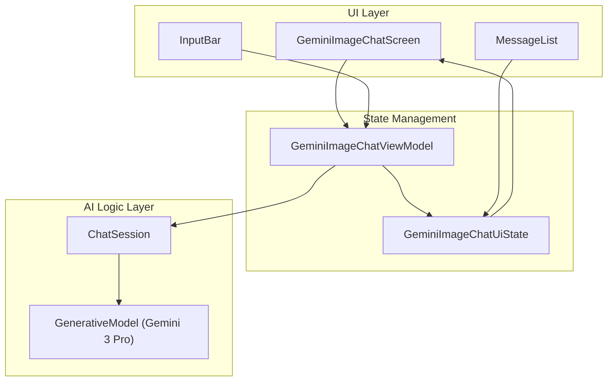
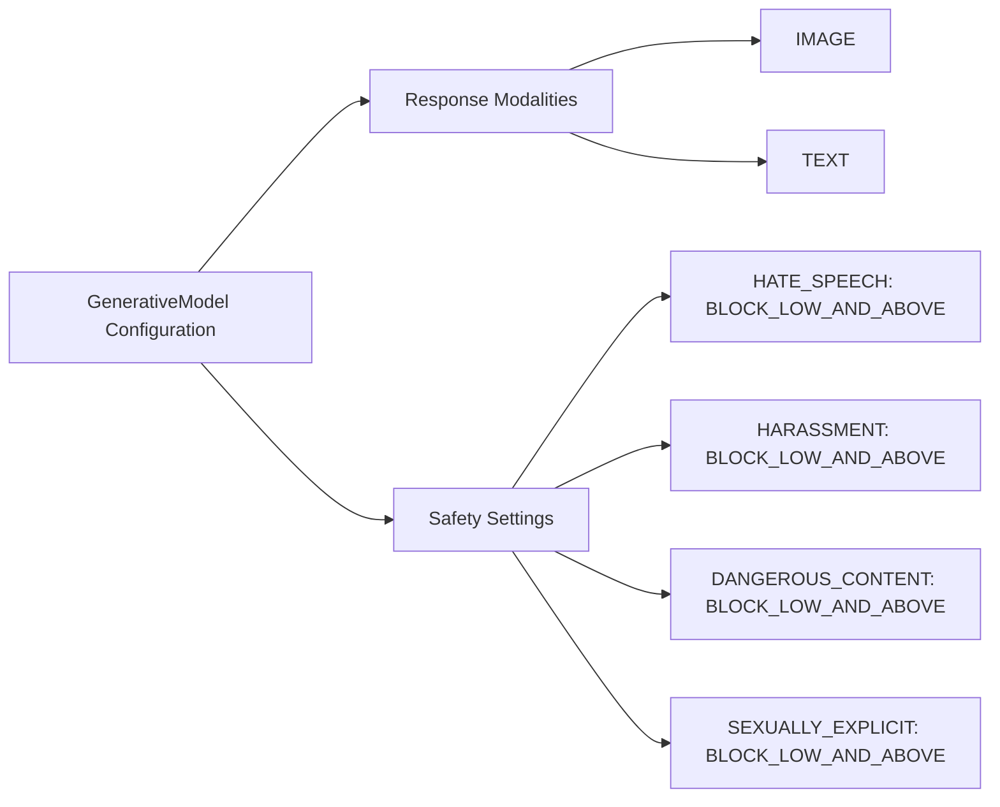
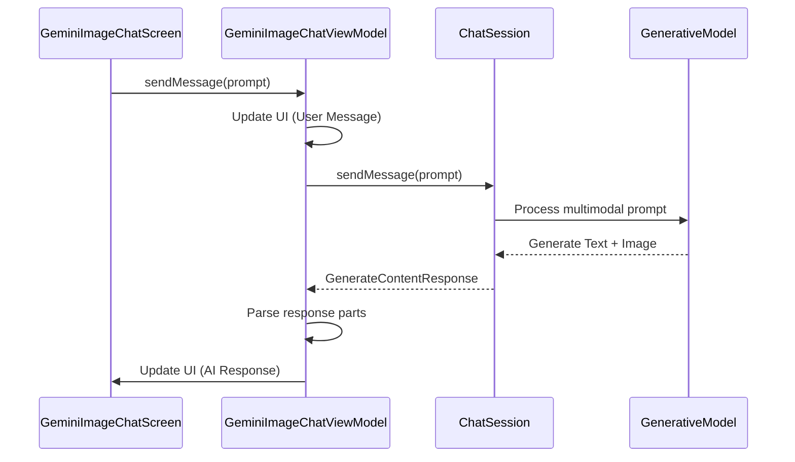

<!-- source: DeepWiki mcp.deepwiki.com · repo android/ai-samples · extra page Gemini Image Chat (Nano Banana Pro) · fetched 2026-10-23 -->

# Gemini Image Chat (Nano Banana Pro)

Relevant source files

The following files were used as context for generating this wiki page:

- [README.md](README.md)

The Gemini Image Chat sample (internally referred to as "Nano Banana Pro") demonstrates a multimodal conversational interface where users can generate images from text and then iterate on those images through natural language chat. It utilizes the Gemini 3 Pro Image model via Firebase Vertex AI, showcasing advanced model configurations including response modalities and safety settings.

## Architecture Overview

The sample follows a clean MVVM architecture, separating UI concerns from model interaction logic. The `GeminiImageChatViewModel` serves as the central orchestrator, managing the conversation state and communicating with the Gemini model.

**System-to-Code Mapping**

| System Component | Code Entity | Role |
| :--- | :--- | :--- |
| **View** | `GeminiImageChatScreen` | Renders the chat UI and handles user interactions. [ai-catalog/samples/gemini-image-chat/src/main/java/com/android/ai/samples/geminiimagechat/GeminiImageChatScreen.kt:65-117]() |
| **ViewModel** | `GeminiImageChatViewModel` | Manages the `ChatSession` and UI state. [ai-catalog/samples/gemini-image-chat/src/main/java/com/android/ai/samples/geminiimagechat/GeminiImageChatViewModel.kt:41-43]() |
| **Model Configuration** | `GenerativeModel` | Defines the Gemini model, safety settings, and modalities. [ai-catalog/samples/gemini-image-chat/src/main/java/com/android/ai/samples/geminiimagechat/GeminiImageChatViewModel.kt:50-70]() |
| **Conversation State** | `GeminiImageChatUiState` | A data class holding the list of messages and loading status. [ai-catalog/samples/gemini-image-chat/src/main/java/com/android/ai/samples/geminiimagechat/GeminiImageChatViewModel.kt:113-116]() |

Sources: [ai-catalog/samples/gemini-image-chat/src/main/java/com/android/ai/samples/geminiimagechat/GeminiImageChatScreen.kt:65-117](), [ai-catalog/samples/gemini-image-chat/src/main/java/com/android/ai/samples/geminiimagechat/GeminiImageChatViewModel.kt:41-116]()

## Model Configuration

The sample uses a specific configuration for the Gemini model to enable multimodal responses (text and images) and ensure content safety.

### Response Modalities and Safety
The model is initialized with `responseModalities` set to include both `IMAGE` and `TEXT`. This allows the model to generate visual content in response to user prompts. Additionally, it implements `SafetySetting` to block high-risk content across various categories.

**Key Configuration Details:**
- **Model Name**: `gemini-3-pro-image` [ai-catalog/samples/gemini-image-chat/src/main/java/com/android/ai/samples/geminiimagechat/GeminiImageChatViewModel.kt:51]()
- **Response Modalities**: Configured via `generationConfig` to support `IMAGE` and `TEXT`. [ai-catalog/samples/gemini-image-chat/src/main/java/com/android/ai/samples/geminiimagechat/GeminiImageChatViewModel.kt:52-54]()
- **Safety Threshold**: Uses `BlockThreshold.BLOCK_LOW_AND_ABOVE` for all categories. [ai-catalog/samples/gemini-image-chat/src/main/java/com/android/ai/samples/geminiimagechat/GeminiImageChatViewModel.kt:57-68]()

Sources: [ai-catalog/samples/gemini-image-chat/src/main/java/com/android/ai/samples/geminiimagechat/GeminiImageChatViewModel.kt:50-70]()

## Implementation Details

### Message Data Flow
The `GeminiImageChatViewModel` maintains a `ChatSession` which tracks the history of the conversation. When a user sends a message, the following sequence occurs:

1.  The user's text is added to the local `_uiState`. [ai-catalog/samples/gemini-image-chat/src/main/java/com/android/ai/samples/geminiimagechat/GeminiImageChatViewModel.kt:80-83]()
2.  `chatSession.sendMessage(userMessage)` is called. [ai-catalog/samples/gemini-image-chat/src/main/java/com/android/ai/samples/geminiimagechat/GeminiImageChatViewModel.kt:87]()
3.  The model returns a response containing text and/or images.
4.  The response is parsed into a `ChatMessage` object and added to the UI state. [ai-catalog/samples/gemini-image-chat/src/main/java/com/android/ai/samples/geminiimagechat/GeminiImageChatViewModel.kt:88-100]()

### UI Components
- **`MessageList`**: A `LazyColumn` that renders `ChatMessage` items. It handles different content types (text vs. image) within the message bubbles. [ai-catalog/samples/gemini-image-chat/src/main/java/com/android/ai/samples/geminiimagechat/GeminiImageChatScreen.kt:133-163]()
- **`MessageBubble`**: Displays text using `MarkdownText` and images using `AsyncImage`. [ai-catalog/samples/gemini-image-chat/src/main/java/com/android/ai/samples/geminiimagechat/GeminiImageChatScreen.kt:165-200]()
- **`InputBar`**: A custom text input field with a send button, optimized for chat interactions. [ai-catalog/samples/gemini-image-chat/src/main/java/com/android/ai/samples/geminiimagechat/InputBar.kt:47-102]()

Sources: [ai-catalog/samples/gemini-image-chat/src/main/java/com/android/ai/samples/geminiimagechat/GeminiImageChatScreen.kt:133-200](), [ai-catalog/samples/gemini-image-chat/src/main/java/com/android/ai/samples/geminiimagechat/InputBar.kt:47-102](), [ai-catalog/samples/gemini-image-chat/src/main/java/com/android/ai/samples/geminiimagechat/GeminiImageChatViewModel.kt:76-108]()

## Summary of Data Structures

| Class | Description | Key Fields |
| :--- | :--- | :--- |
| `ChatMessage` | Represents a single turn in the conversation. | `text`, `images`, `isIncoming`, `timestamp` |
| `GeminiImageChatUiState` | The state consumed by the Compose UI. | `messages` (List), `isLoading` (Boolean) |

Sources: [ai-catalog/samples/gemini-image-chat/src/main/java/com/android/ai/samples/geminiimagechat/GeminiImageChatViewModel.kt:113-125]()

---

