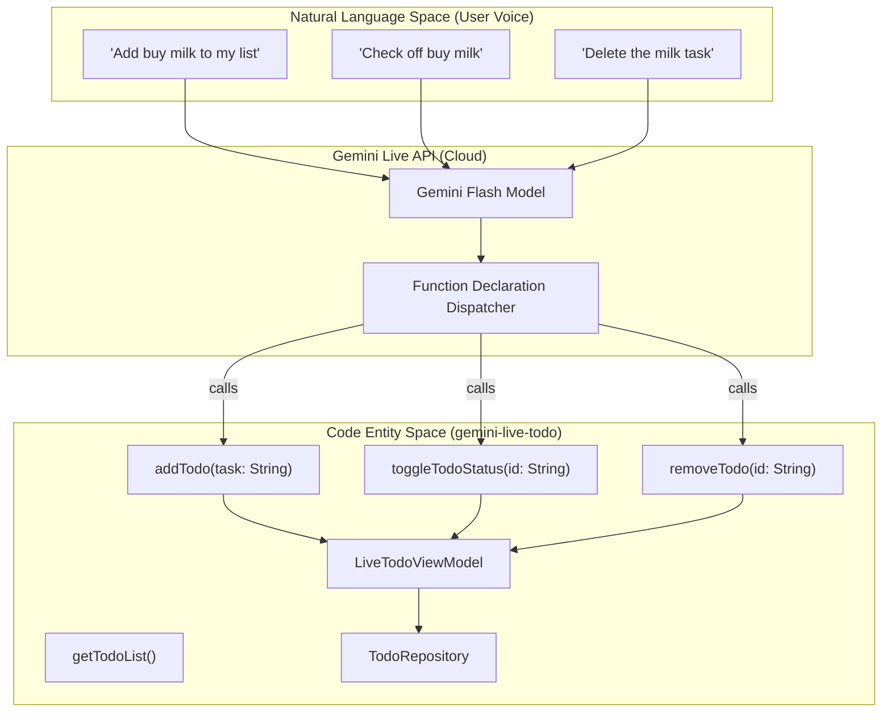
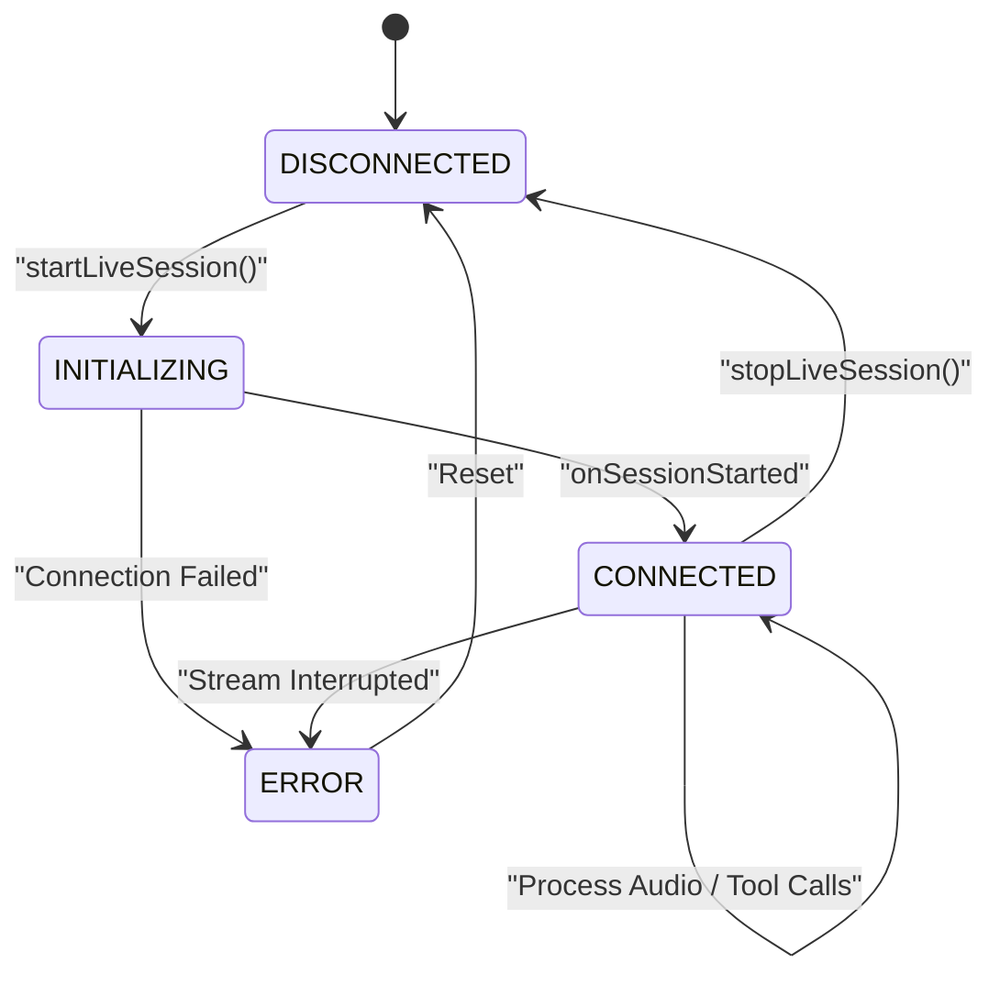
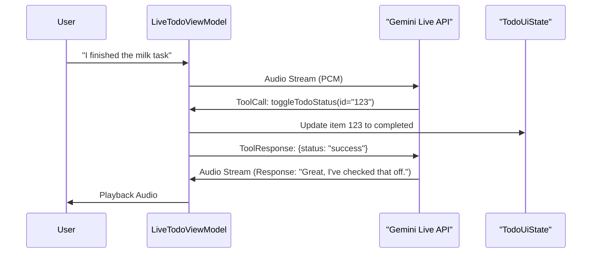

<!-- source: DeepWiki mcp.deepwiki.com · repo android/ai-samples · extra page Gemini Live API To-Do App · fetched 2026-10-23 -->

# Gemini Live API To-Do App

Relevant source files

The following files were used as context for generating this wiki page:

- [README.md](README.md)

The `gemini-live-todo` sample demonstrates real-time, bidirectional voice interaction using the Gemini Live API. It enables users to manage a task list through natural language conversations with Gemini Flash. The application leverages function calling to bridge the gap between natural language intent and structured code execution, allowing the model to perform operations such as adding, removing, and toggling the status of to-do items.

### System Architecture and Data Flow

The application follows a reactive architecture where the `LiveTodoViewModel` manages the state of the voice session and the to-do list. The communication with the Gemini Live API is handled via a `LiveSession` object, which facilitates the streaming of audio data and tool call exchanges.

#### Natural Language to Code Mapping
The following diagram illustrates how natural language requests from the user are transformed into executable code within the application.

**Diagram: Intent-to-Function Mapping**

**Sources:** [ai-sample-catalog/gemini-live-todo/src/main/java/com/google/android/aisamples/live/LiveTodoViewModel.kt:35-150](), [ai-sample-catalog/gemini-live-todo/src/main/java/com/google/android/aisamples/live/LiveTodoScreen.kt:40-100]()

---

### Live Session Management

The core of the interaction is managed by the `LiveSession` class provided by the Firebase AI Logic SDK. The `LiveTodoViewModel` initializes this session with specific configurations, including the model selection (Gemini Flash) and the set of available tools (functions).

#### Session Lifecycle and State
The UI observes the `LiveSessionState` to update the microphone icon, status text, and visual feedback for the user.

| State | Description | UI Representation |
| :--- | :--- | :--- |
| `INITIALIZING` | The WebSocket connection is being established. | Loading Spinner |
| `CONNECTED` | Session is active; model is listening or responding. | Active Mic Waveform |
| `DISCONNECTED` | Session has ended or failed. | Start Button |
| `ERROR` | An exception occurred during the session. | Error Message Snackbar |

**Diagram: Session State Transitions**

**Sources:** [ai-sample-catalog/gemini-live-todo/src/main/java/com/google/android/aisamples/live/LiveTodoViewModel.kt:60-95](), [ai-sample-catalog/gemini-live-todo/src/main/java/com/google/android/aisamples/live/LiveTodoScreen.kt:110-140]()

---

### Function Declarations and Tool Use

The Gemini model is provided with a set of `FunctionDeclaration` objects. These define the schema that the model must follow when it decides to interact with the application's data.

#### Supported Functions
The following functions are registered in the `LiveTodoViewModel`:

1.  **`addTodo`**: Takes a `task` string. It creates a new `TodoItem` and adds it to the list.
    *   Defined in: [ai-sample-catalog/gemini-live-todo/src/main/java/com/google/android/aisamples/live/LiveTodoViewModel.kt:120-125]()
2.  **`removeTodo`**: Takes an `id`. It removes the corresponding item from the state.
    *   Defined in: [ai-sample-catalog/gemini-live-todo/src/main/java/com/google/android/aisamples/live/LiveTodoViewModel.kt:130-135]()
3.  **`toggleTodoStatus`**: Takes an `id`. It flips the `isCompleted` boolean of the task.
    *   Defined in: [ai-sample-catalog/gemini-live-todo/src/main/java/com/google/android/aisamples/live/LiveTodoViewModel.kt:140-145]()
4.  **`getTodoList`**: Returns the current list of tasks to the model so it can answer questions like "What is on my list?".
    *   Defined in: [ai-sample-catalog/gemini-live-todo/src/main/java/com/google/android/aisamples/live/LiveTodoViewModel.kt:110-115]()

#### Implementation of Tool Calls
When the model emits a `ToolCall`, the `LiveTodoViewModel` intercepts it within the `liveSession.start()` block. The application executes the local logic and sends back a `ToolResponse` to the model, allowing the conversation to continue seamlessly.

**Diagram: Tool Call Execution Loop**

**Sources:** [ai-sample-catalog/gemini-live-todo/src/main/java/com/google/android/aisamples/live/LiveTodoViewModel.kt:75-110](), [ai-sample-catalog/gemini-live-todo/src/main/java/com/google/android/aisamples/live/LiveTodoScreen.kt:150-180]()

---

### Implementation Details

#### Audio Processing
The sample uses `AudioRecord` for capturing user voice and `AudioTrack` for playing back the model's responses. The audio is streamed in real-time as 16-bit Linear PCM at 16kHz, which is the standard requirement for the Gemini Live API.

#### ViewModel and State Management
The `LiveTodoViewModel` exposes a `StateFlow<LiveTodoUiState>` which contains:
*   `todoList`: The current list of `TodoItem` objects.
*   `sessionState`: The current `LiveSessionState`.
*   `isRecording`: A boolean indicating if the microphone is active.

**Sources:** [ai-sample-catalog/gemini-live-todo/src/main/java/com/google/android/aisamples/live/LiveTodoViewModel.kt:40-55](), [ai-sample-catalog/gemini-live-todo/src/main/java/com/google/android/aisamples/live/LiveTodoScreen.kt:60-85]()

---

