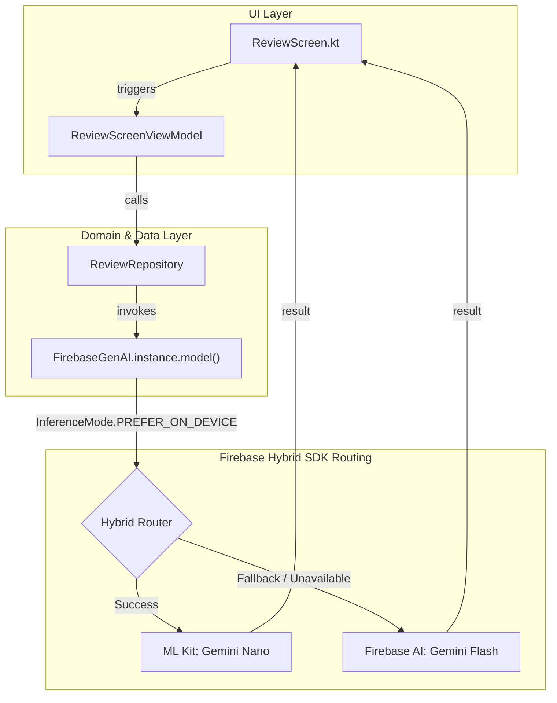
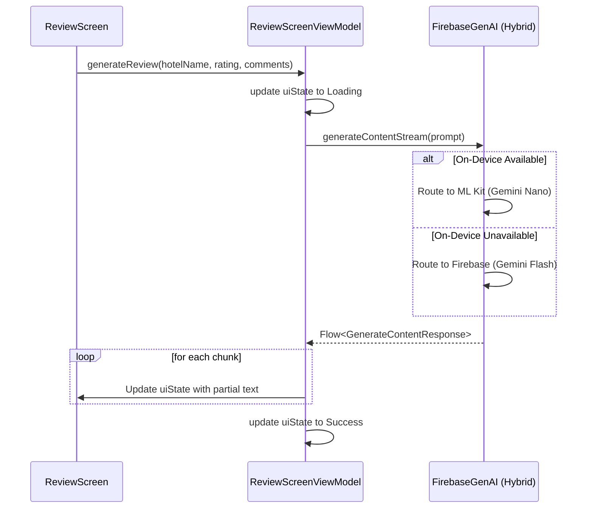

<!-- source: DeepWiki mcp.deepwiki.com · repo android/ai-samples · extra page Hybrid Inference Sample · fetched 2026-10-23 -->

# Hybrid Inference Sample

<details>
<summary>Relevant source files</summary>

The following files were used as context for generating this wiki page:

- [README.md](README.md)

</details>


The **Hybrid Inference Sample** (`gemini-hybrid`) demonstrates the implementation of a unified AI strategy that balances on-device privacy and latency with cloud-based model capabilities. It utilizes the **Firebase Hybrid SDK** to generate hotel reviews, employing a fallback logic that prioritizes **Gemini Nano** (via ML Kit) while falling back to **Gemini Flash** (via Firebase) when local resources are unavailable or insufficient.

## Architectural Overview

The sample is built around the `InferenceMode.PREFER_ON_DEVICE` strategy. This approach attempts to run the inference locally on the user's hardware to reduce costs and improve response times. If the device does not support Gemini Nano or the model is not yet downloaded, the SDK automatically routes the request to the cloud.

### System Flow: Natural Language to Code Entities

The following diagram maps the logical flow of a review generation request from the user interface through the hybrid routing logic to the respective model providers.

**Hybrid Inference Data Flow**

Sources: [ai-sample-catalog/samples/gemini-hybrid/src/main/java/com/google/android/aisamples/hybrid/ReviewScreenViewModel.kt:34-45](), [ai-sample-catalog/samples/gemini-hybrid/src/main/java/com/google/android/aisamples/hybrid/ReviewScreen.kt:45-55]()

## Key Implementation Details

### Hybrid Model Configuration
The core of the hybrid logic is defined in the `ReviewScreenViewModel`. The model is initialized using a specific configuration that links a cloud model name with a local inference mode.

*   **Cloud Model**: `gemini-1.5-flash` is used as the remote fallback.
*   **Inference Mode**: `InferenceMode.PREFER_ON_DEVICE` [ai-sample-catalog/samples/gemini-hybrid/src/main/java/com/google/android/aisamples/hybrid/ReviewScreenViewModel.kt:41-41]().

```kotlin
// Example initialization pattern used in the sample
val model = FirebaseGenAI.instance.model(
    modelName = "gemini-1.5-flash",
    config = generationConfig { 
        inferenceMode = InferenceMode.PREFER_ON_DEVICE 
    }
)
```
Sources: [ai-sample-catalog/samples/gemini-hybrid/src/main/java/com/google/android/aisamples/hybrid/ReviewScreenViewModel.kt:37-43]()

### Review Generation Logic
The application takes structured input (Hotel Name, Rating, and User Comments) and constructs a prompt for the model. The `generateReview` function manages the `UiState` and handles the asynchronous stream of content.

| Component | Role | File Reference |
| :--- | :--- | :--- |
| `ReviewScreen` | Composable function for user input and displaying the generated review. | [ReviewScreen.kt:45-45]() |
| `ReviewScreenViewModel` | Manages the `uiState` and model interaction logic. | [ReviewScreenViewModel.kt:25-25]() |
| `generateReview()` | Function that triggers the hybrid inference process. | [ReviewScreenViewModel.kt:53-53]() |
| `ReviewUiState` | Sealed interface representing `Initial`, `Loading`, `Success`, and `Error` states. | [ReviewScreenViewModel.kt:80-80]() |

### Code Entity Interaction
The following diagram illustrates how the code entities interact during the lifecycle of a review generation event.

**Code Entity Interaction Diagram**

Sources: [ai-sample-catalog/samples/gemini-hybrid/src/main/java/com/google/android/aisamples/hybrid/ReviewScreenViewModel.kt:53-76](), [ai-sample-catalog/samples/gemini-hybrid/src/main/java/com/google/android/aisamples/hybrid/ReviewScreen.kt:114-125]()

## Use Case: Hotel Review Generation
The sample demonstrates a practical "writing assistant" use case. It converts raw user notes into a polished review.

1.  **Input Collection**: The user enters a hotel name, selects a star rating (1-5), and provides brief comments (e.g., "Great pool, but slow check-in"). [ai-sample-catalog/samples/gemini-hybrid/src/main/java/com/google/android/aisamples/hybrid/ReviewScreen.kt:70-110]()
2.  **Prompt Engineering**: The `ReviewScreenViewModel` formats these inputs into a structured prompt:
    *   `"Write a review for $hotelName with a rating of $rating stars based on these comments: $comments"` [ai-sample-catalog/samples/gemini-hybrid/src/main/java/com/google/android/aisamples/hybrid/ReviewScreenViewModel.kt:59-60]()
3.  **Streaming Output**: The result is streamed back to the UI, allowing the user to see the review being written in real-time, which improves the perceived performance of the hybrid model. [ai-sample-catalog/samples/gemini-hybrid/src/main/java/com/google/android/aisamples/hybrid/ReviewScreenViewModel.kt:63-71]()

Sources: [ai-sample-catalog/samples/gemini-hybrid/src/main/java/com/google/android/aisamples/hybrid/ReviewScreenViewModel.kt:53-78](), [ai-sample-catalog/samples/gemini-hybrid/src/main/java/com/google/android/aisamples/hybrid/ReviewScreen.kt:45-130]()

---

