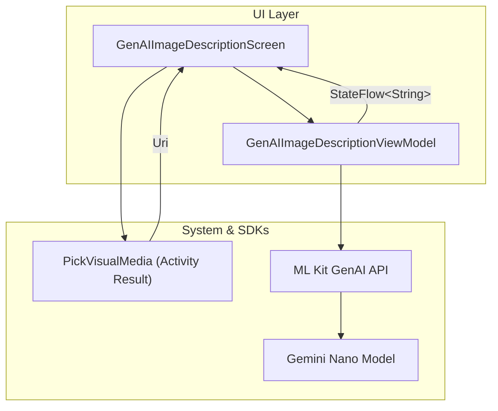
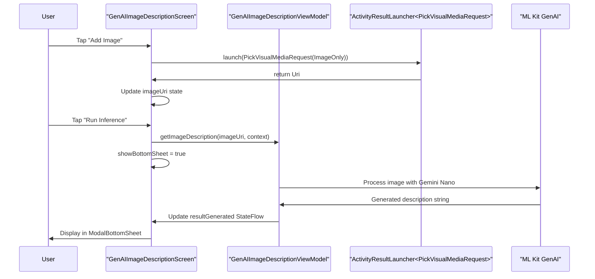
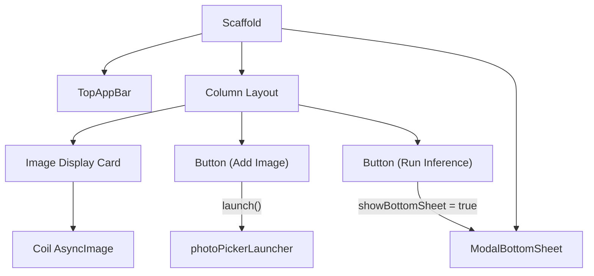
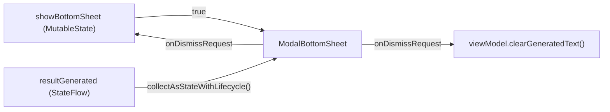

<!-- source: DeepWiki mcp.deepwiki.com · repo android/ai-samples · extra page Image Description · fetched 2026-10-23 -->

# Image Description

Relevant source files

The following files were used as context for generating this wiki page:

- [README.md](README.md)

This document covers the on-device image description sample implementation that uses Gemini Nano through ML Kit to generate text descriptions of images. This sample demonstrates privacy-focused AI processing by performing image analysis entirely on the user's device without requiring cloud connectivity.

For cloud-based multimodal capabilities using Gemini models, see **3.1.1 Multimodal Generation and Chatbot**. For other on-device GenAI samples, see **3.2.1 Text Summarization and Writing Assistance**.

## System Architecture

The image description system follows a standard Android MVVM pattern with Jetpack Compose UI and Hilt dependency injection. The architecture emphasizes on-device processing using ML Kit's GenAI capabilities.

### Component Overview

**Sources:** [ai-sample-catalog/samples/genai-image-description/src/main/java/com/android/ai/samples/genai_image_description/GenAIImageDescriptionScreen.kt:54-67]()

### Data Flow Architecture

The data flow bridges the user's local media selection with the on-device inference engine.

**Sources:** [ai-sample-catalog/samples/genai-image-description/src/main/java/com/android/ai/samples/genai_image_description/GenAIImageDescriptionScreen.kt:70-74, 128-131]()

## UI Components and Implementation

### Main Screen Structure

The `GenAIImageDescriptionScreen` composable implements the primary user interface using Material 3 components within a `Scaffold` layout.

**Sources:** [ai-sample-catalog/samples/genai-image-description/src/main/java/com/android/ai/samples/genai_image_description/GenAIImageDescriptionScreen.kt:76-139]()

### Image Display and Selection

The image selection utilizes the modern Android `PickVisualMedia` contract, ensuring the app only accesses the specific image selected by the user.

| Component | Implementation | Configuration |
|-----------|---------------|---------------|
| Image Card | `Card` with fixed dimensions | 450dp × 450dp with 20dp padding [ai-sample-catalog/samples/genai-image-description/src/main/java/com/android/ai/samples/genai_image_description/GenAIImageDescriptionScreen.kt:90-91]() |
| Image Loader | Coil3 `AsyncImage` | `ContentScale.Fit` for aspect ratio preservation [ai-sample-catalog/samples/genai-image-description/src/main/java/com/android/ai/samples/genai_image_description/GenAIImageDescriptionScreen.kt:97-101]() |
| Photo Picker | `PickVisualMedia()` contract | `ImageOnly` media type restriction [ai-sample-catalog/samples/genai-image-description/src/main/java/com/android/ai/samples/genai_image_description/GenAIImageDescriptionScreen.kt:70-74]() |

**Sources:** [ai-sample-catalog/samples/genai-image-description/src/main/java/com/android/ai/samples/genai_image_description/GenAIImageDescriptionScreen.kt:70-101]()

### Results Display Pattern

The generated description appears in a `ModalBottomSheet` that provides a dismissible overlay interface. This pattern is consistent with other GenAI samples in the catalog to denote an "AI generation" event.

**Sources:** [ai-sample-catalog/samples/genai-image-description/src/main/java/com/android/ai/samples/genai_image_description/GenAIImageDescriptionScreen.kt:141-153]()

## Image Processing Pipeline

### ViewModel Integration

The `GenAIImageDescriptionViewModel` (referenced in the Screen) handles the core image processing logic. The ViewModel exposes a `StateFlow` for reactive UI updates.

| Method | Purpose | Parameters |
|--------|---------|------------|
| `getImageDescription()` | Initiates image analysis via ML Kit | `Uri`, `Context` [ai-sample-catalog/samples/genai-image-description/src/main/java/com/android/ai/samples/genai_image_description/GenAIImageDescriptionScreen.kt:130]() |
| `clearGeneratedText()` | Resets result state to empty | None [ai-sample-catalog/samples/genai-image-description/src/main/java/com/android/ai/samples/genai_image_description/GenAIImageDescriptionScreen.kt:145]() |
| `resultGenerated` | Exposes results to the UI | `StateFlow<String>` [ai-sample-catalog/samples/genai-image-description/src/main/java/com/android/ai/samples/genai_image_description/GenAIImageDescriptionScreen.kt:60]() |

**Sources:** [ai-sample-catalog/samples/genai-image-description/src/main/java/com/android/ai/samples/genai_image_description/GenAIImageDescriptionScreen.kt:60-145]()

## Dependencies and Configuration

### Module Configuration

The image description sample is configured as an Android library module (`:samples:genai-image-description`).

| Dependency Category | Library | Purpose |
|-------------------|---------|---------|
| GenAI Processing | `libs.mlkit.genai.image.description` | ML Kit GenAI image analysis [ai-sample-catalog/samples/genai-image-description/build.gradle.kts:73]() |
| Image Loading | `libs.coil.compose` | Async image loading and caching [ai-sample-catalog/samples/genai-image-description/build.gradle.kts:75]() |
| DI | `libs.hilt.android` | Dependency injection [ai-sample-catalog/samples/genai-image-description/build.gradle.kts:76]() |
| Coroutines | `libs.kotlinx.coroutines.guava` | Async processing support for ML Kit's ListenableFuture results [ai-sample-catalog/samples/genai-image-description/build.gradle.kts:74]() |

**Sources:** [ai-sample-catalog/samples/genai-image-description/build.gradle.kts:73-76]()

### Build Standards

The module requires minimum SDK 26 and targets compilation SDK 35, ensuring compatibility with the Gemini Nano availability requirements via ML Kit.

**Sources:** [ai-sample-catalog/samples/genai-image-description/build.gradle.kts:27, 34]()

---

