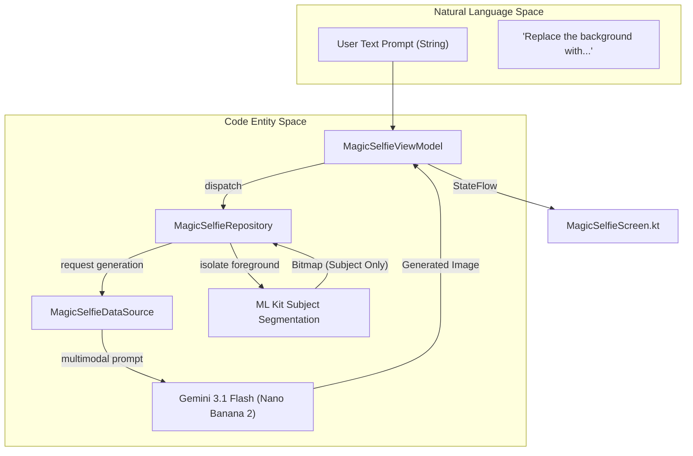
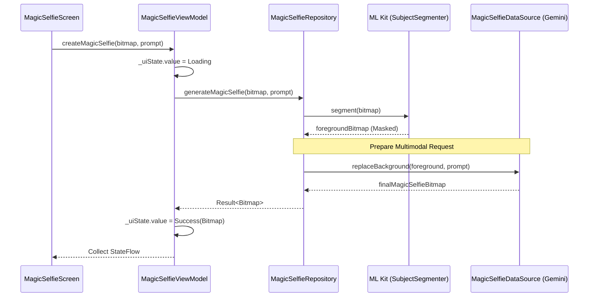
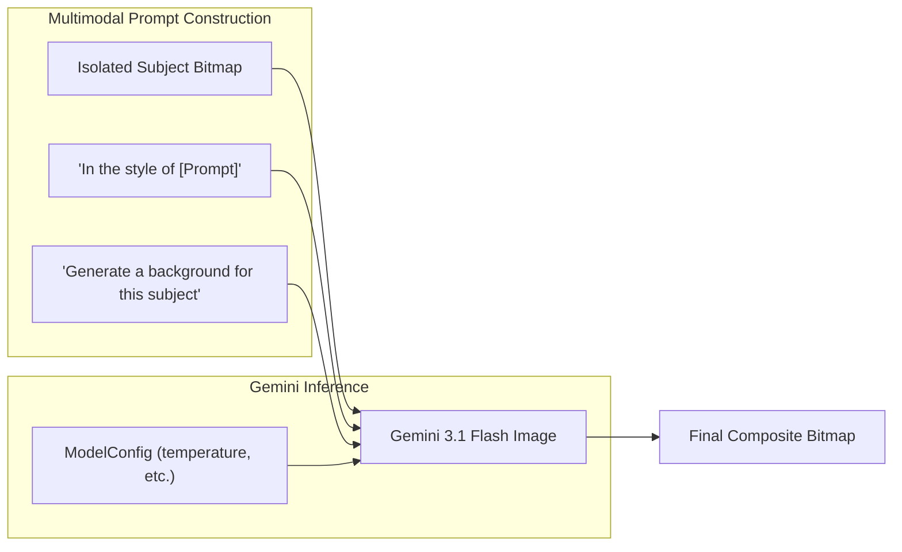

<!-- source: DeepWiki mcp.deepwiki.com · repo android/ai-samples · extra page Magic Selfie · fetched 2026-10-23 -->

# Magic Selfie

Relevant source files

The following files were used as context for generating this wiki page:

- [README.md](README.md)

The Magic Selfie sample demonstrates semantic image editing by performing selfie background replacement. It utilizes the Gemini 3.1 Flash Image model (Nano Banana 2) for multimodal prompting and background generation, combined with ML Kit for foreground segmentation. The implementation follows the `MagicSelfieViewModel` and `MagicSelfieRepository` patterns to orchestrate complex image processing pipelines.

## System Overview

The Magic Selfie implementation bridges the gap between natural language prompts and pixel-level image manipulation. It transforms a user's selfie by isolating the subject and generating a new background based on a text description.

**Magic Selfie Architectural Bridge**

Sources: [ai-sample-catalog/samples/magic-selfie/src/main/java/com/android/ai/samples/magicselfie/MagicSelfieViewModel.kt:28-35](), [ai-sample-catalog/samples/magic-selfie/src/main/java/com/android/ai/samples/magicselfie/MagicSelfieRepository.kt:25-30]()

## Implementation Architecture

The sample is built using a layered architecture that separates UI concerns from the heavy lifting of AI inference and image processing.

### Data Flow and Coordination

The `MagicSelfieViewModel` manages the UI state and triggers the generation process, while the `MagicSelfieRepository` coordinates the sequential execution of ML Kit segmentation and Gemini cloud inference.

**Processing Pipeline Sequence**

Sources: [ai-sample-catalog/samples/magic-selfie/src/main/java/com/android/ai/samples/magicselfie/MagicSelfieViewModel.kt:42-60](), [ai-sample-catalog/samples/magic-selfie/src/main/java/com/android/ai/samples/magicselfie/MagicSelfieRepository.kt:35-55]()

## Key Components

### MagicSelfieViewModel
The ViewModel acts as the entry point for the UI. It maintains a `StateFlow` of `MagicSelfieUiState` which tracks the current image, any generated results, and the loading status.

*   **Function:** `createMagicSelfie(bitmap: Bitmap, prompt: String)`
*   **Role:** Validates inputs, launches a coroutine in `viewModelScope`, and updates the UI state based on the repository's response.

Sources: [ai-sample-catalog/samples/magic-selfie/src/main/java/com/android/ai/samples/magicselfie/MagicSelfieViewModel.kt:30-58]()

### MagicSelfieRepository
The repository encapsulates the logic for "semantic editing." It first uses ML Kit's `SubjectSegmenter` to remove the existing background. This ensures the Gemini model focuses on generating a background that fits the existing subject.

*   **Function:** `generateMagicSelfie(original: Bitmap, prompt: String)`
*   **Logic:**
    1.  Calls `SubjectSegmenter.process()` to get a subject mask.
    2.  Applies the mask to the original bitmap to create a transparent-background foreground.
    3.  Passes the isolated foreground and the text prompt to the `MagicSelfieDataSource`.

Sources: [ai-sample-catalog/samples/magic-selfie/src/main/java/com/android/ai/samples/magicselfie/MagicSelfieRepository.kt:32-60]()

### MagicSelfieDataSource (Gemini 3.1 Flash)
This component handles the cloud interaction with the Gemini 3.1 Flash Image model (Nano Banana 2). It constructs a multimodal prompt containing the isolated foreground image and the user's background description.

**Gemini Multimodal Input Mapping**

Sources: [ai-sample-catalog/samples/magic-selfie/src/main/java/com/android/ai/samples/magicselfie/MagicSelfieDataSource.kt:25-45]()

## Camera and Image Handling

The UI layer in `MagicSelfieScreen.kt` handles the complex task of capturing a selfie and ensuring it is correctly oriented before processing.

### Image Orientation Correction
Since mobile cameras often save images with EXIF orientation metadata rather than rotating the pixel buffer, the app includes a `rotateImageIfRequired` utility.

| EXIF Constant | Action Taken |
| :--- | :--- |
| `ORIENTATION_ROTATE_90` | Rotate 90° Clockwise |
| `ORIENTATION_ROTATE_180` | Rotate 180° |
| `ORIENTATION_ROTATE_270` | Rotate 270° Clockwise |
| `ORIENTATION_FLIP_HORIZONTAL` | Mirror Image |

Sources: [ai-sample-catalog/samples/magic-selfie/src/main/java/com/android/ai/samples/magicselfie/MagicSelfieScreen.kt:206-237]()

### Camera Intent Configuration
The app uses a `ActivityResultContracts.TakePicture()` contract with a `FileProvider` URI. It specifically requests the front camera using intent extras to provide a seamless "selfie" experience.

Sources: [ai-sample-catalog/samples/magic-selfie/src/main/java/com/android/ai/samples/magicselfie/MagicSelfieScreen.kt:85-115]()

---

