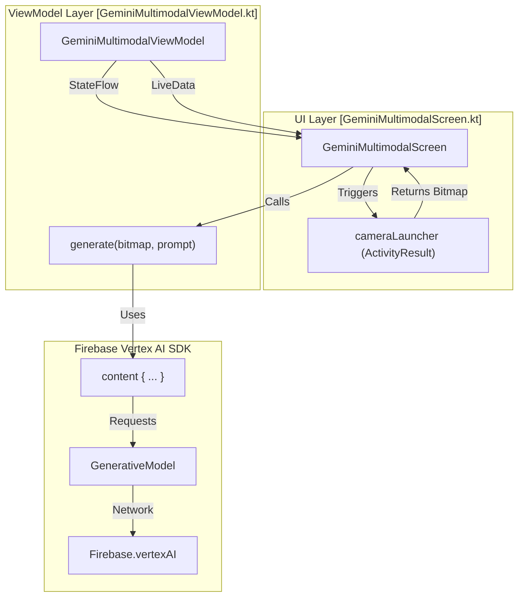
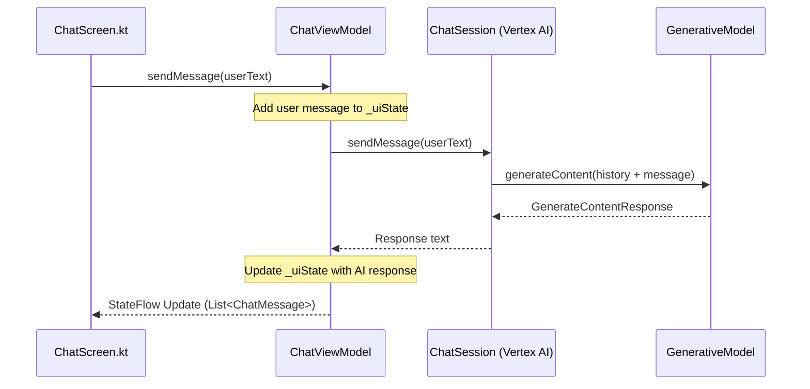

<!-- source: DeepWiki mcp.deepwiki.com · repo android/ai-samples · extra page Multimodal Generation and Chatbot · fetched 2026-10-23 -->

# Multimodal Generation and Chatbot

Relevant source files

The following files were used as context for generating this wiki page:

- [README.md](README.md)

## Purpose and Scope

This document provides a detailed technical overview of two primary Gemini cloud-based samples within the AI Catalog: **Multimodal Generation** and the **Chatbot**. 

The **Multimodal Generation** sample demonstrates how to combine image and text inputs to generate AI-powered responses using Google's Gemini 2.0 Flash model via Firebase Vertex AI [ai-catalog/samples/gemini-multimodal/src/main/java/com/android/ai/samples/geminimultimodal/GeminiMultimodalViewModel.kt:43-46](). 

The **Chatbot** sample showcases conversation management, persona configuration using system instructions, and state-driven UI for a turn-based chat interface [ai-catalog/samples/chatbot/src/main/java/com/android/ai/samples/chatbot/ChatViewModel.kt:1-111]().

## 1. Multimodal Generation

This sample implements a complete flow for capturing a photo, providing a text prompt, and receiving a contextual response from Gemini Flash.

### System Architecture

The Multimodal sample follows a standard MVVM pattern.

**Sources:** [ai-catalog/samples/gemini-multimodal/src/main/java/com/android/ai/samples/geminimultimodal/GeminiMultimodalScreen.kt:88-93](), [ai-catalog/samples/gemini-multimodal/src/main/java/com/android/ai/samples/geminimultimodal/GeminiMultimodalViewModel.kt:35-78]()

### Implementation Details

*   **Camera Integration**: Uses `rememberLauncherForActivityResult` with the `TakePicturePreview()` contract to obtain a thumbnail-sized `Bitmap` [ai-catalog/samples/gemini-multimodal/src/main/java/com/android/ai/samples/geminimultimodal/GeminiMultimodalScreen.kt:88-93]().
*   **Model Configuration**: The `GenerativeModel` is configured with `gemini-2.0-flash` and specific `generationConfig` parameters including `temperature = 0.9f` and `maxOutputTokens = 4096` [ai-catalog/samples/gemini-multimodal/src/main/java/com/android/ai/samples/geminimultimodal/GeminiMultimodalViewModel.kt:43-58]().
*   **Content Construction**: The SDK's `content` DSL is used to wrap both the `Bitmap` and the `String` prompt into a single multimodal request [ai-catalog/samples/gemini-multimodal/src/main/java/com/android/ai/samples/geminimultimodal/GeminiMultimodalViewModel.kt:66-69]().

**Sources:** [ai-catalog/samples/gemini-multimodal/src/main/java/com/android/ai/samples/geminimultimodal/GeminiMultimodalViewModel.kt:43-78]()

---

## 2. Gemini Chatbot

The Chatbot sample demonstrates a conversational interface with a persistent history and a specific AI persona defined via system instructions.

### Conversation Data Flow

The `ChatViewModel` manages the lifecycle of a `ChatSession`.

**Sources:** [ai-catalog/samples/chatbot/src/main/java/com/android/ai/samples/chatbot/ChatViewModel.kt:86-109](), [ai-catalog/samples/chatbot/src/main/java/com/android/ai/samples/chatbot/ChatScreen.kt:111-125]()

### Persona and System Instructions

The chatbot is configured with a "Cat" persona using `systemInstruction`. This tells the model how to behave before the conversation even begins.

| Component | Value / Implementation |
| :--- | :--- |
| **Model** | `gemini-1.5-flash` [ai-catalog/samples/chatbot/src/main/java/com/android/ai/samples/chatbot/ChatViewModel.kt:45]() |
| **System Instruction** | "You are a cat. Your name is Meow. You are a very grumpy cat..." [ai-catalog/samples/chatbot/src/main/java/com/android/ai/samples/chatbot/ChatViewModel.kt:47-51]() |
| **Session Initialization** | `generativeModel.startChat(history = emptyList())` [ai-catalog/samples/chatbot/src/main/java/com/android/ai/samples/chatbot/ChatViewModel.kt:65]() |

**Sources:** [ai-catalog/samples/chatbot/src/main/java/com/android/ai/samples/chatbot/ChatViewModel.kt:43-65]()

### Key Classes and Roles

*   **`ChatViewModel`**: Responsible for initializing the `GenerativeModel`, starting the `ChatSession`, and maintaining the `uiState` which is a `MutableStateFlow` of `ChatUiState` [ai-catalog/samples/chatbot/src/main/java/com/android/ai/samples/chatbot/ChatViewModel.kt:34-41]().
*   **`ChatMessage`**: A UI-layer data class representing a single turn in the conversation, including the `author` (USER or MODEL) and the `text` [ai-catalog/samples/chatbot/src/main/java/com/android/ai/samples/chatbot/ChatUiState.kt:32-35]().
*   **`ChatScreen`**: A Composable that renders the message list using a `LazyColumn` and handles user input via a `TextField` [ai-catalog/samples/chatbot/src/main/java/com/android/ai/samples/chatbot/ChatScreen.kt:81-125]().

**Sources:** [ai-catalog/samples/chatbot/src/main/java/com/android/ai/samples/chatbot/ChatViewModel.kt:34-41](), [ai-catalog/samples/chatbot/src/main/java/com/android/ai/samples/chatbot/ChatUiState.kt:21-36](), [ai-catalog/samples/chatbot/src/main/java/com/android/ai/samples/chatbot/ChatScreen.kt:81-125]()

### Error Handling

The `ChatViewModel` utilizes a `try-catch` block during the `sendMessage` execution. If an exception occurs (e.g., network failure or safety filter trigger), the error message is captured and displayed in the UI as a message from the "MODEL" author to inform the user [ai-catalog/samples/chatbot/src/main/java/com/android/ai/samples/chatbot/ChatViewModel.kt:101-107]().

**Sources:** [ai-catalog/samples/chatbot/src/main/java/com/android/ai/samples/chatbot/ChatViewModel.kt:101-107]()

---

