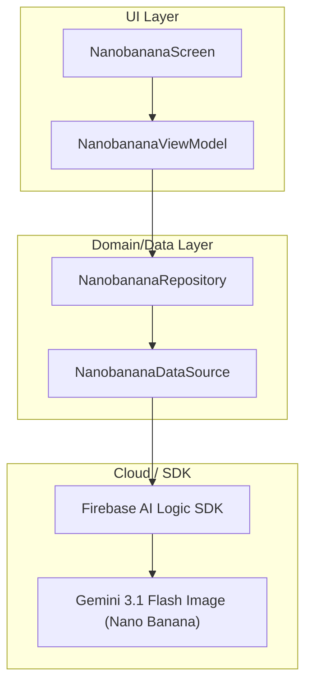
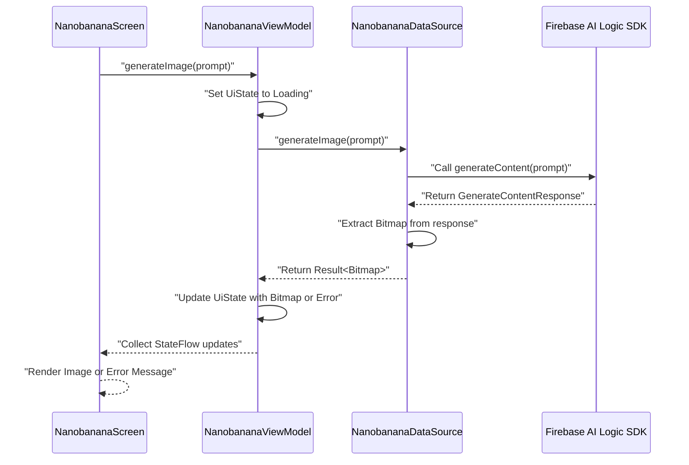

<!-- source: DeepWiki mcp.deepwiki.com · repo android/ai-samples · extra page Nanobanana Image Generation · fetched 2026-10-23 -->

# Nanobanana Image Generation

Relevant source files

The following files were used as context for generating this wiki page:

- [README.md](README.md)

This document covers the "Nanobanana" text-to-image generation sample within the AI Catalog application. The Nanobanana integration demonstrates how to implement prompt-based image generation using the Gemini 3.1 Flash Image model (internally referred to as Nano Banana) through the Firebase AI Logic SDK.

## Architecture Overview

The Nanobanana implementation follows a layered architecture that bridges the UI layer with cloud-based generative models via a dedicated data source and repository pattern.

### Component Structure

**Component Architecture**
The sample utilizes `NanobananaDataSource` as the primary interface for model configuration and request execution, while `NanobananaViewModel` manages the UI state and lifecycle of the generation process.

Sources: [README.md:13-13]()

### Data Flow for Image Generation

**Generation Workflow**
The flow begins with a user-provided text prompt. The `NanobananaDataSource` wraps the SDK calls, ensuring that the raw model output (typically a list of parts) is correctly parsed into a displayable Android `Bitmap`.

Sources: [README.md:1-3]()

## Implementation Details

### NanobananaDataSource and Model Configuration

The `NanobananaDataSource` is responsible for initializing the Gemini model with specific configurations optimized for image generation.

| Configuration Property | Value / Purpose |
| :--- | :--- |
| **Model Name** | `gemini-3.1-flash-image` |
| **Response Modality** | Configured to return image data |
| **Functionality** | Converts text descriptions into visual assets |

### ViewModel Logic

The `NanobananaViewModel` acts as the state holder for the screen. It exposes a `StateFlow` that represents the current status of the generation request.

*   **Idle State**: Initial state where the user can enter a prompt.
*   **Loading State**: Triggered when the "Generate" button is clicked; displays a progress indicator.
*   **Success State**: Contains the generated `Bitmap` for display in the UI.
*   **Error State**: Handles API failures or safety filter triggers, providing feedback to the user.

Sources: [README.md:1-3]()

## User Interface

The `NanobananaScreen` provides a high-level interface for interacting with the Nano Banana model.

### Key UI Components

1.  **Prompt Input**: A `TextField` where users describe the image they wish to create.
2.  **Generation Trigger**: A button that initiates the `generateImage` call in the ViewModel.
3.  **Image Display**: A dedicated area (often a `Card` or `Box`) that renders the resulting `Bitmap` using Compose's `Image` component.
4.  **Status Feedback**: Visual cues for loading states and error handling.

### Navigation and Code Access

As part of the AI Sample Catalog, this screen includes a `SeeCodeButton`. This button allows developers to jump directly to the implementation on GitHub, facilitating a "learn-by-example" workflow.

Sources: [README.md:20-25]()

---

