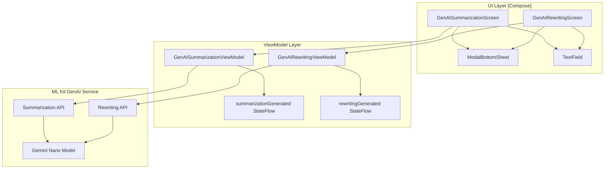
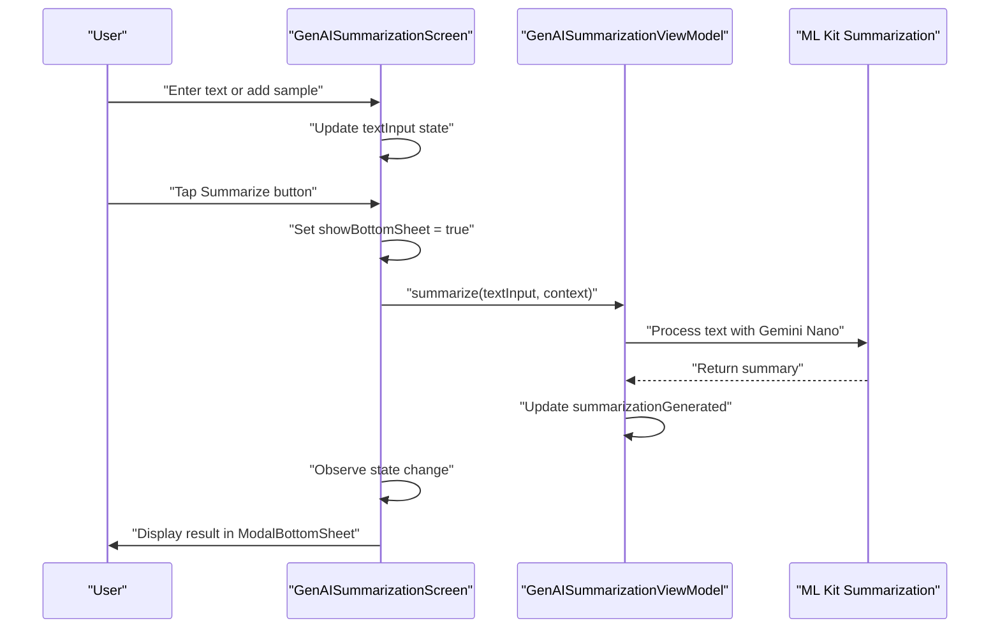
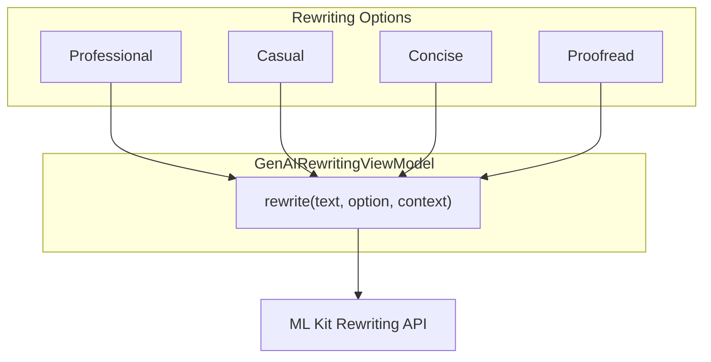

<!-- source: DeepWiki mcp.deepwiki.com · repo android/ai-samples · extra page Text Summarization and Writing Assistance · fetched 2026-10-23 -->

# Text Summarization and Writing Assistance

<details>
<summary>Relevant source files</summary>

The following files were used as context for generating this wiki page:

- [README.md](README.md)

</details>


This document covers the on-device text processing samples that demonstrate Gemini Nano capabilities through ML Kit. These samples provide complete Android implementations for text summarization and writing assistance (proofreading and rewriting), utilizing local processing for privacy and offline functionality.

For cloud-based text processing capabilities, see [3.1 Gemini Cloud Samples](). For other on-device GenAI capabilities, see [3.2.2 Image Description]().

## Architecture Overview

The text summarization and writing assistance samples implement a standard Android MVVM architecture using Jetpack Compose for the UI layer and Hilt for dependency injection. The systems process text input locally using Gemini Nano through the ML Kit GenAI Summarization and Rewriting APIs.

### Component Architecture Diagram



Sources: [ai-sample-catalog/samples/genai-summarization/src/main/java/com/android/ai/samples/genai_summarization/GenAISummarizationScreen.kt:1-157](), [ai-sample-catalog/samples/genai-rewriting/src/main/java/com/android/ai/samples/genai_rewriting/GenAIRewritingScreen.kt:1-196]()

## 1. Text Summarization Implementation

The `GenAISummarizationScreen` composable implements the user interface for condensing long-form text into concise summaries using on-device inference.

### Summarization Process Flow



### Key UI Components (Summarization)

| Component | Purpose | Implementation |
|-----------|---------|----------------|
| `TextField` | Text input for content to summarize | [ai-sample-catalog/samples/genai-summarization/src/main/java/com/android/ai/samples/genai_summarization/GenAISummarizationScreen.kt:84-91]() |
| `Button` (Summarize) | Triggers the summarization process | [ai-sample-catalog/samples/genai-summarization/src/main/java/com/android/ai/samples/genai_summarization/GenAISummarizationScreen.kt:97-108]() |
| `ModalBottomSheet` | Displays the generated summary results | [ai-sample-catalog/samples/genai-summarization/src/main/java/com/android/ai/samples/genai_summarization/GenAISummarizationScreen.kt:129-141]() |

Sources: [ai-sample-catalog/samples/genai-summarization/src/main/java/com/android/ai/samples/genai_summarization/GenAISummarizationScreen.kt:67-141]()

## 2. Writing Assistance (Rewriting) Implementation

The `GenAIRewritingScreen` provides tools for proofreading and rewriting text in different styles (Professional, Casual, or Concise) using the ML Kit GenAI Rewriting API.

### Rewriting UI and Logic

The rewriting interface includes a style selector (`RewriteOption`) that determines how Gemini Nano transforms the input text.



### Rewrite Styles

The sample utilizes several rewriting configurations:
- **Professional**: Adjusts tone for formal communication.
- **Casual**: Makes text more conversational.
- **Concise**: Shortens text while maintaining meaning.
- **Proofread**: Fixes grammar and spelling without significant style changes.

Sources: [ai-sample-catalog/samples/genai-rewriting/src/main/java/com/android/ai/samples/genai_rewriting/GenAIRewritingScreen.kt:100-146](), [ai-sample-catalog/samples/genai-rewriting/src/main/java/com/android/ai/samples/genai_rewriting/GenAIRewritingScreen.kt:177-196]()

## State Management and Data Flow

Both screens maintain UI state through their respective ViewModels and local `mutableStateOf` variables.

### Shared Patterns

1.  **Input State**: `textInput` tracks user-entered text [GenAISummarizationScreen.kt:64](), [GenAIRewritingScreen.kt:68]().
2.  **Result Observation**: Results are collected from a `StateFlow` (e.g., `summarizationGenerated`) in the ViewModel [GenAISummarizationScreen.kt:66]().
3.  **Result Display**: A `ModalBottomSheet` is triggered upon clicking the action button to show the output [GenAISummarizationScreen.kt:129](), [GenAIRewritingScreen.kt:151]().
4.  **Helper Actions**: Both screens include "Add Text" (randomly selects from `R.array`) and "Reset" buttons [GenAISummarizationScreen.kt:113-125](), [GenAIRewritingScreen.kt:137-148]().

### SecondaryButton Component

A reusable `SecondaryButton` is used for helper actions like resetting input or adding sample text:

```kotlin
@Composable
fun SecondaryButton(
    buttonText: String,
    onClick: () -> Unit,
) {
    Button(
        onClick = onClick,
        colors = ButtonDefaults.buttonColors(
            containerColor = MaterialTheme.colorScheme.secondaryContainer,
            contentColor = MaterialTheme.colorScheme.onSecondaryContainer
        ),
        shape = RoundedCornerShape(10.dp),
        modifier = Modifier.fillMaxWidth()
    ) {
        Text(text = buttonText)
    }
}
```

Sources: [ai-sample-catalog/samples/genai-summarization/src/main/java/com/android/ai/samples/genai_summarization/GenAISummarizationScreen.kt:145-157](), [ai-sample-catalog/samples/genai-rewriting/src/main/java/com/android/ai/samples/genai_rewriting/GenAIRewritingScreen.kt:177-196]()

## Resource Configuration

The implementations rely on string resources for internationalization and sample content:

| Resource | Purpose |
|----------|---------|
| `R.array.summarization_sample_text` | Array of sample strings for summarization testing [GenAISummarizationScreen.kt:58]() |
| `R.array.rewriting_sample_text` | Array of sample strings for rewriting testing [GenAIRewritingScreen.kt:61]() |
| `R.string.genai_summarization_title_bar` | Header for the summarization screen [GenAISummarizationScreen.kt:74]() |
| `R.string.genai_rewriting_title_bar` | Header for the rewriting screen [GenAIRewritingScreen.kt:78]() |

Sources: [ai-sample-catalog/samples/genai-summarization/src/main/java/com/android/ai/samples/genai_summarization/GenAISummarizationScreen.kt:58-74](), [ai-sample-catalog/samples/genai-rewriting/src/main/java/com/android/ai/samples/genai_rewriting/GenAIRewritingScreen.kt:61-78]()

---

