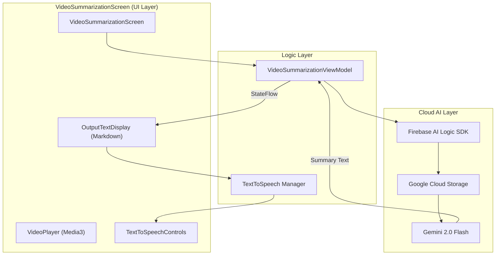
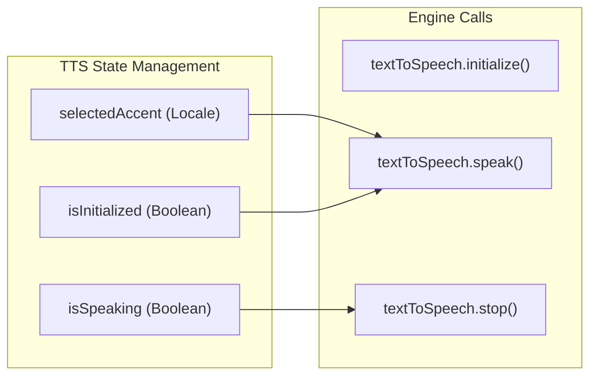
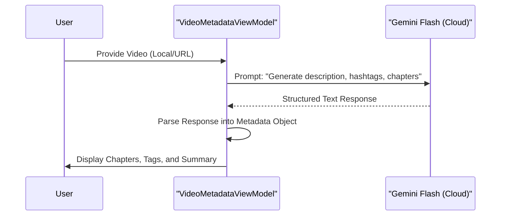

<!-- source: DeepWiki mcp.deepwiki.com · repo android/ai-samples · extra page Video Analysis Samples · fetched 2026-10-23 -->

# Video Analysis Samples

Relevant source files

The following files were used as context for generating this wiki page:

- [README.md](README.md)

## Purpose and Scope

The Video Analysis samples demonstrate advanced cloud-based video processing capabilities using Gemini models via Firebase Vertex AI. These samples illustrate two primary use cases:

1.  **Video Summarization**: Utilizing Gemini Flash with Cloud Storage for large file support, integrated with ExoPlayer for playback and multilingual Text-to-Speech (TTS) for accessibility.
2.  **Video Metadata Creation**: Generating structured metadata including descriptions, hashtags, chapters, thumbnails, and account tags from either YouTube URLs or local video files.

These samples highlight the integration of the Firebase AI Logic SDK with standard Android media components like `Media3` (ExoPlayer).

**Sources:** [README.md:1-37](), [ai-catalog/samples/gemini-video-summarization/src/main/java/com/android/ai/samples/geminivideosummary/VideoSummarizationScreen.kt:1-278]()

---

## Video Summarization Implementation

The `gemini-video-summarization` sample provides a comprehensive workflow for analyzing video content and providing an audio-visual summary.

### Architecture Overview

The system bridges standard Android media playback with Gemini's multimodal reasoning capabilities.

**Sources:** [ai-catalog/samples/gemini-video-summarization/src/main/java/com/android/ai/samples/geminivideosummary/VideoSummarizationScreen.kt:70-120]()

### Video Playback and Selection

The sample uses `ExoPlayer` for video rendering. It supports a selection of pre-defined videos or custom URIs. The `VideoPlayer` component is a reusable UI element from the `ui-component` module.

| Function/Class | Role | File Reference |
| :--- | :--- | :--- |
| `VideoPlayer` | Composable wrapper for `PlayerView` and `ExoPlayer` | [ai-sample-catalog/ui-component/...]() |
| `onSelectedVideoChange` | Updates `ExoPlayer` media items and resets TTS | [VideoSummarizationScreen.kt:217-233]() |
| `VideoSelectionDropdown` | UI for selecting input video sources | [VideoSummarizationScreen.kt:135-155]() |

**Sources:** [ai-catalog/samples/gemini-video-summarization/src/main/java/com/android/ai/samples/geminivideosummary/VideoSummarizationScreen.kt:89-103](), [ai-catalog/samples/gemini-video-summarization/src/main/java/com/android/ai/samples/geminivideosummary/VideoSummarizationScreen.kt:217-233]()

### Multilingual Text-to-Speech (TTS)

A key feature is the ability to read the generated summary aloud using the Android `TextToSpeech` engine with support for various accents.

The system supports several locales including `Locale.UK`, `Locale.FRANCE`, `Locale.GERMANY`, `Locale.ITALY`, `Locale.JAPAN`, `Locale.KOREA`, and `Locale.US`.

**Sources:** [ai-catalog/samples/gemini-video-summarization/src/main/java/com/android/ai/samples/geminivideosummary/VideoSummarizationScreen.kt:248-261](), [ai-catalog/samples/gemini-video-summarization/src/main/java/com/android/ai/samples/geminivideosummary/ui/TextToSpeechControls.kt:100-119]()

---

## Video Metadata Creation

The `gemini-video-metadata-creation` sample focuses on extracting structured data from videos to automate content management tasks.

### Metadata Extraction Workflow

This sample demonstrates how to prompt Gemini to return specific structured information about a video file or a YouTube link.

### Key Metadata Features

1.  **Description Generation**: A natural language summary of the video content.
2.  **Hashtag Suggestion**: Relevant tags for social media discovery.
3.  **Chaptering**: Time-stamped segments of the video for navigation.
4.  **Thumbnail Analysis**: Identifying key frames or describing the visual style.
5.  **Account Tags**: Identifying potential creators or entities mentioned.

**Sources:** [README.md:13-14](), [ai-catalog/samples/gemini-video-summarization/src/main/java/com/android/ai/samples/geminivideosummary/VideoSummarizationScreen.kt:1-50]()

---

## Technical Implementation Details

### State Management

Both samples utilize `StateFlow` within ViewModels to manage the asynchronous nature of AI processing and video loading.

| State Property | Type | Description |
| :--- | :--- | :--- |
| `uiState` | `StateFlow<UiState>` | Manages Loading, Success, and Error states for the AI request. |
| `outputText` | `StateFlow<String>` | The raw or parsed text returned by Gemini. |
| `isPlaying` | `Boolean` | Current playback state of the video player. |

### AI Configuration

The samples use Gemini 2.0 Flash for its balance of speed and multimodal performance. Large videos are typically handled by uploading to Cloud Storage before inference, allowing the model to process high-resolution content without client-side memory constraints.

**Sources:** [ai-catalog/samples/gemini-video-summarization/src/main/java/com/android/ai/samples/geminivideosummary/VideoSummarizationScreen.kt:77-86](), [ai-catalog/samples/gemini-video-summarization/src/main/java/com/android/ai/samples/geminivideosummary/ui/TextToSpeechControls.kt:36-48]()

---

