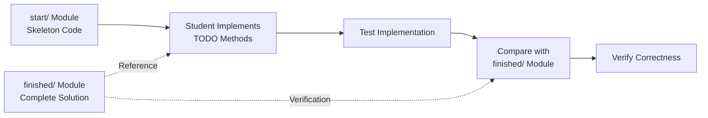
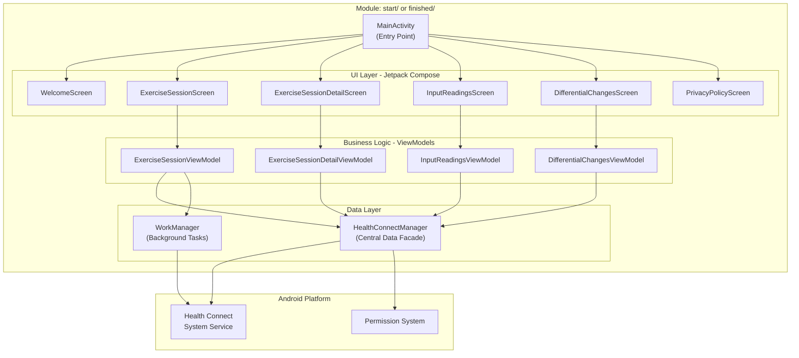
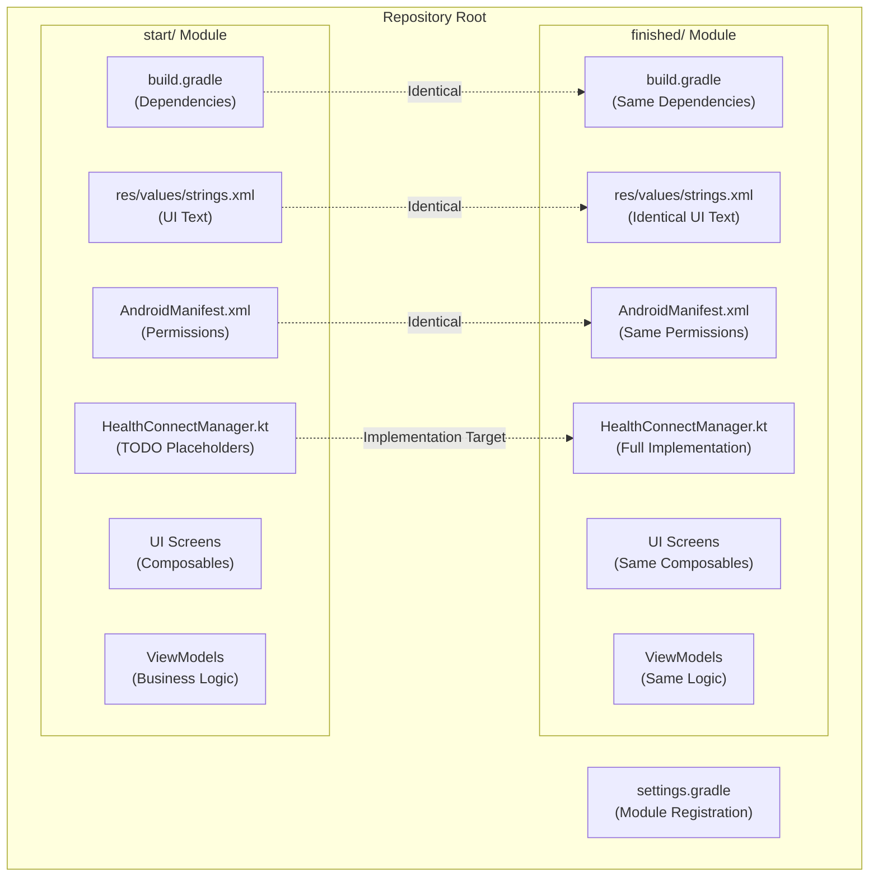

<!-- source: DeepWiki mcp.deepwiki.com · repo android/android-health-connect-codelab · page 1 Overview · fetched 2026-10-23 -->

# Overview

Relevant source files

The following files were used as context for generating this wiki page:

- [README.md](README.md)
- [finished/src/main/res/values/strings.xml](finished/src/main/res/values/strings.xml)
- [screenshots/hc1.png](screenshots/hc1.png)
- [start/src/main/res/values/strings.xml](start/src/main/res/values/strings.xml)

This document provides an overview of the Health Connect Codelab, a hands-on tutorial application designed to teach developers how to integrate Android's Health Connect platform into their applications. This page covers the educational structure, demonstrated features, and learning objectives. For specific setup instructions and prerequisites, see [Getting Started](#2). For details on the project organization, see [Project Structure](#3). For architectural details, see [Architecture Overview](#4).

## Purpose and Scope

The Health Connect Codelab is a pedagogical Android application that demonstrates Health Connect API integration through practical examples. The codebase is structured as a dual-module project containing both a skeleton implementation (`start/`) for students and a complete reference solution (`finished/`). 

**Sources:** [README.md:1-31]()

## What is Health Connect

Health Connect is Android's centralized platform for health and fitness data, allowing applications to read and write health records (exercise sessions, weight measurements, heart rate, steps, calories) with user permission. This codelab teaches developers how to:

- Check for Health Connect availability on devices
- Request and manage health data permissions
- Perform CRUD operations on health records
- Aggregate health statistics
- Track incremental data changes
- Execute background health data operations

**Sources:** [start/src/main/res/values/strings.xml:26-31](), [README.md:3-10]()

## Dual Module Architecture

The repository implements a learning-by-doing approach through two parallel modules:

| Module | Purpose | Implementation Status | Primary Use Case |
|--------|---------|----------------------|------------------|
| `start/` | Student workspace | Skeleton with TODO placeholders | Initial development environment |
| `finished/` | Reference solution | Fully implemented | Solution verification and comparison |

Both modules share identical:
- String resources for UI text ([start/src/main/res/values/strings.xml]() and [finished/src/main/res/values/strings.xml]())
- Android manifest permissions
- Build configuration (SDK versions, dependencies)
- UI screen structures

**Codelab Learning Flow:**

**Sources:** [README.md:1-31]()

## Demonstrated Features

The codelab demonstrates six distinct Health Connect integration patterns through dedicated screens:

### Feature Matrix

| Feature | Screen | Key Operations | Record Types |
|---------|--------|----------------|--------------|
| Exercise Session Management | `ExerciseSessionScreen` | Write sessions, read sessions list | `ExerciseSessionRecord`, `HeartRateRecord`, `StepsRecord`, `TotalCaloriesBurnedRecord` |
| Exercise Session Details | `ExerciseSessionDetailScreen` | Read aggregated metrics, time-series data | Same as above |
| Weight Input & Tracking | `InputReadingsScreen` | Write weight, read history, compute averages | `WeightRecord` |
| Differential Changes | `DifferentialChangesScreen` | Token-based sync, change tracking | All record types |
| Background Data Access | Exercise screen actions | WorkManager integration | `StepsRecord` |
| Permission Management | All screens | Request permissions, check availability | N/A |

**Sources:** [start/src/main/res/values/strings.xml:17-139]()

## Application Structure Overview

**Sources:** [README.md:1-31](), [start/src/main/res/values/strings.xml:17-24]()

## Technology Stack

The codelab demonstrates modern Android development practices using:

| Technology | Purpose | Integration Point |
|------------|---------|-------------------|
| **Health Connect SDK** | Health data access | `HealthConnectManager` class |
| **Jetpack Compose** | Declarative UI | All screen Composables |
| **ViewModel** | State management | Screen-specific ViewModels |
| **Kotlin Coroutines** | Asynchronous operations | All data operations |
| **WorkManager** | Background processing | Step reading worker |
| **Navigation Compose** | Screen routing | `MainActivity` navigation setup |

The application follows the MVVM (Model-View-ViewModel) architecture pattern with unidirectional data flow. For detailed architectural discussion, see [Architecture Overview](#4).

**Sources:** [README.md:18-19]()

## Learning Objectives

By completing this codelab, developers will learn to:

1. **Availability Checking**: Determine if Health Connect is installed and supported on the device (see [Health Connect Availability](#5.1))
2. **Permission Management**: Request and verify health data permissions using the three-tier permission model (see [Permission Management](#5.2))
3. **Writing Health Records**: Insert exercise sessions with associated records (steps, calories, heart rate time series) and weight measurements (see [Writing Health Data](#5.5))
4. **Reading Health Records**: Query health data with time range filters and data origin filtering (see [Reading Health Data](#5.4))
5. **Aggregations**: Compute statistics like weekly averages, exercise session metrics, and heart rate statistics (see [Aggregations and Statistics](#5.6))
6. **Differential Sync**: Implement token-based incremental synchronization to detect changes efficiently (see [Differential Changes Tracking](#5.7))
7. **Background Work**: Execute health data operations in the background using WorkManager (see [Background Work with WorkManager](#5.8))
8. **Error Handling**: Handle Health Connect exceptions and provide appropriate user feedback (see [Error Handling and User Feedback](#9.2))

**Sources:** [start/src/main/res/values/strings.xml:68-124]()

## Key Implementation Points for Students

The `start/` module contains placeholder implementations with `TODO` comments in critical methods. Students implement:

### Exercise Session Feature (see [Feature: Exercise Sessions](#6))
- `writeExerciseSession()` - Insert exercise records with associated heart rate, steps, calories
- `readExerciseSessions()` - Query exercise session records
- `readAssociatedSessionData()` - Retrieve detailed metrics for a specific session

### Weight Input Feature (see [Feature: Weight Input](#7))
- `writeWeightInput()` - Insert weight measurements
- `readWeightInputs()` - Query weight records with time ranges
- `computeWeeklyAverage()` - Aggregate weight data

### Differential Changes Feature (see [Feature: Differential Changes](#8))
- `getChangesToken()` - Obtain initial sync token
- `getChanges()` - Retrieve incremental changes since token

### Background Operations (see [Background Work with WorkManager](#5.8))
- `enqueueReadStepWorker()` - Schedule background step reading

**Sources:** [start/src/main/res/values/strings.xml:68-139]()

## Module File Structure Comparison

**Sources:** [README.md:1-31](), [start/src/main/res/values/strings.xml:1-140](), [finished/src/main/res/values/strings.xml:1-140]()

## Prerequisites for Codelab Completion

| Requirement | Specification | Verification Method |
|-------------|---------------|---------------------|
| Android Device/Emulator | API level 27 (Android 8.1) or higher | System settings |
| Health Connect APK | Required for Android 13 and lower | Check installed apps or follow installation link |
| Development Environment | Android Studio with Kotlin support | Build project successfully |
| Gradle | Version specified in wrapper | `./gradlew build` |

For detailed setup instructions, see [Getting Started](#2).

**Sources:** [README.md:7-10]()

## User Interface Preview

The codelab demonstrates six distinct screens:

1. **Welcome Screen** - Health Connect availability status and navigation entry point ([strings.xml:26-31]())
2. **Exercise Sessions** - List view of recorded exercise sessions with insert functionality ([strings.xml:68-76]())
3. **Exercise Session Detail** - Detailed metrics for a specific exercise session ([strings.xml:78-90]())
4. **Record Weight** - Weight input form with history and weekly average ([strings.xml:106-114]())
5. **Differential Changes** - Token-based change tracking interface ([strings.xml:116-124]())
6. **Privacy Policy** - Placeholder privacy policy screen ([strings.xml:34-39]())

**Sources:** [start/src/main/res/values/strings.xml:17-139]()

## Navigation Between Pages

This overview provides a high-level introduction to the codelab. For deeper exploration:

- **Setup and Prerequisites**: [Getting Started](#2)
- **Code Organization**: [Project Structure](#3) and [Start vs Finished Modules](#3.1)
- **Architecture Patterns**: [Architecture Overview](#4)
- **Core Data Operations**: [Data Layer - HealthConnectManager](#5)
- **Specific Features**: [Exercise Sessions](#6), [Weight Input](#7), [Differential Changes](#8)
- **UI Implementation**: [UI Architecture Patterns](#9)
- **Step-by-Step Guide**: [Implementation Guide for Students](#12)

**Sources:** [README.md:1-31]()

---

