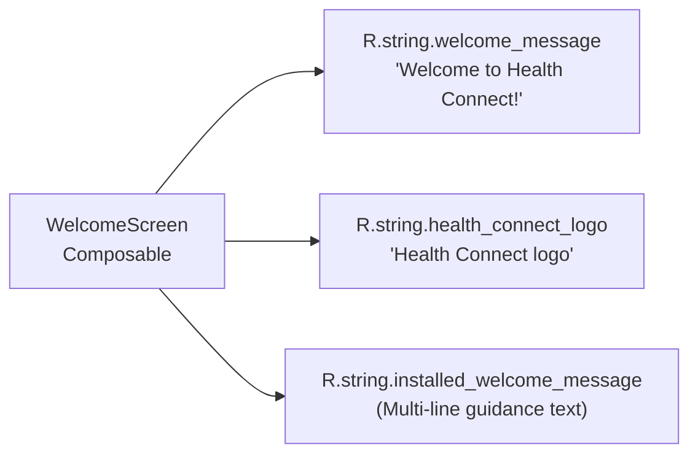
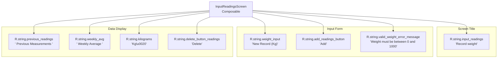
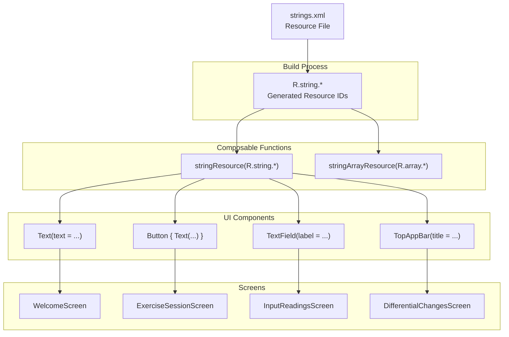
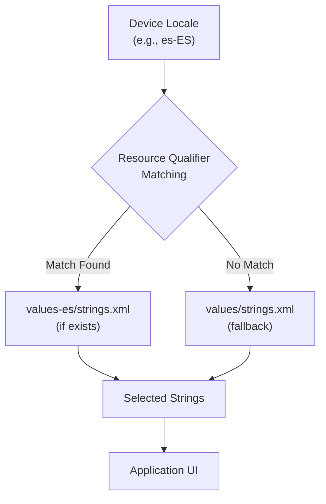

<!-- source: DeepWiki mcp.deepwiki.com · repo android/android-health-connect-codelab · page 10 String Resources and Localization · fetched 2026-10-23 -->

# String Resources and Localization

<details>
<summary>Relevant source files</summary>

The following files were used as context for generating this wiki page:

- [finished/src/main/res/values/strings.xml](finished/src/main/res/values/strings.xml)
- [start/src/main/res/values/strings.xml](start/src/main/res/values/strings.xml)

</details>


## Purpose and Scope

This document describes the string resource management system used in the Health Connect Codelab. It covers the organization of user-facing text in the `strings.xml` files, the categorization of strings by feature area, formatting conventions, and the localization approach. Both the `start` and `finished` modules share identical string resources to ensure consistent UI text across the learning template and reference solution.

For information about how these strings are used in UI components, see [UI Architecture Patterns](#9). For details on the screens that consume these strings, see sections on specific features ([Exercise Sessions](#6), [Weight Input](#7), [Differential Changes](#8)).

---

## String Resource File Location

Both modules contain identical string resource files:

| Module | File Path |
|--------|-----------|
| Start | `start/src/main/res/values/strings.xml` |
| Finished | `finished/src/main/res/values/strings.xml` |

The files are structured as standard Android XML string resources following the `<resources>` root element pattern. All 139 lines in both files are identical, ensuring that students working through the codelab see the same user interface text regardless of which module they are building.

**Sources:** [start/src/main/res/values/strings.xml:1-139](), [finished/src/main/res/values/strings.xml:1-139]()

---

## String Organization Structure

The `strings.xml` file uses XML comments to organize strings into logical feature groups. This organizational structure mirrors the application's screen-based architecture.

```mermaid
graph TB
    StringsXML["strings.xml<br/>(139 lines)"]
    
    subgraph "Common Strings"
        AppName["app_name"]
        Menu["menu"]
        ScreenTitles["Screen Titles<br/>welcome_screen<br/>exercise_sessions<br/>exercise_session_detail<br/>sleep_sessions<br/>sleep_session_detail<br/>differential_changes"]
    end
    
    subgraph "Welcome Feature"
        WelcomeMsg["welcome_message"]
        Logo["health_connect_logo"]
        InstalledMsg["installed_welcome_message"]
    end
    
    subgraph "Privacy Policy"
        PrivacyTitle["privacy_policy"]
        PrivacyDesc["privacy_policy_description"]
    end
    
    subgraph "Availability States"
        NotInstalledStrings["not_installed_tag<br/>not_installed_description<br/>not_installed_link_text<br/>market_url<br/>health_connect_package<br/>onboarding_url"]
        NotSupportedStrings["not_supported_tag<br/>not_supported_description<br/>not_supported_link_text<br/>not_supported_url"]
    end
    
    subgraph "Exercise Session Feature"
        ExerciseScreenStrings["insert_exercise_session<br/>no_title<br/>delete_button<br/>request_background_read<br/>background_read_is_not_available<br/>read_steps_in_background<br/>request_history_read<br/>history_read_is_not_available"]
        ExerciseDetailStrings["total_active_duration<br/>total_steps<br/>total_distance<br/>total_energy<br/>hr_stats<br/>hr_series<br/>speed_stats<br/>speed_series<br/>min_label<br/>max_label<br/>avg_label<br/>label_and_value"]
    end
    
    subgraph "Sleep Session Feature"
        SleepStrings["generate_sleep_data<br/>sleep_notes_array<br/>sleep_notes<br/>sleep_duration<br/>sleep_time<br/>sleep_stages"]
    end
    
    subgraph "Weight Input Feature"
        WeightStrings["input_readings<br/>delete_button_readings<br/>weight_input<br/>add_readings_button<br/>previous_readings<br/>weekly_avg<br/>kilograms<br/>valid_weight_error_message"]
    end
    
    subgraph "Differential Changes Feature"
        DiffStrings["differential_changes_title_text<br/>differential_changes_continuation_text<br/>differential_changes_switch_text<br/>differential_changes_button_text<br/>differential_changes_empty<br/>differential_changes_current_token<br/>differential_changes_upserted<br/>differential_changes_deleted"]
        DiffTypeStrings["differential_changes_type_*<br/>(10 record type labels)"]
    end
    
    subgraph "Shared Strings"
        SharedStrings["permissions_button_label<br/>not_available_abbrev<br/>settings"]
    end
    
    StringsXML --> AppName
    StringsXML --> Menu
    StringsXML --> ScreenTitles
    StringsXML --> WelcomeMsg
    StringsXML --> Logo
    StringsXML --> InstalledMsg
    StringsXML --> PrivacyTitle
    StringsXML --> PrivacyDesc
    StringsXML --> NotInstalledStrings
    StringsXML --> NotSupportedStrings
    StringsXML --> ExerciseScreenStrings
    StringsXML --> ExerciseDetailStrings
    StringsXML --> SleepStrings
    StringsXML --> WeightStrings
    StringsXML --> DiffStrings
    StringsXML --> DiffTypeStrings
    StringsXML --> SharedStrings
```



**Sources:** [start/src/main/res/values/strings.xml:13-139]()

---

## String Categories and Resource IDs

### Application Identity

| Resource ID | Value | Purpose |
|-------------|-------|---------|
| `app_name` | "Health Connect Codelab" | Application display name |
| `menu` | "menu" | Menu content description |

### Screen Titles

Screen titles are used in top app bar components and navigation labels:

| Resource ID | Screen | Lines |
|-------------|--------|-------|
| `welcome_screen` | Welcome/Home | [18]() |
| `exercise_sessions` | Exercise session list | [19]() |
| `exercise_session_detail` | Exercise session detail view | [20]() |
| `sleep_sessions` | Sleep session list (unused) | [21]() |
| `sleep_session_detail` | Sleep session detail (unused) | [22]() |
| `differential_changes` | Changes tracking screen | [23]() |

**Note:** Sleep session strings are defined but not implemented in the current codelab version.

**Sources:** [start/src/main/res/values/strings.xml:14-23]()

### Welcome Screen Strings



The `installed_welcome_message` [28-31]() is a multi-line string that explains the app's purpose to users when Health Connect is detected on the device.

**Sources:** [start/src/main/res/values/strings.xml:26-31]()

### Privacy Policy Strings

| Resource ID | Purpose | Lines |
|-------------|---------|-------|
| `privacy_policy` | Screen title | [34]() |
| `privacy_policy_description` | Placeholder policy text explaining data handling | [35-39]() |

**Sources:** [start/src/main/res/values/strings.xml:34-39]()

### Availability State Strings

#### Not Installed State

When Health Connect is not installed on the device:

| Resource ID | Purpose | Lines |
|-------------|---------|-------|
| `not_installed_tag` | Tag identifier | [42]() |
| `not_installed_description` | User-facing message | [46-48]() |
| `not_installed_link_text` | Installation instructions | [49-52]() |
| `market_url` | Google Play market URI scheme | [43]() |
| `health_connect_package` | Package name: `com.google.android.apps.healthdata` | [44]() |
| `onboarding_url` | Deep link: `healthconnect://onboarding` | [45]() |

#### Not Supported State

When the device doesn't support Health Connect (API level too low):

| Resource ID | Purpose | Lines |
|-------------|---------|-------|
| `not_supported_tag` | Tag identifier | [55]() |
| `not_supported_description` | Formatted message with API level parameter | [57-59]() |
| `not_supported_link_text` | Link to developer documentation | [60-63]() |
| `not_supported_url` | Documentation URL | [56]() |

**Sources:** [start/src/main/res/values/strings.xml:42-63]()

### Exercise Session Feature Strings

#### Main Screen

| Resource ID | Purpose | Lines |
|-------------|---------|-------|
| `insert_exercise_session` | Button text for creating sessions | [69]() |
| `no_title` | Placeholder for sessions without titles | [70]() |
| `delete_button` | Delete action label | [71]() |
| `request_background_read` | Background permission button | [72]() |
| `background_read_is_not_available` | Feature unavailable message | [73]() |
| `read_steps_in_background` | Background worker action | [74]() |
| `request_history_read` | History permission button | [75]() |
| `history_read_is_not_available` | Feature unavailable message | [76]() |

#### Detail Screen

The detail screen displays aggregated metrics and time-series data:

| Resource ID | Metric | Lines |
|-------------|--------|-------|
| `total_active_duration` | Exercise duration | [79]() |
| `total_steps` | Step count | [80]() |
| `total_distance` | Distance traveled | [81]() |
| `total_energy` | Calories burned | [82]() |
| `hr_stats` | Heart rate statistics (bpm) | [83]() |
| `hr_series` | Heart rate time series (bpm) | [84]() |
| `speed_stats` | Speed statistics (m/s) | [85]() |
| `speed_series` | Speed time series (m/s) | [86]() |

Statistic labels:

| Resource ID | Value | Lines |
|-------------|-------|-------|
| `min_label` | "Min" | [87]() |
| `max_label` | "Max" | [88]() |
| `avg_label` | "Avg" | [89]() |
| `label_and_value` | "%1$s: %2$s" (format string) | [90]() |

**Sources:** [start/src/main/res/values/strings.xml:68-90]()

### Sleep Session Strings (Unused)

The codelab defines sleep session strings but does not implement the feature:

| Resource ID | Lines |
|-------------|-------|
| `generate_sleep_data` | [93]() |
| `sleep_notes_array` (string-array) | [94-100]() |
| `sleep_notes` | [101]() |
| `sleep_duration` | [102]() |
| `sleep_time` | [103]() |
| `sleep_stages` | [104]() |

The `sleep_notes_array` is a string-array resource containing 5 example sleep notes [94-100]().

**Sources:** [start/src/main/res/values/strings.xml:93-104]()

### Weight Input Feature Strings



**Key details:**
- `kilograms` [113]() uses Unicode escape `\u0020` for a trailing space
- `valid_weight_error_message` [114]() defines the validation range (0-1000 kg)

**Sources:** [start/src/main/res/values/strings.xml:107-114]()

### Differential Changes Feature Strings

#### Instructional Text

| Resource ID | Purpose | Lines |
|-------------|---------|-------|
| `differential_changes_title_text` | Explanation of token-based tracking | [117]() |
| `differential_changes_continuation_text` | Button usage instructions (note typo: "Connnect") | [118]() |
| `differential_changes_switch_text` | Toggle label | [119]() |
| `differential_changes_button_text` | Action button label | [120]() |

#### Status Display

| Resource ID | Purpose | Lines |
|-------------|---------|-------|
| `differential_changes_empty` | No changes found message | [121]() |
| `differential_changes_current_token` | Token display format: "Current token: %1$s" | [122]() |
| `differential_changes_upserted` | Section header for new/updated records | [123]() |
| `differential_changes_deleted` | Section header for deleted records | [124]() |

#### Record Type Labels

The codelab defines 10 record type labels for displaying changes:

| Resource ID | Record Type | Lines |
|-------------|-------------|-------|
| `differential_changes_type_exercise_session` | ExerciseSessionRecord | [126]() |
| `differential_changes_type_exercise_event` | ExerciseEventRecord | [127]() |
| `differential_changes_type_speed_series` | SpeedRecord | [128]() |
| `differential_changes_type_heart_rate_series` | HeartRateRecord | [129]() |
| `differential_changes_type_total_calories` | TotalCaloriesBurnedRecord | [130]() |
| `differential_changes_type_steps` | StepsRecord | [131]() |
| `differential_changes_type_sleep_session` | SleepSessionRecord | [132]() |
| `differential_changes_type_sleep_stage` | SleepStageRecord | [133]() |
| `differential_changes_type_distance` | DistanceRecord | [134]() |
| `differential_changes_type_weight` | WeightRecord | [135]() |

**Sources:** [start/src/main/res/values/strings.xml:117-135]()

### Shared Strings

| Resource ID | Usage Context | Lines |
|-------------|---------------|-------|
| `permissions_button_label` | "Request permissions" - Used across multiple screens | [65]() |
| `not_available_abbrev` | "N/A" - Displayed when data is not available | [66]() |
| `settings` | Navigation to Health Connect settings | [138]() |

**Sources:** [start/src/main/res/values/strings.xml:65-66](), [start/src/main/res/values/strings.xml:138]()

---

## String Formatting and Special Characters

### Format String Parameters

The codelab uses Android's string formatting conventions for dynamic content:

| Resource ID | Format Parameters | Example Usage |
|-------------|-------------------|---------------|
| `not_supported_description` | `%1$d` (integer) | API level number |
| `differential_changes_current_token` | `%1$s` (string) | Token value |
| `label_and_value` | `%1$s` (label), `%2$s` (value) | "Min: 60", "Max: 180" |

**Format string syntax:**
```xml
<string name="label_and_value">%1$s: %2$s</string>
```

Usage in Kotlin:
```kotlin
getString(R.string.label_and_value, "Min", "60")
// Result: "Min: 60"
```

**Sources:** [start/src/main/res/values/strings.xml:58](), [start/src/main/res/values/strings.xml:90](), [start/src/main/res/values/strings.xml:122]()

### Unicode Escape Sequences

The `kilograms` string uses a Unicode escape for whitespace:

```xml
<string name="kilograms">Kg\u0020</string>
```

The escape sequence `\u0020` represents a space character, ensuring consistent trailing whitespace in the UI.

**Sources:** [start/src/main/res/values/strings.xml:113]()

### Multi-line Strings

Several strings span multiple lines for readability in the XML file. Android automatically collapses whitespace:

```xml
<string name="installed_welcome_message">
    Health Connect is installed on this device. Use the menu to explore the sample, with each
    screen demonstrating a different aspect of Health Connect functionality.
</string>
```

The rendered output will have whitespace normalized to single spaces between words.

**Sources:** [start/src/main/res/values/strings.xml:28-31](), [start/src/main/res/values/strings.xml:35-39](), [start/src/main/res/values/strings.xml:46-52](), [start/src/main/res/values/strings.xml:57-63]()

---

## Configuration Strings

Several strings serve as configuration values rather than user-facing text:

### Health Connect Integration

| Resource ID | Value | Purpose | Lines |
|-------------|-------|---------|-------|
| `health_connect_package` | `com.google.android.apps.healthdata` | Package name for availability checks | [44]() |
| `market_url` | `market://details` | Google Play Store URI scheme | [43]() |
| `onboarding_url` | `healthconnect://onboarding` | Deep link to Health Connect onboarding | [45]() |
| `not_supported_url` | `https://developer.android.com/health-connect` | Documentation URL | [56]() |

These configuration strings are used programmatically by `HealthConnectManager` for feature availability detection and deep linking.

**Sources:** [start/src/main/res/values/strings.xml:43-45](), [start/src/main/res/values/strings.xml:56]()

---

## String Resource Usage in UI Components

The following diagram shows the flow from string resources to rendered UI:



### String Resource Access Pattern

In Jetpack Compose, strings are accessed using the `stringResource()` function:

```kotlin
Text(text = stringResource(R.string.welcome_message))
```

For formatted strings:

```kotlin
Text(
    text = stringResource(
        R.string.not_supported_description,
        MIN_SUPPORTED_SDK_VERSION
    )
)
```

For string arrays:

```kotlin
val sleepNotes = stringArrayResource(R.array.sleep_notes_array)
```

**Sources:** [start/src/main/res/values/strings.xml:1-139]()

---

## Localization Strategy

### Current State

The codelab currently provides **only English language strings**. There is a single `values/strings.xml` file with no locale-specific variants (e.g., `values-es/strings.xml`, `values-fr/strings.xml`).

### File Location Pattern

To support additional languages, the standard Android resource qualifier system would be used:

```
start/src/main/res/
├── values/strings.xml              # Default (English)
├── values-es/strings.xml           # Spanish (not present)
├── values-fr/strings.xml           # French (not present)
└── values-de/strings.xml           # German (not present)
```

### Localization-Ready Design

The codebase follows localization best practices:

1. **No hardcoded strings** in Kotlin code
2. **All user-facing text** extracted to `strings.xml`
3. **Format parameters** used for dynamic content (prevents word order issues)
4. **Content descriptions** provided for accessibility (e.g., `health_connect_logo`)

### Example Localization Flow



Android automatically selects the appropriate string resource file based on device locale settings. If a localized version isn't found, it falls back to the default `values/strings.xml`.

**Sources:** [start/src/main/res/values/strings.xml:1-139](), [finished/src/main/res/values/strings.xml:1-139]()

---

## Consistency Between Modules

Both the `start` and `finished` modules share **identical** string resources:

| Aspect | Status |
|--------|--------|
| File size | Identical (139 lines) |
| String count | Identical (78 strings + 1 array) |
| Resource IDs | Identical |
| Content | Identical |
| Comments | Identical |

This consistency ensures that:
1. Students see the same UI text while implementing functionality
2. Reference solution maintains identical user experience
3. No string-related bugs can occur from module differences
4. Documentation references apply to both modules

**Sources:** [start/src/main/res/values/strings.xml:1-139](), [finished/src/main/res/values/strings.xml:1-139]()

---

## Summary

The Health Connect Codelab uses a single, comprehensive `strings.xml` file containing 78 string resources and 1 string-array resource. The file is organized with XML comments grouping strings by feature area, making it easy to locate and maintain specific text. Both modules share identical string resources to ensure UI consistency across the learning experience.

The strings support:
- **9 feature areas** (Welcome, Privacy Policy, Exercise, Weight, Changes, etc.)
- **Format parameters** for dynamic content insertion
- **Configuration values** for Health Connect integration
- **Multi-line text** for detailed explanations
- **Accessibility** through content descriptions

While currently only English is supported, the codebase follows Android localization best practices, making it straightforward to add additional language translations by creating locale-specific `values-XX/strings.xml` files.

---

