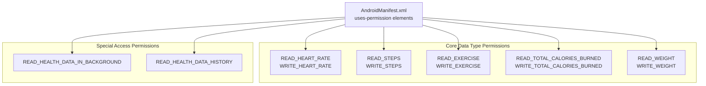
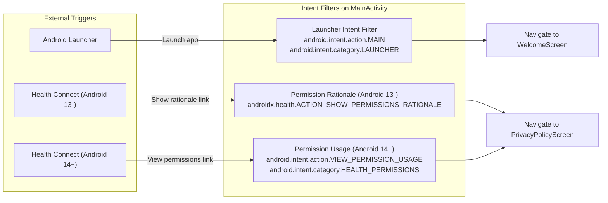
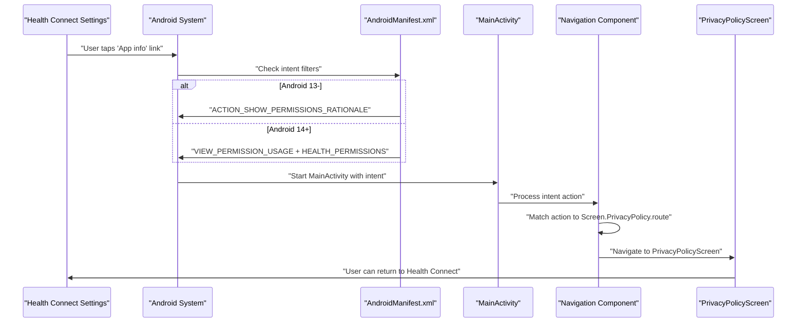
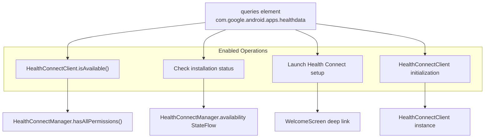
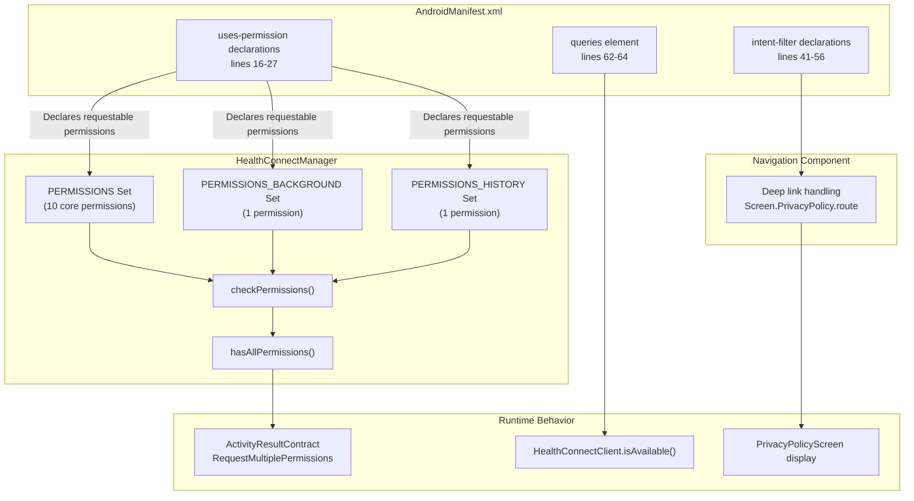

<!-- source: DeepWiki mcp.deepwiki.com · repo android/android-health-connect-codelab · page 11 Android Manifest Configuration · fetched 2026-10-23 -->

# Android Manifest Configuration

<details>
<summary>Relevant source files</summary>

The following files were used as context for generating this wiki page:

- [finished/src/main/AndroidManifest.xml](finished/src/main/AndroidManifest.xml)

</details>


This document details the Android Manifest configuration required for the Health Connect Codelab application. The manifest declares all Health Connect permissions, configures the application entry point, sets up intent filters for permission rationale handling across different Android versions, and establishes package visibility for Health Connect system services.

For information about how these permissions are checked and requested at runtime, see [Permission Management](#5.2). For details on the application entry point and initialization, see [Application Entry Point](#4.1).

## Overview

The manifest file is identical in both the `start` and `finished` modules, located at [finished/src/main/AndroidManifest.xml:1-65](). The configuration includes:

- 12 Health Connect permissions (read/write pairs for 5 data types, plus 2 special permissions)
- Application component declaration with `BaseApplication` as the custom Application class
- `MainActivity` with three intent filters: launcher, permission rationale (Android 13-), and permission usage (Android 14+)
- Package visibility query for the Health Connect system package

**Sources:** [finished/src/main/AndroidManifest.xml:1-65]()

## Health Connect Permissions Declaration

### Permission Structure

The manifest declares three categories of Health Connect permissions, all under the `android.permission.health` namespace:



**Diagram: Health Connect Permission Categories in AndroidManifest.xml**

**Sources:** [finished/src/main/AndroidManifest.xml:15-27]()

### Core Data Type Permissions

The manifest declares read and write permissions for five Health Connect record types:

| Record Type | Read Permission | Write Permission | Line Reference |
|-------------|-----------------|------------------|----------------|
| Heart Rate | `android.permission.health.READ_HEART_RATE` | `android.permission.health.WRITE_HEART_RATE` | [16-17]() |
| Steps | `android.permission.health.READ_STEPS` | `android.permission.health.WRITE_STEPS` | [18-19]() |
| Exercise Session | `android.permission.health.READ_EXERCISE` | `android.permission.health.WRITE_EXERCISE` | [20-21]() |
| Calories | `android.permission.health.READ_TOTAL_CALORIES_BURNED` | `android.permission.health.WRITE_TOTAL_CALORIES_BURNED` | [22-23]() |
| Weight | `android.permission.health.READ_WEIGHT` | `android.permission.health.WRITE_WEIGHT` | [24-25]() |

These permissions correspond directly to the `PERMISSIONS` set used by `HealthConnectManager` for runtime permission checking. Each permission must be explicitly declared in the manifest before it can be requested at runtime.

**Sources:** [finished/src/main/AndroidManifest.xml:16-25]()

### Special Access Permissions

Two additional permissions extend the app's capabilities:

**READ_HEALTH_DATA_IN_BACKGROUND** [finished/src/main/AndroidManifest.xml:26]()
- Allows reading health data when the app is not in the foreground
- Required for WorkManager background operations (see [Background Work with WorkManager](#5.8))
- Used by the step reading worker that executes periodically

**READ_HEALTH_DATA_HISTORY** [finished/src/main/AndroidManifest.xml:27]()
- Enables access to health data older than 30 days
- Required for reading historical exercise sessions and weight measurements
- Used by features that display long-term trends or historical records

**Sources:** [finished/src/main/AndroidManifest.xml:26-27]()

## Application Component Configuration

### Application Element

The `<application>` element at [finished/src/main/AndroidManifest.xml:29-59]() configures the application-level settings:

| Attribute | Value | Purpose |
|-----------|-------|---------|
| `android:name` | `com.example.healthconnect.codelab.presentation.BaseApplication` | Custom Application class for initialization |
| `android:label` | `@string/app_name` | Display name: "Health Connect Codelab" |
| `android:icon` | `@mipmap/ic_launcher` | App icon resource |
| `android:theme` | `@style/Theme.HealthConnect` | Material Design theme |
| `android:allowBackup` | `true` | Enable automatic backup |
| `android:supportsRtl` | `true` | Right-to-left layout support |

The `BaseApplication` class handles dependency injection and global initialization. See [Application Entry Point](#4.1) for implementation details.

**Sources:** [finished/src/main/AndroidManifest.xml:29-36]()

### MainActivity Declaration

The `<activity>` element at [finished/src/main/AndroidManifest.xml:37-58]() declares the main entry point:

```xml
<activity
    android:name="com.example.healthconnect.codelab.presentation.MainActivity"
    android:exported="true"
    android:theme="@style/Theme.HealthConnect">
```

The `android:exported="true"` attribute is required because the activity handles intent actions from external sources (launcher, Health Connect system).

**Sources:** [finished/src/main/AndroidManifest.xml:37-40]()

## Intent Filters for Permission Rationale

### Three Intent Filter Types

The manifest configures three distinct intent filters for different purposes:



**Diagram: Intent Filter Flow and Permission Rationale Handling**

**Sources:** [finished/src/main/AndroidManifest.xml:41-56]()

### Launcher Intent Filter

Located at [finished/src/main/AndroidManifest.xml:41-44](), this standard intent filter makes the app appear in the device launcher:

```xml
<intent-filter>
  <action android:name="android.intent.action.MAIN" />
  <category android:name="android.intent.category.LAUNCHER" />
</intent-filter>
```

This is the primary entry point when users tap the app icon.

**Sources:** [finished/src/main/AndroidManifest.xml:41-44]()

### Permission Rationale Intent Filter (Android 13-)

Located at [finished/src/main/AndroidManifest.xml:46-50](), this intent filter handles permission rationale requests on Android 13 and earlier:

```xml
<!-- Permission handling for Android 13- -->
<intent-filter>
  <action android:name="androidx.health.ACTION_SHOW_PERMISSIONS_RATIONALE" />
</intent-filter>
```

When users view app permissions in Health Connect settings on Android 13-, tapping "App info" or similar links triggers this intent. The `Navigation` component in the app detects this action and routes to `PrivacyPolicyScreen` via the `Screen.PrivacyPolicy.route` deep link.

**Sources:** [finished/src/main/AndroidManifest.xml:46-50]()

### Permission Usage Intent Filter (Android 14+)

Located at [finished/src/main/AndroidManifest.xml:52-56](), this intent filter provides Android 14+ compatibility:

```xml
<!-- Permission handling for Android 14+ -->
<intent-filter>
  <action android:name="android.intent.action.VIEW_PERMISSION_USAGE"/>
  <category android:name="android.intent.category.HEALTH_PERMISSIONS"/>
</intent-filter>
```

Starting with Android 14 (API 34), Health Connect uses a new intent action. This filter ensures the app can still display permission rationale on newer Android versions. Both intent filters can coexist because Android automatically selects the appropriate one based on the system version.

**Sources:** [finished/src/main/AndroidManifest.xml:52-56]()

### Permission Rationale Flow

The complete flow from manifest declaration to UI navigation:



**Diagram: Permission Rationale Intent Processing Sequence**

**Sources:** [finished/src/main/AndroidManifest.xml:46-56]()

## Package Visibility Query

### Health Connect Package Declaration

The `<queries>` element at [finished/src/main/AndroidManifest.xml:62-64]() declares visibility for the Health Connect system package:

```xml
<queries>
  <package android:name="com.google.android.apps.healthdata" />
</queries>
```

This declaration is required due to Android 11+ package visibility restrictions. Without this query element, the app cannot:
- Check if Health Connect is installed via `PackageManager`
- Launch the Health Connect app for initial setup
- Verify Health Connect availability using `HealthConnectClient.isAvailable()`

The package name `com.google.android.apps.healthdata` refers to the Health Connect system service installed on compatible Android devices.

**Sources:** [finished/src/main/AndroidManifest.xml:61-64]()

### Package Visibility Impact

The following operations require this package visibility declaration:



**Diagram: Package Visibility Dependencies in HealthConnectManager**

**Sources:** [finished/src/main/AndroidManifest.xml:61-64]()

## Manifest-Runtime Permission Mapping

The relationship between manifest declarations and runtime permission handling:



**Diagram: Manifest Configuration to Runtime Permission Flow**

Each `<uses-permission>` element in the manifest enables the corresponding permission string to be requested via `HealthConnectClient.permissionController.getGrantedPermissions()` and `ActivityResultContracts.RequestMultiplePermissions()`. The manifest declarations are prerequisites; without them, runtime permission requests will fail silently.

**Sources:** [finished/src/main/AndroidManifest.xml:15-64]()

## Version Compatibility Considerations

### Android Version Differences

| Android Version | Intent Filter Used | Package Visibility | Permission UI Location |
|-----------------|-------------------|-------------------|----------------------|
| Android 11-12 | N/A (pre-Health Connect) | Required | N/A |
| Android 13 | `ACTION_SHOW_PERMISSIONS_RATIONALE` | Required | Health Connect app |
| Android 14+ | `VIEW_PERMISSION_USAGE` + `HEALTH_PERMISSIONS` | Required | System Settings integration |

The manifest is designed to support all Health Connect-compatible Android versions (13+) while maintaining backward compatibility with the package visibility query required since Android 11.

**Sources:** [finished/src/main/AndroidManifest.xml:46-56]()

## Summary of Manifest Requirements

For a Health Connect application to function correctly, the manifest must include:

1. **All required Health Connect permissions** as `<uses-permission>` elements
2. **Custom Application class** in the `android:name` attribute of `<application>`
3. **Exported MainActivity** with `android:exported="true"`
4. **Three intent filters**: launcher, Android 13- rationale, Android 14+ rationale
5. **Package visibility query** for `com.google.android.apps.healthdata`

Omitting any of these elements will result in runtime failures when attempting to access Health Connect functionality.

**Sources:** [finished/src/main/AndroidManifest.xml:1-65]()

---

